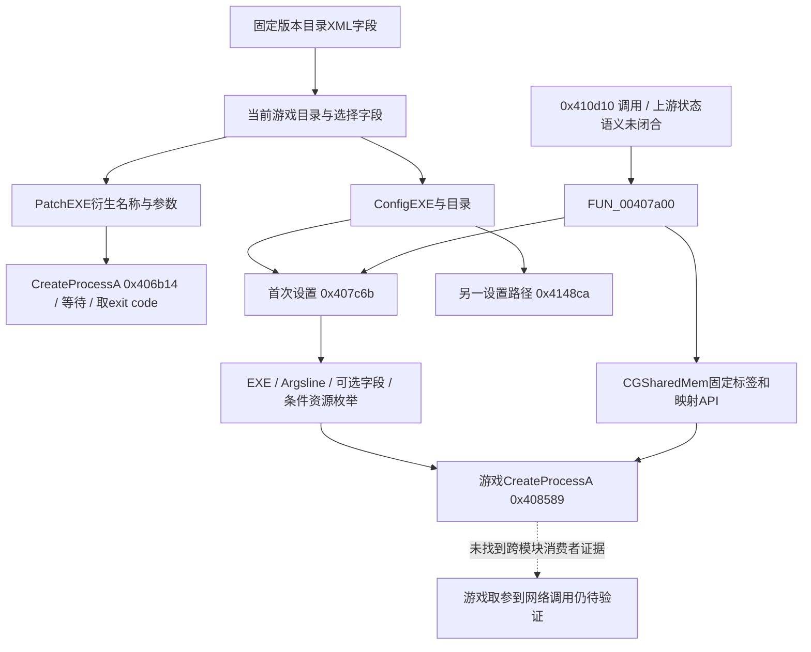

# 第三阶段：登录器非更新进程调用链

本文件仅记录当前登录器的离线静态增量，供既有 `reports/logic-protocol-spec.md` 汇总，不建立另一套产品进度。只运行本机已安装 REA/Ghidra/GNU objdump 与原创核验器；没有执行Windows目标、读取运行账号值、连接服务、导入网页文件或更改工具安全设置。没有新增游戏协议或会话实现。

## 样本、工具与证据界限

- 样本：`POLCN_Launcher.unpacked.exe`，1,735,168 B，SHA256 `601b79565e4ac4c71605744a5087bb24582dde164f417514c74190cd4cdc6e31`。来源安装包SHA256 `dc90bb88e35a82a649f1c026bd0b7b6e7039ddbe5e872f40ffebfb4b16b0fb11`；沿用阶段一标准UPX离线解压链。
- 工具：REA 6.7.0，Ghidra 12.1.4，GNU objdump 2.47.20260726，Python 3.9.6标准库。下文VA均为image base `0x400000`的静态地址，不是原安装包偏移。
- 新函数：`FUN_00407a00`范围 `0x407a00..0x408656`，Evidence `ev_dbedcd398f62cfc0101d98d128add039c7a90461c7435bb3b9077cb713da935e`；`FUN_00406110`范围集合见JSON，Evidence `ev_551bb5ecdc0779adda6493577b23585ec2a28667fe52ad2dc5fcf29dae674ed5`。
- 两个函数均未报告unresolved calls，**但native high-pcode均截断**（至少遗漏1操作；补丁函数还报告2个已知遗漏edge）。此结果不能称为全部控制/数据语义已经闭合。Ghidra存在 `FID_conflict` 和宽窄字符串类型推断问题。
- [launch-evidence.json](launch-evidence.json)保存原创结论、置信度、上游dossier SHA256/Evidence ID、字段与52个短锚点；[anchor-validation.json](anchor-validation.json)逐项保存VA、对应文件偏移和API身份。完整反编译、分析快照和官方文件仅留临时目录，不加入成果。

## 已闭合的目录字段到调用位置

**事实，高置信度：**目录解析引用字段名并存入stride `0xa4`的记录，选择路径再复制或拼接到当前对象。下列地址由已有目录函数dossier、新函数dossier、GNU objdump和直接字节复核交叉支撑。中文字段名仅是解释，未知运行值未读取。

| XML字段 | 解析键引用 → 记录位置 | 选择/消费链 |
|---|---|---|
| `EXE` | `0x40318f` → 对象+ordinal×0xa4+0x1b5c（字段定位指令 `0x403207`） | 安装目录与EXE形成当前对象+0x1b1c（`0x404ce2..0x404ce8`）；`0x407e25..0x407e2f`复制为游戏命令缓冲 |
| `Argsline` | `0x403213` → +ordinal×0xa4+0x1b60（`0x40328b`） | `FUN_00408fe0`在`0x408ff9`返回该字段；游戏路径在`0x407e69`调用后添加到命令缓冲 |
| `PatchEXE` | `0x40352b` → +ordinal×0xa4+0x1b84（`0x4035a3`） | 当前对象+0x1b40（`0x404e43`）；`0x406636`读取进入补丁命令构造 |
| `ConfigEXE` | `0x4035af` → +ordinal×0xa4+0x1b88（`0x403627`） | 当前对象+0x1b44（`0x404e74`）；`0x407ba1`与`0x4147f5`分别用于两条设置程序路径 |

**事实：**配置文件指定的EXE与静态命令构造形成关联；该事实不保证这些文件在用户安装目录存在、当前区服仍接受此版本或命令运行成功。空格引用、转义和全部异常处理尚未恢复，因此不直接生成可执行命令行。

## 四处CreateProcessA已经区分

| 调用VA / 文件偏移 | 静态角色及来源 | 成功后的可见操作 | 未闭合项 |
|---|---|---|---|
| `0x406b14` / `0x5f14` | **事实：补丁进程路径**，位于`FUN_00406110`，由`0x412b42`调用；使用选择的PatchEXE和目录、region相关字段0x1b34/0x1b38 | `WaitForSingleObject`在`0x406b28`，`GetExitCodeProcess`在`0x406b36` | 命令构造先引用`.EXE`/`.BAK.EXE`和文本转换辅助函数；不能简写为直接执行原Patcher名。转换细节和补丁参数消费者未完全闭合 |
| `0x407c6b` / `0x706b` | **事实：游戏启动函数内的首次设置分支**，使用ConfigEXE和安装目录，邻接“第一次运行/进入设置窗口”文本 | `0x407c82`等待设置进程，再继续同函数后续路径 | 首次标记的全部存储/失败规则未形成兼容规范 |
| `0x408589` / `0x7989` | **事实：游戏客户端启动路径**，同一`FUN_00407a00`；当前EXE路径＋Argsline＋可选0x1b48/0x1b4c＋部分分支资源枚举结果 | 成功路径关闭进程/线程句柄，调用UI辅助函数；失败路径明确“启动客户端程序失败” | 可选字段、资源枚举格式和分支状态的精确语义未全部确认；不能视为完整认证argv |
| `0x4148ca` / `0x13cca` | **事实：另一条设置程序路径**，读取同一ConfigEXE字段和目录；有“游戏设置程序启动失败”错误文本 | `0x4148dd`等待 | UI事件名称和所有前置状态仍未知；“手动设置”是上下文推测 |

上表VA通过PE节映射得到精确文件偏移：以[核验JSON](anchor-validation.json)中的 `patch`、`first_config`、`game`、`config` 行为准。全部`CreateProcessA`均通过IAT `0x4b136c`；核验器独立解析PE导入名称，不能只凭Ghidra函数名认为调用已确认。



该图是**静态条件路径**，不是一次执行日志；省略的条件不表示一定执行。`FUN_00410c80`调用游戏启动时检查自身状态字段+0x968；未恢复事件/状态名称，不称其为“认证成功回调”。

## CGSharedMem：只确认静态交接形状

**事实，高置信度：**特定Game Code分支（包含4和11）选择字面量 `CGSharedMem`（引用`0x407fc5`，字符串VA `0x4b2a94`）。先在`0x408477`调用`OpenFileMappingA`，必要时在`0x4084a2`调用`CreateFileMappingA`，容量参数为 `0x100`，然后`0x4084c6`调用`MapViewOfFile`。`0x4084e2`把已构造文本指针和映射地址传给string-copy-like辅助函数`0x44dc00`。

**事实：**另一局部文本使用固定标签 `gid:` 与 ` glt:`（引用`0x407f0c`、`0x407f35`），来自对象字段的运行值未被读取或保存。该文本与游戏argv是两个不同局部缓冲区，不能把标签拼接擅自写成已经验证的游戏命令行认证格式。

**推测：**上述映射可能用于登录器与游戏的身份/会话交接；名称及标签不足以证明字段含义。**待验证：**值的来源与约束、编码、范围、生命周期、游戏侧消费者及与任何网络请求的关系。这里只是静态常量和数据流观察，没有账号、口令、会话、票据样本或可用于登录的输出，也没有创建共享内存。

## 验收与具体停止边界

- **52/52固定样本锚点通过**：IAT/API、直接相对调用、字符串引用、关键字段/参数指令。每项保留VA和文件offset；源SHA256不匹配会拒绝。
- **7/7原创合成测试通过**：有效PE导入、截断/坏头、不由文件后备的VA、跨界读取、有符号相对调用、错误目标/API/opcode、字符串预算/错误字面值、变更样本与重复ID拒绝。见[tests.log](tests.log)。这些测试核验取证可靠性，不是游戏协议兼容测试。
- REA普通沙箱尝试因工具Swift/Clang标准缓存写入失败；具体静态重试获执行、exit0。随后补丁函数静态分析也exit0。详见[tool-status.json](tool-status.json)。未修改全局设置，无待运行会话。
- **未完成的桥接边：**从登录器argv/CGSharedMem到游戏侧消费者，再到游戏socket/分帧调用。仅凭名字、网络库字符串或可见MapViewOfFile不能建立这条边；游戏网络分支报告须独立核对。
- **最小下一步：**在既有解包游戏文件中找到可读的argv/该命名映射消费者及其调用者；若文件后备代码受打包结构阻断，需先取得适当来源的未打包调试/符号材料，或另行说明并取得受控动态观察授权。此处不运行目标、脱壳、规避访问限制或进行账号/官服试验。
- 当前证据足够更新调用链规格，尚不足以独立实现认证、会话或任何游戏帧codec；因此本分支没有为凑功能新增解析/状态产品代码。

复核（所有路径显式，本地只读）：

```sh
python3 analysis/protocol-v3/launch/verify_launch.py \
  --pe /tmp/moli-analysis/polcn/POLCN_Launcher.unpacked.exe
python3 -m unittest discover -s analysis/protocol-v3/launch -p 'test_*.py' -v
```

完整REA结果的临时复现命令是`rea function`指定该样本、地址`0x408589`或`0x406b14`、`--provider ghidra`及本任务独占snapshot。临时路径可能被清理，复核前须按已记录安装包身份和标准解包链重新取得同样本，不能改哈希门槛迎合新版本。
