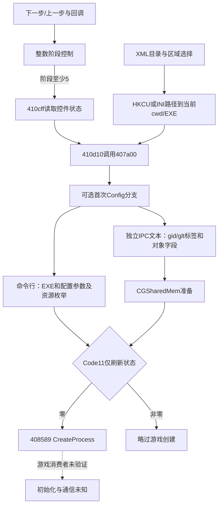

<a id="fixed-f5a-entry-business-admission"></a>

## 固定 F5A 的 A1 登录器入口归属

**事实**。固定 F5A 分析映像 SHA-256 为 `f5abc77a1d6c7b1875bae8cdea948469424a8e683d72939e2118d1a38de06842`。按 App、Frame、主对话框和子视图的虚表及消息表读取八行，另核 App 的 `+0x50` 启动虚槽。C82 的退出菜单行仍指向自己的原登记。 [版本、回调与文件偏移](../build/analysis/launcher-f5a-entry-business-v1/source-review.json) · [A1 台账](../analysis/capability-first-v1/entry-admission.json#/selected_fixed_f5a_operations)

| 所选操作 | 登记和准入 |
| --- | --- |
| 自更新交接 | 子视图 `5DE278` 把 `0x80C9` 交给 `408950`，准备内嵌更新器后由 `5DE260 → 4096B0` 的 9003 分支轮询。就绪、更新器仍在及窗口条件满足时，清任务槽后请求关窗。新候选由 `5E5D68 → 43F240` 启动，所选主窗绘制后调用 `43FFA0` 申请新启动确认。 |
| 补丁完成 | 同一子视图回调以 9001 消费补丁结果，退出码查询成功且已结束时撤定时器，清进程槽后调 `406AD0`。退出 100 且当前目录索引有效才发布准备标记。主对话框的 `5E3DB0 → 429A50` 单独消费 876，按临时图标与当前占用退役提示。 |
| 普通确认 | 主对话框 `5E3C30` 将 IDOK 交给 `423220`。`5E3D38` 的 `0x8242` 先核准备编号，匹配时清待消费位，然后查阶段、占用和窗口状态，合资格才进同一确认入口。主对话框 100 负责登录轮询。成功发起首次配置后的等待由子视图 9002 消费。 |
| 关闭 | App 的 `5E5F90 → 43F8D0` 同步发 `WM_CLOSE`，主对话框 `5E3C18 → 423150` 处理普通取消确认。Frame 的 `5E5788 → 43AD20` 按嵌入窗与忙态决定延后或销毁。延期关闭由 `41EF80` 清标记后向同一 Frame 请求投递。 |

**事实**。补丁成功的 `428D44 → 428D4E` 先写阶段 3，再重新准备。普通启动返回的 `43A355 → 43A383 → 43A389` 先重新准备和请求重绘，再写阶段 3。队列消息按消费时的条件检查。D1 复用原准备、选择和关闭所有者，D5 按现有宿主端口验次序与迟到结果。 [补丁规格](#f5a-patch-completion) · [普通返回规格](#f5a-start-return)

**待验证**。原版实际消息送达、延期关闭与进程退出、回退制品、当前同版游戏读取和三端组合。真实通行证会话沿 D6 验收。 [本机核验](validation.md#fixed-f5a-entry-business-validation)

<a id="f5a-update-handoff-and-ack"></a>

## 11 月分发版的自更新接管和启动确认

**事实**。11 月 4 日分发的分析映像 SHA-256 为 `f5abc77a1d6c7b1875bae8cdea948469424a8e683d72939e2118d1a38de06842`。消息表 `5DE278` 将 `0x80C9` 绑定到 `408950`。其所选分支在 `408C21 → 442F10` 查找 `BIN_DATA/143`，准备后把更新器从临时名移到目标名。语言 2052 的资源 143 为 809,984 字节，SHA-256 为 `c1b2c8b7870275a2268364bfb1e8a8a7a09444174f8be4e9274ed74d6dae4b5b`，与 C82 的内嵌更新器身份不同。 [REA 6.7.0、Ghidra 12.1.4 和 PE 核对](../build/analysis/launcher-f5a-update-handoff-v1/source-review.json)

**事实**。旧进程以 PID 和进程创建时间的高、低 DWORD 生成就绪事件名。事件为手动复位、初始未置位，创建失败或已存在进入清理。所选正常分支请求启动更新器，取得进程句柄后登记定时器 9003，间隔 100 毫秒。内嵌更新器 `407290` 用父进程时间生成同名事件，打开后置位并关闭句柄。打开失败且错误为 2 时沿兼容分支继续。其后最多等待父进程 60,000 毫秒，等待结果为 0 才进入已有事务的恢复。 [生产与消费调用](../build/analysis/launcher-f5a-update-handoff-v1/source-review.json)

**事实**。`4096B0` 先以零时长分别读取事件和进程结果。只在未就绪、进程仍运行且无符号时差小于 60,000 毫秒时续等。结束时撤定时器，关闭并清除进程槽 `+0x2CE4` 和事件槽 `+0x2CE8`。就绪且仍运行时，所选窗口查询成功分支在 `4097BA` 请求 `WM_CLOSE`，函数随即收尾。事件未就绪、子进程已退出或首次窗口查询失配，沿失败处理。排队登录、游戏补丁和普通游戏启动各自检查同一个事件槽是否为空。 [轮询、退役与共用准入](../build/analysis/launcher-f5a-update-handoff-v1/source-review.json)

**事实**。内嵌更新器 `402A00` 读取候选的启动确认资源。`4069F0` 为支持确认的候选准备另一事件，登记事务阶段 4 后经 `406590` 启动，带本更新器 ID 和确认参数。等待顺序为事件、候选进程，单次 50 毫秒。结果为超时且时差小于 30,000 毫秒时续等，结果 0 进入提交与清理分支，失败请求恢复。提交先请求记录阶段 5，随后清理，清理失败单独报告。 [资源读取、启动与事务调用](../build/analysis/launcher-f5a-update-handoff-v1/source-review.json)

**事实**。`43F240` 的所选成功路径在主窗创建并调用 `UpdateWindow` 后记 `frame-painted`，经 `43F6AC → 43FFA0` 发出确认。主窗创建失败提前返回。首个大小写精确匹配的 `UPDATEACK:` 参数决定结果，事件名限 32–128 个 UTF-16 码元，固定前缀后仅允许 ASCII 十六进制字符和下划线。首项非法即结束该次检查。打开成功才尝试置位，随后归还句柄和参数缓冲。主启动路径在调用返回后按原分支返回 1。 [启动入口与确认规格](../analysis/capability-first-v1/launcher-update-ack-reconciliation.json#/f5a_update_handoff_and_ack)

**待验证**。实际 Windows 投递、关闭与父进程退出，候选替换、启动确认和清理结果，以及三端产品发布后的新启动和资源读回。复用 UF-T12、UF-T13、UF-T16 及原 AU 用例，D1/D5 共用已有更新所有者与宿主端口。 [本机 ZIP 与回归](validation.md#f5a-update-handoff-validation) · [三端设计与已核夹具](architecture-and-milestones.md#portable-update-handoff-readback)

<a id="f5a-patch-completion"></a>

## 11 月分发版的补丁结果与登录准备

**事实**。固定 F5A 映像 SHA-256 为 `f5abc77a1d6c7b1875bae8cdea948469424a8e683d72939e2118d1a38de06842`。补丁轮询的已退出分支清进程句柄槽后，经 `4099CD` 进入 `406AD0`。备份路径准备成功时先尝试删除备份。退出码 100 时读取当前所选索引，范围为 `0 <= index < count`。有效索引按 164 字节步长将对应条目的准备字节置 1，再把成功和代码 100 交给 `428C10`。索引失效时交失败和 `0x585`。 [原文件和调用位置](../build/analysis/launcher-f5a-patch-completion-v1/source-review.json)

**事实**。所选补丁待处理分支在 `439BFB` 调用 `41FBD0`，先写待处理位，再于 `439C49` 写阶段。第一索引在当前计数内、第二索引按无符号比较小于 15，且对应表项按有符号比较大于零时写阶段 2，其余写阶段 1。普通确认据当前阶段分派。排队提交消费匹配编号后还会独立检查待补丁位。 [阶段选择和准入指令](../build/analysis/launcher-f5a-patch-login-admission-v1/source-review.json)

**事实**。`439B70` 的补丁待处理分支写主窗 `+0x1AA6=1`。`428C10` 见该字节为零便返回。非零时先清字节。失败分支按 `+0x1135` 更新 `+0x1136`，清 `+0x1135` 后调用 `42F490` 和 `431BE0`。成功分支处理可选托盘提示，最终在 `428D44` 写阶段 3，再进入同一准备函数 `439B70`。托盘登记失败也落到这个续接点。 [准入与失败、成功分支](../build/analysis/launcher-f5a-patch-completion-v1/source-review.json)

**事实**。重新准备时，`40DB40` 对同一有效条目读取同一准备字节，置位时沿返回 0 的分支继续。活动准备路径可经 `43A05C → 41ED30`，按现行准备编号和已尝试位决定投递。补丁进程槽 `+0x2CDC` 先于结果处理清除。消费匹配消息后仍检查三个子视图任务槽均为空，再检查窗口启用状态和表单。 [共享准入](#f5a-login-owner) · [指令核验](../build/analysis/launcher-f5a-patch-login-admission-v1/source-review.json)

**事实**。`419030` 先复用已登记的图标，必要时通过 `Shell_NotifyIconA` 登记。登记可用时请求“游戏更新完成”提示，结构内写 10000 毫秒。原图标标记为零且 `+0x1AB4` 为零时设置临时清理标记。提示请求后临时标记非零时申请定时器 876，间隔 12000 毫秒。主窗 `WM_TIMER` 在 `429A50` 消费 876，先撤定时器，再在临时标记非零且 `+0x1AB4` 为零时请求移除图标并清标记。 [提示文字、消息表和导入](../build/analysis/launcher-f5a-patch-completion-v1/source-review.json)

**待验证**。真实 Windows 提示、定时器到达和退出期间的回调，`<Code>.pat` 实物、进程身份以及当前同版游戏读取。D1/D5 复用现有补丁结果和宿主通知所有者，按来源落实目录发布与控制器准入。 [核验范围](validation.md#f5a-patch-completion-validation)

<a id="conditional-template-scope"></a>

## 两版登录器的条件模板用途

**事实**。固定 C82 与 11 月分发 F5A 的 296、30721、30734 三个对话框资源逐字节一致。296 的文案指向《树世界精灵》的启动倒计时，30721 含新建列表及确认、取消和帮助，30734 的标题为空且没有控件。 [资源位置、样本哈希与 REA 记录](../build/analysis/launcher-conditional-template-scope-v1/source-review.json)

**事实**。两版的 `CLauncher_Dlg_Update` 构造均把模板 130 写入 `+0x84`。C82 `0x42DFE9` 与 F5A `0x43AAA9` 的 296 是该类析构分支传入的尺寸参数，两处目标均直接返回。 [构造、析构与原字节对照](../build/analysis/launcher-conditional-template-scope-v1/source-review.json)

**推测**。30721 和 30734 落在 MFC 保留的资源编号段，结合模板内容，暂按框架资源候选登记。**待验证**。三个模板在魔力必要流程中的实际赋值、加载或调用，沿 CE-U1 追踪。 [MFC 资源编号约定](https://learn.microsoft.com/en-us/cpp/mfc/tn020-id-naming-and-numbering-conventions?view=msvc-170) · [原条件入口规格](../analysis/capability-first-v1/launcher-conditional-entry-contract.json)

<a id="f5a-official-launcher"></a>

## 11 月 4 日分发版的普通游戏启动

**事实**。11 月 11 日读取的官网下载页指向 11 月 4 日的安装 ZIP。安装包的两个登录器记录与公开更新 ZIP 的登录器逐字节一致。原始 EXE 的 SHA-256 为 `9a792a5e2aae0b30bd7631a85018830fa0b6b823cd0450b291dcffba42464731`，更新元数据给出的 MD5 与实物相符。`GameList.xml` 与 `RegionList.xml` 逐字节匹配 C82 留存的目录。发布者的签名认证待验证。 [官网下载页](https://www.polchina.com.cn/staticHtml/download.html) · [分发核验](../build/analysis/current-official-launcher-package-v1/source-review.json)

**事实**。UPX 5.2.1 生成独立分析映像，SHA-256 为 `f5abc77a1d6c7b1875bae8cdea948469424a8e683d72939e2118d1a38de06842`。沿旧 C82 的相对调用位置定位，复核新映像的 21 个直接调用位置及 8 组目标。REA 6.7.0／Ghidra 12.1.4 核实 `43A330 → 40E8D0` 的启动入口，Apple LLVM 21.0.0 独立对照该函数的 923 条指令和 2938 个文件字节。C82 的完整行为规则继续按原样本引用。 [调用位置对照](../build/analysis/current-official-launcher-package-v1/c82-relative-direct-calls.json) · [REA 证据](../build/analysis/current-official-launcher-package-v1/rea-evidence.json)

**事实**。`40E0D0` 前检先检查组合路径是否存在，再把目录和 EXE 分别写入对象 `+0x2C9C` 和 `+0x2CA0`。`40EC37` 调用 `4436E0` 处理 EXE 引号，`40F2E5` 以显式 EXE、可写命令行、目录和大小 68 的 `STARTUPINFOA` 调用 `CreateProcessA`。进程与线程安全参数、继承标志、创建标志、环境参数为零。所选成功分支依次关闭线程和进程句柄，再调用返回帮助函数。所选创建失败分支取 `GetLastError`，零值归为 31，存在映射名时调用退役帮助函数。 [前检与返回位置](../build/analysis/current-official-launcher-package-v1/source-review.json)

**事实**。普通 CG 路径选中 `CGSharedMem`，使用七个与 C82 同文的资源模板。`40F225` 调到 `409DF0`，该帮助函数的新建映射请求大小为 256 字节。公开游戏更新清单与上次读取的大小及 SHA-256 一致，声明的五个程序与留存的大小和 MD5 相符。三个游戏主程序的 `.text` 文件字节均为零。 [资源模板和游戏材料](../build/analysis/current-official-launcher-package-v1/source-review.json)

**待验证**。实际 Windows 资源枚举和短名、F5A 对应游戏对命令行和映射的读取、真实创建及官方联合接受。后续优先使用能观察上述游戏读取点的对应材料。 [验收记录](validation.md#f5a-distribution-validation)

<a id="f5a-path-preflight"></a>

## 11 月分发版的启动、配置与补丁路径前检

**事实**。固定 11 月 4 日版分析映像的 SHA-256 为 `f5abc77a1d6c7b1875bae8cdea948469424a8e683d72939e2118d1a38de06842`。目录解析将 `EXE`、`SpeFile`、`PatchEXE`、`ConfigEXE` 分别写到步长 164 的条目 `+0x04`、`+0x1C`、`+0x2C`、`+0x30`。两条 Code 11 仍各按原序号选择。 [目录格式](resource-formats.md#f5a-catalog-path-roles) · [原指令与摘要](../build/analysis/launcher-f5a-path-preflight-v1/source-review.json)

**事实**。前检 `40E0D0` 先清诊断与错误值。所选序号为负、越过当前条目数或行 `+0xA1` 为零时前检失败，错误值为 13。普通 CG 的 `40EB58` 按仅刷新锁存值传 `(1,0)` 或 `(0,0)`，首次配置的 `40D0C4` 传 `(0,1)`。

| 操作 | 检查顺序与成功效果 |
| --- | --- |
| 仅刷新 | 选中行通过即返回成功。 |
| 普通游戏启动 | 先检查目录和 `SpeFile`，再检查 `EXE`。通过后在 `40E23F`、`40E24E` 依次发布规范目录与词法 EXE 到 `+0x2C9C`、`+0x2CA0`。 |
| 首次配置 | 先检查目录和 `SpeFile`，再检查 `ConfigEXE`。路径保存在临时值。随后 `40D136` 以同一目录走单组件路径解析，要求 1–244 字节。失败在 `40D14A` 传入 161，通过才准备 9002 定时器和显式应用路径。 |

前检中目录或识别文件检查失败写入错误值 3，主程序或配置器的路径与存在检查失败写入 2，主程序与配置器各用自己的提示。函数内的双标志分支先发布游戏路径，再检查配置器。上述已核普通调用点均各自传单标志或两个零。 [分支与发布顺序](../build/analysis/launcher-f5a-path-preflight-v1/preflight-branch-cases.json)

**事实**。`4432C0` 规范化目录并检查目录属性位 `0x10`。通用路径 `443860` 先通过相对组件、长度及词法严格后代检查，再交 `442680` 处理文件系统关系。缺少最终路径 API 时按顺序扫根和候选的属性前缀，遇到重解析位 `0x400` 拒绝。API 可用时解析双方，比较最终路径关系，解析失败即拒绝。`443BA0` 能解析已有祖先并拼回缺失后缀。两层关系通过时交回词法路径，完整文件由后续的 `PathFileExistsA` 检查。 [文件系统分支与真实返回寄存器](../build/analysis/launcher-f5a-path-preflight-v1/source-review.json)

**事实**。目录重选 `401CB0` 先生成识别文件和主程序路径，再按该顺序查存在。路径拒绝设置 161。写入 `[Path]` 成功后更新该条目，仍选中时才更新活动目录和 EXE。`40DB40` 用同一解析器准备 `PatchEXE`。路径无效先报告 161，路径有效且存在查询返回假才走已有 `.pat` 回退。`40D3A0` 另行解析目标与备份。 [目录恢复](#f5a-directory-recovery) · [补丁回退](#f5a-patch-fallback)

**待验证**。原版 Windows 的实际路径和文件结果、回退制品与所选子进程身份，以及当前同版游戏读取。D0/D1/D5 复用路径合同、目录及进程所有者和原验收用例。 [本机核验与范围](validation.md#f5a-path-preflight-validation)

<a id="f5a-first-config"></a>

## 11 月分发版的首次配置和启动续接

**事实**。固定 F5A 映像 SHA-256 为 `f5abc77a1d6c7b1875bae8cdea948469424a8e683d72939e2118d1a38de06842`。所选目录读取在 `40B163` 取得 `ConfigEXE`，把字符串写入条目 `+0x30`，选中条目经 `40CEEB` 复制到启动所有者 `+0x2CC8`。随包目录用现有解析器核对五条记录，四条魔力记录均指定 `Config.exe`。 [目录、条目与复制调用](../build/analysis/launcher-f5a-first-config-v1/source-review.json)

**事实**。`40E8D0` 要求三个进程槽为空且所选索引有效。以账号原字节的 MD5 摘要生成 32 个小写十六进制字符作配置节，按 `Game<原始 Code>_Config` 读配置值，默认 1。该启动对象的内存完成缓存用 `<配置节>:Game<原始 Code>_Config` 匹配。C82 的缓存按 `Game<原始 Code>_Config` 匹配。配置值非零、缓存未命中、配置器名非空且跳过参数为零时，`40EC1F` 调 `40D060`。 [两版读取和键构造](../build/analysis/launcher-f5a-first-config-v1/source-review.json)

**事实**。`40D060` 前检安装目录并解析配置器路径，先申请定时器 9002、间隔 250 毫秒，再用显式 EXE、可写命令行和安装目录调用 `CreateProcessA`。创建失败撤定时器。成功时关闭线程句柄，保存进程句柄、开始时钟和配置节，并按当时选中代码构造写入键。成功返回后，本次普通游戏创建延至进程收尾。前检、定时器或进程创建失败时，调用者继续其余普通创建检查。 [进程创建与返回](../build/analysis/launcher-f5a-first-config-v1/source-review.json)

**事实**。`4096B0` 的 9002 分支在句柄为空时撤定时器，查询失败或返回 259 时保持待处理。259 分支按无符号时钟差在 15 分钟时提醒一次。确认其它退出值后依次撤定时器、关句柄、清槽。`C0000135`、`C000007B`、`C0000142` 三个值直接走异常收尾。其余退出值先追加捕获的 `<配置节>:<写入键>`，再向捕获的配置节和键写十进制 `0`。写失败保留已追加的进程内记录。清捕获字段后调用主窗步骤处理，在阶段至少为 5 时把加载失败标志带回普通启动，该标志抑制本次首次配置。子视图析构也撤销 9002 并关闭所持跟踪句柄。 [轮询、缓存和续接](../build/analysis/launcher-f5a-first-config-v1/source-review.json)

**待验证**。真实 Windows 的提示、定时器调度、创建和写回结果，以及当前同版游戏消费。D1 复用现有配置字节与进程所有者，按版本解释配置缓存键、进程观察及续接。 [验收范围](validation.md#f5a-first-config-validation)

<a id="first-config-dialog-outcomes"></a>

### 固定配置器的默认写入、取消和确认

**事实**。留存的 `Config.exe` SHA-256 为 `9389add9c04cbc6bd313a34098ed94aef11a866ba721c6ccf7f984973efa0f7d`，所留安装目录的 `MFC71.dll` SHA-256 为 `a08ab5280687d699ccd307196e72847b23d0a475744ef7c73654defee0fb2cf2`。对话模板 102 使用按钮 1、2 和 1008。`403438` 的派生消息表绑定 1 至 `401180`、1008 至 `401140`。按钮 2 沿 MFC 基类表的 `7C16471F` 分派，通过虚表 `+0x158` 到 `7C1AE800`，以结果 2 调用关闭。 [资源、消息表和导入序号](../build/analysis/first-config-outcome-v1/source-review.json)

**事实**。`401480` 在 `PathFileExistsA("Config.dat")` 返回零时，在当前工作目录尝试写入 12 字节 ` 3Ddevice:1 `，然后发布窗口的默认档和四个清零项。已有文件走读取分支。`401140` 只恢复窗口内默认值。普通取消由基类关闭回调处理，初始化已经成功写入的默认文件可以保留。 [读写分支](../build/analysis/first-config-outcome-v1/source-review.json) · [字节格式](resource-formats.md#first-config-file-effects)

**事实**。历史安装脚本为同目录的 `Config.exe` 和 `Config.dat` 记录了大小及 CRC32。留存配置器和现有编解码器生成的缺文件默认值分别与两条记录相符。冷启动规格引用该默认值及已验证的历史游戏读入边界。 [来源与本机对照](validation.md#legacy-render-startup-tier-input-validation)

**事实**。确认先同步输入并编码，然后在 `401268` 请求删除原文件，调用 `Open(0x3001)`、`Write`、`Close`。所选路径忽略删除和打开的返回值。所留 MFC 以写入权限、共享标志 0 和 `OPEN_ALWAYS` 打开，写入失败、短写或关闭失败可进入异常路径。正常返回后在 `4012E7` 显示保存成功提示，提示返回再调用基类确认。基类的第二次数据同步成功时才以结果 1 关闭。**静态推导**。删除失败但成功打开较长旧文件，且新写入较短时，旧尾部可能保留。 [分支和库调用](../build/analysis/first-config-outcome-v1/source-review.json)

**事实**。配置器 `401090` 调用 `DoModal` 后析构并返回 0，框架随后沿虚调用退出。F5A `4098EB` 读取进程退出码，`4099F3` 起按已证的三个加载失败值分流。其余终止值依据捕获的配置键，沿 `409ACD` 请求写首次配置标记，再经 `409B49` 续接。对话返回和文件写入在配置器内产生。 [两条退出链](../build/analysis/first-config-outcome-v1/source-review.json)

**待验证**。实际 Windows 上确认与取消的进程退出码、文件异常呈现及 F5A 安装中所用的配置器和库身份。当前同版游戏的读入继续沿 L07/X07。D0/D1/D5 将三种结果纳入同一启动用例，分别处理设置文件的提交、窗口结果和启动续接。 [现有用例和本地对照](validation.md#first-config-outcome-validation)

<a id="f5a-directory-recovery"></a>

## 11 月分发版的目录恢复与选服续接

**事实**。固定 F5A 的普通启动前检失败经 `40EB85 → 425490`，所选补丁及准备失败经 `428C66` 或 `439C3B → 431BE0`。两条处理链以 `430B70` 的返回低字节为准，非零时由 `42CB10` 投递目录恢复。操作标记 `+0x1137` 为零时才置位并请求 `0x8241`，携带当前目录条目索引和阶段。投递失败先取错误，再清标记并提示。 [生产者与原指令](../build/analysis/launcher-f5a-directory-recovery-v1/source-review.json)

**事实**。主窗消息表 `5E3D20` 将 `0x8241` 交给 `428EF0`。接收方读取阶段并清操作标记，再比较阶段和条目索引，匹配时调用 `42E770(index, 1)`。普通右键入口由 `5E3FA8` 登记，经 `424400 → 4313A0`，所选阶段 0 菜单确认后调用同一选择器，续接参数为 0。 [两条入口与消息表](../build/analysis/launcher-f5a-directory-recovery-v1/source-review.json)

**事实**。选择器先核条目范围、主窗登录忙态、补丁等待、操作标记及三个子视图任务槽。通过后持操作标记进入对话框 295。对话框返回 1 时经 `40BBB0 → 401CB0` 应用所选目录。该路径先处理输入目录，再解析 `SpeFile` 与 `EXE` 并按该顺序调用 `PathFileExistsA`。`WritePrivateProfileStringA` 写入 `[Path]` 的 `Game<Code>`，写入成功才更新目录项、匹配的当前目录缓存及提示。正常取消、应用失败与成功返回各自清理对话框并恢复原操作标记。 [检查、写入与发布顺序](../build/analysis/launcher-f5a-directory-recovery-v1/source-review.json)

**事实**。排队恢复成功后先写阶段 3，再进入 `439B70`，满足既有准备条件时可按当前编号投递 `0x8242`。右键入口成功后重建列表，找到原条目索引时恢复选中项，随后执行选择更新。**待验证**。实际 Windows 消息到达、嵌套提示与旧连接退役的顺序，以及当前同版游戏读取。 [提交准入](#f5a-login-owner) · [本批核验](validation.md#f5a-directory-recovery-validation)

<a id="launcher-directory-host-handoff"></a>

### 目录选择的保存、读回和续接

**事实**。固定 F5A 的目录应用以原始 Code 文本构造 `[Path]` 下的 `Game<Code>`。写入成功后发布目标条目，执行时仍选中该条目才更新活动目录和 EXE。目录载入 `40A660` 的所选回退在 `40B90D → 4498F0` 从同一设置对象读该键，缓冲区为 256 字节。读到的目录通过 `4432C0` 后写入本行槽。已有更早来源的所选分支可写回同一键。 [固定映像、读写指令与导入](../build/analysis/launcher-directory-host-handoff-v1/source-review.json)

**推导**。两条原始 Code 都是 `11` 的记录，运行时分别发布目录。两条记录均到达设置回退且各自前检通过时，共用冷启动读取的 `Game11`。实际是否到达回退取决于各行的来源和路径检查。 [目录记录来源](resource-formats.md#f5a-catalog-path-roles)

**事实**。Chrome 当前登录页把目录文字、安装文件夹和已选补丁候选分别处理。实际替换文件夹后前检失败会清旧交接参数，页面仍显示新文件选择。微信宿主夹具的 ZIP 选择器取消会保留基础文件并清已选候选。两端缓存均可读回已保存且绑定匹配的资源，重开后需要明确选择。 [桌面与移动视口、微信宿主对照](validation.md#launcher-directory-host-handoff-validation)

**设计交接与待验证**。D0/D1/D5 沿现有尝试状态与设置、资源端口，在候选前检或保存结果未确认期间保留可用旧目录。成功后，手动选择刷新列表，失败恢复回到该请求对应的准备分支。真实选择器、原版设置文件效果和三端重开继续沿 LP-A09 至 LP-A12 验收。 [复刻规格与用例](../analysis/capability-first-v1/launcher-callback-reentry-contract.json#/f5a_directory_recovery/host_selection_and_readback)

<a id="first-config-directory-composition"></a>

### 目录恢复、首次配置与普通启动的共同准入

**事实**。固定 F5A 映像 SHA-256 为 `f5abc77a1d6c7b1875bae8cdea948469424a8e683d72939e2118d1a38de06842`。目录选择先检查其自身忙态，再经 `42E7F0 → 408280` 查启动所有者的 `+2CDC`、`+2CE0`、`+2CE8` 三槽。普通启动 `40E8D0` 也检查这三处。首次配置创建成功后由 `40D220` 发布 `+2CE0`，查询失败或读到 259 时继续持有。正常观察到终止后由 `4099E9` 清槽，再处理已捕获的配置标记和续接。 [共用准入与证据](../analysis/capability-first-v1/launcher-functional-specification.json#/f5a_first_config/directory_and_host_settings/source_facts)

**事实**。所选条目的路径设置、首次配置完成标记和工作目录内的 `Config.dat` 分别按各自来源读写。F5A 捕获配置节与原始 Code 的配置键，退出后仍写捕获值。普通准备重新进入时读取当时有效条目。两条同 Code 记录可以共用设置键，同时保有各自的目录和文件角色。 [配置回执与选择范围](../analysis/capability-first-v1/launcher-functional-specification.json#/f5a_first_config/directory_and_host_settings)

**目标端设计**。复用本地存储、目录来源绑定和设置字节模块。已提交的设置按活动目录读回，缺文件、读取失败和结果未知分别反馈。浏览器和微信宿主目前可读回目录或资源候选。首次配置流程及三端实际重开待接入。固定配置器和 F5A 安装中实际使用的配置器身份仍待配对。 [共用用例、本机结果及待验项](validation.md#first-config-directory-composition-validation)

<a id="f5a-recovery-prompt"></a>

### 11 月分发版的目录恢复提示准入

**事实**。同一固定 F5A 映像中，普通启动失败 `425490` 和补丁或准备失败 `431BE0` 仅在错误码 2、3、161 时开启重选操作。输入错误为零时，两条入口分别使用 31 和 13。`430B70` 见主窗 `+0x19E1` 已置位时返回低字节 0。正常进入时置位，并按重选开关向模式 1 的 `415700` 传入 UTF-16 按钮标题“重新定位游戏目录…”或空指针。 [原指令、调用和文字](../build/analysis/launcher-f5a-recovery-prompt-v1/source-review.json)

**事实**。`415700` 先将结果字节置 0，登记窗口过程 `42C960`，标题指针非空时请求创建控件 104。窗口过程在 `WM_NCCREATE` 绑定上下文。模式 1 收到 `WM_COMMAND` 且低字为 104 时，先置结果字节为 1，再请求销毁窗口。控件 103“关闭”和 `WM_CLOSE` 走销毁路径，保留结果字节。 [窗口创建与消息分派](../build/analysis/launcher-f5a-recovery-prompt-v1/source-review.json)

**事实**。取得提示 HWND 后，`430B70` 先设置拥有者，再请求禁用主窗。它用 `GetMessageW` 从线程队列取消息，交 `IsDialogMessageW` 处理，其余消息按普通路径翻译并分派。窗口失效或取消息返回非正数时结束循环，随后请求启用主窗并置前。启用帮助函数在 `+0x74` 为空时调用 `EnableWindow`，另一分支调用虚表槽 `+0xA8`。`43115B` 读取结果，`431161` 清提示标记。调用者取得非零结果后才进入 `42CB10`，此时读取阶段和目录索引，再沿既有 `0x8241` 投递条件处理。 [消息泵、结果与投递时点](../build/analysis/launcher-f5a-recovery-prompt-v1/source-review.json)

**待验证**。实际原版的按钮、消息到达与关闭期间的绑定变化。D1/D5 在已有目录恢复用例内覆盖同一主窗的重复提示、窗口创建失败、普通关闭及重选后的上下文。 [验收范围](validation.md#f5a-recovery-prompt-validation)

<a id="f5a-handoff-fields"></a>

### 11 月分发版的命令行和映射载荷

**事实**。固定 F5A 分析映像 SHA-256 为 `f5abc77a1d6c7b1875bae8cdea948469424a8e683d72939e2118d1a38de06842`。`40EC37` 从控制器 `+0x2CA0` 构造命令行首项。所选 `4436E0` 路径加一对双引号，双引号前的连续反斜杠按 `2n+1` 输出，末尾反斜杠按 `2n` 输出。随后加一个空格和选中记录的文本。记录位置由 `[64C8B4]+0x2DF8` 的索引与 `0xA4` 步长定位，文本指针取自记录表的 `+0x2E58` 对应项。`+0x2CCC`、`+0x2CD0` 各在非空时按此顺序加空格再追加。合资格的 CG 路径再追加七组资源。进程 API 另传 `+0x2CA0` 的显式应用名和 `+0x2C9C` 的目录。

**事实**。另一个本地字符串依次写入 `gid:`、从 `[64C8B4]+0x14D9` 到首个 NUL 的字节、` glt:`、从同一对象 `+0x14B8` 到首个 NUL 的字节、冒号、数字和尾随空格。`40ECDD` 将控制器 `+0x1764` 的低 32 位与零高位送入无符号格式化，进制为 32，使用 `0–9` 和 `a–v`。零输出一位 `0`。`40F225` 将独立的映射名和载荷交给 `409DF0`，沿既有 256 字节发布规则复制含 NUL 的前缀。

**设计依据**。D1 可复用共同的路径引号和载荷字节格式。按 F5A 的显式应用名、输入顺序、资源条件和发布所有者组装。数字的初值与回复来源见下节。

**待验证**。实际 Windows 调用中的完整输入和当前同版游戏对两块缓冲的消费。 [原 PE 核验](../build/analysis/launcher-f5a-handoff-fields-v1/source-review.json) · [本机对照](validation.md#f5a-handoff-fields-validation)

<a id="f5a-handoff-number-origin"></a>

#### 交接数字的构造初值与回复写入

**事实**。同一固定 F5A 映像的应用对象位于 `64C7E0`，其 `43F240` 路径在 `43F618` 将构造结果保存到应用 `+0xD4`，即 `64C8B4`。令构造结果为 A。构造链 `43AC40 → 4027B0 → 414CB0` 先取 A 的 `+0x120`，再取控制器的 `+0x1A8`。构造函数在 `414EC7` 将该子对象 `+0x15BC` 的四字节值置零。它与启动读取的控制器 `+0x1764` 都落在 A 的 `+0x1884`。 [构造、发布和读取原指令](../build/analysis/launcher-f5a-handoff-number-origin-v1/source-review.json)

**事实**。`43F900` 的状态 0 分派进入 `43F94C`，先检查所选数量和指针，再要求 `4289F0` 返回非零。`43FA09` 以 A 的 `+0x2C8` 调用 `429D80`。回调的第 15 个栈参数经 `43F9F1` 成为该函数的第 8 个栈参数。沿到达写入的路径，`42A9CF` 加 `0x80000000`，`42A9D4` 保存低 32 位到子对象 `+0x15BC`。启动器按上节规则格式化该保存值。 [分派表、参数和写入原指令](../build/analysis/launcher-f5a-handoff-number-origin-v1/source-review.json)

**设计依据**。D1 保留构造初值与已接收回调的状态。按回调原值组装时执行一次 32 位调整，采用已保存值时直接按无符号 32 进制格式化。回调原值 0 对应文本 `2000000`，构造初值对应文本 `0`。 [本机边界对照](validation.md#f5a-handoff-number-origin-validation)

**待验证**。实际回复到达与调用顺序、数字的业务含义，以及当前同版游戏对该字段的读取。

<a id="f5a-mapping-lifecycle"></a>

### 11 月分发版的映射发布与退役

**事实**。固定 F5A 分析映像 SHA-256 为 `f5abc77a1d6c7b1875bae8cdea948469424a8e683d72939e2118d1a38de06842`。对象 `+0x2D24` 的记录数组使用 32 字节步长，记录 `+0x18` 是映射句柄，`+0x1C` 是视图。 `409DF0` 先校验名称和输入长度，空名称或空输入指针报 87，NUL 前长度达到 256 报 122。同名查找忽略大小写，首次命中直接向现有视图复制长度加一字节，保留未覆盖尾部。 [原件和字节锚点](../build/analysis/launcher-f5a-mapping-lifecycle-v1/source-review.json)

**事实**。首次登记先尝试打开，失败再请求创建 256 字节映射。取 256 字节视图后检查 `VirtualQuery` 返回 28、状态为 `0x1000`、保护字的 `0x101` 位均清除，以及从视图开始仍有至少 256 字节。通过检查后先登记记录，再复制含 NUL 的内容。取视图失败先保存系统错误再关闭句柄。视图检查失败先解除视图、再关闭句柄并报 122。 [导入与调用顺序](../build/analysis/launcher-f5a-mapping-lifecycle-v1/source-review.json)

**事实**。编译器异常表将准备记录的状态 1 绑定到 `40A071`。该分支先解除视图、再关闭句柄，错误输出可用时写 8，经 `40A096` 返回失败。普通创建失败进入 `406150`，按名称移除首个匹配项，先解除视图、再关闭句柄并缩短数组。普通析构 `403510` 以同一对象的 `+0x2D24` 调用 `403910`，逐项解除非空视图和关闭非空句柄，最后退役数组。 [异常表及两个退役入口](../build/analysis/launcher-f5a-mapping-lifecycle-v1/source-review.json)

**事实**。 `40E8D0` 为游戏代码 0、1、2、4、11 锁存早期仅刷新值。映射发布失败先记录错误，锁存位为 1 时提前退出，为 0 时继续进程调用门槛。该门槛读取实时仅刷新值，共同返回仍使用锁存位和进程结果。所选成功尾部先关闭线程、进程句柄，再清本地标志并走托盘返回，映射登记仍由原对象持有。实际 Windows 回调顺序、API 完成与同版游戏读取仍待验收。 [启动与返回分支](../build/analysis/launcher-f5a-mapping-lifecycle-v1/source-review.json) · [验收范围](validation.md#f5a-mapping-lifecycle-validation)

<a id="f5a-resource-enumeration"></a>

### 11 月分发版的七组文件搜索与标题规则

**事实**。固定 F5A 映像的七组调用进入 `406F40`。它用 `4513DF` 检查完整搜索模式的字节长度，普通分支接收最多 259 字节，再经 `45145D` 调用 `FindFirstFileA`。首次查找或完整路径解析失败时，该组为空。循环先在 `4515C0` 把预取记录发布为当前记录，再用 `FindNextFileA` 请求下一条。调用者处理当前行后才检查返回值，随后释放记录并关闭有效句柄。 [新旧调用位置与原字节](../build/analysis/launcher-f5a-resource-arguments-v1/source-review.json)

**事实**。点名和双点名在目录属性检查后跳过。标题函数从当前记录偏移 44 的长文件名取得标题，普通目录在此后过滤。文件标题先小写，再将末个下划线换成冒号，索引 0 也参与。按 `info`、`graphic`、`anime`、`coordinate` 找第一个命中族，替换该族的全部命中。每条参数前加一个空格，保留枚举顺序。 [标题转换来源](../build/analysis/launcher-f5a-resource-arguments-v1/source-review.json)

<a id="f5a-resource-title-bytes"></a>

**事实**。同一 F5A 映像在 `407175` 把标题及字节长度加一传给 `5A6B11`。该包装以空 locale 参数调用 `5A6B28`，后者用当前 CRT 表处理单字节，命中双字节分支时把区域设置中的代码页传给 `5B9577`。普通路径在小写完成后，从先前记录的标题长度减一开始逐字节向前查找 `0x5F`。`4071B0` 比较一字节，`4071D7` 将命中位置写成 `0x3A`，然后进入族名匹配。 [固定样本、地址与原字节](../build/analysis/launcher-f5a-title-bytes-v1/source-review.json)

**推导**。如果小写后的缓冲区含 CP936 双字节 `81 5F`，且尾字节是最后一个 `5F`，替换结果为 `81 3A`。共享入口在 ASCII 配置下拒绝同一高位字节夹具。D1 保留 F5A 的字节替换顺序，非 ASCII 路径还需绑定原启动器实际的大小写环境。 [夹具范围](validation.md#f5a-resource-title-bytes-validation)

**推导**。Windows 搜索可由长名或短名命中，返回顺序由文件系统决定。若只因短名命中，所选启动器仍从长名生成标题。D1 可沿现有资源快照接收宿主给出的有序匹配行。网页长名入口的匹配范围已用现有实现复核，夹具在合成短名条件下给出差异。 [FindFirstFileA](https://learn.microsoft.com/en-us/windows/win32/api/fileapi/nf-fileapi-findfirstfilea) · [FindNextFileA](https://learn.microsoft.com/en-us/windows/win32/api/fileapi/nf-fileapi-findnextfilea) · [本地核验](validation.md#f5a-resource-arguments-validation)

<a id="windows-installed-resource-enumeration"></a>

**事实**。在 Parallels 26.3.3 (57507) 的 Windows ARM64 中，PowerShell 5.1 加载已核对哈希的原创 C# 采集器。对安装目录中 SHA-256 为 `9baa0d2660f96c6699ccf42ad46bd918717b98ccb228f4edde2d92afb89d3126` 的游戏，按固定 F5A 映像的七组搜索式调用 `FindFirstFileA` 和 `FindNextFileA`。采集进程的 `GetACP` 返回 936。七组分别返回 10、8、2、2、2、2、2 行，26 行带非空短名，七组在末行后均返回 18，关闭未报错。 [原始顺序与哈希回执](../build/analysis/windows-resource-enumeration-v1/source-review.json)

**本地对照**。这 28 个长名与随包网页匹配集相同，六组与按小写名称排序的输入次序不同。例如第一组从 `AnimeAp.bin` 开始，网页排序输入的同组从 `Anime_3.bin` 开始。现有共享入口保留采集顺序，生成 480 字节参数尾部，历史资源投影仍匹配 42 条路径。仅短名命中的实际用例、F5A 自身的 CRT 大小写环境和当前同版游戏读取待验证。 [验收范围](validation.md#windows-installed-resource-enumeration-validation)

**本地对照**。共享入口以代码 4 和 11 分别生成七组资源尾部。正序加随包配置、反序加随包配置和正序无配置六个组合均得到预期 42 条资源路径。历史 Item 和 SE 的参数解析已分别绑定到各自原文件。 [历史 Item 消费路径](game-static.md#legacy-item-resource-handoff)

<a id="f5a-startup-code-page"></a>

## 11 月分发版的代码页初始化与登录输入

**事实**。固定 F5A 映像的 PE 入口 `592C54` 进入 `592AD8`，在普通启动链调用 CRT 初始化。八字节一行的初始化表在 `6184D0` 指向 `5C0CE0`。首次调用以 `-3` 和启动标志 1 进入 `5C0BDF`，`5C0973` 将 `-3` 解析为进程的 `GetACP` 返回值。代码页已经相同时直接返回。需要换表时先分配并准备 544 字节，再发布给当前线程。允许共享时更新 `6478F0`，启动分支随后写入 `6471E4`。分配或表准备失败时保留原指针，启动回调仍设一次性标记。嵌入的一个 manifest 未声明 `activeCodePage`。 [映像、初始化表、导入和字节](../build/analysis/launcher-f5a-code-page-v1/source-review.json)

**事实**。标题小写和词族搜索都以空 locale 参数取表。CRT 的 locale 变更标记为零时，`5A6343` 读 `6471E4`，变更路径读取并刷新线程配置。选择 936 时，内置记录 `647408` 以 `0x04` 标记 `81–FE` 首字节，并关联 `zh-CN`。多字节模式的 `5A6CEA` 逐候选位置比较，遇带首字节标记的字节且后续非零时，跨两个字节再查下一个位置。资源标题选择和后续替换共同调用这个搜索入口。 [表、搜索与调用点](../build/analysis/launcher-f5a-code-page-v1/source-review.json)

**事实**。模板 133 的 `41C6A0` 将控件 1013、1014 保存到 `+0x2250`、`+0x2254`。`45D5CE` 先用 `GetWindowTextLengthA` 准备窄字符缓冲，再用 `GetWindowTextA` 读取并更新 `CString<char>` 长度。`45D346` 比较已保存的字节长度，两处调用均传 16。 [模板绑定与字节校验](../build/analysis/launcher-f5a-code-page-v1/source-review.json)

**推导**。对选用 936 的标题搜索，双字节 `81 69` 的尾字节与后续 `nfo` 连起来，逐字节查找会看到 `info`，原搜索从首字节跳过这一对。若 `info` 独立出现在这对字节之后，原搜索能命中。D1 按宿主选定的 ANSI 编码处理登录文本，并按 CRT 配置处理标题。Windows 采集进程实测代码页 936，F5A 自身实际运行后的有效配置和当前游戏读取仍待验证。 [两组字节用例](validation.md#f5a-startup-code-page-validation) · [Windows 回执](#windows-installed-resource-enumeration)

<a id="f5a-normal-startup-locale-selection"></a>

## F5A 普通启动的两次代码页选择

**事实**。固定分析映像 SHA-256 为 `f5abc77a1d6c7b1875bae8cdea948469424a8e683d72939e2118d1a38de06842`。普通启动沿 `592AD8` 先调用 C 初始化表，再调用 C++ 构造表。C 表的 `5DDE7C → 592A13` 在所查正常分支由返回零的 `43A3E0` 给 `5B5F85` 传 0，读取当前模式。C++ 表的 `5DDBCC → 401C7E` 调用 `5C0DA0(-3)`，转给 `5C0BDF` 时使用非初始化标记 0。解析 `-3` 仍沿 `GetACP`。 [调用、表项与分支](../analysis/capability-first-v1/launcher-functional-specification.json#/f5a_startup_code_page/normal_startup_locale_selection)

**事实**。代码页相同直接结束。分配或准备新表失败时保留本次比较采用的表。非初始化调用若改变代码页并成功建表，经 `5B5D89` 置变更标记，发布线程表，允许共享时更新 `6478F0`。`6471E4` 沿初始化分支发布。标题以空 locale 调用 `5A6315`，变更标记为零时读 `6471E4`，变更后经 `5B932D` 检查线程表与共享表。只有指针不同且线程标记与共享掩码交集为零，才刷新该线程表。 [指令和静态用例](validation.md#f5a-normal-startup-locale-selection-validation)

**推导**。固定 ACP 936 且允许共享时，两次选择成功可沿默认表处理标题。若首次准备失败而构造器再次准备成功，后续标题转换可沿变更后的线程表恢复。**待验证**。每次真实启动生效的表、其他可能的运行期 locale 调用和当前同版游戏读取。 [条件输入和回执](../build/analysis/launcher-f5a-startup-locale-selection-v1/source-review.json)

<a id="f5a-login-owner"></a>

## 11 月分发版的普通提交与排队提交

**事实**。固定 F5A 分析映像 SHA-256 为 `f5abc77a1d6c7b1875bae8cdea948469424a8e683d72939e2118d1a38de06842`。对话框 133 的 1016 字节与 C82 一致。主窗消息表按连续 11 项匹配，`5E3C30` 将 IDOK 绑定到 `423220`，虚表槽 `+0x100` 的 `41C6A0` 绑定 IDOK、1009、1013、1014。普通提交在阶段 3 检查忙状态，在按该比较结果分支前清 `+0x105D`。通过提交前检后设置忙标记，请求定时器 100，再请求禁用并重绘四个控件。 [消息表、绑定和原字节](../build/analysis/launcher-f5a-login-owner-v1/source-review.json)

**事实**。同一消息表 `5E3D38` 的 `0x8242` 绑定 `428D80`。选定的配置处理 `431DE0` 将主窗 `+0x1058` 的编号加一并跳过零，同时清除 `+0x105C` 的已尝试位和 `+0x105D` 的待处理位。其准备路径经 `439B70 → 41ED30`。在所选准备返回 0 且本编号尚未尝试时，先设置两位，再向主窗异步投递，编号放在 `wParam`。投递失败只清待处理位。 [投递来源](../build/analysis/launcher-f5a-login-owner-v1/source-review.json) · [PostMessageA](https://learn.microsoft.com/en-us/windows/win32/api/winuser/nf-winuser-postmessagea)

**事实**。接收先核待处理位和编号，匹配后清待处理，再查阶段 3、忙标记及所列主窗和控制器条件。根窗、主窗、IDOK 都须启用。1029 的检查状态为 0，1013 的当前文本与保存的表单值匹配，1014 的文本长度非零，随后在 `428EC4` 进入同一普通提交函数。旧编号在清待处理位前结束。 [完整准入条件](../build/analysis/launcher-f5a-login-owner-v1/source-review.json) · [根窗查找](https://learn.microsoft.com/en-us/windows/win32/api/winuser/nf-winuser-getancestor) · [按钮检查状态](https://learn.microsoft.com/en-us/windows/win32/controls/bm-getcheck)

**事实**。所选错误路径 `4288E0` 调用 `41EF80` 清忙标记。随后经 `456683` 以主窗 HWND 和类型 0 调用 `MessageBoxA`。返回后 `42F400` 请求清除四个控件的禁用位并重绘，`4289A7` 请求将焦点交给 1014。 [错误路径与焦点](../build/analysis/launcher-f5a-login-owner-v1/source-review.json)

**适用范围**。D1 可沿现有会话所有者和调度端口落实按编号的一次性投递规则。Windows 夹具已核对模态派发和窗口启用条件，固定样本已绑定普通预设命令。原版实际消息投递、退出销毁及同版登录接受仍待验证。 [预设命令](#f5a-preparation-generation) · [窗口实测](#windows-launcher-modal-dispatch) · [来源核验](validation.md#f5a-login-owner-validation)

<a id="windows-launcher-modal-dispatch"></a>

### Windows 的拥有者提示与排队提交

Windows 11 ARM64 上的原创夹具用主窗 HWND 调用类型 0 的 `MessageBoxA`。主窗在提示显示期间禁用，预先排入的旧编号 6 和显示期间投递的匹配编号 7 都到达主窗过程。按固定 F5A 准入顺序，旧编号保留待处理，匹配编号清除后在窗口启用检查处返回。同一次提示中显式投递的 IDOK `WM_COMMAND` 也到达主窗过程。**事实**。 [来源和来宾输出](../build/analysis/windows-launcher-modal-v1/source-review.json)

提示返回 IDOK 后主窗已启用，独立禁用的提交按钮仍禁用。夹具在恢复按钮前同步发送编号 8，匹配项被消费，在按钮检查处返回。恢复按钮后同步发送编号 9，通过所测窗口门槛。固定 F5A 的 `428DC1`、`428E27`、`428E2E` 和 `428E51` 对应消费、根窗和按钮检查，提示调用 `428995` 返回后在 `42899C` 请求恢复控件。**事实**。 [REA 锚点与退出码](validation.md#windows-launcher-modal-dispatch-validation)

**待验证**。实际登录器在提示期间的合资格消息生产、投递时序、定时器及重绑后旧借用的退役。D1/D5 按消息到达时的状态判断准入，并沿现有会话标识区分两次绑定。 [回调规格](../analysis/capability-first-v1/launcher-callback-reentry-contract.json)

<a id="launcher-edit-focus"></a>

### 输入焦点与自动提交取消

**事实**。固定 C82 和 F5A 主窗消息表分别从 `5D4780`、`5E3B88` 开始，共 43 项和 46 项。两版均为账号框 1013 登记获焦和文本变化，为密码框 1014 登记获焦。F5A 还在 `5E3E28`、`5E3D50` 登记密码失焦和文本变化，分别进入 `424E10`、`428D70`。两版所选提示返回后均先恢复控件，再向 1014 请求焦点。 [完整样本哈希与消息表](../build/analysis/launcher-edit-focus-v1/source-review.json) · [SetFocus](https://learn.microsoft.com/en-us/windows/win32/api/winuser/nf-winuser-setfocus)

**事实**。两版账号获焦设置标记并刷新建议列表。密码获焦清该标记、隐藏有效的建议窗，按控制器标记决定是否请求模式 200 的输入辅助窗，最后请求 1014 焦点。C82 的 `430C7B` 请求 `ShowWindow(5)`。F5A 的所选非空布局在辅助窗未显示时经 `43EC8D` 请求 `ShowWindow(4)`，已显示时请求重绘。`424E10` 仅在有效且可见时请求隐藏该辅助窗。 [原指令核验](validation.md#launcher-edit-focus-validation) · [ShowWindow](https://learn.microsoft.com/en-us/windows/win32/api/winuser/nf-winuser-showwindow)

**事实**。F5A 密码变更处理仅清 `+0x105D` 待处理位。`428DA5` 在读取编号前检查此位，`41EE95` 检查独立的已尝试位，因此同编号的排队项可被取消，且原准备路径保持一次尝试。两版账号变化处理在满足门槛且账号文本与保存值失配时清资格，重读资格仍为真才记为变化。F5A 匹配项在 `428DC1` 清待处理，随后在 `428DC8` 检查账号资格。 [编号规则](#f5a-login-owner) · [输入与用例合同](../analysis/capability-first-v1/launcher-callback-reentry-contract.json)

**待验证**。实际原版控件的通知顺序、提示后的新旧会话交接，以及网页和微信在键盘、触屏与程序改值时的事件对应。D1/D5 在 L03、L04、L08 共用同一份用例。 [验收范围](validation.md#launcher-edit-focus-validation)

<a id="f5a-status-zero-admission"></a>

### 11 月版状态 0 回复的准入与选择更新

**事实**。同一固定 F5A 映像的 `43F931` 先置回复位。状态 0 分派至 `43F94C`，以无符号方式检查第 4 个栈参数至多 32、第 6 个至多 64，并按非零长度和计数核对指针与行。第 6 个参数非零时，四组长度以有符号比较分别满足该计数。所选校验失败在 `43FA30` 把 `-6` 传给 `428B20`。该入口在忙态下记录结果、请求停止通道，再调用 `4323E0`。 [原字节与完整准入条件](../build/analysis/launcher-f5a-status-zero-admission-v1/source-review.json)

**事实**。通过形状检查后，`4289F0` 要求主窗 `+0x1ABC` 仍为非零，随后调用既有停止入口 `41EF80`。停止会清忙。若处理待关闭位 `+0x1ABD`，停止先清该位并投递关窗，再固定返回 1。忙态已清或停止返回非零时，准入返回 0，分派直接结束。 [停止与准入指令](../build/analysis/launcher-f5a-status-zero-admission-v1/source-review.json) · [关窗来源](#f5a-close-ownership)

**事实**。准入路径调用 `42E960`，并在列表有项时重读条数、移除末项。`428A52` 增加步骤值，接着同步调用 `43A2D0(0)`，再请求恢复四个控件。该步骤分派在有符号步骤值至少为 5 时进入 `40E8D0` 的普通启动路径。准入返回 1 后，`43F9E8` 重读主对象指针，随后 `43FA09` 调用选择更新函数 `429D80`，由其后续分支写入交接数字。 [阶段分派与写入来源](../build/analysis/launcher-f5a-status-zero-admission-v1/source-review.json) · [数字字段](#f5a-handoff-number-origin)

**待验证**。实际 Windows 回调、关窗投递与同步分派次序，以及当前同版游戏读取。D1 按三条路径分别验收收到回复、停止和选择更新。 [验收记录](validation.md#f5a-status-zero-admission-validation)

<a id="f5a-result-selection"></a>

### 11 月版登录结果、候选确认与启动交接

**事实**。固定 F5A `f5abc77a1d6c7b1875bae8cdea948469424a8e683d72939e2118d1a38de06842` 的状态 0 准入从普通阶段 3 推进到 4 时，`43A2D0` 在阶段 4 返回。所选路径接着刷新控件和阶段 4 界面，再由 `43FA09` 调用 `429D80`。回复第 6 个栈参数经 ESI 成为该函数第 4 个参数。有效计数为零时，先消费预设请求、清当前候选数，再沿空结果分支返回。所选非空路径先写交接数字，随后才检查自动确认。 [参数、分支和交接顺序](../build/analysis/launcher-f5a-result-selection-v1/source-review.json)

**事实**。`4320C6 → 417B00` 把一个四字节字段和七个 24 字节字符串记录复制到主窗 `+0x1138`，随后置预设请求。`4198B0` 只在该请求仍置位时处理。读取记录后消费请求，用等长逐字节比较在当前候选中查找保存的名称。出现第二个匹配即将索引置为 `-1`。自动确认还要求上下文文本比较相等、所选状态字为 0 或 `-4`，以及对应的两个字段至少一个为零。 [预设和唯一匹配](../build/analysis/launcher-f5a-result-selection-v1/source-review.json)

**事实**。`41EF00` 沿列表显示行查找对应候选索引。名称、上下文或状态失配时先请求清选择，再提示。候选合资格而没有对应显示行时直接提示。映射成功则先发 `LB_SETCURSEL`，再同步调用普通确认 `423220`。阶段 4 的确认重读实际选择和候选状态。通过后写入确认名称和候选索引，尝试保存 `GameID`，递增至 5 并分派到启动入口。固定同一主窗和应用对象时，这条自动确认链在启动读取前已保存本次交接数字。 [显示行和普通确认](../build/analysis/launcher-f5a-result-selection-v1/source-review.json) · [设置与交接的实际次序](#f5a-ordinary-handoff)

**规格**。D1 的手动与自动选择共用普通确认。D5 按实际列表回执验证空结果、重名、候选不可见、选择请求未生效和正常确认。若准入时已是阶段 4，初次同步分派仍可先于本次选择更新进入启动入口。**待验证**。该条件的实际正常触发、Windows 重入投递及当前同版游戏对交接内容的消费。 [状态与用例](../analysis/capability-first-v1/launcher-callback-reentry-contract.json) · [核验范围](validation.md#f5a-result-selection-validation)

<a id="f5a-ordinary-handoff"></a>

### 固定 F5A 的选服确认到普通启动交接

**事实**。分析映像 SHA-256 为 `f5abc77a1d6c7b1875bae8cdea948469424a8e683d72939e2118d1a38de06842`。状态 0 的合资格非空回复在 `42A185–42A1B2` 写主窗 `+0x11F0` 的上下文，列表重建后在 `42A9D4` 发布交接数字。手动或预设进入 `423220` 时重读当前显示行。通过阶段 4 的候选检查后，`4238E0` 以 `lstrcpynA` 的计数 41 将所选候选名写主窗 `+0x1211`。回复解码的 `59A240` 使用 42 字节单项容量，长度上限在扣除终止位后计算。计数 41 含终止位，41 字节 ASCII 候选名的确认输出为前 40 字节。原版 ANSI 多字节边界待验。 [调用、字节和样本](../build/analysis/launcher-f5a-ordinary-handoff-v1/source-review.json) · [微软的复制参数定义](https://learn.microsoft.com/en-us/windows/win32/api/winbase/nf-winbase-lstrcpyna)

**事实**。`4238F7` 把排序后的候选索引写入 `Frame+0x7894`。`42391D` 将 `Frame+0x78B8` 的字符串与 `Settings` 拼成设置节。`423938 → 449A30` 以 `%d` 格式化索引，调用 `WritePrivateProfileStringA` 写键 `GameID` 并返回该调用结果。`42393D` 直接递增阶段，`423947` 分派启动。设置 API 正常返回失败时仍走这条启动路径。 [写入、返回和阶段字节](../build/analysis/launcher-f5a-ordinary-handoff-v1/source-review.json) · [微软的设置写入返回定义](https://learn.microsoft.com/en-us/windows/win32/api/winbase/nf-winbase-writeprivateprofilestringa)

**事实**。同一 Frame 的启动控制器在 `Frame+0x120`，主窗在 `Frame+0x2C8`。启动的目录条目索引读控制器 `+0x7768`。交接中的 `gid` 从 `Frame+0x14D9` 读取确认后名称，`glt` 的文本从 `Frame+0x14B8` 读取回复上下文，数字从 `Frame+0x1884` 读取。普通启动前检失败先置启动错误，随后可按 2、3 或 161 进入目录重选。前检成功清错误位，首次配置成功发起时延后本轮命令及映射，失败返回继续；首次配置检查也位于所选仅刷新路径。 [组合来源](../analysis/capability-first-v1/launcher-functional-specification.json#/current_game_process_producer/distribution_supplement/ordinary_handoff) · [首次配置](#f5a-first-config) · [目录重选](#f5a-recovery-prompt)

**事实**。CG 的前检及两条失败返回使用早期仅刷新值。资源枚举在 `40EEC2`、创建门槛在 `40F27C` 各自重读。映射失败且早期值为零时可进入创建门槛，早期值非零则进入错误路径。创建成功或早期仅刷新成立时进入共用返回。创建失败或跳过创建且早期值为零时，先取系统错误，零归 31，映射名存在时按名退役再提示。正常返回按线程、进程顺序关非零句柄，保留已登记的映射供所有者管理；启动错误清除且三个任务槽为空时，准备及重绘先于阶段 3。 [进程与返回](../build/analysis/launcher-f5a-ordinary-handoff-v1/source-review.json) · [静态组合用例](../build/analysis/launcher-f5a-ordinary-handoff-v1/source-cases.json)

**本地对照**。现有共享组合保留 41 字节 ASCII 名称，按当前历史启动计划生成无引号的测试命令和空应用名。D1 复用现有登录、目录、路径引号及交接字节格式，接入上述确认字段及 F5A 进程参数。**待验证**。真实 Windows 的保存和提示回执、仅刷新值变化的实际触发、原版多字节边界、当前同版游戏读取及三端产品。 [本地与验收范围](validation.md#f5a-ordinary-handoff-validation)

<a id="f5a-profile-list-projection"></a>

### 11 月版登录候选的排序、显示和确认

**事实**。固定 F5A 的 `43F900` 状态 0 入口限制候选至 64、上下文至 32 字节。非空列表要求上下文非空、各名称指针有效，并检查 W1 到 W4 的指针及计数。W0 在解码后由回调包装器跳过。`429D80` 按无符号字节比较名称，严格小于时同步交换当前与先前的名称和四列。W1 的低 16 位以及 W2、W3、W4 写入同一候选索引，排序后的索引用于后续列表。 [原件、列来源与汇编](../build/analysis/launcher-f5a-profile-list-v1/source-review.json)

**事实**。`42D110` 依次处理置顶组和普通组，再按当前筛选词决定是否请求插入。`44B530` 将有效的实际返回行写到控件映射 `+0x2E0`。重建前取得的旧候选在新列表仍可见时，重选新行并刷新详情。否则请求清选择并将应用 `+0x7894` 置为 `-1`。返回 `429D80` 后，发布交接数字，再检查当时的保存索引及预设。手动和预设共用普通确认，按实际显示行映射重读候选并通过状态和期限检查后保存候选索引。 [分组、筛选、映射及确认](../analysis/capability-first-v1/launcher-callback-reentry-contract.json#/f5a_result_selection/profile_list_projection)

**实现差异**。D1 在现有登录流程区分回复原序号、排序后候选索引与显示行。解码、成组交换和确认条件可复用。补 F5A 的非空上下文准入、置顶和锚点顺序、筛选及显示行映射。**待验证**。实际 Windows 列表返回、文本转换和组合用例，以及同版游戏读取。 [现有入口对照](../build/analysis/launcher-f5a-profile-list-v1/local-comparison.json) · [用例和验证](validation.md#f5a-profile-list-projection-validation)

<a id="f5a-pin-publication"></a>

### 11 月版候选的置顶保存和列表恢复

**事实**。固定 F5A 的 `424400` 在阶段 4 检查列表窗口、候选数和位置命中。键盘请求以所选行的矩形中心为位置。所选路径请求选中命中行，刷新详情，再由 `44C2C0` 读当前映射。菜单按置顶位显示 `0x7202` 或 `0x7203`。命令返回后 `430900` 再读实际选中候选，只有索引有效且请求会改变置顶位时才继续。 [消息表、源字节和调用](../build/analysis/launcher-f5a-pin-publication-v1/source-review.json)

**事实**。置顶扫描所有候选的置顶排序值，取以零起算的有符号最大值加一。取消置顶使用零。先写 `GID_PIN_`，得到非零结果后写 `GID_PIN_ORDER_V2_`。两写成功才清排序撤销位、发布候选值并调用 `42D110` 重建。任一失败都尝试恢复两项旧值，随后提示失败。当前处理函数在失败时保留内存值和撤销位。重建时复用候选索引及实际插入行恢复选择。 [共用状态与用例](../analysis/capability-first-v1/launcher-callback-reentry-contract.json#/f5a_result_selection/profile_list_projection/pin_publication)

**推测，按已核指令推导**。排序值达到 `INT32_MAX` 时，下一次置顶的内存排序值回绕为 `INT32_MIN`，设置写入值为零。**待验证**。实际窗口消息、恢复写入及重开结果，以及三端存储与确认。 [边界用例与回归](validation.md#f5a-pin-publication-validation)

<a id="f5a-candidate-management"></a>

### 11 月版候选筛选、备注和排序撤销

**事实**。固定 F5A `f5abc77a1d6c7b1875bae8cdea948469424a8e683d72939e2118d1a38de06842` 的 `0x7210` 文本变化先按 CRT 修剪两端空白并转换为小写。新旧筛选词不同时才更新，阶段 4 随即重建。名称与备注拼成同一个搜索文本。`0x7211` 收起或展开控件时，所选直接路径保留查询，只保存展开设置。定时器检测列表从可用转为不可用时清查询。正数候选回复也清查询、编辑文本和排序撤销位。 [消息表、调用和原字节](../build/analysis/launcher-f5a-candidate-management-v1/source-review.json)

**事实**。编辑备注在打开前取得有效候选索引，只在对话框结果为 1 时保存。32 字节规则跳过字符起始处的控制字节，保留空格，并在目标代码页报告双字节首字节且有后继时成对处理。清除备注按处理时的当前候选检查非空。两条保存路径均在设置返回成功后更新备注并重建。 [备注输入、读写及版本](../analysis/capability-first-v1/launcher-callback-reentry-contract.json#/f5a_result_selection/profile_list_projection/candidate_management/facts)

**事实**。上下移动与放下拖动共用 `421A10`，按空筛选和有效组内位置准入。拖动以目标行中点决定放在前面或后面，调整移走原项后的位置。置顶组仅保存变化的排序值，普通组沿 `B:`、`A:` 和 `F` 保存锚点及排序值。失败按各自路径尝试恢复此前的写入，成功才更新内存、登记旧排序快照并重建。重置和撤销通过 `4195E0` 依次写每项的两类排序值及锚点。失败时尝试恢复从第一项到失败项的三个旧值，并按恢复回执选择提示。 [移动和批量应用规格](../analysis/capability-first-v1/launcher-callback-reentry-contract.json#/f5a_result_selection/profile_list_projection/candidate_management)

**待验证**。实际输入编码、拖动命中、设置恢复后重开和三端确认。备注的回复准入、确认和窗口时序沿同一候选规格。 [本地对照和用例](validation.md#f5a-candidate-management-validation) · [备注打开至保存](#f5a-note-modal-admission)

<a id="f5a-note-modal-admission"></a>

### 固定 F5A 的候选备注与迟到回复

**事实**。固定 F5A 映像 SHA-256 为 `f5abc77a1d6c7b1875bae8cdea948469424a8e683d72939e2118d1a38de06842`。`424400` 在阶段 4 对实际列表窗口和命中候选开放菜单。忙态影响命令 `0x1EF6` 的菜单标志，备注命令 `0x7201` 使用固定标志 0。`430730` 打开前重读选择映射，校验候选索引，再复制该槽原备注。所选模态链把主窗传给拥有者解析，禁用合资格的窗口，运行有消息派发的循环，并在返回时恢复本次禁用的窗口。 [原指令、导入及例外清理](../build/analysis/launcher-f5a-note-modal-v1/source-review.json)

**推导**。从普通阶段 3 成功登录进入阶段 4 时，`41EF80` 先清忙。在同一主窗保持空闲时，送达的状态 0 回复可记录收到，`4289F3` 阻止它进入 `429D80` 更新。编号 100 的定时器在空闲时撤销。匹配的 `0x8242` 先消费待处理位，在阶段 4 无法通过提交门槛。`0x332` 仍可尝试维护，原维护的嵌套条件各自适用。既有原创 Windows 夹具记录过拥有者禁用期间的消息到达。 [回复准入](#f5a-status-zero-admission) · [维护顺序](#f5a-pump-retirement) · [Windows 夹具](#windows-launcher-modal-dispatch)

**事实**。结果为 1 时，`43087B/430881` 用此前索引读取当时的候选名称槽，以当前账号、游戏码和该名称生成 `GameIDNotes` 的基础键。确认路径没有再次检查候选数或显示行。空账号、空名称或写入失败均无法发布新备注。成功才写回同索引的备注槽并重建。取消及创建失败跳过写入。 [保存位置、回执和数据字节](../build/analysis/launcher-f5a-note-modal-v1/source-review.json)

**推导**。若候选实际替换且原对话继续执行，同一索引的新名称决定保存目标。正数替换先清 64 个名称槽再填前 N 项，缩表后的空名称让保存失败。零计数分支先清计数，保存仍取决于槽内名称。**待验证**。原版备注窗口的实际派发、普通流程能否在其间产生合资格的替换，以及原写回、三端生命周期和重开。D1/D5 共用 LS-T17、LS-T20。 [规格和用例](../analysis/capability-first-v1/launcher-callback-reentry-contract.json#/f5a_result_selection/profile_list_projection/candidate_management/note_modal_admission)

<a id="f5a-start-return"></a>

### 11 月版启动返回、托盘提示与重新准备

**事实**。固定 F5A `f5abc77a1d6c7b1875bae8cdea948469424a8e683d72939e2118d1a38de06842` 在 `43A330` 以当前 Frame 内的 `+0x120` 子视图进入 `40E8D0`。通过前检后用子视图 `+0x1A8` 的主窗作为界面返回对象。创建成功或所选仅刷新进入共用返回，依次关闭非零线程和进程句柄，清主窗 `+0x1AA7`，再调用 `43A3F0`。普通创建失败且仅刷新锁存为零时，沿已证的映射退役和启动错误分支处理。 [原件与调用](../build/analysis/launcher-f5a-start-return-v1/source-review.json) · [仅刷新与映射](#f5a-mapping-lifecycle)

**事实**。已有托盘登记或 `Shell_NotifyIconA(0, …)` 成功时，`419030` 返回 1。新登记成功后还请求操作 4，最终仍返回 1。`43A3F0` 在可用分支清 `+0x1AA8`，依次请求隐藏主窗和当前 Frame，再置 `+0x1AB4=1`。登记失败时清 `+0x1AB4`，对 Frame 依次请求显示和恢复，再对主窗做同样两次请求，最后以主窗 HWND 调用类型 0 的 `MessageBoxA`。显示帮助函数在对象 `+0x74` 为零时走 `ShowWindow`，其余情况使用对象虚槽 `+0xA0`。C82 的既有规格也保留托盘失败后的可见界面和提示。 [两种返回及原导入](../build/analysis/launcher-f5a-start-return-v1/source-review.json) · [C82 界面返回](#c82-game-process-producer)

**事实**。启动调用返回后，`43A335` 检查主窗 `+0x1AA7`。该字节为零且 `408280` 查子视图三个任务槽均为零时，`43A355` 调用 `439B70`，请求重绘后才在 `43A389` 写阶段 3。所选普通准备经 `43A05C → 41ED30`，准备结果为零且编号非零、未尝试时可在这次调用内投递 `0x8242`。匹配的接收先清待处理位，再检查当时的阶段和窗口、表单准入。 [调用和投递条件](../build/analysis/launcher-f5a-start-return-v1/source-review.json) · [接收准入](#f5a-login-owner)

**推导**。普通阶段 3 的合资格状态 0 回复经唯一候选自动确认时，托盘失败提示和后续准备均处于 `595190` 的回复借用期间。该准备入口在托盘提示正常返回后才运行。`595227 → 595050 → 595560` 是回复正常尾部，归还所持借用。旧登记移除由关闭回调处理。 [回复调用链与尾部](../build/analysis/launcher-f5a-start-return-v1/source-review.json) · [关闭回调规格](#f5a-disconnect-retry)

**规格与待验证**。D1/D5 共用创建成功但托盘失败、已有托盘、仅刷新返回、任务仍在以及按匹配编号接收的用例。实际 Windows 界面调用、消息在哪个阶段到达、是否形成新连接绑定及当前游戏消费继续按 LS-U3 和 L07/X07 验收。 [核验范围](validation.md#f5a-start-return-validation)

<a id="f5a-preparation-generation"></a>

### 11 月版预设应用与自动提交编号

**事实**。同一固定 F5A 在 `4201D7` 用 `0x1FA4 + 控件序号` 生成预设控件 ID。预设窗的 `WM_COMMAND` 通过虚槽 `+0xF4` 进入 `423FA0`。所选高字为零的命令先核 ID 范围，再以控件序号查 `42D4D0` 的实际记录索引。只有查到有效记录才用 `SendMessageA` 向主窗同步发送 `0x8250`，`wParam` 为记录索引，`lParam` 为零。 [固定样本、控件与虚槽](../build/analysis/launcher-f5a-preparation-generation-v1/source-review.json)

**事实**。主窗的 `4343A0` 先保存索引及编辑模式，再调用 `427D80`。入口需要存在预设对象、通过主窗启用检查，并且 `IsWindowEnabled(GetAncestor(HWND, GA_ROOT))` 为非零。根窗禁用时在 `427DE2` 返回。正常应用还须通过忙态、任务槽和编辑闩锁检查，再从 172 字节步长的预设列表复制合资格记录。应用函数 `431DE0` 通过前检后递增 32 位编号，跳过零，清两个提交标记。所选正常路径先写阶段 3，再发起准备。`0x8251` 走编辑分支并汇合到返回尾部。 [应用及分支顺序](../build/analysis/launcher-f5a-preparation-generation-v1/source-review.json)

**推导**。启动返回后的准备使用主窗当时的编号。`41ED30` 检查已尝试位，若仍是已尝试的同一编号就跳过投递。投递失败、密码文本变更、阶段 3 的普通提交或匹配消息的消费都可清除待处理位，这些清除位置保留已尝试位。构造初值为零，所选成功准备在检查编号是否为零前设置两位。旧编号到达时保留当前待处理项，匹配编号先消费待处理位，再查当前阶段与窗口。 [重新准备](#f5a-start-return) · [投递与消费](#f5a-login-owner) · [字节复核](../build/analysis/launcher-f5a-preparation-generation-v1/source-review.json)

**规格与待验证**。L03、L04、L08 共用 D1/D5 用例，覆盖根窗禁用、索引无效、编号回绕、同编号重复准备和旧编号迟到。原版实际模态派发、释放旧借用后的新连接绑定及同版会话仍待 LS-U3 验收。 [统一合同](../analysis/capability-first-v1/launcher-callback-reentry-contract.json) · [核验记录](validation.md#f5a-preparation-generation-validation)

<a id="f5a-disconnect-retry"></a>

## 11 月分发版的断线重试与错误结果退役

**事实**。固定 F5A 的应用实例 `64C7E0` 经表项 `5E5D68` 进入 `43F240`，后者将表 `5E5FCC` 安装到通道对象并保存至应用 `+0xD8`，即全局 `64C8B8`。正常连接 `594EA0` 保存新句柄，清回复标记，并经 `599D20` 将关闭回调 `594D00` 安装至连接记录 `+0x78`。 [固定样本与原字节](../build/analysis/launcher-f5a-callback-retirement-v1/source-review.json)

**事实**。关闭回调按传入句柄查表并借用通道。没有回复时，虚表 `+0x14` 调用 `43F900`，状态 `-100` 从表 `43FE8C[0]` 进入 `43FD44 → 4288C0`。主窗忙时将 `+0x1AC0` 置 1 后返回。回调正常尾部 `594D9A` 用原句柄执行 `594DF0`，再经 `595560` 归还借用。回复位已置时直接走尾部。 [关闭回调与尾部](../build/analysis/launcher-f5a-callback-retirement-v1/source-review.json)

**事实**。主窗 `WM_TIMER` 在 `5E3DB0` 绑定 `429A50`。定时器 100 在忙时进入 `42BAE0`，先消费 `+0x1AC0` 并在 `42BDAD` 调用 `4323E0` 推进候选。后续 DNS 有有效结果时，经 `42BC2D` 向原通道对象开始连接。空闲时定时器走取消路径。 [定时器与连接来源](../build/analysis/launcher-f5a-callback-retirement-v1/source-review.json)

**事实**。结果接收在 `595EF9` 调用 `595190`，后者借用通道后同样调用虚表 `+0x14`。所选错误结果走 `43FDC0 → 4288E0`，先经 `41EF80` 清忙、待重试和 DNS 状态、取消定时器，并向 `594C00` 请求停止，然后进入主窗提示和控件恢复。接收包装器的正常尾部 `595227` 只归还借用。固定 C82 的本地 `-100` 则由其状态表进入 `431B08`，正常准备错误文本后在 `431B9E` 调用主窗错误路径 `422A70`，关闭回调随后注销原句柄再归还借用。 [两版路径对照](../build/analysis/launcher-f5a-callback-retirement-v1/source-review.json)

**推导**。旧关闭尾部若成功取得操作门，先按同一所有者的当前记录移除登记，再用原句柄的前两个字段判断是否清除当前字段。在尾部执行前已经装入不同新句柄的条件下，这个顺序可移除新登记而保留新字段。该条件对应实际消息投递与重绑准入，仍待宿主证据。D1 的复刻规格沿现有会话标识和关闭回执处理旧尝试，将 F5A 的断线重试交给登录定时器，将所选错误结果交给主窗提示。 [会话合同](../analysis/capability-first-v1/launcher-callback-reentry-contract.json) · [本地核验](validation.md#f5a-disconnect-retry-validation)

<a id="f5a-pump-retirement"></a>

### 11 月分发版的连接维护、回调与退役顺序

**事实**。固定 F5A 的 SHA-256 为 `f5abc77a1d6c7b1875bae8cdea948469424a8e683d72939e2118d1a38de06842`。主窗 `4272DF` 请求间隔 100 毫秒的 `0x332`。消息表将 `WM_TIMER` 交给 `429A50`，该编号经 `595590` 在管理器初始化后进入 `598EA0`。维护入口在 `650798` 为零或嵌套计数 `6507A4` 非零时直接返回。合资格调用置计数为 1，再处理当前连接。正常尾部减一，跳入 `596DA0` 检查可退役的上下文。登录定时器 100 有自己的忙态、撤销和重试分支。 [导入、调用及原字节](../build/analysis/launcher-f5a-pump-retirement-v1/source-review.json)

**事实**。普通连接经 `599D20` 将 `594D00` 写入连接上下文 `+0x78`。Stop 的所选请求路径先解除登记并清句柄，再经 `598940` 在合资格的原连接上置 `+0xEC`。主维护所选分支在该位非零、`+0x3C` 和 `+0x64` 为零、`+0x4C` 等于 `+0x48` 时，调用 `596B60(连接, 2, 1)`。后者先增加嵌套计数并置 `+0xF0`，再按第三参数及上下文条件同步调用关闭通知。通知结束后还可调用上下文 `+0x7C`，然后清登记、释放记录并降低计数。所选 `-100` 在忙时只置待重试，正常尾部用原句柄注销并归还借用。随后合资格的登录定时器读取并消费待重试。 [连接与回调顺序](../build/analysis/launcher-f5a-pump-retirement-v1/source-review.json)

**事实**。接收路径将 `599010`、`595C30` 分别写入上下文 `+0x68`、`+0x6C`，构造连接时复制到 `+0xFC`、`+0x100`。维护函数同步调用第一项。完整帧通过第二项传给 `595C30`，类型 11 的所选结果经 `595190` 借用通道并调用虚槽。接收包装器正常返回时归还借用。帧解析器重新核对连接身份与接收长度，两者一致才扣除已处理字节。 [接收登记、帧调用及返回检查](../build/analysis/launcher-f5a-pump-retirement-v1/source-review.json)

**推导**。收到所选错误结果并进入提示时，Stop 已清忙和待重试、撤销登录定时器并在合资格路径提交旧连接关闭。若 `0x332` 在同一维护调用栈尚未退出时送达并到达维护入口，嵌套计数阻止再次推进。若定时器 100 送达时主窗仍空闲，则撤销该定时器。提示返回后才归还接收借用，底层关闭回执另行确认。**待验证**。实际 Windows 的消息到达及销毁、提示期间的新绑定准入和完整宿主退役。D0/D1/D5 沿 LS-D3 和 LS-T20 使用现有会话身份，按关闭请求、旧借用结束和关闭回执验收。 [共享规格](../analysis/capability-first-v1/launcher-callback-reentry-contract.json#/f5a_callback_retirement/pump_and_retirement_order) · [本机对照](validation.md#f5a-pump-retirement-validation)

<a id="f5a-modal-connection-admission"></a>

### 11 月分发版登录错误提示期间的连接准入

**事实**。固定分析映像 SHA-256 为 `f5abc77a1d6c7b1875bae8cdea948469424a8e683d72939e2118d1a38de06842`。`595190` 持通道借用同步调用虚槽 `+0x14`，所选错误经 `43FDC0` 进入主窗处理。主窗在 `42892C` 清 `+0x1135` 的准备资格，再调用 Stop。Stop 清登录忙、待重试和前台解析任务，撤计时器并请求关闭连接。Stop 处理延期关闭时返回非零，本次提示随即跳过。普通分支进入 `428995` 的类型 0 主窗提示，返回后恢复控件，接收正常尾部 `595227` 归还旧借用。 [先后顺序及原字节](../build/analysis/launcher-f5a-modal-connection-admission-v1/validation.json)

**事实**。所核 `594EA0` 的唯一直接调用在 `42BC2D`，已登记通道虚表没有该入口。主窗 `WM_TIMER` 的编号 100 两次检查忙位，解析期限内的已完成任务仍须状态零且地址非空，才发起连接。异步解析工作线程只更新自己的任务结果、置完成位并归还引用。旧接收仍处于维护栈时，`0x332` 到达 `598EA0` 会遇到非零嵌套计数。 [登记、调用及解析边界](../build/analysis/launcher-f5a-modal-connection-admission-v1/validation.json)

**事实**。匹配编号的 `0x8242` 在 `428DC1` 先消费待提交位，再查准备资格。普通预设的根窗检查在 `427DE2`，合资格的新预设应用才重建编号和资格。目录恢复的 `0x8241` 比对阶段与索引，成功后可进入 `439B70`。补丁完成及首次配置进程退出的所选路径分别返回准备与阶段分派。`439FC0` 在资格为零时跳过 `41ED30` 所在的自动投递路径。通道通知进入 `428B20` 后见空闲即返回。合形状的状态 0 回复也须先过 `4289F3` 的忙态检查，后续自动确认 `4198B0` 另查准备资格。 [各入口的原指令和共用用例](../analysis/capability-first-v1/launcher-callback-reentry-contract.json#/f5a_callback_retirement/modal_connection_admission)

**推测**。上述路径在同一主窗仍空闲且资格未恢复时，无法独立开启新连接。IDOK 和列表双击另走 `423220`，阶段 3 空闲时可以在准备资格为零的情况下进入普通前检。若普通确认实际送达且输入及候选均合资格，它可置忙并请求定时器。Windows 原创夹具证实人为排队的 IDOK 能在提示中送达。F5A 的两处普通输入生产已核当前窗口检查。**待验证**。原版实际入队与送达、合资格候选和新登记与旧借用归还的顺序。 [Windows 夹具](#windows-launcher-modal-dispatch) · [原版输入生产者](#f5a-ordinary-input-idok)

**本机对照**。现有共享登录会话先请求关闭，再向网页交付拒绝结果，异步关闭的成功或失败只影响原尝试。现有网页与微信各显示失败状态。D0/D1/D5 复用同一会话所有者，按 LS-D3 和 LS-T20 接入已证提示与提交条件，分别核旧连接回执和新尝试。 [本机回执及待验用例](validation.md#f5a-modal-connection-admission-validation)

<a id="f5a-ordinary-input-idok"></a>

### 固定 F5A 普通输入发送 IDOK 的两条路径

**事实**。固定样本 SHA-256 为 `f5abc77a1d6c7b1875bae8cdea948469424a8e683d72939e2118d1a38de06842`。输入辅助窗模板 211 由 `43AF50` 安装虚表，`43C710` 返回消息表 `5E5B60`。`0x102` 的 `43D340` 接回车字符。鼠标按下经 `43DDF0 → 43E6C0` 处理命中记录，双击复用按下入口。普通模式下，类型 0、编号 7 的命中与回车字符分别从 `43E7B7` 和 `43D406` 投递同一普通确认。辅助模式的这两种输入走焦点请求。 [消息表与调用证据](../analysis/capability-first-v1/launcher-callback-reentry-contract.json#/f5a_callback_retirement/modal_connection_admission/ordinary_input_idok)

**事实**。普通路径的 `43C8A0` 检查主窗有效、主窗启用及其根窗启用。鼠标入口请求焦点后还会在 `43E6C0` 重做检查。通过后，两个调用以 `WM_COMMAND`、`wParam=1` 和 IDOK 控件 HWND 投递到同一主窗。主窗表项 `5E3C30` 进入 `423220`，按消费时的阶段、忙态和表单前检决定是否置忙并申请计时器 100。编号消息 `0x8242` 仍按其编号及准备资格准入。 [入口及指令核验](validation.md#f5a-ordinary-input-idok-validation)

**待验证**。实际消息的入队与派发、候选完成、通道重新登记及旧借用结束的先后。LS-T20 增补窗口启用期间投递、焦点回调期间改变启用状态及旧队列项送达用例。 [共用验收](../analysis/capability-first-v1/launcher-callback-reentry-contract.json#/f5a_callback_retirement/modal_connection_admission)

<a id="f5a-candidate-lifecycle"></a>

## 11 月分发版的候选解析、期限与取消

**事实**。固定 F5A 映像 SHA-256 为 `f5abc77a1d6c7b1875bae8cdea948469424a8e683d72939e2118d1a38de06842`。普通提交 `423220` 读地区候选数，正数时以 `5B041A` 的随机值取余作为起点，以候选数为剩余次数，申请编号 100、间隔 100 毫秒的定时器。`4323E0` 先扣一次、按候选数推进下标，再选地址和端口、停止旧连接并设置当前时钟加 10000 毫秒的期限。解析未能启动也消耗该候选。次数耗尽后先调用 `41EF80`，返回允许时再恢复控件并提示。 [原文件、指令和 REA 记录](../build/analysis/launcher-f5a-candidate-lifecycle-v1/source-review.json)

**事实**。`41A0B0` 先移除旧任务指针并释放前台引用。非空输入使进程内解析计数加一，增量后至多为 4 时才启动。容量拒绝和创建线程失败会撤销增量。成功分支关闭线程句柄并发布带两份引用的任务。`435630` 通过任务回调使用首条 IPv4 结果，先写状态，再跳到 `435695` 原子发布完成位。线程随后扣计数并释放自身引用。`42E550` 在引用归零时释放任务。普通取消走 `41EF80`，先解除前台任务引用，再清忙和候选状态、撤定时器并请求停止连接。 [启动、完成与取消](../build/analysis/launcher-f5a-candidate-lifecycle-v1/source-review.json)

**事实**。定时器 100 忙时进入 `42BAE0`，待重试位优先消费。解析期间先取 32 位 `now - deadline` 的符号，再读任务完成位。到期立即解除并推进。到期前取到结果时先复制地址并解除前台引用，再以状态零且地址非空为条件，经 `42BC2D → 594EA0` 开始连接。该分支已由指令核验，反编译伪代码省略了这段调用。连接仍沿用此候选的期限，所选提交成功后才再次设置 10000 毫秒期限。 [期限与连接调用](../build/analysis/launcher-f5a-candidate-lifecycle-v1/source-review.json)

**推导**。解析完成与截止落在同一次轮询时，截止分支优先。取消与完成的两种到达顺序都在第二份引用释放时回收任务。现有共享流程采用一次总期限，D1 为固定 F5A 来源采用上述阶段期限，并复用尝试标识与退役回执。**待验证**。Windows 的定时器和线程实际调度、会话重绑，以及当前同版登录与游戏交接。 [用例与核验](validation.md#f5a-candidate-lifecycle-validation)

<a id="launcher-login-timer-dispatch"></a>

## 两版登录器的计时器、提交边界与退出确认

**事实**。以留存 C82 和 11 月分发 F5A 两份分析映像为准，完整 SHA-256、原文件偏移、REA 6.7.0 和 Ghidra 12.1.4 的证据编号见来源表。两版普通提交置忙后调用 `SetTimer(hwnd, 100, 100, NULL)`，保存原返回值，然后继续调整控件并启动候选。C82 的 `41E996 → 41E99F → 41EA42` 与 F5A 的 `4237B1 → 4237BA → 42385D` 在此段均无零值分支。 [两版映像、原字节与导入](../build/analysis/launcher-login-timer-dispatch-v1/source-review.json)

**事实**。两版主窗的 `WM_TIMER` 入口分别为 `423910` 和 `429A50`。收到 ID 100 时，空闲分支以收到的 ID 撤定时器并返回，忙分支对当前主窗调用登录轮询。所选判断使用数值 ID 和当前忙标记。Stop 撤保存的 ID，保存值为零时回退到 100，再清保存槽。F5A 在其余轮询前先消费已置的无回复断线重试位。 [消息表与计时器规则](../analysis/capability-first-v1/launcher-session-functional-specification.json#/login_timer_dispatch_and_exit/rules/timer_registration_and_dispatch)

**事实**。解析分支先用 32 位 `now - deadline` 判截止，等于或超过时解除前台解析任务并推进候选。到期前有有效地址时，连接调用返回后同次轮询可进入通道判定。C82 在 `424E65 → 424E8B → 424F03` 检查记录和可用量后调用提交，F5A 对应 `42BC6A → 42BC90 → 42BD08`。未提交且两项准入通过时先调用虚槽 `+0xC`。返回非零时标记已提交，从调用后的新时钟样本计 10 秒。返回零时记录失败、请求停通道并推进候选。已提交、记录无效或可用量非正才进入等待分支的截止检查，到期按标记记录连接或响应超时。所选两个异常续体分别执行候选推进和提交失败收尾。 [指令与异常续体](../analysis/capability-first-v1/launcher-session-functional-specification.json#/login_timer_dispatch_and_exit/rules)

**事实**。普通取消按钮分别由 `5D4810 → 41E360` 和 `5E3C18 → 423150` 分派。调用主窗的退出确认前更新准备标记并请求隐藏 Frame 子视图，此路径保留登录忙标记。确认后重读忙态。忙时置延期关闭位并调用 Stop，由 Stop 请求投递 Frame `WM_CLOSE`。空闲时直接请求投递。其他结果清主窗 `+0xD28` 后返回。 [普通取消来源](../analysis/capability-first-v1/launcher-session-functional-specification.json#/login_timer_dispatch_and_exit/rules/ordinary_cancel)

**推测**。若计时器返回零且此后没有合资格轮询，已启动解析的完成位写入不会自行推进主窗。**待验证**。实际 Windows 的计时器返回、迟到投递、提示中的忙态变化与新旧绑定、异常触发和窗口退役继续沿原用例核验。现有本地核心在截止时先结束，网页计时器调度抛错时在打开流之前报告失败。D0/D1/D5 复用现有会话所有者与宿主端口，把两版的阶段时钟和退出行为纳入同一批。 [对照与验收范围](validation.md#launcher-login-timer-dispatch-validation)

<a id="launcher-ordinary-exit-confirmation"></a>

### 普通退出确认中的候选与排队提交

**事实**。C82 的 `41E360` 和 F5A 的 `423150` 先清准备资格，请求隐藏子视图，再以主窗 HWND 和类型 4 显示退出确认。该分支保留忙位。计时器 100 若送到原入口，仍按当时的忙位选择候选轮询或撤计时器。拒绝确认的分支只清主窗 `+0xD28`。 [两版来源与指令](../build/analysis/launcher-exit-confirmation-order-v1/source-review.json)

**事实**。F5A 的 `0x8242` 若编号匹配且已武装，先在 `428DC1` 清武装，再在 `428DC8` 读准备资格。资格为零时直接返回，排在阶段、忙态与窗口可用性检查之前。旧编号不清当前武装位。后续普通预设成功会推进编号并恢复准备资格。两版普通阶段 3 的人工提交在空闲且准备资格为零时继续检查输入，沿各自前检决定能否开始。 [排队与人工提交规格](../analysis/capability-first-v1/launcher-session-functional-specification.json#/login_timer_dispatch_and_exit/rules/ordinary_cancel/exit_confirmation_order) · [预设应用](#f5a-preparation-generation)

**事实**。确认返回 6 后才重读忙位。此刻忙则由 Stop 清忙和撤计时器，请求停通道后消费延期位并投递 Frame `WM_CLOSE`。此刻空闲则直接向 Frame 投递。两条路径均未根据该次投递返回值重试。F5A 的 Frame 收到关窗消息后另有自己的忙态分派。**待验证**。原版在提示期间的实际消息、生产新绑定的普通入口、窗口销毁与旧通道排空。D1/D5 复用已有尝试退役规则和 LS-T19 至 LS-T21。 [Frame 关闭规则](#f5a-close-ownership) · [本机对照与验收](validation.md#launcher-ordinary-exit-confirmation-validation)

<a id="c82-owned-login-error"></a>

## C82 登录错误提示、提交准入与控件恢复

**事实**。固定分析映像 SHA-256 为 `c82fc98d3d274beadee91254e3343974d7c7fdaf2b2a32bc21cc81b76e85c152`。主窗模板 133 是弹出窗。原消息表 `5D4828` 将子按钮 `IDOK=1` 的通知 0 绑定到 `41E420`。主类虚表槽 +0x100 的 `41A040` 将按钮绑定到主对象 +0xB38，另将 1009、1013、1014 绑定到 +0xA90、+0xA8、+0x158。

**事实**。正常提交的阶段 3 先检查忙标记。通过前检后设置忙标记和定时器 100，再为四个控件请求加上 `WS_DISABLED` 并请求重绘，然后进入候选连接。原生句柄的样式帮助函数按 `(原样式 & ~移除掩码) | 添加掩码` 计算差异，所选调用的附加标志为 0。

**事实**。断开错误沿控制器 +0x2C8 到主对象的 `422A70`。停止函数在 `41B6C2` 清忙标记。延迟关闭分支返回 1，错误处理直接进入收尾。正常分支以主对象 +0x20 的 HWND 和 `uType=0` 调用 `MessageBoxA`。返回值被丢弃。随后 `426BC0` 依次请求清除四个控件的禁用位和重绘，包括模板中初始禁用的 1009，再请求将焦点给 1014。正常旧回调随后以捕获的绑定调用注销函数，再归还借用。

**推导**。有效的主窗 HWND 所拥有的错误提示显示期间，Win32 应用模态规则禁用其子控件的普通输入。提示框自己的确定按钮结束提示。另一个已核的 `41E420` 直接入口来自成功回包重建列表后的预设选择。主窗忙标记为 0 时，`422B80` 返回 0，`43179F` 跳过后续列表与预设投递。 [MessageBoxA](https://learn.microsoft.com/en-us/windows/win32/api/winuser/nf-winuser-messageboxa) · [按钮通知](https://learn.microsoft.com/en-us/windows/win32/controls/bn-clicked) · [窗口样式](https://learn.microsoft.com/en-us/windows/win32/winmsg/window-styles)

**待验证**。原 Windows 的窗口调用结果、已入队或程序触发的消息，以及退出、销毁和借用排空的实际顺序。REA 6.7.0 与 Ghidra 12.1.4 补了两处引用、消息表和两个帮助函数，独立核对 18 段代码的 496 条指令、1,564 字节。 [原字节核验](../build/analysis/launcher-owned-login-error-v1/source-review.json) · [回调规格](../analysis/capability-first-v1/launcher-callback-reentry-contract.json)

<a id="launcher-list-activation"></a>

## C82 与 11 月分发版的列表确认入口

**事实**。两份固定分析映像的模板 133 字节相同。子控件 1012 为列表框，样式 `0x50210161` 含 `LBS_NOTIFY`。C82 的 `41A073` 和 F5A 的 `41C6D3` 将它绑定到主对象 `+0x208`。`WM_COMMAND` 通知 2 对应列表双击。C82 的 `5D4858` 经 `422570` 跳到 `41E420`，F5A 的 `5E3C60` 经 `4280B0` 跳到 `423220`。两者分别与各自的 IDOK 共用确认函数，从 `+0x228` 的列表句柄取当前行，再走当前阶段。 [资源及调用核验](../build/analysis/launcher-list-activation-v1/source-review.json) · [微软列表双击文档](https://learn.microsoft.com/en-us/windows/win32/controls/lbn-dblclk)

**事实**。普通选择变更为通知 1。C82 绑定 `422580`，F5A 绑定 `4280C0`，两处只在阶段 0 和 4 处理所选资料，阶段 3 直接归还。双击进入共用确认后，阶段 3 检查忙状态。F5A 在 `42360A` 比较忙位，在 `423611` 清待处理位 `+0x105D`，随后按前一比较分支。忙态返回也清待处理位，后续 `0x8242` 仍按原准入消费。 [阶段分支](../build/analysis/launcher-list-activation-v1/source-review.json) · [编号准入](#f5a-login-owner)

**推导与待验证**。两版所选错误提示以主窗 HWND 调用 `MessageBoxA`，类型为 0。列表与确定按钮同属该主窗，提示实际显示期间同受应用模态的子窗禁用约束。实际已入队或程序发送的消息、关闭提示后的重绑与旧借用顺序继续按 LS-U3 核对。网页的目录变更与表单提交、微信的选择器变更与开始按钮已有各自入口。D1/D5 复用现有确认和会话所有者处理这两类动作。 [原提示规则](#c82-owned-login-error) · [微软应用模态文档](https://learn.microsoft.com/en-us/windows/win32/api/winuser/nf-winuser-messageboxa) · [验收范围](validation.md#launcher-list-activation-validation)

<a id="c82-game-process-producer"></a>

## C82 普通游戏创建与界面返回

**事实**。固定分析映像 SHA-256 为 `c82fc98d3d274beadee91254e3343974d7c7fdaf2b2a32bc21cc81b76e85c152`。`42D830` 调用 `410C00`。普通前检 `40F980` 验证所选行、规范化目录、解析并检查前提文件及 EXE。所选成功路径先把目录写到控制器 `+2B44`，再把解析后的 EXE 写到 `+2B48`。首次配置子进程开始时按既有规则延期。

**事实**。`410F67` 调用 `435A10` 给 EXE 路径加引号，随后追加基本参数及非空的区域、区服参数。基本参数使用全局对象的 `+2CA0` 序号，前检使用控制器的 `+7610` 序号。普通魔力创建路径从已发布目录经 `4088C0` 生成七组资源参数。`411615` 的 `CreateProcessA` 同时接收显式 EXE 路径、命令缓冲和已发布目录。 [七组规则](#c82-resource-arguments)

**事实**。游戏代码 0、1、2、4、11 的仅刷新通行证路径锁存跳过创建标志，调用点还读取实时刷新值。非空交接名称尝试发布映射，失败会提示并根据锁存标志决定后续。创建失败读取 `GetLastError`，返回 0 时取 31。名称非空时 `407AE0` 按名称移除首个匹配记录，先解除视图，再关闭映射句柄。

**事实**。创建成功或所选仅刷新分支先关闭非空线程、进程句柄，再走 `42D940` 的界面返回。托盘已登记或添加成功时请求隐藏。添加失败时请求恢复可见并显示提示。固定 C82 的创建返回和界面规则已入 L07/L08。

**待验证**。当前同版游戏怎样消费交接内容、实际创建和联合接受。已用 REA 6.7.0、Ghidra 12.1.4 和 Apple LLVM 21.0.0 核对所选函数和调用，旧版共享计划的显式路径差异已列入 D1。 [启动器规格](../analysis/capability-first-v1/launcher-functional-specification.json) · [来源核验](../build/analysis/launcher-current-game-process-v1/source-review.json)

<a id="c82-resource-arguments"></a>

### C82 七组资源搜索与标题规则

**事实**。`44482A` 初始化普通搜索模式。`444AA6` 接受长度小于 260 字节的完整 ANSI 模式并调用 `FindFirstFileA`。初次查找或完整路径解析失败时，该组为空。`444C5F` 先把预取行发布为当前行，再调用 `FindNextFileA`。`4088C0` 先处理当前行，再检查推进结果，因此推进返回 0 时仍处理该行，随后释放记录和有效搜索句柄。

**事实**。先跳过带目录标记的点名和双点名。`444E00` 通过虚槽取当前记录的长文件名，再提取标题。普通目录在标题提取后排除。文件标题小写后，末个下划线替换为冒号，包含索引 0。按 `info`、`graphic`、`anime`、`coordinate` 的顺序取首个命中族，`40D4F0` 替换该族的全部命中。参数保留同组顺序，每条前置一个空格。

**事实**。随包 2,367 条路径在七组普通长名模式下匹配 28 个文件，按组为 10、8、2、2、2、2、2。现有网页快照和共享计划在两种输入顺序下均得到相符的 480 字节参数尾部。索引 0 的下划线差异由原创标题快照检出，该标题超出这七组的普通长名匹配范围。

**待验证**。实际 Windows 枚举顺序、短名影响、更新后目录与当前游戏消费。开发沿现有七组快照，补 C82 搜索和标题差异。 [固定映像和安装材料核验](../build/analysis/launcher-resource-arguments-v1/source-review.json) · [现有入口对照](../build/analysis/launcher-resource-arguments-v1/focused-probe.json)

**事实**。将长名投影产生的资源尾部交给固定历史 37c4 的现有独立解析模块，选出原材料规格的路径，并在 Chrome 用实际 ZIP 初始化资源库。适用范围为固定历史消费者规则与这份分发材料。 [游戏侧对照](game-static.md#legacy-resource-handoff)

<a id="installed-patcher-association"></a>

## 四条魔力配置的已安装补丁器身份

**事实**。从主安装包提取了其列出的 `tmp/POLCN_Setup.exe`，长度及 SHA-1 相符。它与独立提供的同名安装器是两个容器，交付的登录器及两份 XML 逐字节一致。随包目录里，Code 4 对应 Item，Code 1 对应 SE 6000，两条 Code 11 对应 SE 3000，四条的 `PatchEXE` 均为 `Patcher_PUK3.exe`。

**事实**。同一主包的实际补丁器 SHA-256 为 `195f3afda41f342147b0616a4c005a4cb308ae6869b52c4a558fded5f5d9aaa8`，与已有 REA 样本相符。两份留存清单的补丁器、配置程序及三份游戏 EXE 声明匹配实际制品。旧归档登录器匹配 601b 分析映像的原打包身份。既有 stage108 更新后磁盘读回同时核出 C82 对应的打包 EXE 和这份游戏目录。

**适用条件**。选择解析到这份游戏安装且复制已核补丁器成功时，备份文件保留相同字节。实际创建的进程映像仍需运行证据。缺文件分支所需旧 `Code/PatchEXE` 和新 `Code.pat` 回退制品仍待取得。 [两版补丁规格](../analysis/capability-first-v1/launcher-game-patch-functional-specification.json) · [材料核验](../build/analysis/launcher-patch-payload-association-v1/source-review.json)

<a id="installed-patcher-argument-handoff"></a>

## 固定安装补丁器的参数与退出

**事实**。C82 的 `40EF33`、`40F0A8` 和 F5A 的 `40D693`、`40D808` 都先给备份路径加引号，再以单个空格依次拼接地址和端口。`CreateProcessA` 的应用名另传备份路径，工作目录为游戏安装目录。两版收到退出 102 时计数加一，第一次和第二次直接回各自的备份启动入口，第三次耗尽。 [父进程指令核验](../build/analysis/launcher-patcher-argument-handoff-v1/source-review.json)

**事实**。随包补丁器与 SHA-256 为 `195f3afda41f342147b0616a4c005a4cb308ae6869b52c4a558fded5f5d9aaa8` 的 REA 样本逐字节相符。`453F25` 读取窄字节命令行，`4542B4` 的模式 1 经 `4543D8` 生成 `argc` 和 `argv`，计数包含程序名。补丁入口 `409251` 在 `argc < 3` 时直接返回 102，普通 CRT 退出分支传递这个值。通过计数门槛后，`409297` 和 `4092B2` 分别复制 `argv[1]` 和 `argv[2]`。显式空参数也占一个位置，后续业务校验另按原规则。 [固定补丁器来源](../build/analysis/launcher-patcher-argument-handoff-v1/source-review.json)

**适用条件**。上述消费规则适用于这份固定补丁器的字节被复制为备份、实际进程从该备份启动的情形。旧 `Code/PatchEXE`、新 `<Code>.pat` 的供应制品、实际创建的进程和该次退出继续按 GP-U01 核对。 [补丁规格](../analysis/capability-first-v1/launcher-game-patch-functional-specification.json) · [本地核验](validation.md#installed-patcher-argument-handoff-validation)

<a id="f5a-patch-fallback"></a>

## 11 月分发版的补丁器回退路径和重试

**事实**。固定 F5A 的 `439BEA` 调用 `40DB40`。`443860` 以游戏安装目录与 `PatchEXE` 生成目标，`PathFileExistsA` 为真时直接准备备份。返回假时，`441C50` 经 `GetModuleFileNameA(NULL)` 取登录器路径，检查结果长度 1–259 字节，再分出目录。F5A 接受末反斜杠在索引 2 且第二字节为冒号的路径，分目录时保留该反斜杠。`406050` 只在目录缺少末尾反斜杠时追加。固定 C82 的对应分支要求索引至少为 3。 [模块路径与目录边界](../build/analysis/launcher-f5a-patch-fallback-v1/source-review.json)

**事实**。`40DE58` 从步长 164 的所选目录行读字符串，和目录及 `.pat` 拼接。`40DEC7` 以 `CopyFileA(FALSE)` 复制到游戏目录的补丁器目标。路径准备失败报告 `0xA1`，复制失败读取 `GetLastError`。完成目标准备后才清零重试计数，并转换 `.BAK.EXE` 名称。 [回退复制与结果](../build/analysis/launcher-f5a-patch-fallback-v1/source-review.json)

**推导**。所选行字符串与已核 C82 的原始 Code 字段对应。11 月版随包目录字节与已核安装目录相同，四条魔力配置对应 `4.pat`、`1.pat` 和两条 `11.pat`。以盘符根目录安装、选择 Code 4 的缺文件路径为例，F5A 生成 `C:\4.pat`。当前登录器安装器及更新 ZIP 的实际成员均已复核，三个回退文件的供应身份仍待取得。 [随包目录和归档核验](../build/analysis/launcher-f5a-patch-fallback-v1/source-review.json)

**事实**。`40D3A0` 另用 `CopyFileA(TRUE)` 建立备份，以备份作为 `CreateProcessA` 的显式应用路径，工作目录为游戏安装目录。启动失败取消定时器并尝试删除备份，已复制到目标的补丁器留在原位。定时器 9001 请求 250 ms 间隔，消息到达后查询。查询失败或退出码 259 保持待处理，运行满 30 分钟提示一次并继续查询。确认退出后关闭进程句柄，进入 `406AD0` 尝试删除备份。退出 100 在选择有效时完成准备。退出 102 将计数加一，计数小于 3 时直接回 `40D3A0`，前面的回退复制和计数初始化仅在首次准备分支执行。 [备份启动、轮询与退出](../build/analysis/launcher-f5a-patch-fallback-v1/source-review.json)

**待验证**。实际回退制品、运行中创建的补丁器身份、三端事务恢复及同版联合接受。D1 复用现有补丁命令与轮询规格，补齐按来源区分的回退路径和两次复制的完成点。 [补丁规格](../analysis/capability-first-v1/launcher-game-patch-functional-specification.json) · [回归记录](validation.md#f5a-patch-fallback-validation)

<a id="f5a-patch-retry-directory"></a>

## 固定 F5A 的备份重试与目录恢复

**事实**。固定样本的 SHA-256 为 `f5abc77a1d6c7b1875bae8cdea948469424a8e683d72939e2118d1a38de06842`。`40DB40` 在活动条目和补丁目标通过检查后，于 `40DEF3` 清重试计数，生成备份名并调用 `40D3A0`。定时器 9001 读取当前补丁句柄。确认退出后撤定时器、清句柄，再把退出字交给 `406AD0`。该入口从控制器当前目录和备份名取得删除路径，继续处理退出码。 [已核指令和工具版本](../build/analysis/launcher-patch-retry-directory-v1/validation.json)

**事实**。前两次退出 102 从 `406C24` 直接回备份入口，沿用已有计数。每次重新读取控制器已发布的目录、补丁器名和备份名，查备份属性，再取地址和端口字段创建进程。若该次备份准备失败，`406C3C` 发出这次的错误码和详情。第三次观察到 102 时发出 102。`428C10` 仅消费待处理位有效的结果，推进前清该位。错误 2、3、161 可在失败提示开放重选。耗尽的 102 和选择失效的 `0x585` 显示失败。 [退出与待处理位](../build/analysis/launcher-patch-retry-directory-v1/rea-evidence.json) · [补丁和前检原规格](#f5a-patch-fallback)

**事实**。确认重选后，`0x8241` 携带投递时的条目索引和阶段。`428EF0` 先清操作标记，两值与当前状态匹配时才调用选择器。路径写入成功后恢复阶段 3，再进入 `439B70`。若仍需补丁，本次准备从活动条目和已发布的目录开始。 [选择器和写入](#f5a-directory-recovery)

**推导**。若已投递的旧计时消息在新句柄就位后才处理，所选入口将查当前句柄。实际 Windows 投递顺序、同索引同阶段的跨准备消息、备用制品及子进程身份仍待证。三端复刻用现有资源绑定、准备身份及读回接口，拒绝已退役尝试的晚到结果。 [组合规格与用例](../analysis/capability-first-v1/launcher-game-patch-functional-specification.json#/f5a_patch_fallback/retry_and_directory_recovery) · [本机对照](validation.md#f5a-patch-retry-directory-validation)

<a id="f5a-installation-and-backup-preflight"></a>

## 11 月安装动作与补丁备份检查

**事实**。11 月分发包的 Inno 5.5.7 Unicode 头含五条文件记录。其中一条为卸载器，另外四条指向三个载荷位置，分别为登录器和两份 XML。唯一安装后运行项调用 `{app}\POLCN_Launcher.exe`，参数为空，选中时无需等待，静默安装跳过。3,294 字节 IFPS 脚本的六个内部函数用于向导及两个链接的点击回调。旧嵌套安装包有同样的文件和运行声明，3,416 字节脚本与已留独立旧包脚本一致。 [安装头和脚本核验](../build/analysis/launcher-inno-provisioning-v1/source-review.json)

**事实**。固定 F5A 的 `40D3A0` 在复制备份前先清最后错误并查备份属性。查询失败时，错误 2 或 3 直接进入复制，其余错误报告后结束该次启动准备。属性查询成功时先尝试删除已有备份，删除失败时报告该错误。备份复制使用 `CopyFileA(TRUE)`，成功后尝试设属性 2，再申请定时器。 [属性查询、删除和复制指令](../build/analysis/launcher-inno-provisioning-v1/source-review.json)

**事实**。定时器创建返回 0 时，输出错误 8 并尝试删除本次备份。进程创建失败时，先保存创建错误，再撤销定时器并尝试删除备份。定时器 9001 的完成路径按进程退出码处理结果，在路径准备成功时先尝试删除备份。退出 102 且计数小于 3 时再次进入 `40D3A0`，重新查询备份属性。 [创建失败及退出重试](../build/analysis/launcher-inno-provisioning-v1/source-review.json)

**待验证**。本批证据覆盖所核安装脚本、安装声明和 F5A 备份分支。`<Code>.pat` 的实际供应、运行中的子进程身份和宿主恢复仍待验收。 [补丁规格](../analysis/capability-first-v1/launcher-game-patch-functional-specification.json) · [回归记录](validation.md#f5a-installation-and-backup-validation)

<a id="f5a-close-ownership"></a>

## 11 月分发版的关窗与补丁进程归属

**事实**。固定 F5A 的 App 菜单表将 `E141` 绑定到 `43F8D0`。该入口先调用 `42EFC0`，再经 `4690E4` 同步发送 `WM_CLOSE`。所选初始化路径把同一 Frame 写入 App 的 `+0x20` 与 `+0xD4`，两次关窗分别从这两个字段取窗口。 [App 绑定及对象来源](../build/analysis/launcher-f5a-close-ownership-v1/source-review.json)

**事实**。Frame 的 `43AD20` 在嵌入主窗有效时调用 `41C450`。忙态置延后字 `+0x1ABD`，调用 `41EF80` 后结束本次关窗处理。Stop 清忙、撤销登录定时器并请求通道停止。延后字非零时先清字，再 `PostMessageA(WM_CLOSE)`，随后固定返回 `AL=1`。后续空闲关窗进入 `464312`，所选销毁分支经 Frame 虚槽 `+0x60` 请求 `DestroyWindow`。 [同步发送、投递及销毁入口](../build/analysis/launcher-f5a-close-ownership-v1/source-review.json)

**事实**。补丁启动成功将进程句柄存入 `CChildView+0x2CDC`。Frame 析构经 `43ACB2` 调子视图析构，撤销 9001–9003 定时器，并对非零补丁句柄调用 `CloseHandle`。析构中的 5000 毫秒等待读取 `+0x2D1C`。补丁 9001 轮询读取 `+0x2CDC` 查询退出，所选退出分支清槽后经 `406AD0` 尝试清理备份。 [句柄来源与轮询](../build/analysis/launcher-f5a-close-ownership-v1/source-review.json) · [Win32 句柄语义](https://learn.microsoft.com/en-us/windows/win32/api/handleapi/nf-handleapi-closehandle)

**待验证**。实际消息投递和窗口退役、补丁进程退出及备份结果、回退制品身份。LS-U3 和 GP-U03 的其余准入与三端接受继续按原用例复核。 [阶段核验](validation.md#f5a-close-ownership-validation)

<a id="launcher-startup-functional-specification"></a>

## 当前登录器补证：嵌套退出hook的安装与所选分支已成规（2026-11-11）

QH沿固定C82 App Init的正向OLE初始化调用补齐EA-F13：45C46F在所证mode/HRESULT条件下把45C570写入44FD1F所得对象+3c；alternate mode可返回1而不走本体setter。45A8A6实际以(1,1)调用，再在正常返回后投递退出消息，不能把所有nonzero初始化结果或quit请求当作资源/登录通道已退役。

所选45C502(1)先执行条件OleFlushClipboard、factory链遍历和先移除再虚槽0调用，然后跳过本地零参filter删除/COM-uninitialize分支。实际module flag、资源成员/间接效果保来源条件；不据所选代码报告必现重绑/死锁或完整Windows关闭接受。普通modal期间形成替换binding的合法producer/投递准入、LS-U3实际消息/销毁和Host drain仍待。

新增7必要完整native/477B，复用App Init与quit两完整体；9窗1679B/531指令核原PE，REA已导出关闭。形成9事实、2推导、5操作、3组开发差异和8项未执行接受案例。停止已答OLE/MFC库存扩张，仅沿原必要正向对象/producer或Host证据继续。

原40/81/37/10/6、owner/依赖/批次/profile及14端口62方法保持；19项固定来源本域规格就绪不变，L03/L06/L08及统一A1..A4不提升。产品仍stage306，本轮无产品修改、目标测试/构建、VM/SDK/网络/账号操作。原GP补丁五组与UH三端发布/恢复方案直接复用，先全部能力成规再按D0–D6开发。

完整SHA-256固定为c82fc98d3d274beadee91254e3343974d7c7fdaf2b2a32bc21cc81b76e85c152。新增45C46F/44FD1F/45C570/45C502/472C66/4728B8/472852；App431000及45A8A6复用。函数FID名与getter对象实际字段分开，参数以原字节两次PUSH1为准。

[quit hook合同](../analysis/capability-first-v1/launcher-quit-hook-contract.json) · [源核验](../build/analysis/launcher-quit-hook-v1/source-review.json) · [本轮核验](../build/analysis/launcher-quit-hook-v1/validation.json) · [原补丁规格](../analysis/capability-first-v1/launcher-game-patch-functional-specification.json)

<a id="launcher-exit-admission"></a>

## 实际App/Frame退出链与quit条件（2026-11-10）

事实：431000经42e180构造Frame并写App+20/+d4，失败清槽；E141→431690→45c22f同步发WM_CLOSE。42e260通过41a020处理busy/延迟close，空闲才45745a；其+e0 hook、doc许可、App/save/recovery及窗口wrapper条件独立。固定Frame+60→448dc2，实际请求DestroyWindow或wrapper虚调用。

事实：E140→431620模板100/owner0走共同modal；App+54→45b1ba→450354外层pump返回0才+68→430f30。嵌套44bad6在pump0后走45a8a6并返回-1，该helper可先调用返回对象+3c callback。App+d8 Release587110零准入走AAChannel槽0→430d70→587210/261，槽+4→431ce0另属通知。

推测：仅在旧callback同步Dispatch、嵌套hook正常返回且无提前App退出的前提下，该外层退出入口在旧callback返回后才运行。未宣称所有hook为空、原平台已验或全路径安全；LS-U3仍未闭。33窗4851B/1587规范指令、12槽核原件，9必要新体1198B与重复/未用查询分列，REA已关闭。

[退出准入合同](../analysis/capability-first-v1/launcher-exit-admission-contract.json) · [源核验](../build/analysis/launcher-exit-admission-v1/source-review.json) · [既有端口结果](../build/analysis/launcher-callback-reentry-v1/focused-probe.json) · [本轮核验](../build/analysis/launcher-exit-admission-v1/validation.json)

<a id="launcher-callback-reentry"></a>

## current普通入口与旧tail的有界源结论（2026-11-10）

事实：固定c82f的420410接hotkey tuple并走426ad0，42c400左键显示、右键只构造E140/E141。4256e0实际由4201d0/428a90在具名失败恢复分支调用，排队8241携game/step；422f80先清latch再验该上下文并进426150。目录与预设正常返回可恢复step3，所选返回体没有直接登录。

事实：587440同步UI回调正常返回后由5874da unregister/release；587530先按owner删registry，587593后比旧pair清token。推测：已形成不同新binding且gate准入时，旧tail能删新registry而保留新token；普通modal实际是否能满足此前提仍待，不报必现bug或全交错安全。

5新完整/748B，复用22完整与13派生，43窗/4,248规范指令核原件。REA已导出关闭；4项纯目标端口交错通过，不是原程序、Windows、SDK或账号官服执行。LS-U3保持未闭，其他helper不作无界扩展。

[回调入口合同](../analysis/capability-first-v1/launcher-callback-reentry-contract.json) · [源核验](../build/analysis/launcher-callback-reentry-v1/source-review.json) · [端口结果](../build/analysis/launcher-callback-reentry-v1/focused-probe.json) · [本轮核验](../build/analysis/launcher-callback-reentry-v1/validation.json)

<a id="launcher-legacy-failure"></a>

## 旧版Exp、EH区间与清理分支的事实（2026-11-10）

事实：601b prologue→4ad349→FuncInfo4cb018；实际唯一try为state11，catchHigh12，handler41195e指TypeDescriptor4d34ec（cdll::Exp）。ThrowInfo4cff90的首catchable与该descriptor匹配，已解析构造器直接caller为4690c0/4693c0/46cbe0。布局以[LLVM主源](https://github.com/llvm/llvm-project/blob/release/21.x/llvm/lib/CodeGen/AsmPrinter/WinException.cpp)辅助核对，业务归属仍来自固定PE，不是catch-all/原运行证明。

事实：catch按wrapped last/完成flag决定不再推进；即时清理另比未wrapped initial-1，故valid initial0最终失败跳过该组。新414e90不补login timer/Close。catch返回411bc0，普通出口经411bb9，两路由411bc9回跳41171b；69B非连续tail不形成递归栈。Close的registry异常可先于token清零，send numeric/容量wait也不能统称typed retry。

18完整记录中仅2新体509B，19窗/1800指令独立核验。129原创目标例，55顺序相符、10清理差异，770静态元组另列；LS-U1所选规则闭合，LS-U3/原25和新12完整接受仍未完成。REA已关闭，无原程序/VM/SDK/账号官服执行。

[旧版失败合同](../analysis/capability-first-v1/launcher-legacy-failure-contract.json) · [源核验](../build/analysis/launcher-legacy-failure-v1/source-review.json) · [纯目标对照](../build/analysis/launcher-legacy-failure-v1/focused-probe.json) · [本轮核验](../build/analysis/launcher-legacy-failure-v1/validation.json)

<a id="launcher-derived-material"></a>

## 两版短材料、初始化和发布分支的补证（2026-11-10）

事实：601b 474fe0调用47a290以0x48d8宽建池，成功时全payload清零；475100正常清理在归还pool后以memset再清整记录。482fc0/475640部分写两个方向buffer，结合明确初态与原canonical hex生产可推短材料的零尾部。该推导仅覆盖新建或完成串行清理后的首次普通握手，不证明中断/并发复用。

事实：c82f 5912a0清+8起0x680并设state0；590c80在590f3f/590f41检查len>=2*keySize，不足到590fe1写-5并由591042返回，CFG不能达590f70 key写/590faf state2。早期batch void签名丢了返回细节，新完整native+汇编已补，不能据其推短材料部分发布。

5新完整native/3600字节、5复用完整记录和8派生视图分列，8独立窗/1122指令核对，2会话已导出关闭。27原创核心例中current14项材料规则相符，旧版7项拒绝仍为实现差异。LS-U2仅所选规则关闭；LS-U1/LS-U3、完整25原接受和7补充接受均未通过，无原程序/VM/SDK/账号官服运行。

[材料合同](../analysis/capability-first-v1/launcher-derived-material-contract.json) · [来源核验](../build/analysis/launcher-derived-material-v1/source-authentication.json) · [纯模块结果](../build/analysis/launcher-derived-material-v1/focused-probe.json) · [本轮核验](../build/analysis/launcher-derived-material-v1/validation.json)

<a id="launcher-session-functional-specification"></a>

## L03双来源登录交换规格与边界（2026-11-10）

事实：601b原件已从用户安装包离线恢复，完整哈希等于旧REA身份；c82f保持当前已留存分析身份，不宣称今日官方最新。复用78个旧版完整native记录和70当前来源行、67当前入口；原PE范围分别33852/28538字节并重核7个当前handshake/record窗。范围核验不是新反汇编或原程序运行。

事实：旧记录floor(n/8)*8+8，当前ceil(n/8)*8+8；当前reader允许0/0。旧timer100分支终止等待，当前每候选首10秒/提交后回复10秒。882原创纯模块检查通过，现有总deadline差异已明确。

待验证：旧版必要异常来源到续体/清理，短派生hex下方向缓冲构造/重用，以及已持有borrow跨modal/替换的具名普通序列。16操作/20事实/6差异已成表，L03整项不提升；25完整案例和真实平台/账号/官方接受未运行。旧LF/LO及其他profile不可变材料继续保留。

[双来源操作规格](../analysis/capability-first-v1/launcher-session-functional-specification.json) · [来源核验](../build/analysis/launcher-session-functional-specification-v1/source-authentication.json) · [纯模块结果](../build/analysis/launcher-session-functional-specification-v1/focused-probe.json) · [本轮核验](../build/analysis/launcher-session-functional-specification-v1/validation.json)

<a id="launcher-config-path"></a>

## 事实：两层路径关系及系统能力分支已闭合（2026-11-10）

固定分析像c82fc98d…6e85c152，REA6.7.0/Ghidra12.1.4/profile7810ea94…0180cb。[LP来源](../build/analysis/launcher-config-path-v1/source-authentication.json)保留8份新完整Evidence与9份旧记录、17体8282B/2883条独立指令；新函数434610/4349B0/433CC0/434100/435E10/4366A0/40A190/41CBC0均沿必要正向调用，根4329B0/435AD0和已知根/分类器未重查。完整哈希/范围/ID见链接。

434610在整串MBCS不分大小写相等时返回第三DWORD，当前父函数传0；否则构造base加必要反斜杠，要求path更长且其等长字节前缀相等。4349B0缺GetFinalPathNameByHandleA时短路扫描两路径前缀的属性0x400，查属性失败本身不判定失败；API可用时必须分别解析base和候选后再作严格后代比较，解析失败不改走缺API分支。

434100以访问0/共享7/OPEN_EXISTING值3/flags02000000打开输入，调用32768字节最终路径API后关handle，返回长度须>0且<32768；4366A0处理设备/UNC前缀、尾斜杠并返回已有绝对根谓词。两者伪代码void投影丢失真实EAX返回，独立正常返回链已核实，原Evidence不改。435E10对不存在的候选逐段回到已有祖先、解析后拼回后缀，不证明完整目标存在。父函数发布的仍是词法完整路径。

本节关闭旧LF-U2选定来源；系统API/locale实效、完整原多来源、L07同版消费者及三端接受保留。5个原创纯模块情境核实已有本地路径/元数据合同不能替代这些观察，没有执行源算法、Windows API或新增产品功能。

<a id="launcher-functional-specification"></a>

## 事实：C82首次Config是异步策略，原完整范围仍未闭合（2026-11-10）

来源为4111872字节分析像c82fc98d…6e85c152，REA6.7.0/Ghidra12.1.4、profile7810ea94…0180cb；不宣称当前官方最新版。新完整Evidence为40E900 ev_560f10c1…ce498a5、4329B0 ev_68b16634…582a9db；另复用11份完整原记录，13体/3161条独立解码指令与原PE字节核对。完整哈希、范围、原始carrier/pointer在[来源核验](../build/analysis/launcher-functional-specification-v1/source-authentication.json)，无需重复反编译根函数。

410C00先检查三个进程slot与选中raw行；section来自账号原字节MD5，key来自Game+原Code+_Config，默认profile整数1，并用key-only内存列表抑制重复。可选Config条件成立时40E900执行前检、路径解析，先设0x232A/250ms再CreateProcessA；成功捕获账号section与游戏key并延后普通游戏生产分支。失败返回false会进入后续普通生产路径的其余检查，不是统一拒绝。

40B010在259时继续poll；无handle杀timer、查询失败保持pending、uint32差值达到900000ms仅提醒一次。退出先杀timer/关handle/清slot，恰好C0000135/C000007B/C0000142三值跳过cache与profile写入；其余退出先追加捕获key，再请求写0，写失败不回滚cache。清捕获字段后按低失败字节恢复42D830；不等于游戏已启动或接受。404410销毁关闭Config观察handle；其5000ms等待属于另一个catalog job，不能写成Config终止。

4329B0原伪代码void/两参失真：调用者和独立原字节指令证明三参/正常布尔返回；原Evidence未改。其434610/4349B0具名子谓词内部仍待证，不猜路径包含语义。601b同步无限wait/raw命令与C82不同，既有patch30min也非Config15min；6组原创纯模块对照确认这两个复用边界，未运行原程序或C82新实现。

[规格](../analysis/capability-first-v1/launcher-functional-specification.json)保留L01–L08原profile/范围及19旧+8新操作，MP已关闭LO-U1。条件入口/具名正常组合、原多来源范围、L07当前同版消费者与宿主接受继续保留；L01–L08均未整体ready，统一A1..A4未通过，stage306不变。本节为有效补充，不将旧来源规格整体改称新版。

<a id="capability-specification-audit"></a>

## 当前登录器能力审定（2026-11-10）

LO19行操作与MP缺补丁器来源覆盖选定旧问题，登录器剩余工作主要是必要操作合成、目标更新接管/重载及持久化失败合同和具体开发差异。现行同版producer/consumer仍缺对应证据，不能拼接601b/C82/37c4；真实账号接受另列。三模板/四菜单继续保留正向准入条件，不凭资源ID新建功能，也不重新分析已证XML/App/channel。

[当前逐能力审定](../build/analysis/capability-specification-audit-v1/specification.json) · [来源补充](../build/analysis/capability-specification-audit-v1/supplemental-source-views.json) · [本轮核验](../build/analysis/capability-specification-audit-v1/validation.json)

# POLCN 登录器离线静态调查

<a id="capability-first-launcher"></a>

## 当前：登录器纳入统一能力分析

**current缺补丁器整链已取证**：40F430旧组合体/父batch复用，新增433FB0、440E00及六必要字符串体。当前目录来自GetModuleFileNameA(NULL)及最后反斜杠前缀；模块filename1..259B、分隔符位置>=3。40F73B..788拼moduleDir\rawCode.pat，CopyFileA的FALSE允许覆盖；缺失时此处不解包/下载/校验摘要。return0/1/2及busy0xAA、路径/目录0xA1、复制GetLastError和启动失败保留文件已分清。8新规范/1旧组合共2548B核原件/LLVM，11完整记录通过factory；REA932导出/快照并关闭。 [缺文件准备规格](../build/analysis/launcher-missing-patcher-v1/specification.json) · [核验](../build/analysis/launcher-missing-patcher-v1/validation.json)

**P02所选整链成规**：复用10份同C82合同118个事实字段及24份相关版本规格，19操作按6类结果组合。22个已有body声明的25范围15,203B重新核固定PE，仅佐证已留存声明，未新导入完整dossier/反编译。候选每次tick+10000、受理请求后再+10000已与当前flow对照；预设外层取消、手动路径scratch/commit、ID单次消费、modal pump/lease及两类更新恢复分别登记。40F430缺PatchEXE的current包准备仍具名未决。 [操作规格](../build/analysis/launcher-operation-composition-v1/specification.json) · [核验](../build/analysis/launcher-operation-composition-v1/validation.json)

**当前8域统一复核**：L01–L08的原需求、现有所有者与引用已归入统一矩阵，复用10份限定合同；完整XML/输入边界、取得回调后的modal/替换/退出顺序、3个资源模板及4个非App菜单用途仍保留必要问题。601b旧登录器、c7ba历史目录与c82f更新后固定样本分开，同版生产/游戏消费配对及当前接受仍未证。本批没有重新执行登录器或新增原生REA查询。[当前缺口与共享组](../analysis/capability-first-v1/capability-matrix.json) · [引用盘点](../build/analysis/capability-readiness-review-v1/lookup-launcher/launcher-inventory.json)

**最新来源事实（同C82）**：44f422/44f59c和44fa8b/44fa42绑定正常所有者禁用/恢复；44bad6→44ff3b→44fe62处理线程消息，EndModalLoop4490b4写结果并清continue位。四vtable的24槽、七XML删除槽及App消息pump槽已核；422a70先Stop后调用449c73，后者实际导入MessageBoxA，不能按FID冲突的W名解释字宽。57体/58范围22,705字节，REA6.7.0/Ghidra12.1.4；原程序未执行。[合同](../analysis/capability-first-v1/launcher-modal-recovery-contract.json) · [来源](../analysis/capability-first-v1/launcher-modal-recovery-source-check.json) · [核验](../analysis/capability-first-v1/launcher-modal-recovery-validation.json)

**最新来源事实（同C82）**：589520产生非零连接序号；588190以指针键查找后核对channel+11序号并取得channel/CCE引用，5878d0同步调用回复并释放。Main420740/423910以0x332、100ms驱动网络pump；588660/58bf60有嵌套pump门槛。587340提交关闭，430d70→587210/587261正常析构等待借用归零。43体/43范围16,770字节、六vtable槽及36组锚点已核；REA6.7.0/Ghidra12.1.4。全局退出、异常和已取得回调的modal/并发交错仍待证。[合同](../analysis/capability-first-v1/launcher-channel-contract.json) · [来源](../analysis/capability-first-v1/launcher-channel-source-check.json) · [核验](../analysis/capability-first-v1/launcher-channel-validation.json)

**最新来源事实**：同C82的PE入口584fb4→584e38→5a8ac8实际遍历CRT表，401000/401020/401040三个表项绑定108字节独立LLVM视图；App63c800四自定义字段显式置零，并登记5ce480→430ce0正常析构。401040规范dossier请求失败，未冒充规范恢复。普通登录候选/DNS引用/10秒时限/取消关闭及busy回复门槛另归入[生命周期合同](../analysis/capability-first-v1/launcher-lifecycle-contract.json)。27体/32范围11,768字节核原件；REA6.7.0/Ghidra12.1.4与Apple LLVM21.0.0的来源分开记录。全部channel/modal重入和实际平台/账号接受尚未闭合。[来源](../analysis/capability-first-v1/launcher-lifecycle-source-check.json) · [核验](../analysis/capability-first-v1/launcher-lifecycle-validation.json)

2026-11-08 起，按用户要求先完成全部需求能力的 REA 与规格，再按依赖开发。登录器 L01..L08 与游戏/平台的共同状态、版本和交接列入[当前能力清单](requirements-index.md#capability-first-inventory)，当前步骤是入口盘点与已有证据归并。[统一计划](development-plan.md#capability-first-workflow)

**事实**：既有旧版 `601b79565e4ac4c71605744a5087bb24582dde164f417514c74190cd4cdc6e31` 与更新后分析样本 `c82fc98d3d274beadee91254e3343974d7c7fdaf2b2a32bc21cc81b76e85c152` 各自保留来源；后者不声明为此刻官方最新版本。此前已证配置/更新/交换/选择与映射生产合同继续复用，本轮没有重新执行登录器、认证或重跑其历史测试。

**本轮事实**：REA 对 c82f 分析样本核对 327 个资源目录项/157 资源；全部 14 个对话框（12 DIALOGEX、2 DIALOG）按各自精确范围解析，登记 84 个控件；一个标准菜单登记 6 个命令，均完整消费。只保存结构、ID/类/样式/位置和文本哈希；未导出标题/条款/资源载荷。这关闭的是该样本的静态 UI 元数据盘点，MFC 命令绑定和实际流程仍待审查。[入口元数据](../analysis/capability-first-v1/entry-inventory.json)

**新增来源事实**：小型旧REA包中的430ff0返回5d69b8，与源6字节MOV/RET及两条菜单表项相符：E140→431620、E141→431690。另有41c050返回5d4ba0，后者指向5d4780的43条24字节记录/全零终止项，其中24条WM_COMMAND、21个不同ID；19条的ID在资源控件中存在，另5个为7901/7926/29200/29201/32528。5d4978的24字节记录还与旧REA读字节证据相同。实际PE节映射及范围哈希均保存，没有重新反编译既有处理函数。[两组消息表和访问器核验](../analysis/capability-first-v1/launcher-message-map.json)

**当前绑定事实**：主构造415050把0x85传入基初始化器44ee28，随后对同一对象写vtable5d3540；4164b0是清理/析构路径，不能把两处vptr写都称为构造。44ee28存ID于+0x80/low16于+0x84，44f422从+0x84经FindResourceA(type5)加载模板。配合vtable+0x28的返回访问器、RTTI和消息继承，主消息表5d4ba0绑定模板133；24条WM_COMMAND已按该对象作用域登记，19条对应主模板控件。[完整类/模板绑定及源锚点](../analysis/capability-first-v1/launcher-dialog-bindings.json)

**批量事实/边界**：18个基初始化调用者已检查，11模板ID有构造路径：100/130/133/211/282/287/295/306/318/7900/7927；13个vtable观察含共同基类、末级类和App，不能当作13项业务。Surface接受7900/7927后，调用者分别写CLaunchPresetDialog/Editor末级表，保留参数化基类和不同业务归属。296/30721/30734用途未闭合；某296立即数位于42dfb0删除析构分支，已排除为模板加载证据。

**菜单事实/待验证**：App表5d69b8连到CPOLCN_LauncherApp的vtable5d6710和全局63c800，构造完整体仍未恢复。E140→431620在栈上构造模板100并调用模态加载/清理；E141→431690先4269a0再45c22f，后者发送WM_CLOSE，不等于进程必然退出。其余4菜单ID在已读App继承链无匹配，焦点/其他对象路由和菜单实际挂载未证。另有四个运行创建控件和上下文动作7926本组已有来源；它们与这4个未决静态菜单ID分开登记，完整业务条件继续待证。[绑定与未决](../analysis/capability-first-v1/launcher-dialog-bindings.json)

机制参照微软[TN006](https://learn.microsoft.com/en-us/cpp/mfc/tn006-message-maps?view=msvc-170)、[CDialog构造及模态方法](https://learn.microsoft.com/en-us/cpp/mfc/reference/cdialog-class?view=msvc-170)和[WM_COMMAND](https://learn.microsoft.com/en-us/windows/win32/menurc/wm-command)；类、ID与字段偏移的结论均取自固定c82f字节，不把文档当该程序实际执行证明。本组33体/13,462字节逐段核原文件，其中32新补、1旧记录复用；REA导出/快照各249并关闭。没有执行原程序或新增登录功能。[本组核验](../analysis/capability-first-v1/dispatch-bindings-validation.json)

**预设事实（仅固定 c82f）**：主命令7901/7926进入选择/保存当前组合；模板7900当前列表与一次撤销、模板7927只改名称的本地副本已定位。每条为一个0..14的UInt32和七个文本字段，内存步长172字节；账号/游戏ID/游戏/区服显示次序由字段索引5/6/1/3及源标签共同锚定。最多32条；不是旧偏好模块的UserMode=1/2。

**保存/退出事实**：重命名、确认删除、上下移动先验证并在持久模式写入，再保存旧列表作一次撤销并发布候选；撤销本身也须先保存成功。外层取消只取消应用所选组合，已发布修改仍复制回主列表；关闭销毁一次撤销快照。持久模式重开重读文件，会话模式使用主列表。读取失败清空显示并禁止修改；文件不存在按空列表成功处理。

**文件与边界**：LaunchPresets.dat使用LPS1/version1/count及逐字段UInt32小端长度+字节；精确EOF，先在临时容器完成解析再交换。写入先构造临时文件、核写全/Flush后尝试MoveFileExA(9)。源处理意图与真实文件系统故障/崩溃耐久性分开；未做原程序或设备验收。54体/16,779字节中48新取、6复用；两处15字节虚调用桥只作有界字节派生，未伪称规范函数。后续普通登录/ID消费已按下述本组补证；本组补充目录字段、准备恢复和列表规则；完整XML/安装、编辑持久化、认证/交接全分支、全部关闭/重入和平台接受仍待证。[合同](../analysis/capability-first-v1/launcher-presets-contract.json) · [源锚点](../analysis/capability-first-v1/launcher-presets-source-check.json) · [核验](../analysis/capability-first-v1/launcher-presets-validation.json)

**应用后续事实（同一c82f）**：428c00要求游戏显示名、区服名各唯一，结合类型/次级标识的精确字节比较、游戏→区服归属及可选子区规则后，才复制到main+0x10f4并置+0x10f0/+0x10f1为1/0。准备普通列表后再次核游戏有效性；此后失效会清待处理标记，但不回滚此前所有UI/目录副作用。主目录布局与预设172字节记录分开，次级标识本组已绑定同版XML Game.EXE，不能直接当安装路径；完整安装判断仍待证。

**普通登录与ID消费事实**：42d120先调用既有准备检查，只有可继续分支才从预设字段5填正常账号并清密码；41e420的正常case3仍要求账号/密码、原有前置返回1及登录候选。账号或+0x2428选项变化会取消预设待处理并继续普通登录。正回复423c30重建列表后调用418590，后者先复制记录并清待处理标记，再核账号、唯一ID、状态及可见行映射，成功才调用普通case4；失败保留手动流程。源码选中ID后进入既有42d830→410c00，不把它当成同版游戏消费完成。

**同版目录/列表/准备事实**：40bf80的Game.Name/EXE/Code和Galaxy.Name字段绑定预设消费者；旧current-catalog/current-metadata规格实际为c7ba69…，与c82f分开。main+0x1694应为游戏ID筛选词，已修正前组生成器/合同的账号缓存误称。418db0按组/有符号rank及F/B:/A:构造顺序，425790先group1再0、过滤并恢复仍可见的原序号选择；备注/置顶/排序的限定保存/失败路径本组补证；实际存储与完整owner生命周期仍待验。

**创建与恢复事实**：420740创建29200/29201/32528/7901四控件，41f2c0创建7926上下文菜单动作并直接分派422fc0，不能当第五个静态控件。403040/vtable5cfff4/5d04a8定位CChildView启动/目录回调；422e20按pending先清再处理，成功重入42d120，失败426c50重查当前目录后恢复0/1/2，再走错误处理；没有证明所有迟到/owner关闭安全。

**分析质量/边界**：49体/50范围43,452字节逐项比较REA静态加载映像与原PE，其中30新规范、14旧规范、5组合复用。独立副本仅补418db0/42b0a0参数存储原型，425790与41cc70删除块警告32/102降为0，五调用者1,624指令/6,267字节前后及原件一致；规范REA未标注，派生视图不冒充dossier。导出/快照各452，最终关闭。本组没有执行原程序、账号或新增产品功能。[合同](../analysis/capability-first-v1/launcher-catalog-state-contract.json) · [来源/派生身份](../analysis/capability-first-v1/launcher-catalog-state-source-check.json) · [核验](../analysis/capability-first-v1/launcher-catalog-state-validation.json)

**ID本地元数据事实**：同c82f以account|game-code|GameID字节格式产生摘要键，在模块目录PlayOnline.ini的GameIDNotes节读写；备注、置顶、pin-order-v2、move-order-v2和move-anchor分开。备注32字节规整、动态四控件CGidNoteDialog、写成功后发布、排序失败恢复尝试、重置/单次撤销已有来源。+0x1998是排序撤销可用标记；排序快照768字节不含备注/置顶标志。7209/720a实际为重置/撤销，本组未观察导入导出，不把旧候选当功能要求。

**本组证据边界**：56体/57范围30,433字节与REA静态读取/原PE匹配，其中36新规范、19旧规范、1组合复用；另两15字节命令桥和15字节普通返回帮助体只作字节派生。运行模板为独立静态模型，未增加静态资源计数；MD5分类结合完整压缩表达式与512组压缩/12个完整摘要模型对照。旧41cc70参数原型视图复用，未再运行headless实验。导出/快照各529并关闭，无原程序或账号运行。[合同](../analysis/capability-first-v1/launcher-id-metadata-contract.json) · [逐项来源](../analysis/capability-first-v1/launcher-id-metadata-source-check.json) · [核验](../analysis/capability-first-v1/launcher-id-metadata-validation.json)

**本组目录/安装/宿主事实**：同c82f的XML查找区分大小写，只取字段的首个type4子节点；15游戏/40区域、成员/BIP/Galaxy上限及默认/资格已有源证。Windowed来自DownloadPage属性；游戏字段OfficialSite/+0x20、CreateURL/+0x24、News/+0x34按本版绑定。HKCU发现/INI回退与手动校验EXE+SpeFile、写成功后发布分开；Frame忙时取消登录并投递关闭的链已明确。70体/71范围34,417字节及两个独立派生95字节回调匹配原件；App完整初始化器、XML词法和全部晚到/重入、菜单/3资源用途继续待证。[合同](../analysis/capability-first-v1/launcher-catalog-install-contract.json) · [来源](../analysis/capability-first-v1/launcher-catalog-install-source-check.json) · [核验](../analysis/capability-first-v1/launcher-catalog-install-validation.json)

**本组路径与宿主路由事实**：434200拒绝点/双点组件，434bd0/434c30识别盘符或有效UNC根；首字节包装函数的FID名称有冲突，实际5a3738在此字节输入下检查locale ctype&0x103或多字节标志bit1。菜单128的加载、经两层PreCreateWindow保留hMenu、传入CreateWindowExA及失败清理已有源；Frame先委派CChildView，再委派基类的活动view/Frame/App。6命令中2个首匹配App，另外4个已知对象链无普通处理者，动态目标仍待证。26体/27范围14,658字节、3消息链/7虚槽/4导入及3任务消息路由核原件，未运行原程序。[合同](../analysis/capability-first-v1/launcher-host-routing-contract.json) · [源证](../analysis/capability-first-v1/launcher-host-routing-source-check.json) · [验收](../analysis/capability-first-v1/launcher-host-routing-validation.json)

**本组XML事实**：文档可保留多个顶层节点并在普通尾文停止，非空加载用error_flag判断；节点分派无CDATA专用分支。模式0/2的数字实体输出低字节，模式1用字节宽度表及1..4字节数值分支，不是Unicode标量校验器。属性允许无引号/相邻写法，闭合名按精确</name>匹配；首个子节点类型影响目录字段。34体/35范围14,930字节核原PE/REA静态读，70字节4分支独立LLVM解码另记；声明的3个CMOV值复制按汇编核定，不采纳被删为空的伪代码。28项现有JS对照仅与静态期望比较，未运行原程序。[合同](../analysis/capability-first-v1/launcher-xml-contract.json) · [来源](../analysis/capability-first-v1/launcher-xml-source-check.json) · [验收](../analysis/capability-first-v1/launcher-xml-validation.json)

**时序/证据边界**：36a/100ms定时器只处理键盘/Caps Lock提示；100/100ms才是普通登录进度。37体共23,158字节/41范围已逐段比较REA静态加载映像读取和原PE；其中16新规范、9旧规范及12组合复用，旧workflow profile与当前native profile分别保留。规范425790/424cf0仍保留反编译删除块警告；本组独立原型实验补证425790列表分支，不把它当作424cf0全部重试或完整生命周期关闭。没有执行原程序或账号会话。[应用规格](../analysis/capability-first-v1/launcher-apply-contract.json) · [逐范围来源](../analysis/capability-first-v1/launcher-apply-source-check.json) · [核验](../analysis/capability-first-v1/launcher-apply-validation.json)

**待验证**：全入口/错误与恢复分支覆盖、同版游戏消费、实际目标平台和现行服务接受。登录器生产端与旧游戏消费者不能拼成同版完整交接。以下各阶段记录保留其原版本和验收边界，不作为当前统一分析已完成的证明。

<a id="stage229-legacy-startup-materials"></a>

## stage229 现行登录器映射生产端复核

**事实**。REA 6.7.0 与 Ghidra 12.1.4 复核固定 `c82fc98d…e85c152` 分析映像。函数 `0x42d830` 调用 `0x410c00`，后者引用 `CGSharedMem` 并在 `0x411555` 调用 `0x40b750`。写入器使用 256 字节映射，生产端后续调用 `CreateProcessA`。原封装与分析映像身份沿用对应样本记录。

**待验证**。当前游戏怎样读取映射、校验票据并进入首包。旧版摘要的实现采用单独固定的 `37c4…13bd` 游戏样本。

[本轮 REA 与调用核对](../analysis/game-legacy-startup-materials-v1/source-check.json) · [原封装和分析映像](../analysis/launcher-current-runtime-v4/static-audit.json) · [游戏消费者](game-static.md#stage229-legacy-startup-materials)

<a id="stage148"></a>
## stage148：资源缓存属原创实现，源语义保持

本轮未增加REA查询、样本或原生语义事实；当前c82调用者、固定195补丁消费者、路径/MD5和既有v1/v2绑定文件均按stage147清单重核未变。新MOLIRES1是独立本地封套，不是原启动器/游戏协议格式。[源与提取检查](../analysis/launcher-wechat-resource-cache-v1/source-check.json)。

已完成资源保存/恢复的本机JS链路。原创迁移夹具重放被既有PATH_ALIAS拒绝后，改为下一清单校验恢复后的文件，未放宽原消费者；完整游戏业务/消费者仍无新增证据。[测试与范围](validation.md#stage148)。

<a id="stage147"></a>
## stage147：当前补丁命令、定时器与退出分支

**事实：** 固定分析c82fc98d/4111872B，REA6.7.0/Ghidra12.1.4。0x40ec40调用0x435a10→0x431f90，始终给备份路径加引号，遇引号前n个反斜杠输出2n+1、结尾输出2n，地址与端口原文追加；CreateProcessA applicationName明确为备份路径。0x435ad0含目录/相对路径检查、分隔符处理、GetFullPathNameA及包含关系检查；不能认为旧raw拼接等价。

**事实：** timer0x2329/250ms，经0x40b010查询GetExitCodeProcess；259继续，查询失败保留，UInt32经过1800000ms只提示一次。最终退出先停timer/关handle/清槽，再调用0x408460删除备份及处理100/101/102；100选中项无效报0x585，不写完成；102最多三次。14条指令/4映射匹配原件，30新记录已留证并关会话。[证据/限制](../analysis/launcher-current-patch-v1/source-check.json)。

**实现范围与待验证：** 独立转义器与规范ASCII盘符目录+basename计划、轮询/退出数据已实现；旧默认保留。完整目录谓词、MBCS/文件存在性/实际Windows行为与官服不由静态数据证明。[接口](module-interfaces.md#stage147)、[验收](validation.md#stage147)。

当前计划保留的`packagedSourceRelativeBytes`只属旧格式派生声明，`packagedSourceStatus`明确标为当前未证；当前缺失补丁程序的完整准备来源仍待核对。

<a id="stage146"></a>
## stage146：固定PUK3消费者复用于薄端口，不合并主程序版本

**事实：** 本轮对项目保留的Patcher_PUK3副本578560B重算SHA256为195f3afda41f342147b0616a4c005a4cb308ae6869b52c4a558fded5f5d9aaa8，复用v26清单/ZIP/create/append/replaceto和v27目录绑定证据；REA6.7.0/Ghidra12.1.4为当时版本，本轮查询0。原0x408f90/0x4138d0/0x410910及源选择0x409528..0x4095a8的证据入口未改。四份既有私有导出/快照hash仍匹配。[绑定/现存路径](../analysis/launcher-wechat-patch-v1/source-check.json)、[原分析](../analysis/launcher-v26/static-spec.json)。

**事实/材料边界：** 两份旧/tmp原件路径已失效；旧601b7956…主登录器（1735168B）原件在本轮限定项目候选中未定位，其v27字段/producer证据仅作历史复用。项目另有c7ba69…分析副本和当前c82fc98…，它们不是601b，不据此声明当前主程序PatchEXE producer等价；新增独立端口不执行该Win32计划。[历史调用方](../analysis/launcher-v27/static-spec.json)、[当前状态](../analysis/launcher-wechat-patch-v1/source-check.json)。

**事实：** 现有路径/预算/计划函数体提取核验，Web默认包装仍用原HTTP/codec；微信通过明确来源→桥接route取同一资源路径，备用选择传原sourceOrdinal，ZIP基础文件及候选只在内存。桥接路由是本项目独立传输合同，不是新官方字段或HTTPS真实性证明。[接口](module-interfaces.md#stage146)、[格式](resource-formats.md#stage146)。

**待验证：** 新Node/API形状/生成工程是本地实现证据，实际微信、TLS/域名、官方来源/账号与原游戏业务/可玩没有新接受，不提升推测为事实。[验收](validation.md#stage146)。

<a id="stage145"></a>
## stage145：原目录字节进入独立缓存，未增加官方格式结论

**事实：** 现有current初始化仍使用已证自身摘要/目录请求/rtm和raw-pair比较，本轮只接入此前HTTP或显式恢复得到的实际目录字节。纯候选校验从Web提取至shared，除导入位置/显式解码口外函数体与前态一致；原Web包装保留native TextDecoder默认。没有新REA查询、业务消息或版本混用。[源绑定与提取比较](../analysis/launcher-wechat-cache-v1/source-check.json)、[旧初始化源证据](../analysis/launcher-current-page-v1/source-check.json)。

**事实：** MOLICAT1是本项目原创本地格式，revision、双slot、整记录摘要及检查/恢复/保存政策不冒充厂商协议或Windows原生事务。缓存完整性、显式编码/兼容策略及区域允许表继续检查，来源/authentication保持unverified。[格式](resource-formats.md#stage145)、[接口](module-interfaces.md#stage145)。

**待验证：** 本机原创文件/Python/API形状与生成JS检查不证明微信存储、跨进程/断电、原生渲染、官服或原游戏业务。原游戏缺口没有因缓存实现改变。[验收](validation.md#stage145)。

<a id="stage144"></a>
## stage144：已证 current 初始化复用于微信端口

**事实：** 重新核对6d459… packed及c82fc98…分析副本哈希，复用stage136的REA6.7.0/Ghidra12.1.4源绑定：自身摘要不同先走定位器/包候选，相同再依次请求目录标记、游戏、区域；五类元数据/目录请求追加rtm，包不加；目录标记只判请求成功，替换判断比较实际字节。没有新REA查询、协议字段或版本混用。[源与具体引用](../analysis/launcher-wechat-bootstrap-v1/source-check.json)、[原初始化证据](../analysis/launcher-current-page-v1/source-check.json)。

**事实：** 本轮将现有bootstrap的时钟/取消/解码抽成端口，微信通过显式HTTPS来源和本地文件输入调用同一实现；更新EXE仅解码校验候选，未启动/替换。原生API边界取自固定hash的微信官方类型；GB18030取自固定WHATWG提交/表及许可，属于跨平台解码政策，不是新增的Windows ACP推断。[实施合同](../analysis/launcher-wechat-bootstrap-v1/implementation-spec.json)、[格式](resource-formats.md#stage144)。

**待验证：** 本机原创API形状/HTTP/Python测试不是微信或官方接受；没有新游戏业务证据、真实账号或原生事务。没有新增推测提升为事实。[751Node/4工程](validation.md#stage144)。

<a id="stage143"></a>
## stage143：既有目录/阅读/编码合同接入微信宿主

**事实/复用：** 当前6d459/c82fc98握手/record/控制合同及现有纯目录、选择、文本和四页阅读实现被宿主复用，没有新REA查询或新的原程序行为结论。四页forcePrompt/不持久化为本客户端本地政策，不据旧resource映射声称当前原生条款等价。[来源与实现绑定](../analysis/launcher-wechat-host-v1/source-check.json)。

**实际实现与证据：** App/Page控制器明确选择配置和原Galaxy ordinal，四页确认后调用同一current会话，回复选择沿用原core gate；未新增协议/游戏字段。完整719Node及2工程专项支撑本地实现；后者实际加载生成的App/Page/CommonJS，在无DOM VM由Node wx形状端口连接原创Python。[接口](module-interfaces.md#stage143)、[测试](../analysis/launcher-wechat-host-v1/test-results.json)。

**待验证：** 微信SDK/CLI一次尝试因服务端口关闭未连接，不能证明工程原生编译/WXML/设备通过；没有新账号、官方服务或游戏消费者。原生全更新、微信HTTP资源、完整认证/游戏/三平台官方接受仍未完成。[实际工具结果](../analysis/launcher-wechat-host-v1/native-ui-audit.json)、[验收](validation.md#stage143)。

<a id="stage142"></a>
## stage142：既有current协议证据驱动微信适配，不重复二进制分析

**事实/来源复用：** 使用固定packed6d459/分析c82fc98对应stage110握手、111记录、112控制及136页面的既有REA合同；本轮逐件核原文件与合同SHA，未对相同问题重开REA或增加原程序结论。新增平台依据是微信官方api-typings捕获的TCP/UserCryptoManager类型定义；不是游戏原生行为证据。官方Performance类型没有now，已纠正早期假设。[具体原件、来源和范围](../analysis/launcher-wechat-v1/source-check.json)。

**实际实现：** 微信TCP事件/取消/预算和异步20B安全随机数端口组合现有session及current flow，不重新实现握手、record或登录字段。独立原创Python验证正常交换/错误组；只在Node原生API形状夹具及无DOM VM运行，认证状态仍unverified。[实施范围](../analysis/launcher-wechat-v1/implementation-spec.json)、[测试](../analysis/launcher-wechat-v1/test-results.json)。

**待验证：** 真正微信API/域名/JS能力/设备与账号、完整宿主界面/HTTP目录资源、原生更新事务、游戏业务消费者及可玩实现。本轮没有VM、厂商程序、CDB/新转储或官方服务器动作。[架构](architecture-and-milestones.md#stage142)、[验收](validation.md#stage142)。

<a id="stage141"></a>
## stage141：恢复日志不是当前文件状态或恢复成功的证明

**事实/来源：** 当前7eb173更新器完整SHA重核，复用stage140匹配native snapshot的57条记录；target-free资源inventory仍在原ledger，不作为native replay。本轮新增0x40ee10、0x40ebd0、0x40db60、0x40d8f0、0x40f110、0x40d910共6份调查/12条记录，6段2760B与原件相等，17处指令核对。新high-pcode均完整，但security-failure helper的no-return假设及默认void的AL遗漏仍单列；不宣称完整EH/原子文件事务。0x403cf0路径角色复用stage101同SHA证据，不重报为新发现。[偏移/哈希/ID/覆盖](../analysis/launcher-recovery-state-v1/source-check.json)。

**事实/读取：** 0x40ebd0先把输出stage置0，第一次GetFileAttributesW返回0xffffffff即AL1，无GetLastError判别；这是“查询不可见”的分支，不证明文件不存在。可见journal重新检查mask0x410，再打开仅读16B、关句柄、校magic/version/xor/stage1..5，失败AL0。原生不查尾随，shared精确16B范围保留；stage0不是合法新header。

**事实/恢复：** 0x40ee10先删journal.new（仅错误2可允许缺失），再读日志。stage0有可见backup即失败，否则仅清download/staging/failed，不要求target存在；stage1可恢复可见backup，再要求target的属性查询有效；stage2..4首次backup查询无效即拒绝隐式提交，否则恢复后清理。stage5先检查target为mask0x410清零的可见对象才清backup等；fallback在可见backup时调用恢复，最后只检查target属性查询有效，并未重复regular检查。所有所需cleanup后，非0stage还必须删除journal；AL1不证明目标身份或可运行。[完整条件表](../analysis/launcher-recovery-state-v1/static-contract.json)。

**事实/helper：** 0x40d8f0只判属性不等无效，不是regular校验。0x40f110拒绝mask0x410，允许缺失须allowMissing且错误恰2，空错误输出不改变失败返回。0x40d910要求source为所选regular profile、destination属性无效，再MoveFileExW flags8，实际成功才AL1。0x40db60备份初查无效可无动作返回AL1；否则先把当前target移到failed，再backup移target，第二步失败且failed可见/target不可见时尝试移回，仍AL0；成功后的failed清理失败不改变AL1。未把路径查询等同句柄身份或原子性。

**实现/待验证：** 现有header接口只返回历史元数据，未发现需改字节格式；本轮不新增未接入的平台恢复API，shared/web/native/adapters保持。实际文件效果/故障矩阵、全事务、认证、原游戏业务消费者与三平台官方可玩均未验；没有本轮运行/测试/构建。[接口](module-interfaces.md#stage141)、[验收](validation.md#stage141)。

<a id="stage140"></a>
## stage140：新登录器启动确认及资源能力门槛

**事实/源：** 固定packed6d459、分析c82fc98父程序及7eb173内嵌更新器完整SHA重核。REA6.7.0/Ghidra12.1.4新增7份函数调查/23条记录，新调查高pcode均完整；9段5792B逐段匹配原文件。旧0x4071c0入口截断与terminal假设保留，不能据新局部合同声称全事务还原。完整反编译/快照仅留build，最终REA关闭且无待清理任务。[具体地址/偏移/哈希/Evidence IDs](../analysis/launcher-startup-ack-v1/source-check.json)。

**事实/消费时点：** 0x431d80用CommandLineToArgvW，从argv1寻找第一个精确`UPDATEACK:`前缀；第一个匹配值无效也不采用后续重复项。事件名32..128WCHAR，固定31WCHAR前缀`Local\POLCN_Launcher_UpdateAck_`，余下只接受ASCII hex/下划线，未要求生产者的PID_8hex细分格式。通过后OpenEventW(2,0)/SetEvent/CloseHandle。0x431000在frame-painted后于0x43146c调用它；单实例/初始化早退不确认，ACK失败仅日志，不能当账号/游戏成功。原始命令行的带空格子串只用于未找到参数时诊断。

**事实/生产与结果：** 更新器0x406920以自身PID、GetTickCount与QPC高低DWORD异或生成`Local\POLCN_Launcher_UpdateAck_%lu_%08lX`，创建manual-reset/初始未置位事件，日志stage4后经0x4064c0启动候选，附加ID:自身PID与UPDATEACK:event。等待[event,child]、50ms轮询、DWORD差小于30000才续等；只有结果0返回AL真。子进程先退出不是成功；失败路径静态存在TerminateProcess/5000ms清理，本轮没有执行这些调用。原入口所选调用点在ACK真后提交、假后恢复；commit清理失败所选分支没有回滚，恢复成功后的旧登录器重启不带ACK。[完整局部合同与限制](../analysis/launcher-startup-ack-v1/static-contract.json)。

**事实/声明与实现：** 0x402a00检查type10命名资源`POLCN_LAUNCHER_ACK_PROTOCOL`，值为21B ASCII `POLCN_LAUNCHER_ACK_V1`或22B末尾NUL；缺少资源1812/1813/1814允许legacy能力=false，其余畸形/加载错误失败。packed原件的完整资源工具查询因virtual范围拒绝；分析映像查询成功与两件原文件独立所选路径检查均保留，未宣称packed全资源有效。shared现有current decoder已实现所选声明检查；独立预算/所有语言一致是支持范围，不是Windows locale仿真。[实施范围](../analysis/launcher-startup-ack-v1/implementation-spec.json)、[686项Node及浏览器](validation.md#stage140)。

**待验证：** 实际命名事件/子进程存活、完整替换恢复、语言回退、真实认证、游戏消费者与三平台官方可玩；资源声明不建立来源信任。当前只新增纯字节校验和冻结元数据，不新增原生执行或保护修改。

<a id="stage139"></a>
## stage139：接管就绪与父进程退出，区别于更新后的启动确认

**事实/源：** 当前父登录器packed `6d459ddb…6e6ac987`、分析映像 `c82fc98d…6e85c152`，内嵌更新器分析映像 `7eb173b0…90c0fe1`完整哈希均重核；不混用旧22d561更新器或旧主程序地址。REA6.7.0/Ghidra12.1.4复用对应快照，父侧新7/更新器新12记录，共5份新dossier；7段11948B与原文件全部相等，含既有3132B callback重核。两份完整包/快照只留私有build，会话最终关闭、无待清理或存活分析。[哈希、偏移、Evidence IDs与覆盖](../analysis/launcher-handoff-ready-v1/source-check.json)。

**事实/父侧：** 0x40a320用自身PID及GetProcessTimes创建时间high/low格式化`Local\POLCN_UpdateHandoff_%lu_%08lX%08lX`，CreateEventW为manual-reset/初始未置位，空句柄或已存在183失败。ShellExecuteExA成功仍须非空进程句柄，再SetTimer0x232b/100ms。新追踪的0x40b010把事件wait0==0作为就绪、进程wait0==0x102作为仍运行；缺失/其他进程结果均走非运行分支。未就绪且仍运行且DWORD tick差<60000继续等；否则清timer、关闭/清零两句柄。只有就绪且仍运行并通过窗口获取检查，才PostMessageA(WM_CLOSE0x10)；其他终态调用窗口辅助及错误提示。0x404410析构也清timer/持有句柄，关闭进程句柄不是终止该进程。

**事实/更新器：** 正常请求在验证与事务互斥对象检查后，0x403830以0x101000、失败再0x100400打开所给父PID；动态QueryFullProcessImageNameW，0x402d60以GetFullPathNameW/260WCHAR规范化并裁去长度>3时的末尾分隔符，__wcsicmp比较目标路径。这不是最终文件/发布者身份认证。0x4071c0取该父创建FILETIME，以PID/high/low生成同名事件，OpenEventW(2,0,...)成功则SetEvent并关事件；若不存在且last-error2，允许不置位的兼容分支。随后等待父退出60000ms并关父句柄，wait0才到0x4078d7的恢复调用及后续更新。因此此就绪发生在恢复/下载/替换之前，不能当commit或新登录器启动ACK。[逐项合同](../analysis/launcher-handoff-ready-v1/static-contract.json)。

**推测/待验证：** 窗口辅助的恢复意图可由所选调用路径解释，真实窗口关闭、调度竞态、事件结果与全事务均未运行观察；字符串/命名对象不建立账号或发布者信任。更新器入口高pcode截断下界1及terminal调用假设保留；parent/path helper默认void签名不推翻指令AL=1/0与调用方TEST AL的事实，不以伪代码签名替代指令。本轮无新增产品执行接口，当前web/mobile/WeChat没有Win32命名事件端口；独立实现、后续startup ACK和游戏目标继续未完成。[架构](architecture-and-milestones.md#stage139)、[验收](validation.md#stage139)。

<a id="stage137"></a>
## stage137：现行主登录器的更新参数生产已闭合为纯字节合同

**事实/身份：** 6d459ddb…packed对应c82fc98…分析映像；REA6.7.0/Ghidra12.1.4复用stage136快照后新增5份函数调查/14条记录。0x406590、0x409de0、0x409c20、0x40d4f0及callback0x40a320的所选文件范围，7段4933B均直接匹配原件；完整反编译不交付。[具体哈希/偏移/Evidence ID及限制](../analysis/launcher-update-arguments-v1/source-check.json)。

**事实：** builder要求非0 UInt32 PID，URL≤255B，盘符绝对路径4..259B，包长1..10位十进制/1..268435456，MD5恰32hex。URL/路径拒绝管道符、双引号、控制/DEL及首尾SP；URL只做HTTP/S前缀和紧随字符有限检查。0x406777/0x406789经0x40d4f0把内部SP替换为管道符，再用0x5d0190五字段格式保留原包长文字和MD5大小写。CString终止NUL不在逻辑字节内。

**独立实现/待验证：** 新encoder仅覆盖明确ASCII子集、输入副本与有界数据输出；不是完整URL/磁盘/发布者验证，未实现后续runas/父创建时间事件/ACK/替换恢复。callback high-pcode截断下界1及terminal调用假设保留。新13/相关88/全663Node通过；游戏、当前原生事务和官方接受仍未证。[规格](../analysis/launcher-update-arguments-v1/implementation-spec.json)、[接口](module-interfaces.md#stage137)。

<a id="stage136"></a>
## stage136：当前c82fc98初始化子链与页面来源版本接线

**事实/样本：** 实际更新原件1666048B、SHA256`6d459ddbdf80a86cf7a1e41b99ab7fb575b42842d7163522efb3c9fa6e6ac987`；现有只作分析映像4111872B、SHA256`c82fc98d3d274beadee91254e3343974d7c7fdaf2b2a32bc21cc81b76e85c152`均重新核对。REA6.7.0/Ghidra12.1.4复用当前快照，新3份调查（406a00/432d10/4343e0）、14处指令、7处literal文件字节全匹配。[证据ID/偏移/工具/限制](../analysis/launcher-current-page-v1/source-check.json)。

**事实/范围：** 当前worker对self文字trim SP/CR/LF、截32并case-sensitive比较；marker请求成功才顺序获取GameList/RegionList。HTTP包装器传cache flag1与8MiB预算，transport追加?rtm或&rtm。worker/transport高pcode截断下界1、部分函数body非连续/terminal假设仍保留，不能据摘要宣称完整异常流或更新器事务等价。旧metadata来自不同c7ba69映像，只在本轮明确子链范围核对共同合同。完整反编译/原文件仅留私有build，REA已关闭且无待清理。

**独立实现/未决：** sourceProfile是本地显式适配选择，不是来源鉴定、版本自动检测或wire字段；页面按其同时选bootstrap/current握手/record。650Node、6实际浏览器及独立Python验证有限当前流程，结构更新候选仍不安装执行；真实认证、当前原生updater恢复/替换和游戏消费者未验。[规格与政策](../analysis/launcher-current-page-v1/implementation-spec.json)、[验收](validation.md#stage136)。

<a id="stage125"></a>
## stage125：登录器证据保持，游戏无账号诊断已经执行

本轮没有新登录器执行、REA登录器记录或跨平台登录器代码变更。游戏按独立一次无参数诊断运行，得到 `TEXT_ZERO`、无快照及 `0xc0000005` 退出；它不验证登录器认证、CGSharedMem交接或正常游戏入口。[实际结果](../analysis/game-text-observer-runtime-v1/game-runtime-stage125.json)、[后续顺序](development-plan.md#stage125)。

<a id="stage122"></a>
## stage122：登录器结果保留，推进游戏的执行确认已取得

本次没有新登录器执行、REA 登录器记录或跨平台代码修改。原一次游戏诊断的具体执行确认已答复；正常输入恢复后 Mac 锁定，尚无新游戏前检/启动/消费者，原登录器阶段证据保持其历史范围。[授权](../analysis/game-text-observer-runtime-v1/authorization-stage122.json)、[当前需求](development-plan.md#stage122)。真实认证、玩法及三平台/官方可玩仍未验收。

<a id="stage119"></a>
## stage119：原创工具资格通过，登录器合同沿用既有证据

本轮没有新登录器执行、REA记录或真实账号会话。原fixture文件完整比较补齐代码段工具的原创正向资格；游戏新的文件头/导入表/前检与独立诊断方案不补认证交接合同。既有登录器实现和浏览器证据保持各自范围，完整认证、游戏消费者及官方登录仍待验。[资格](../analysis/game-text-observer-runtime-v1/qualification-stage119.json)、[游戏方案](../analysis/game-text-observer-runtime-v1/game-startup-plan-stage119.md)、[需求](development-plan.md#stage119)。

<a id="stage118"></a>
## stage118：只补分析工具运行证据，登录器合同沿用既有结果

新工作仅为原创固定.text工具的Windows fixture读取和生命周期；没有新的登录器REA记录、账号登录或正常认证交接。stage109–114的实现/浏览器结果保持各自范围，完整登录器和游戏消费者仍未完成。普通输入问题及完整文件传回待办统一记在当前开发计划，不以原创fixture替代游戏验收。[当前实证](../analysis/game-text-observer-runtime-v1/fixture-runtime.json)、[下一步](development-plan.md#stage118)。

<a id="stage114"></a>
## stage114：独立来源缓存实际浏览器资格补齐

现有固定来源profile/ordinal、v2/v1缓存与页面状态所有者保持原hash，真实Chrome156两尺寸83项通过；来源1的v2与默认v1跨浏览器关闭/重开，来源0跨页面重载/副本变异保持字节，跨来源恢复拒绝、明确选择与旧CAS均有实证。[浏览器记录](../analysis/launcher-cache-source-browser-v1/browser-results.json)。

这只验证原创独立资源链，不新增登录器协议字段，也不证明认证、原Win32更新重试/文件事务或游戏已启动。本轮游戏仅重新核对9baa调试标识、原.text负面读取和两个精确PDB404，消费者未恢复。[范围审计](../analysis/launcher-cache-source-browser-v1/evidence-audit.json)。

<a id="stage113"></a>
## stage113：正常选择的补丁路径、配置路径和账号路径已区分

事实：41e420的游戏/区域选择经42d120→40f430→40ec40进入补丁准备，state3后续才检查账号。40ec40使用目录、PatchEXE和PIP/PPort，创建备份命令并等退出；408460处理100完成、101源失败、102最多三次。40e900消费ConfigEXE，40f980检查文件前提，不能据这些函数证明认证或游戏已启动。[源合同](../analysis/launcher-current-entry-v1/implementation-spec.json)。

当前backup经40a200→599ec5→599edc大写，再把`.EXE`替为`.BAK.EXE`；FID库名冲突已用实际callee/0x200标志与字节常量澄清。既有ASCII编码器保持该已证规则。Patcher195f工作函数另有两来源数组，本次精确地址profile支持显式选择备选源，并独立许可所选origin。[REA/字节](../analysis/launcher-current-entry-v1/source-check.json)、[接口](module-interfaces.md#stage113)。

79项Node与6次主机GET完成限定验证，378操作清单语法可读；原生更新文件事务/重试、账号接受和原游戏消费者未验，未新增认证字段或原程序执行。[阶段验收](validation.md#stage113)。

<a id="stage112"></a>
## stage112：正常连接控制、type1构造与type2消费者

**事实：** 现行原件SHA-256 6d459ddbdf80a86cf7a1e41b99ab7fb575b42842d7163522efb3c9fa6e6ac987，分析副本c82fc98d3d274beadee91254e3343974d7c7fdaf2b2a32bc21cc81b76e85c152；REA6.7.0/Ghidra12.1.4续查139+16=155，本轮21个不同函数。5875e0打开/注册CChannel，5877f0→58ba90只查句柄；58bac0在connection+e8为0时返回0。424cf0的待登录段容量可用后调用虚表slot0xc→587820→588c00提交type10，并置pending与10秒期限。[台账](../analysis/launcher-current-control-v1/rea-audit.json)。

**事实：** slot8的587880→5890c0写tag1及两个调用者提供的UInt32BE，9B经587a20→58c230进入正常BE16队列；58d430/58d470分别写byte/BE32。587880已见入引用5d69cc、604cfc位于AA/CChannel虚表。type2经588d00→587a50传两个词到slot0x10；AA表5d69c4对应431d00，汇编实际两次PUSH，回调RET8且本次只调用UI helper而不使用词值。7处原字节锚点通过。[规格](../analysis/launcher-current-control-v1/implementation-spec.json)、[源锚点](../analysis/launcher-current-control-v1/source-check.json)。

**待验证：** type1词含义、业务调用值及所有间接调用。已追踪的正常提交段没有建立必需版本前置；现有opaque request1/type2与current flow符合该范围，45相关Node通过，无产品代码修改或新外部探测。真实加密/账号接受及原游戏、平台/官方验收仍未完成，测试账号暂无。

<a id="stage111"></a>
## stage111：现行record发送/接收与调度

**事实：** 同hashREA新增16/累计139记录、本轮34不同成功反编译入口。588690→58c9b0通过calloc建立selector1/key8、双向加密/默认无压缩；58c230队列BE16，58a060→589ec0→592300为发送，589a20→592090为接收。selector表60756c的块/上限为8/32712/32760。[台账](../analysis/launcher-current-record-v1/rea-audit.json)、[规格](../analysis/launcher-current-record-v1/implementation-spec.json)。

**事实：** 59239f..3a8汇编为ceil(n/8)*8+8，零补齐+BE32(cipher,plain)；592090允许0/0空记录、声明前缀和不检查padding。591f20汇编59200d实际stride8，LE32输入/输出；58b5c0缓存、591ad0/591a40/5919b0为标准Blowfish，6054d8的1042 Pi字与已核标准一致。旧472e70确为floor规则，不把新版本默认等同旧版。[4源区间](../analysis/launcher-current-record-v1/source-check.json)、[表与旧证据](../analysis/launcher-current-record-v1/table-check.json)。

shared/current flow/session已补差异，13 ECB记录+最大摘要/3接收/3会话/65分片/78相关Node通过。**待验证：** 真实加密接受、账号/游戏和平台/官方兼容；本轮无新联网，测试账号暂时没有，继续连接控制源链。

<a id="stage110"></a>
## stage110：现行客户端固定DH组与认证前置实证

**事实：** REA6.7.0/Ghidra12.1.4复用同c82fc…c152快照106记录，新增17/累计123，本轮25不同成功反编译入口（含通用容器与服务端辅助，协议结论仅取已绑定客户端路径）。588690→58c9b0把selector1/key8带到上下文；58b950→5912e0输出BE(1,8)。[记录/完整私有证据摘要](../analysis/launcher-current-channel-v1/rea-audit.json)。

**事实：** 客户端591100逐字节缓冲<=784B，590bb0解析三项1..256B十六进制；590c80要求字面'2'与6053a8固定256B小写模数逐字节一致，58ff50/58ff20与比较要求1<peer<p，包含p-1。591620为服务端辅助，未误当客户端消费者。编译时公开参数不是私钥/会话。[公开参数](../analysis/launcher-current-channel-v1/public-group.json)、[3原字节区间](../analysis/launcher-current-channel-v1/source-check.json)。

**事实：** 40bf80读取BList/BIP/Port，4291d0/424cf0送至CChannel；新鲜6421B配置hash467e…cd58仍与已观察更新结果相同。独立Node对所选221.122.108.12:9030只写8B，收529B并通过当前group，1483.317ms close，无回答/账号。[配置](../analysis/launcher-current-channel-v1/catalog-acquisition.json)、[前置运行](../analysis/launcher-current-channel-v1/network-observation.json)。

shared新增当前握手profile、两纯API及显式flow/session选项，3/8独立向量、530分片、p-1和78相关Node通过。**待验证：** 当前加密记录的完整对应、真正账号/会话、原游戏消费和平台/官方可玩；公共组和HTTP配置不认证服务身份。[接口/限制](../analysis/launcher-current-channel-v1/implementation-spec.json)。

<a id="stage109"></a>
## stage109：更新版认证字节与游戏启动生产者

**事实：** REA6.7.0/Ghidra12.1.4打开6d459…c987的普通UPX分析副本c82fc…c152并复用旧47记录快照；新增59记录、累计106，本轮43不同成功反编译入口，另一个0x401079无已分析procedure，随后单指令核为初始化写0，未当成功函数。已导出私有完整证据/新快照并关闭会话。[身份/记录](../analysis/launcher-current-login-v1/rea-audit.json)。

**事实：** 431000/43135a把AAChannel vtable5d69c4绑定至app+0xd8；登录页41e420→DNS4291d0→timer423910/424cf0，虚表+c为587820→588c00，发送type10、45B、两<=18B字段/大端word。588d00解type11的五列/两个尾word，5878d0丢W0再到4316c0/423c30；汇编RET0x40和额外push支持16/10参，伪代码15/9不完整，不删tailWordB。[规格/具体evidence IDs](../analysis/launcher-current-login-v1/implementation-spec.json)。

**事实：** 42444c/424450以16位存状态，41ea60..41ea86只按低16位0/-4及billing!=0且expired!=0阻止选择。原工程canonical32扩展限制不属于此原生检查，已在profile/handoff两个纯模块去除并保留raw UInt32。选择后42d830/410c00准备40b750的256B映射和CreateProcessA，但本轮未执行或验证游戏消费。[5原字节锚点](../analysis/launcher-current-login-v1/source-verification.json)、[实现/测试](../analysis/launcher-current-login-v1/test-results.json)。

**待验证：** 实际账号认证、会话/代码页/整条transport现版本兼容、有效IPC/游戏消费及官方和目标平台验收。原有名称/列界限仍是本工程支持输入限制，不能把上述局部修复描述为全输入等价或游戏就绪。

<a id="stage108"></a>
## stage108：旧更新器依赖修复后，正常替换和再启动链取得实证

**事实：** 首次599040B/109b…ef0e登录器9732创建46080B/4c46…4976更新器2484后退出0，四文件hash不变。REA对同hash旧更新器的普通UPX输出62db…b0a4复核0x401180启动/五槽检查及0x411410的xref，88锚点/8区间hash通过；MFC71/MSVCP71/MSVCR71为实际导入，完整加载器未恢复。[首次运行](../analysis/game-install-context-v1/lifecycle-runtime-stage108.json)、[新REA证据](../analysis/game-install-context-v1/rea-updater-stage108.json)。

官方运行库来源、x86/258导出、Windows外层包签名Valid及三项app-local拷贝完整hash已验；四原件（含隐藏更新器）先备份并hash。新单次正常运行9280→更新器10436→登录器9012，到达V2.01主界面，未登录/启动游戏，约52秒正常关闭。两登录器stop状态0，更新器stop/退出仍未捕获；97.321秒才读回退出及点计数0。[备份、补库、UI/事件/文件实证](../analysis/game-install-context-v1/vc71-remediation-runtime-stage108.json)。

EXE变为1666048B/6d459ddbdf80a86cf7a1e41b99ab7fb575b42842d7163522efb3c9fa6e6ac987、RegionList变为467eeac27d1127fba828c515dba708b9efaf4d884053a767187b3c96fa5acd58；更新器与GameList原hash保持。新EXE与重新hash的保留公开载荷及既有REA源相同；实际磁盘更新器仍为旧46080B，不能混用新版内嵌更新器规格。[版本桥接](../analysis/game-install-context-v1/updated-source-bridge-stage108.json)。

**推测/待验证：** 修复后三库支持加载依赖为早退因素；未取得逐DLL加载、完整文件顺序/ACK/恢复、登录认证或游戏消费者，不声明唯一根因或完整兼容。

<a id="stage107"></a>
## stage107：正常安装旧版身份与嵌入更新器重新对应

原平台安装器实际退出0；HKCU InstallDir两视图同值，正常目录的POLCN_Launcher.exe为599040B/109b…f0e、LauncherUpdater.exe为46080B/4c46…976。前者经正常UPX离线解压后为1735168B/601b…e31，与历史分析源相同；REA BIN_DATA/143、语言2052、file offset904860、46080B的完整hash与来宾更新器相同。[实际安装](../analysis/game-install-context-v1/platform-installed-stage107.json)、[REA完整hash与7锚点](../analysis/game-install-context-v1/rea-bridge-stage107.json)。

既有4015a0→401d46五槽交接、相对更新器文件操作及NULL子工作目录重新关联到该旧版；下一次正常父启动需显式采用真实平台工作目录。它与后来的1666048/814080配对不同，不能混用新版journal/ACK规格。本轮没有厂商程序启动指令，安装结束自动运行及更新子进程仍未知，原生事务/游戏消费者未验。[尚未执行的方案](../analysis/game-install-context-v1/normal-launcher-plan-stage107.json)。

<a id="stage106"></a>
## stage106：原平台安装器实际到达许可页

当前用户Launcher/InstallDir的32/64视图新鲜查询仍缺项/值、exit1，两个默认父目录不存在。精确dc90…b0fb11平台包正常启动/UAC各一次，PID3440初始HasExited=False；欢迎页后实际显示许可，拒绝选中、Next禁用，未点Install或执行登录器。[前检](../analysis/game-install-context-v1/platform-preflight-stage106.json)、[运行](../analysis/game-install-context-v1/platform-runtime-stage106.json)。

固定包的完整许可只留私有build，实际首尾已核，一次新许可确认待答。之后继续现有向导、取消自动运行，再核真实平台目录/身份；尚无InstallDir写入完成、原生更新ACK/提交/恢复或完整登录器验收的新证据。[许可依据](../analysis/game-install-context-v1/platform-license-stage106.json)。

<a id="stage105"></a>
## stage105：游戏正常注册已有实证，平台子链仍未执行

原游戏安装器正常完成后，HKCU CrossGatePUK3/Path的32/64视图及实际目录相同，安装器exit0。结束页唯一所见“安装易玩通娱乐平台”选项由勾选变为空框后结束；这是所见UI和操作回执，没有完整追踪所有Check调用或瞬时子进程。结束相关进程计数0，本轮未自行运行平台/登录器/更新器。[实际安装](../analysis/game-install-context-v1/guest-installed-context-stage105.json)。

当前不能把旧stage103平台InstallDir缺失查询当新鲜全局结论。下一步核平台正常安装上下文及用户已指定的Win7/登录器启动链；journal/ACK/提交/恢复与完整登录器验收仍未完成。原创观察器新增真实游戏目录配置，尚无原游戏读取或消费者证据。

<a id="stage103"></a>
## stage103：平台安装条件的选定静态语义

**事实：** 游戏包脚本 c9b7e7bb…85bec1/3778B 的导出表定位 GetLauncherPath（IFPS偏移3416/163B）和 CheckPolCNSetup（3579/84B），8处原字节锚点核对通过。**推测（静态工具解释）：** 前者读HKCU Launcher/InstallDir并舍弃查询布尔结果，后者只返回字符串长度是否大于零；这两段没有文件存在、版本或认证检查。[原字节、所用工具与限制](../analysis/game-install-context-v1/install-conditions-stage103.json)。

当前来宾32/64位该值查询均缺项/值、exit1，支持缺少平台路径的推测；不证明未来安装分支、完整启动链或全系统未安装。安装器条件可被多次求值，后续仍需正常安装及真实目录/hash回读。无新REA记录、原程序执行或journal/ACK/恢复验收。

<a id="stage102"></a>
## stage102：游戏安装器到平台安装器/登录器的声明链

**事实：** 游戏Inno表有两项postinstall：`not CheckPolCNSetup`时调用临时POLCN_Setup.exe，`CheckPolCNSetup`时调用`{code:GetLauncherPath}\POLCN_Launcher.exe`，均NoWait/skipifsilent；平台表又有自身登录器postinstall，并声明HKCU Launcher/InstallDir。条件辅助脚本尚未解释、未执行，不能推定所走分支或自动子链完成。[所选安装表](../analysis/game-install-context-v1/installer-metadata-stage102.json)。正常UI须检查并取消结束自动启动，再回读真实安装目录；不借静默模式绕过新条款。

两包来宾hash与原件一致且均NotSigned；平台dc90bb88…b0fb11的既有官方载荷对应，不能借给游戏e593e47f…82f983。当前仍未运行安装器/登录器/更新器；原生journal/ACK/恢复及完整登录器验收没有新增通过。[来源区别](../analysis/game-install-context-v1/source-assessment-stage102.json)、[实际准备](../analysis/game-install-context-v1/transfer-session-stage102.json)。

<a id="stage101"></a>
## stage101：原生 journal 与普通日志的路径分别闭合

**事实：** 新内嵌更新器`7eb173…0fe1`，REA6.7.0/Ghidra12.1.4新增14记录（总49），4原字节锚点。在所选成功构造分支，`403cf0`及`40c360/40ae70/40adf0`把规范化完整launcher路径追加`.update.staging/.backup/.journal/.failed`；下载/普通日志则为目录加`\POL_Launcher.pak.download`/`\LauncherUpdater.log`。`404010`不是单独新函数。不得把普通log的1169B当journal header。[查询、字节、函数及限制](../analysis/launcher-update-recovery-v1/path-audit-stage101.json)。

来宾Updater完整SHA为旧`22d561…e479`。两源重核仅26元数据字节不同、4路径锚点相等，支持所选静态构造桥接；不是全部动态等价。`C:/MoliOffline/launcher-probe/POLCN_Launcher.exe.update.journal`精确候选Test-Path=False；无header/ACK/提交/恢复新证明，不重放Restore。登录器自身已证契约与完整登录器/官方验收边界不变。

<a id="launcher-stage95"></a>
## launcher-stage95：新版更新器仅构建身份元数据改变

**事实：** 旧814080B/updater22d56137…从已核固定ISO/71180e5b…原packed重新提取并UPX派生，对新814080B/7eb173b0b2c298d1ad12c5ebebefa37df81f8dc6d1dcecd256a1caf7e90c0fe1逐字节比较，只差26B；定位为COFF/四项debug时间戳及CodeView GUID，其他字节一致。旧18函数体范围映射到新文件同偏移/同hash，非仅按同大小或节名推定等价。[全差异与节hash](../analysis/launcher-update-recovery-v1/byte-comparison.json)、[逐函数源范围](../analysis/launcher-update-recovery-v1/static-audit.json)。

**事实：** 新身份独立REA/Ghidra12.1.4取得9伪代码函数及8原字节锚点，共35记录后导出关闭。0x40ebd0在0x40ed73读取16B，0x40ed8e校0x554c4f50、0x40ed97校版本1、0x40eda2校stage XOR0xf016ea0b、0x40edac..b2限制1..5，AL返回已核；0x40e7d0写暂存/flush/MoveFileExW flags9。0x406200记录1/2/3，0x406920记录4后启动并等ACK，0x406eb0写5后清理。

**独立实现与待验：** 新纯header解析器要求精确16B，原生选定函数不检查尾随数据，差异明确；recordedStage不是当前文件/ACK/恢复成功。源码字节关系不证明外部身份检查或所有故障恢复。当前Mac锁定，未读取来宾journal、未新运行/恢复。615Node/Chrome验证只覆盖声明的纯格式切面；完整游戏与官方验收未完成。[规格/验收](../analysis/launcher-update-recovery-v1/validation.json)。

<a id="launcher-stage94"></a>
## launcher-stage94：自动换版后的独立静态核对

**事实：** 初始显式启动71180e5b…父进程2384退出0，早期Updater1020，随后主界面和普通退出；最后EXE1666048B/6d459ddbdf80a86cf7a1e41b99ab7fb575b42842d7163522efb3c9fa6e6ac987，与新公开ZIP载荷相同。Restore保护停止，未恢复。窗口运行映像/精确自动子链未捕获，不能把V2.01界面确认绑定到最初71180样本。[父回执](../analysis/launcher-current-runtime-v4/observation-readback.json)、[UI边界](../analysis/launcher-current-runtime-v4/ui-observation.json)。

**独立新样本事实：** UPX5.2.1静态派生4111872B，SHA256 c82fc98d3d274beadee91254e3343974d7c7fdaf2b2a32bc21cc81b76e85c152；REA6.7.0/Ghidra12.1.4新开目标无旧snapshot导入。8选定函数及10指令/source锚点通过；47条证据导出并关闭。worker0x406a00、callback0x40a320、commit0x40d720、recovery0x40bcf0、validate0x409150、compare0x406810，旧地址不复用。[台账与具体Evidence ID](../analysis/launcher-current-runtime-v4/static-audit.json)、[偏移/字节](../analysis/launcher-current-runtime-v4/source-check.json)。

**资源事实：** BIN_DATA143/2052偏移3034136长814080、SHA2567eb173b0b2c298d1ad12c5ebebefa37df81f8dc6d1dcecd256a1caf7e90c0fe1，与早期实际22d56137…不同。ACK资源21B/hash4122b097…仍静态存在，manifest仍requireAdministrator/uiAccessfalse；不证明ACK执行、新更新器等价或安全认证。

**独立实现：** 当前双XML准备/检查行为导向新增浏览器refresh工厂，复用现有存储事务，22定点、605Node及Chrome真实ESM/IndexedDB通过。完整原生文件更新/恢复、当前HTTP所有异常、新嵌入updater与游戏继续待验。[规格和验收](../analysis/launcher-current-refresh-v1/validation.json)。

<a id="launcher-stage92"></a>
## launcher-stage92：新版摘要、声明包长和 HTTP 消费者

**事实：** packed SHA256为71180e5bdda771e7d57dd27d2b879beddee55d61b957dadf7a2da60c907cb69a，UPX分析副本为c7ba69f77809fe589fd5dcccc78fcd4f33d4b6f76325d00a27f37032bbb32384，Ghidra12.1.4/REA6.7.0。保留完整worker 0x4069b0，新增12函数/8指令；总51证据导出关闭，未执行分析副本。[查询与函数体范围](../analysis/launcher-current-metadata-v1/implementation-spec.json)、[12处源字节](../analysis/launcher-current-metadata-v1/source-check.json)。

**事实：** 0x406be7..0x406d4c按字面0x5cf398的SP/CR/LF集合依次修剪尾/头，再取32字节，通过0x406d42调用__mbscmp作大小写敏感比较。本地0x43a3d0按1024字节读文件、0x43fd40/0x43fde0将16字节输出为小写hex，0x43fe00初始化MD5常量。0x407680只是CString复制/保留，0x409aa0是更新器相关字段/句柄存在检查；旧候选角色已纠正。

**事实：** 0x406f16..0x406f57读前两token：URL限255字节，包长文本先限31字节，0x406540最终要求1..10位十进制且值1..268435456。0x409c90仅检查HTTP/S前缀、首个后继字符及长度，0x409ad0拒绝管道符、双引号和控制字符等；它不是完整URL语法验证器。0x407123请求xml_md5.dat到局部临时CString，仅成功返回决定是否继续；随后GameList/RegionList下载到context+0xc/+0x10。该完整worker内未消费配置摘要token选择刷新。

**事实：** 0x4335b0传入8MiB响应上限、缓存参数1和取消指针；0x431ee0追加?rtm=或&rtm=及GetTickCount，含15秒每次调用检查、4秒选项和200..399状态范围。包装签名以汇编传参和EAX消费者为准，不照抄不完整伪签名。[完整结论及限制](../analysis/launcher-current-metadata-v1/static-audit.json)。

**推测：** 远端大写hex即使规范化后相同，也可能触发原版更新分支；这是生产者/比较器推导，未对真实服务器运行验证。**待验证：** 当前原版启动、WinInet完整行为、原生文件提交/恢复及游戏。独立适配保留2xx/无重定向/明确origin和更小预算，空或非文本marker的HTTP200夹具仅验证独立入口不解析其内容，不证明原WinInet空响应的返回结果。

<a id="launcher-stage91"></a>
## launcher-stage91：新版配置容器、字节比较和提交恢复

**事实：** 当前unpacked样本`c7ba69f77809fe589fd5dcccc78fcd4f33d4b6f76325d00a27f37032bbb32384`，Ghidra12.1.4。`0x409060`先检查两document错误标志，再按`0x437670`/`0x436490`精确直接元素名查`Gamelist/Games`与`Regionlist/Regions`；不要求Game/Region条目或业务字段。`0x4067c0`读两文件64位长度和4096字节块，EAX=0表示成功读至相同EOF，差异/读取失败为1；伪代码void不作为ABI。[11函数/17条证据](../analysis/launcher-current-catalog-v1/static-audit.json)、[14原字节锚点](../analysis/launcher-current-catalog-v1/source-check.json)。

**事实：** 既有callback先检查暂存XML对，两个文件都相同才跳过提交；有差异调用`0x40d5e0`备份既有文件，仅在两个原件都存在时创建/flush`Catalog.rollback.pending`，依次MoveFileExA(GameList,flags9)、RegionList；第二步失败尝试恢复或删除。`0x407ca0`调用`0x40bba0`恢复后才加载；marker缺失在恢复helper中直接成功，有marker时要求双备份、复制双原件并重载检查容器后清理。缺失单原件时的崩溃恢复、失败清理/持久性不据静态代码判通过。

**独立实现：** 新两个纯导出分别只检查已解码文本的容器、比较调用者给的字节并说明是否需替换配置对；不执行原生事务或模拟游戏字段。单根/预算/内部PI限制比原生XML范围更窄，完整既有字段解析器保持严格。24XML/29字节向量、558Node与Chrome实际ESM核验通过。当前HTTP完整分支、原生更新/恢复、新版首屏和游戏仍未验。[接口与范围](module-interfaces.md#launcher-stage91)、[验收](../analysis/launcher-current-catalog-v1/validation.json)。

<a id="launcher-stage90"></a>
## launcher-stage90：当前样本仍未执行，Windows工具入口已实测

固定1496576字节packed候选SHA256 `71180e5bdda771e7d57dd27d2b879beddee55d61b957dadf7a2da60c907cb69a`已作为数据传入D:，hash相同；没有运行UPX分析副本或新版EXE。Windows5.1只读解析通过后，Verify加载被实际策略拒绝，尚无备份/替换/首屏/原生更新事务证据。[来宾核对](../analysis/launcher-current-runtime-v2/guest-preflight.json)。

没有新REA结论。旧更新器两限定目录查询无对象不证明缺库根因，旧日志前缀摘要也不支持原文件原样追加。完整静态来源/独立实现与当前运行仍分层；下一步须先处理[待确认的进程策略方案](../analysis/launcher-current-runtime-v2/policy-proposal.json)，再执行原有固定正常路径，不凭工具解析成功宣称登录器或游戏完成。

<a id="launcher-stage89"></a>
## launcher-stage89：既有规格导向正常运行准备

本轮不增加REA静态结论；复用stage87/88新样本与更新器证据。当前原始packed候选1496576字节/`71180e5bdda771e7d57dd27d2b879beddee55d61b957dadf7a2da60c907cb69a`只入数据CD，未运行分析unpacked副本或内嵌更新器。旧MFC71/目标ReadOnly原因未因准备工作转为已证。[计划与停止条件](../analysis/launcher-current-runtime-v1/run-plan.json)。

原创工具固定C:\MoliOffline\launcher-probe，先核旧EXE/隐藏updater/两XML和空闲进程，备份四文件，仅同路径替换EXE；正常UAC一次/父句柄90秒独立计时，无凭据/标题/argv/内存/载荷采集、强杀或政策更改。恢复只还原工具替换EXE及原允许属性，其他备份待审；没有全应用/VM恢复或子链完整性的声明。[工具源码](../analysis/launcher-current-runtime-v1/current.ps1)。

12项原创主机测试及9成员ISO回读通过；Windows5.1、实际UAC/NTFS/新首屏与游戏消费者继续待验。CUA两次locked，VM提交/候选执行均0。[验收](../analysis/launcher-current-runtime-v1/validation.json)。


<a id="launcher-stage88"></a>
## launcher-stage88：新版独立更新器规格与候选实现

**固定样本事实：** 内嵌更新器814080字节，SHA256 `22d56137a48d3c95f4a779c5c68ba85b3ea4fe2439e3e561159d003c697ce479`，不同于旧46080字节样本；Ghidra12.1.4共18函数/29条证据已导出关闭。40dd30解析PID/URL/launcherPath/archiveSize/MD5五参数，4071c0父进程交接等待60秒；403830/403cf0校父进程镜像、同目录与目标对象。404990下载完成条件要求累计字节等于archiveSize，完整resume/retry策略仍仅部分分析。[具体函数、范围、Evidence ID](../analysis/launcher-current-updater-v1/static-audit.json)。

**包格式事实：** 405c40要求单个普通EXE条目、1..64MiB解压、正压缩长度时不超过200倍加1MiB、MD5相同；405ab0排斜杠/反斜杠/冒号，长度至少4且后缀忽略大小写.exe。4060a6..406146校DOS64字节、e_lfanew64..1048575、NT248字节、PE签名/i386/PE32/GUI字段；AL返回由汇编确认，不采信void伪签名。共享实现另限32MiB/可打印ASCII，旧首条目接口不改。[实施规格](../analysis/launcher-current-updater-v1/implementation-spec.json)、[格式](resource-formats.md#launcher-stage88)。

**事务事实与限制：** 406200/40e7d0/40ebd0/40ee10/406eb0/406f10有journal、staging、backup、failed及ReplaceFile/MoveFile恢复分支；402a00以resource-data方式检查ACK标记，406920等待30秒，超时有原程序自身结束新子进程的分支。本轮没有执行这些路径，也未实现原生文件事务/事件或完整故障矩阵。新主程序RCDATA标记21字节在偏移3940872、hash `4122b097cbfed54662bdaec7e0197b898801efaf2b0a1386fc2d4a6f701aeb80`，仅静态存在，不能标ACK实际发生或认证有效。

**已实现并验证：** `decodeWin32LauncherUpdatePackage`纯候选校验，28份原创Python向量+4项边界、完整548Node及真实新包与Python逐字节对照通过。当前GUI报告Mac locked，来宾0提交/0新包运行；游戏消费者和完整目标仍未完成。[验收](../analysis/launcher-current-updater-v1/validation.json)。


<a id="launcher-stage87"></a>
## 更新交接运行证据与不同的新包（stage87）

**事实：** 原packed SHA256`109b1338…5c8ef0e`一次正常UAC后PID7684运行4秒/exit0，未见稳定窗口。受控日志尾部显示“开始更新，程序结束。”；隐藏Updater hash`4c46fced…9284976`已匹配，原主程序及两XML未变。**推测：** 与旧`401d46`成功CreateProcess→`4b1b64`日志→`401dc5`exit0分支相符，非重复实例已证根因。没有子进程/API轨迹或更新完成证明。[运行后](../analysis/launcher-runtime-v2/postrun-files.json)。

**旧样本跟进：** 原分析副本`601b7956…c6e31`重提后相同。`419880..419b0f`的mutex早退、`417140`主窗构造/`439d10`LoadFrame、`40b2e0`UpdateWindow只是静态解释候选；mutex函数也在旧快照中，不算新发现。REA/Ghidra12.1.4增10记录至331并导出/快照关闭。[含完整hash、offset及Evidence ID台账](../analysis/launcher-runtime-v2/rea-followup.json)。

**新样本事实：** 当前主机HTTP摘要`b34278635899e7c1e4aa4cb67b48001a`不同于旧MD5。1469515B ZIP首成员1496576B，shared与Python逐字节一致；packed SHA256`71180e5bdda771e7d57dd27d2b879beddee55d61b957dadf7a2da60c907cb69a`，UPX副本`c7ba69f77809fe589fd5dcccc78fcd4f33d4b6f76325d00a27f37032bbb32384`。新REA4函数/14记录另建档：`4301d0`启动、`4069b0/40a1d0`更新worker/回调、`410a50`含CGSharedMem引用`411035`；不把字串或栈别名补成游戏接受规格。[当前源](../analysis/launcher-runtime-v2/current-update-metadata.json)、[格式对照](../analysis/launcher-runtime-v2/candidate-independent-comparison.json)、[台账](../analysis/launcher-runtime-v2/rea-followup.json)。

**新资源事实/边界：** BIN_DATA143/2052在文件3027992处含814080B不同Updater，SHA256`22d56137a48d3c95f4a779c5c68ba85b3ea4fe2439e3e561159d003c697ce479`；manifest仍requireAdministrator/uiAccessfalse。其静态导入不列旧MFC71三库，但不证明全部运行依赖完备；新包未运行，HTTP/MD5/CRC不认证发行方。[资源/导入](../analysis/launcher-runtime-v2/current-embedded-updater.json)。现有实现仍对应旧已证契约，下一步完成新版本审计及正常首屏，完整目标未完成。

<a id="launcher-stage86-patch-probe"></a>
## 真实补丁清单的有界获取尝试（stage86）

**最后访问复查：** 电脑控制在读取窗口前再次报告Mac locked且自动解锁失败，未提交原启动命令。需正常手动解锁并恢复既有终端焦点操作；当前Windows/联网授权保持。[最新工具结果](../analysis/launcher-patch-live-v1/access-recheck.json)。

**事实：** 复用固定Patcher_PUK3 SHA256195f…aaa8的409240/40983e与477b22更新路径证据，无新REA分析。当前`launch.polchina.com.cn/Launcher/xml_md5.dat` HTTP在响应前关闭，正常HTTPS握手EOF，两XML未取。[HTTP](../analysis/launcher-patch-live-v1/network-observation.json)、[HTTPS](../analysis/launcher-patch-live-v1/https-catalog-followup.json)。

**事实/历史来源：** 重新核验2026-10-27快照的GameList be8f…f85a、RegionList467eea…cd58及两MD5；唯一Code11“魔力宝贝(怀旧)”首引用“牧羊双子(双线经典)”绑定Region33/PIP221.122.108.10/PPort80。对已证Update.TXT?t路径作一次15秒清单请求，超时无正文，没有载荷或原程序执行。[明确历史限定](../analysis/launcher-patch-live-v1/retained-source-probe-plan.json)、[请求结果](../analysis/launcher-patch-live-v1/retained-source-probe.json)。

**待验证：** 当前配置/清单语法实际接受、内容/来源认证、正常原登录器/游戏及账号/目标平台仍未验；不能因无响应断言服务不存在。VM自动暂停已恢复，普通终端输入仍未通过，下一步依人工焦点恢复后正常启动。[审计](../analysis/launcher-patch-live-v1/blocked-audit.json)。

<a id="launcher-stage85-source"></a>
## 当前官网分发与固定登录器的字节对应（stage85）

**事实：** 当前易玩通HTTPS下载页DOM的“HTTP下载”实际href为`http://launch.polchina.com.cn/download/POLCN_Setup_20240423.zip`；网页检索点击尝试HTTPS不证明原href为HTTPS。实际HTTP GET200取得1682288B ZIP，SHA2564f13d51472ea5edec6e1e502ee7ea8eee0b1db356691781896366892cd41a45d；唯一安装器2192044B/SHA256dc90…fb11，与原件逐字节一致。[包比较](../analysis/launcher-provenance-v1/archive-comparison.json)。

**事实：** 重新以innoextract1.9 extract+test抽取到临时目录，原packed登录器599040B/SHA256109b…8ef0e、两XML全部匹配固定源及来宾。REA archive graph独立清单同安装器SHA256，导出2记录并关闭；无新函数分析。[链](../analysis/launcher-provenance-v1/installer-chain.json)、[REA](../analysis/launcher-provenance-v1/rea-archive.json)。

**推论/待验证：** 现可对应官网分发来源，未签名不单独等于未知来源；HTTP仍不认证传输/发行者，不能推导账号安全、合法使用或运行兼容。较早locked后用户已解锁；当前窗口可读、原生Win+Q打开搜索，但普通mouse/text未达来宾，已请求人工终端焦点。重绑后未重核guest文件，原启动命令未输入/提交，本轮无原程序运行证据。[当前方案](../analysis/launcher-provenance-v1/source-assessment-and-run-plan.json)、[最新输入补验](../analysis/launcher-provenance-v1/access-followup.json)。

<a id="launcher-stage84-preflight"></a>
## 原登录器启动前身份核对（stage84）

**事实：** 来宾原packed登录器SHA256`109b13382e7fbd96759f52e8cdb4bc269c379a613dbbf1ddd04a69a4a5c8ef0e`及两XML均匹配固定源，Windows Authenticode结果`NotSigned`。主机当前再取`/Launcher/launcher_md5.dat`返回200/33B，SHA256589195…28910，所称MD5仍494fac15abf1ecef69c1c8732c19fba0；未下载其候选EXE。[来宾证据](../analysis/launcher-runtime-v1/guest-preflight.json)、[摘要](../analysis/launcher-runtime-v1/update-metadata-preflight.json)。

**待验证：** HTTP摘要与既有固定字节一致不认证发行方；来宾原程序尚未联网启动。单次正常启动方案已准备，电脑控制工具要求的具体来源风险确认待回复；本轮无新REA会话、原程序/账号或游戏采集。[方案](../analysis/launcher-runtime-v1/normal-start-plan.json)。

<a id="launcher-stage78-network"></a>
## 当前联网元数据与启动分支对照（stage78）

**事实：** 用户批准联网后，主机对已证5个更新/配置/locator路径请求均返回HTTP200。实际原packed启动器SHA256109b…8ef0e的MD5为494fac15abf1ecef69c1c8732c19fba0，与本次返回一致；4377B GameList与原字节一致。6421B RegionList已不同于原0c94…8438，当前SHA256467eea…acd58，但匹配同次xml_md5；两份XML按现有显式GB18030/裸&兼容规则解析为5游戏/12区域。[原始源实算对照](../analysis/runtime-observer-v2/current-source-comparison.json)。

**推论，限该快照：** 按已证初始化规则，应进入RegionList刷新而非self-candidate/GameList刷新；没有下载locator指向的EXE ZIP或运行任何原程序。**待验证：** DNS返回非全局地址198.18.1.240，标准HTTPS握手EOF且未降级验证，故HTTP状态/MD5不认证发行方身份或正式版本；主机结果也不证明WinINet/VM联网/正常主界面或认证可用。[网络记录](../analysis/runtime-observer-v2/network-observation.json)、[TLS失败](../analysis/runtime-observer-v2/https-observation.json)。新工具/网络授权已记录，后续先验观察器与原创目标；现有普通GUI入口报告locked，尚未运行原启动器。


<a id="launcher-v30"></a>
## 登录器v30：首次Config与刷新分支门槛（stage75 / 2026-10-27，当前）

**事实／固定源：** 主登录器SHA256`601b79565e4ac4c71605744a5087bb24582dde164f417514c74190cd4cdc6e31`。复用321条REA记录；新增1函数409780、2短读取和11份retained投影至335，REA6.7.0/Ghidra12.1.4，导出/快照后已关闭。26处原字节/CALL/分支/字面锚点及3个错误声明反例通过；主407a00 value-flow仍截断，不推广为全部EH/实际运行。[规格](../analysis/launcher-v30/static-spec.json)、[锚点](../analysis/launcher-v30/first-config-source-audit.json)。

**事实／首次Config：** 407a40/407a57取全局S+15a0数据和logical length，407a6b→4231e0/423d70作MD5；既有S/U别名与DDX把此字段关联用户名。Profile section是此小写32hex，key为`Game{原Code}_Config`，407a7a默认1，424d50调用GetPrivateProfileIntA。零或409780判ConfigEXE长度空跳过；配置声明经403627到record+1b88、404e66/404e74到当前+1b44。40bd50的GetAllocLength标签误导，实际读data-12 logical length。[证据关系](../analysis/launcher-v30/static-spec.json)。

**事实／命令与结果：** 407b9b..407c6b按原目录+反斜杠+ConfigEXE构造未引用命令，cwd原目录、applicationName空、环境继承/flags0/不继承句柄。创建成功7c82无限等待，7c88/7d3d随后发出同section/key写0；该局部链未检查wait返回、进程exit或写回结果。创建失败显示/记录错误后仍回到7e1f准备游戏上下文。标记不是配置有效、认证或所有就绪前提。

**独立实现／实际验证：** 新raw firstConfig计划/显式结果解释、catalog绑定和ConfigEXE原文已实现；仅用原创用户名bytes，不读写真实Profile或执行Config。审计发现web适配固定onlyRefresh0已修复，实际checkbox/锁/失效/零资源和不同交接反馈通过，既有source行为不变。516Node、24生产/9结果与固定配置24项、Chrome9新/32旧及交付示例通过。[门槛审计](../analysis/launcher-v30/launcher-gate-audit.json)、[验收](../analysis/launcher-v30/validation.json)。**待验证：** 原Config工具设置、游戏消费者、服务身份/opaque、完整容量/原生恢复及设备/官方；后续按已定顺序进游戏消费者静态联合验证，不宣称完整登录器完成。

<a id="launcher-v29"></a>
## 登录器v29：资源候选的独立保存与恢复（stage74 / 2026-10-27，保留）

**事实／复用源：** 沿v26的Patcher清单/ZIP/三操作最终文件及v27的配置/目录绑定实现独立存储，无新native问题或REA查询。固定Patcher SHA256`195f3afda41f342147b0616a4c005a4cb308ae6869b52c4a558fded5f5d9aaa8`和主登录器`601b79565e4ac4c71605744a5087bb24582dde164f417514c74190cd4cdc6e31`、私有导出/快照已重核。函数4123b0/4138d0/410910和4015a0/405da0/406110等来源、REA6.7.0/Ghidra12.1.4版本及上次关闭状态保留在[复用记录](../analysis/launcher-v29/evidence-reuse.json)。

**独立政策／实际实现：** 新pure资源快照拥有文件bytes并逐项MD5；只存准确配置/ordinal/Code/目录/编码绑定。浏览器以单完整记录和CAS版本做readwrite事务，完成事件后才确认提交；取消/失败/冲突保留旧记录，提交不可逆时明确给已提交标志。实际页面明确检查/保存/恢复，恢复仍需审阅选择；不是原Windows文件事务或新的认证协议。[契约](../analysis/launcher-v29/implementation-spec.json)。

**验收与待验证：** Node501（新10）、两Python参考、真实IDB12项、页面13项和13补丁/6默认回归及交付示例通过。未运行样本/VM/真实账号/官方连接；1024文件/32MiB各/64MiB总范围不覆盖全安装规模/流式存储，原生故障恢复、来源信任、实际ACP/服务/opaque、游戏消费与目标平台仍待验。[验收](../analysis/launcher-v29/validation.json)。

<a id="launcher-v28"></a>
## 登录器v28：复用规格接入补丁页面（stage73 / 2026-10-27，保留）

**事实／证据复用：** 本轮没有新原程序语义问题，不重复REA。已重新核对固定主登录器`601b79565e4ac4c71605744a5087bb24582dde164f417514c74190cd4cdc6e31`、Patcher`195f3afda41f342147b0616a4c005a4cb308ae6869b52c4a558fded5f5d9aaa8`及两阶段私有导出/快照hash。v27的4015a0/405da0/406110绑定入口和v26的40a40e/408f90/4138d0/410910语法、ZIP、追加消费者支持现有纯核心；原REA6.7.0/Ghidra12.1.4记录和关闭状态沿用，不算本轮新分析。[复用清单](../analysis/launcher-v28/evidence-reuse.json)。

**独立实现政策：** 实际登录页已接有界本地基文件读取、下载/取消、文件列表审阅与明确选择；无跳过项才可继续，候选只在本页持有。目录/编码/基文件/配置/缓存恢复/pagehide变化清旧候选，代次隔离迟到完成。选中候选的文件名进入原有资源参数，账号/文本流程仍独立。这些是跨平台适配政策，不宣称原Windows有相同UI/事务/取消行为。[契约](../analysis/launcher-v28/implementation-spec.json)。

**实际验收与待验证：** Node491（新13）、Chrome13项补丁/6项无补丁Galaxy回归及交付示例通过；实际原创HTTP/FileList/WS/TCP和Python独立请求核验，不运行样本/VM/官方连接。原生安装提交/失败恢复、来源信任、真实会话/opaque、实际ACP与目标设备/游戏消费仍待验。[验收](../analysis/launcher-v28/validation.json)。

<a id="launcher-v27"></a>
## 登录器v27：配置到Patcher生产与退出（stage72 / 2026-10-27，保留）

**事实：** 主登录器固定SHA256`601b79565e4ac4c71605744a5087bb24582dde164f417514c74190cd4cdc6e31`，1735168B；REA6.7.0/Ghidra12.1.4复用v25快照314记录，新增1函数/1读取/4投影及1已有函数重查，至321记录。重查412b10不计新函数或独立证据；导出并关闭后open=false、cleanup_pending=false。完整源码表示只留私有build。[ID/范围/哈希与限制](../analysis/launcher-v27/static-spec.json)、[32锚点/3负例](../analysis/launcher-v27/entry-anchor-audit.json)。

**事实：** 4015a0把原Code文本放在game记录+1b80、PatchEXE放+1b84，再复制到当前+1b40；前者不是安装目录。PIP/PPort经region+24f8/+24fc，405da0复制到当前+1b34/+1b38。412b10在当前区域名称非空时调用406110；该补丁路径之后才继续启用表单控件，不把其命名为认证成功回调。

**事实：** 40664f调用的FID_MakeLower标签有歧义，实际沿4093a0→40a5a0→40a5c0→44e142→44e03d到__mbsupr_s_l，LCMapStringA标志200h，支持大写结论；真实locale/DBCS仍未知。随后409050把全部`.EXE`替换`.BAK.EXE`。406666..40677f与operator+重载闭合为`directory\backupName PIP PPort`，没有引号；原始Code/PatchEXE还形成相对打包复制源，目录作为CreateProcess cwd。

**事实：** 当前game+1bf5完成字节或空PatchEXE跳过；需要时先补复制缺失安装补丁器，再复制派生备份、置属性2、创建进程/等待/取退出码/删备份。100设该game完成；101失败终止；102重试至3次；其他退出终止。此标记不是来源认证或最终文件摘要。原函数high-pcode截断，未声称完整错误/运行语义；短源指令、相关callee与Listing支撑以上限定事实。

**独立实现：** raw byte计划/退出解释、保留原PatchEXE正文的配置绑定、顺序候选迭代器及显式来源/总deadline/取消HTTP准备。下载和更新候选只用原创服务/包，原复制/进程/删除不执行；不自动请求原后备IP。[契约](../analysis/launcher-v27/implementation-spec.json)。Node478、32生产/21退出码、固定XML8命令及Chrome11流程/13更新GET通过。真实服务器/文件提交、locale/原生恢复、登录页面补丁生命周期及完整登录器仍未验。[验收](../analysis/launcher-v27/validation.json)。

<a id="launcher-v26"></a>
## 登录器v26：Patcher清单与三操作消费者（stage71 / 2026-10-27，保留）

**事实：** 固定Patcher_PUK3.exe，578560B，SHA256`195f3afda41f342147b0616a4c005a4cb308ae6869b52c4a558fded5f5d9aaa8`。REA6.7.0/Ghidra12.1.4记录35函数/2短读取，Apple LLVM21用于源Listing；导出37记录/关闭快照后open=false、cleanup_pending=false。已有407cb0 HTTP dossier复用，未重复生产；旧空快照不当新分析缓存。[精确函数ID/范围/私有bundle哈希](../analysis/launcher-v26/static-spec.json)、[28锚点/3负例](../analysis/launcher-v26/patch-anchor-audit.json)。

**事实：** 409240应用先按space/TAB/CR/LF集合trim，再402df0按`}`分块；40a491..40a4f7依次删除每个CR、TAB、space和精确`{\n`再trim。408f90按LF分行、至少2行，401970对无通配符的create/append/replaceto作大小写敏感全匹配；分别绑定479888/47987c/479894虚表。412120把后续行按冒号切成恰好2段写map，407600拒绝后续同key；空内部段保留、仅末尾空段丢弃，`name:C:x`因3段被忽略，并非合法盘符路径。

**事实：** 4123b0用cwd/path/name形成目标，412770形成http://host:port/cg50/path/name.bz2?time=...；后缀不定义压缩。4138d0下载到目标.download再调用操作对象+4；413260/40f6b0→40f0e0→40d730/40d580搜索ZIP EOCD并逐项解包。create/replaceto解到目标父目录，append先解到其unzip目录。404cd0的0/1/2为Curl/Socket/Wininet后端；409240逐操作最多尝试3次，不把这些更新HTTP实现当游戏业务协议。

**事实：** create/replaceto由413d90/4116f0消费name、md5、path；412b80/402630取文件长度低32位计算映射文件MD5（本实现≤32MiB，超过4GiB未验），下载前exact bytes相等即跳过。下载后重新MD5只见日志，所见成功路径未再强制比对。append410910/40fd30消费old_name/name/path，基文件不存在则跳过，named chunk读出后SetFilePointer到EOF→WriteFile→MoveFile；其他暂存文件不推广。replaceto需要更新且有old_name时，原样本下载前构造shell删除。**推测：** 原流程可能在删除后失败而无法恢复；实际失败/重试/回滚未动态验证。

**独立实现：** 纯内存候选、最终小写MD5强制校验、严格相对ASCII路径/预算/冲突拒绝、不复现shell或磁盘写入，失败不返回部分候选。原未知ANSI/DBCS、文件权限/失败码及回滚不因此闭合。[契约](../analysis/launcher-v26/implementation-spec.json)。31Python语法/10ZIP场景、Node457（新21）、Chrome同向量/8坏包通过；无真实Update.TXT/服务器包、Windows执行或官方兼容证明。[验收](../analysis/launcher-v26/validation.json)。

<a id="launcher-v25"></a>
## 登录器v25：Galaxy解析、过滤与参数（stage70 / 2026-10-27，保留）

**事实：** 固定SHA256`601b79565e4ac4c71605744a5087bb24582dde164f417514c74190cd4cdc6e31`，REA6.7.0/Ghidra12.1.4复用v23快照；新增6个不同函数、7份dossier记录/2短读取至314记录。410c80在一次本地retained查找遇None后被重查，随后发现旧记录，不计新函数或独立证据。Apple LLVM21补核源Listing；最终export/snapshot后关闭。[精确ID/函数范围/哈希](../analysis/launcher-v25/static-spec.json)、[26锚点](../analysis/launcher-v25/galaxy-anchor-audit.json)。

**事实：** 4015a0加载器402dd4..40303a读取Galaxylist/Galaxy、Name/Gamecode属性和正文。区域stride1c8，Galaxy记录stride0xc，基址24f4的110/114/118为code/name/text；18为总数、d4为各Gamecode计数。此分支未见Args分支的>14 clamp或记录上限检查。407880筛当前6c9c，把原记录index传4272b0并存到自定义列表item metadata；其循环Listing是index≤count。410c80在阶段2且当前game计数<1时跳到3，固定配置无此项时不应补造选择。

**事实：** 410df0保留的dispatcher/独立源Listing411d40..411e86先以选中原index取name至1b14，再405f90按名称在整个区域找首个exact match，复制其text到1b4c；该查找无第二个Gamecode判断。404f2d..405033的保存序号恢复只见范围检查再复制，407ec9..407ee6把非空1b4c加单空格追加。**推测/未验：** 重名跨game可映射到其他记录，inclusive循环可能多访问一条；静态事实不等于已复现运行故障，原widget排序/locale与错误路径仍未知。

**独立实现：** 严格槽0..14/15条预算、保留XML原序号、匹配后明确选择、跨区域内同名记录禁选、无匹配拒绝旧序号，不复现越界/默认回退。页面分组→目标/目录/原回包→额外命令参数已接通，BIP仍须完整allowlist。[契约](../analysis/launcher-v25/implementation-spec.json)。Node436（新15）、63独立向量、26锚点/3负例、Chrome6新/9旧流程通过。固定XML hash重核5游戏/12区域/8选择/5消息向量通过，但其Galaxy数为0；实际分组配置、原Windows运行时/设置与官方游戏接受仍未验。[验收](../analysis/launcher-v25/validation.json)。

<a id="launcher-v24"></a>
## 登录器v24：已证生产端与实际页面合流（stage69 / 2026-10-27，保留）

**复用事实：** 固定SHA256`601b79565e4ac4c71605744a5087bb24582dde164f417514c74190cd4cdc6e31`、REA6.7.0/Ghidra12.1.4的407a00/408840及v22映射记录仍为真源。v23两份完整私有导出hash/size本轮重核，49命令/资源与21映射短锚点保留；配置/区域按既有Game ordinal、Code原文/数值与Args匹配证据。没有新二进制行为问题，不重复分析/运行目标，REA当前closed/无待清理。[复用台账](../analysis/launcher-v24/reused-native-spec.json)、[检查](../analysis/launcher-v24/checks.json)。

**独立实现政策：** 用户明确给Windows目录，沿已有保守path policy生成相对EXE路径；这不是HKCU/INI自动查找。路径编码明确选择，与credential/XML分开。浏览器FileList的相对名字按ASCII长名/既定父目录匹配，属性32是适配输入，不能当Windows实际属性；不证明通配符/8.3/顺序/完整安装。配置选择器重验当前pair和两个ordinal，不按重复Code或+1选错EXE；Galaxy布局继续拒绝，不补造字段。所有原字段/字节生产规则由v22/v23 core重验。[契约](../analysis/launcher-v24/implementation-spec.json)。

**实际实现与结果：** 新统一lease在同一gameCode下持有process和mapping，snapshot只元数据、take一次、close清所有自有借出view。页面实际目录准备→原创HTTP/WS/TCP→候选→聚合数据已接通。复核复现consumer覆盖fill后mapping未清，已固定内建擦除并验证单个buffer转移不阻止其他视图清理；外部copy/转移目标仍非保证。Node421（新17），45独立联合向量、旧回包投影、Chrome9新/8旧流程、4+7实际请求独立核对通过。[修复](../analysis/launcher-v24/review-corrections.json)、[验收](../analysis/launcher-v24/validation.json)。

**待验证：** 实际ACP/locale/Win32行为、资产内容/上游条件、游戏消费/身份/opaque寿命、更新信任/事务、真实账号、Safari/真机/小程序/官方兼容。完整参数生产数据不代表游戏交接接受或完整登录器完成，仍按登录器→游戏顺序继续。

<a id="launcher-v23"></a>
## 登录器v23：启动命令与资源枚举生产端（stage68 / 2026-10-27，保留）

**事实：** 固定1735168B样本SHA256`601b79565e4ac4c71605744a5087bb24582dde164f417514c74190cd4cdc6e31`，REA6.7.0/Ghidra12.1.4复用v22身份快照，新增24函数/7读取、31记录至305，导出后关闭。407a00主链407e25..407ee6从当前1b1c/1b18与已选Argsline复制原bytes，依次加单空格/base、非空region1b48/Galaxy1b4c；没有新增quote/trim。407f94..408391对0/1/2/4/11且1708==0按固定七组Bin/Puk2/Puk3/anime/graphic/coordinate格式枚举，整组直接追加。[精确ID/函数范围/私有导出哈希](../analysis/launcher-v23/static-spec.json)、[49锚点](../analysis/launcher-v23/process-anchor-audit.json)。

**事实：** 408840先FindFile；循环调用43326b把已获取buffer换为current，再取下一条，因此末条仍处理；失败原因与无匹配不区分。43352c判dot目录，433736在普通目录过滤前用_splitpath_s取无末扩展名title（256B缓冲）；40b2c0虚槽→4331d1核目录位10h。4093f0→40a5e0→40a600→44e25e→44e159是mbslwr/LCMapStringA flag100h；工具StringUppercase名称不可靠。40bd50经40c910读data-12字段，主Append也使用它；GetAllocLength标签不应用作容量语义。408973..408aa6从末尾到index1改最后下划线，按info/graphic/anime/coordinate首家族用409050替换全部，409520/409470拼出accumulator+空格+title；Listing保留的预压栈title不能因伪代码缺参而丢弃。

**事实：** Code3/5 cwd分别原dir+Bin/GBrowser后缀，保留双斜线。408518..40858f非零refresh时在支持0..14中恰跳过0/1/2/4/11的CreateProcessA；其余是局部分支继续。API applicationName NULL、原command、cwd、环境继承、不继承句柄/flags0。**实现政策：** 新纯核心只接显式字段/枚举快照，ASCII/C标题profile与有界预算；不做Win32 wildcard/8.3/顺序、路径错误或CRT异常等价，不把局部分支当上游就绪/认证。Microsoft文档确认枚举不保证顺序及locale影响，见[来源入口](../analysis/launcher-v23/static-spec.json)。

**实际验证：** 49源锚点/3负例、Node404（新14）、独立48进程/4枚举向量、Chrome同向量与5既有ASCII文件名通过；第一轮仅测试metadata投影多比了oracle字段，初始日志保留，未因此改产品。既有资源名字不是完整安装或同版本证明。**待验证：** 实际ACP/locale/DBCS、原filesystem/runtime/参数消费和上游条件、服务/opaque寿命、更新来源/原生事务、真实账号、目标设备和官方兼容。[契约](../analysis/launcher-v23/implementation-spec.json)、[验收](../analysis/launcher-v23/validation.json)。本轮未执行原程序、游戏或VM，继续登录器主线。

<a id="launcher-v22"></a>
## 登录器v22：共享映射字节生产端（stage67 / 2026-10-27，保留）

**事实：** 样本仍SHA256`601b79565e4ac4c71605744a5087bb24582dde164f417514c74190cd4cdc6e31`，REA6.7.0/Ghidra12.1.4复用v21匹配快照；4新函数/7记录至274，导出/快照后关闭。复用407a00/4133a0与v8选择来源，补查44dc00、44dc10、44dd67、44dcf8。44dc00仅7字节入口，JMP44dc75进入相邻232B函数共享copy循环；不能按入口body或伪代码跨度推定全部所有权，其caller清单仍partial。[精确ID/限制](../analysis/launcher-v22/static-spec.json)。

**事实：** gid/space+glt/冒号/尾空格字面及调用顺序由407f0c/407f35/407f5a/407f76给出。tailWordA在413e18减80000000h写32位；407eeb..407f04传radix32、high word0；unsigned64 wrapper sign flag0，digit分支+30h/+57h且反转、补NUL。opaque原C-string在首NUL停止；44dc75共享复制包括首NUL后返回，不清映射剩余尾部。映射256B与已证名字分支保留。21源码锚点独立绑定文件offset/调用/字面。[核验](../analysis/launcher-v22/handoff-anchor-audit.json)。

**独立实现与运行：** 新纯producer输出≤92B写入前缀/256容量，原state/billing gate再验，借出一次的private lease在close清自有view。UI由真实session选中结果准备，只显示映射名/长度；旧输入/配置/文本/模式/编码和pagehide清理。pagehide残留就绪显示已复现修复。Node390（新10）、126原创向量/42选择投影、Chrome8交接/9编码/17配置流程+1测量通过，总10039ms。[契约](../analysis/launcher-v22/implementation-spec.json)、[验收](../analysis/launcher-v22/validation.json)。

**待验证：** 原字段业务含义/身份/opaque寿命、游戏侧映射读取与接收、argv完整转义/资源枚举及启动就绪、真实账号/ACP、更新信任/原生事务、Safari/真机/微信/官方兼容。没有创建Windows映射或执行原游戏；仅生产端字节形成实现依据，不能标交接消费或完整登录器完成。此前“停止/未生成”段落保留当时范围。

<a id="launcher-v21"></a>
## 登录器v21：字段销毁与保留方式存储（stage66 / 2026-10-27，保留）

**事实：** 固定样本SHA256`601b79565e4ac4c71605744a5087bb24582dde164f417514c74190cd4cdc6e31`，REA6.7.0/Ghidra12.1.4复用v18匹配快照，新增5函数/9记录至267、导出并关闭。初查401000..4aafff的22处字面1484/1488偏移后，独立原文件完整.text发现4处遗漏；扩大搜索至4b0dff，闭合26处/720384B（含padding）。[台账/精确ID](../analysis/launcher-v21/static-spec.json)、[原字节/指令核对](../analysis/launcher-v21/credential-operand-audit.json)。

**事实：** 新40ff60主窗口析构在4100e1/4100f3将1488/1484字符串送40bcd0；4acf99/4acfa7/4ad163/4ad171为异常展开，ADD字段偏移后JMP同一释放函数。原文件独立E8/E9目标与REA Listing一致。已有构造/DDX/请求/许可/模式清理路径复用。释放不代表清零；字面偏移完整不代表别名/重定位/编辑控件/间接回调及其他存储API完整，**不能宣称全程序无账号落盘**。

**事实复用与独立实现：** v16已证UserMode从prefix+Settings读取/写入整数、接受模式1/2与默认保留标志。新增纯模式记录与浏览器Storage薄适配；本页缺失记录默认2、模式切换另点“保存”才落独立key，这些是明确平台政策。保存只接数字1/2；schema/userMode两项、128字符严格格式，不接账号、复选框、编码或文本确认。原生回读相同才报告保存，异常/不一致报告未确认，未知记录不自动覆盖；用户明确保存可替换本key。刷新只恢复模式/其默认标志。[契约](../analysis/launcher-v21/implementation-spec.json)。

**运行事实：** Node380（新11）；Chrome12设置检查/495请求、9编码回归/256请求、17配置会话回归+1测量/462请求通过，0非预期错误，1预期取消单列，总10041ms。模式恢复后实际WS/TCP请求由Python独立核对；原先中文/缓存/四页/计数0→1链保持通过。[验收](../analysis/launcher-v21/validation.json)、[运行](../web/README.md#launcher-v21)。初始范围/selector假设修正单列，不追认失败。

**待验证：** 原账号持久化的其他路径、实际Profile映射/耐久性与清零、ACP/IME、真实条款/账号/服务身份/opaque寿命、更新来源/原生事务、游戏消费者/玩法及Safari/真机/微信/官方兼容。本轮无原样本执行、VM或账号/官服操作；登录器到游戏的顺序保持，完整目标未完成。

<a id="launcher-v20"></a>
## 登录器v20：明确文本编码与中文候选（stage65 / 2026-10-27，保留）

**事实复用：** 固定样本SHA256`601b79565e4ac4c71605744a5087bb24582dde164f417514c74190cd4cdc6e31`，REA6.7.0/Ghidra12.1.4。43434f的GetWindowTextA/CString<char>与43429f的DDV字节数/调用者16B限制已证；GetACP IAT4b119c及459d0b/463adc调用不能决定实际运行ACP。[v18原证据与ID](../analysis/launcher-v18/static-spec.json)、[v8输入路径](../analysis/launcher-v8/static-spec.json)。本轮无需重复同一REA生产查询，不增加原程序动态结论。

**独立实现政策及实际结果：** 新纯核心显式ASCII/Windows-936/UTF-8，账号1..16B、名称1..41B；无规范化/替换/best-fit或机器/XML推断。936来自官方公开固定2.01表，21791双字节及80=Euro，不覆盖GB18030四字节/其他扩展；UTF-8严格canonical。UI重载回ASCII，切换清旧输入/确认/候选，请求捕获编码并以相同用户名bytes形成许可MD5和请求；名称按原bytes排序、严格回编码失败禁止选择。[契约](../analysis/launcher-v20/implementation-spec.json)、[依赖](../analysis/launcher-v20/dependency.json)。

**运行证据：** Node369（新11）、21791映射/2149未分配/1037 UTF-8独立参考通过。Chrome9编码检查/244请求、17配置会话回归+1测量/440请求通过；0非预期错误，1预期取消单列，整体10043ms。原创中文936与UTF-8实际浏览器WS/TCP请求经Python独立核对，名称顺序/数值状态配对保留；交付936示例另跑通/正常退出。[验收](../analysis/launcher-v20/validation.json)、[运行](../web/README.md#launcher-v20)。

**证据事故：** 旧QA输出路径误覆盖v19详细回执及3个临时PNG，无法恢复精确原件；原manifest身份、既存汇总/日志保留，重跑另存，不追认历史。[事故](../analysis/launcher-v20/artifact-output-incident.json)。原程序/样本未受此误操作改写。

**待验证：** 实际ACP/IME/Windows best-fit/其他代码页、适用条款/真实账号存储、服务身份/opaque寿命、可信更新/原生事务、游戏消费者/玩法、Safari/真机/微信小程序与官方兼容。中文本地成功不升级真实认证/兼容状态，继续登录器→游戏顺序。

<a id="launcher-v19"></a>
## 登录器v19：配置选择到实际会话（stage64 / 2026-10-27，保留）

**事实复用：** 固定解包样本仍为SHA256`601b79565e4ac4c71605744a5087bb24582dde164f417514c74190cd4cdc6e31`；当前v18私有bundle身份重核、7个函数证据定位。没有新的原样本问题，不重复相同REA生产查询；工具仍REA6.7.0/Ghidra12.1.4。[身份/证据台账](../analysis/launcher-v19/reused-native-spec.json)、[修改前832项](../analysis/launcher-v19/preflight.json)。

**事实：** v6的4015a0/405da0按配置引用名称关联区域/BIP，保留记录身份/顺序；v7的410df0:41190c..411957/46d810将所选Gamecode作为类型10末word。v10的4153c0/4015a0许可section使用原Games.Game Code字符串，40f1c0四页表才按数值Code-1索引。因此Code11应传request11/许可Game11_License，不能把UI索引、Code和表索引混为一值。原字节/许可表未改变。

**独立实现政策：** 新bindLauncherSessionTarget重新校验候选原bytes/MD5/解析模型，按游戏/区域ordinal选择；要求所有BIP tuple都在显式允许列表，无BIP/闭区/缺失/歧义/Galaxy/越界Code拒绝，不静默过滤或授予XML目标。输出Code原文/数值、原顺序端点及摘要身份，认证/信任始终未验证。0011保留许可文本、数值11；相同Code不同条目仍可区分。v18独立示例的运行Code+1许可策略不再用于配置接线。

**实际实现：** 文件pair、显式候选缓存恢复和同源HTTP初始化汇入同一个页面；完整pair与有效目标之前不启用账号/确认/会话。自更新分支只返回/展示已验字节候选，无catalog目标或执行；手动开发路径不代表通过原在线初始化。HTTP参考加载与prepare共享10s总deadline；修改配置/区域时清输入、文本/确认和旧候选，取消后不应用迟到结果。缓存仍单pair/CAS，失败不自动覆盖/删除。Node源仅固定本地路由、明确owned bytes，无上游或任意文件读取。[契约](../analysis/launcher-v19/implementation-spec.json)。

**运行验收：** Node358/358（新11）、Chrome17流程+1测量通过；实际整体10052ms，429本机请求/1次预期负例ERR_ABORTED另列/0非预期错误。最终主浏览器6次Python连接，5次完整请求独立解密逐字节验证、1次取消；同页counter0→1和配置Code11通过。原生缓存保存/刷新/恢复/CAS/损坏、未授权拒绝/状态重置、自更新/摘要失败均有证据；交付示例另以实际页面跑通/正常退出。[验收](../analysis/launcher-v19/validation.json)、[修正](../analysis/launcher-v19/review-corrections.json)。

**待验证：** 实际ACP/非ASCII、适用条款/真实账号存储和服务身份/opaque生命周期、官方更新信任/原生事务、游戏消费端/玩法与Safari/真机/小程序/官方兼容。原EXE、VM、真实账号和官方游戏端点均无新增执行；完整目标保持未完成，游戏顺序保持在后。

<a id="launcher-v18"></a>
## 登录器v18：ANSI输入证据与实际浏览器流程（stage63 / 2026-10-27，保留）

**事实：** 固定解包样本仍为SHA256`601b79565e4ac4c71605744a5087bb24582dde164f417514c74190cd4cdc6e31`。REA6.7.0/Ghidra12.1.4导入v16匹配快照后新增5条记录（2函数、3xref），共258条；导出80,559,282B私有bundle/保存155,695,051B快照后关闭。完整反编译只在忽略的build，交付含摘要、位置和边界，[静态规格](../analysis/launcher-v18/static-spec.json)。

**事实：** GetACP IAT`4b119c`的两处直接引用`459d0b/463adc`分别位于CRT`getSystemCP@459cbf`和`_ProcessCodePage@463a40`。复用`DDX_Text@43434f`的GetWindowTextLengthA/GetWindowTextA→CString<char>及`DDV_MaxChars@43429f`字节长度检查，再由既有登录页直接bytes提交。独立PE原始字节核对3个FF15调用/IAT名称通过；CRT中的寄存器恢复伪代码不当作原源码或完整运行时调用图。

**待验证：** 当前用户环境ACP、IME/非ASCII转换仍未确定。GetACP导入及两个CRT调用不证明强制936、UTF-8或缺少动态调用；XML的GB18030也不能迁移为账号编码。微软对[-A API与代码页](https://learn.microsoft.com/en-us/windows/apps/design/globalizing/use-utf8-code-page)的说明是平台语义参考，不是样本运行证据。

**独立实现政策：** UI先明确接受1..16个可显示ASCII字符，保留大小写/空格，拒绝非ASCII/控制/NUL和越界。四份文本每份≤64KiB UTF-8，逐页并单独决定，仅当前页有效；原创测试文本明确标记，实际适用条款/账号写盘未实现。模式切换先确认并清输入，明确选择保留才留在当前页。输入或文本变化丢弃旧候选；默认程序清输入后仍保留刚返回的候选供本次选择。

**已实现与运行证据：** 浏览器页面→原生WebSocket→显式回环Node TCP→原创Python/PyCryptodome对端，已实际发送hello/公值/密文请求、分段回包并显示/选择候选。桥接的capability、JSON状态与write序号是本地适配协议，不加到官方字节流。服务仅127.0.0.1，目标显式白名单、Origin/Host/subprotocol/消息与总预算核验，无官方默认端点；原离线页CSP保持。固定ws8.22.0/MIT已核完整性，无安装脚本/原生插件。[契约](../analysis/launcher-v18/implementation-spec.json)、[依赖](../analysis/launcher-v18/dependency.json)。

Node347（新12）与Chrome最终10项通过；浏览器最终5次对端连接中，4次完整请求经Python独立解密/逐字节核对，1次stall取消验证关闭，profiles两次公值不同。根入口404与旧候选未失效已复现/修复，误期望6个候选修为既有4个另列。[验收](../analysis/launcher-v18/validation.json)、[修正](../analysis/launcher-v18/review-corrections.json)。官方认证、账户/opaque寿命、完整启动初始化/信任/持久化、游戏与手机/小程序仍未验收；下方v17及以前为当时结果。

<a id="launcher-v17"></a>
## 登录器v17：实际字节流执行与独立TCP对照（stage62 / 2026-10-27，保留）

**事实复用：** 主样本仍为SHA256 `601b79565e4ac4c71605744a5087bb24582dde164f417514c74190cd4cdc6e31`。本轮不重复REA；沿用[v7字节证据](../analysis/launcher-v7/static-spec.json)与[v9交换/计时证据](../analysis/launcher-v9/static-spec.json)（REA6.7.0/Ghidra12.1.4）。没有新增字段或原程序行为结论；新成果是执行已证意图的适配层。[契约/来源](../analysis/launcher-v17/session-spec.json)、[修改前756项核对](../analysis/launcher-v17/preflight.json)。

**独立实现政策：** `web/launcher-session.mjs`快照显式端点/类型10输入，start才调用openStream；保存端口read/write/close方法，串行执行hello→挑战→公值/加密请求→通知/最终回包→关闭→候选。平台getRandomValues默认每次挑战提供20新bytes，另给randomBytes时明确caller-provided；未复制原47c6a0的旧hash随机生成器。单调时钟/一个10s截止覆盖连接/读取/写入/熵等待，每次成功或拒绝后复查绝对时间。仅opened之前有限轮换，之后不重放；取消/超时关闭迟到端口，不接旧结果。

**执行与所有权：** 端口read为非空真实bytes≤64KiB或null EOF，累计4MiB预算；write按顺序完成本地提交，不当对端认证回执。内部临时nonce/读块/写出bytes尽力清理。候选在关闭字节流后仍可显式选择或取消；错误回执是冻结受控code/message，不能改写内部错误状态。异步close拒绝/不响应不无限阻塞，close计数不冒称远端关闭；实际Node端口的关闭另由原创对端EOF核对。

**Node开发端口：** `adapters/node/launcher-stream.mjs`只打开调用者明确白名单中的ASCII主机名/IP与端口tuple，构造不连接、无官方默认目标。使用Node Socket/AbortSignal、64KiB缓冲和自有字节副本；不是浏览器TCP或网关。所有实际测试仅127.0.0.1原创Python/PyCryptodome对端，对端用独立pow/struct/Blowfish推导、解密并逐字节比较原创请求frame，不记录nonce、key或请求正文。[实际三组示例](../analysis/launcher-v17/example-output.json)、[对端源](../analysis/launcher-v17/original_tcp_peer.py)。

**实际验收：** Node335/335（新35）通过，含9次原创Python TCP会话、真实10s超时/对端关闭、分段/断流/坏挑战/截断、4MiB预算与取消/迟到完成。另示例三组候选/空候选/拒绝通过。Chrome6项/27源码回环GET、0console warn/error/pageerror/requestfailed；浏览器三组向量使用注入流，平台WebCrypto路径也实际运行，不能当浏览器真实TCP。[浏览器](../analysis/launcher-v17/browser-session-smoke.json)、[总验收](../analysis/launcher-v17/validation.json)。

**复核/失败区别：** 已复现并修复关闭时重新读取可变close方法、返回错误对象可改变后续错误码两处所有权问题，补回归。初始端口测试把一次setImmediate当接受/远端关闭证明，两次失败保留，改为等待实际accept/close事件；没有为此放宽生产行为。[复核](../analysis/launcher-v17/review-corrections.json)、[测试假设](../analysis/launcher-v17/test-corrections.json)。

**待验证：** 页面会话控件、浏览器/小程序实际传输、代码页、真实条款/模式/账号存储、服务身份/会话和opaque寿命、可信更新/原生事务、游戏交接及官方接受。未运行原程序/VM或使用真实账号/官方游戏端点；完整登录器仍未完成，游戏阶段继续在后。

<a id="launcher-v16"></a>
## 登录器v16：UserMode与Profile边界（stage61 / 2026-10-27，保留）

同SHA256 `601b79565e4ac4c71605744a5087bb24582dde164f417514c74190cd4cdc6e31`，恢复v14快照；REA6.7.0/Ghidra12.1.4新增8份函数dossier/14记录至253，导出/快照后关闭。旧`4015a0/415d20`及Profile/输入清理证据直接复用，不重新请求相同分析。[台账/范围](../analysis/launcher-v16/static-spec.json)、[前置746项核对](../analysis/launcher-v16/preflight.json)。

**事实：模式设置与账号字段分开。** `40483f→424d50`从prefix＋Settings/UserMode读默认-1，只有1/2跳过modal；`4048ae`判断modal结果1，写1，否则写2。`415dad`在旧模式2且新结果1时确认，`415dca`比较返回7后直接退出；接受路径写模式并清两项文本，重选原模式也到写入/清空。初始化mode2只清密码标志，未在该分支清用户名勾选；mode1设用户名1/密码0。不能把初始化和切换共用同一清空规则。

**事实：对话框与导入绑定。** `40f780`指定DIALOG287；`40f880`把控件2/1绑定到对象+74/+130。`40f8c0→40f8d0`返回4b3790，base指针431a5e/own entries4b3798，首24B为0；不扩大成全部基类或运行时dispatch证明。原字符串查找`WritePrivateProfileStringA`未解析，随后按已知调用的IAT4b12d8查得5处引用，独立PE导入验证全为该KERNEL32 API。新增两个scalar wrapper无解析的direct caller，间接用途仍未知；框架WriteProfileInt还存在注册表分支。安装Path调用不是账号写盘证据，IAT枚举也不是全局持久化清单。

**独立实现政策：** 新`planLauncherUserModeInitialization/Change`接显式非秘密快照，输出模式、复选框/控件状态、clearInputs及UserMode整数写入意图。-1/UInt32记录值仅1/2直接采用；未知等待明确选择。显式cancel不写入；2→1须另给boolean确认，未决定/拒绝都无清空或写入。接受切换即使同模式也清两项输入；初始化mode2保留传入用户名勾选。严格取消政策不复制原“非1都写2”，不读取真实账号或猜GUI返回码。`settingsSection`由调用者显式解析，字符预算/own数据属性是新实现约束；不代写系统Profile或接受条款。[API](../shared/README.md#launcher-v16)。

**实际验证：** 29个固定操作数与修改/截断/空样本身份负例通过；独立Python54政策向量可复现，Node300/300（新12）和Chrome54向量/旧页5项/48回环GET通过，0console warn/error、pageerror或requestfailed。[操作数](../analysis/launcher-v16/mode-operand-audit.json)、[向量生成器](../analysis/launcher-v16/make_mode_vectors.py)、[浏览器](../analysis/launcher-v16/browser-mode-smoke.json)、[总验收](../analysis/launcher-v16/validation.json)。原配置缓存保存/恢复/计划与原创图形页正常；完整窄视口/冲突等沿用stage60，未冒称重跑。

**待验证：** 模式UI与实际存储、真实账号记忆/其他文件及注册表API、Profile映射/耐久性、实际条款/代码页与会话/opaque寿命、平台初始化/可信更新及游戏。当前无原程序/VM/账号/官方请求，完整登录器仍未验收，不提前进入游戏阶段。

<a id="launcher-v15"></a>
## 登录器v15：本机配置缓存接入页面（stage60 / 2026-10-27，保留）

**证据复用：** 本轮是已有规格的浏览器接线，没有新原程序问题或REA调用。继续绑定主登录器SHA256 `601b79565e4ac4c71605744a5087bb24582dde164f417514c74190cd4cdc6e31`；配置关联依据[v6](#launcher-v6)，原双XML写入/解析边界依据[v14静态规格](../analysis/launcher-v14/static-spec.json)（REA6.7.0/Ghidra12.1.4）。不能把页面行为反写为原程序事实。[前置737项交付核对](../analysis/launcher-v15/preflight.json)。

**独立实现政策：** 配置页按`launcher-local` profile使用现有候选pair缓存。启动显示原创示例并检查缓存信息；只有显式恢复才改变页面配置。保存raw双XML/摘要/解码选项，不保存目录、文件名、条款决定、账号或会话；恢复先清旧配置/计划/目录，再校验最新pair并标记未验证来源。保存按已知revision比较，冲突保留当前模型、禁用保存/恢复直到重新检查；重新检查只更新缓存信息，不应用其配置。存储失败/坏record不自动删除，离线读取仍可用。

**取消与异步边界：** 保存/恢复锁定数据控件，取消传原生AbortSignal。事务complete之后的晚取消明确报告已保存，不能称回滚；失败/取消后的未知版本须重新检查。generation阻止旧文件读取覆盖新示例/选择，信息检查不应用模型。新File适配读前固定1MiB以内size，一次slice并核原生ArrayBuffer长度/读后size，返回独立原始bytes；UTF-8/GB18030解码留在已有候选验证层，摘要不经文本归一化。

**实际验证：** Node288/288（新3），Chrome155/Playwright1.62.1实际页面14项/125源码回环GET通过，含保存/重载/显式恢复、原生写失败/取消/晚提交、双页CAS、旧异步结果及不可用/坏缓存。另独立390×844初始导航→保存/恢复→计划25 GET、GB18030四字节“中文”向量50 GET往返通过，raw bytes相同；最终三组0控制台warn/error及pageerror。[页面](../analysis/launcher-v15/ui-validation.json)、[窄屏](../analysis/launcher-v15/mobile-validation.json)、[编码](../analysis/launcher-v15/encoding-validation.json)。只使用原创XML与临时存储，未重跑真实旧XML导入。

**本地服务修复：** 模块突发GET曾重置，原服务仍活且直接GET200。相同Handler、16并发下队列5为6/16、队列64为16/16；仅本地服务backlog设64，核对进程后正常SIGINT退出并原端口启动，同端口16/16及5项访问边界通过。Handler/后缀白名单/HTML CSP未改；不把本次证据追认成历史阶段重置的根因。初次窄截图条带原因未定，最终新上下文DOM/截图正常。[诊断](../analysis/launcher-v15/server-burst-check.json)、[视觉](../analysis/launcher-v15/visual-review.json)、[总验收](../analysis/launcher-v15/validation.json)。

**待验证：** HTTP bootstrap仍为独立API；官方HTTP/CORS/来源信任、原生更新事务/完整EH、实际条款/账号存储/会话、游戏交接及Safari/手机/小程序尚未完成。本轮无原程序、VM、真实账号或官方请求，登录器整体仍未验收。

<a id="launcher-v14"></a>
## 登录器v14：目录写入边界、初始化与候选缓存（stage59 / 2026-10-27，保留）

同601b…主登录器恢复v13快照，REA6.7.0/Ghidra12.1.4补入6份函数dossier，总239记录；导出/快照后关闭。主调者沿用4015a0既有完整证据，独立审查聚焦401eae..4025ec；31个固定字节锚点及三种身份负例通过。[函数/范围/政策](../analysis/launcher-v14/static-spec.json)、[producer](../analysis/launcher-v14/catalog-producer.json)、[锚点](../analysis/launcher-v14/catalog-write-audit.json)。

**事实：两份XML分开覆盖、之后统一解析。** 同一个CFile对象EBP-204：Game GET40229b→DeleteFile4022ef→Open402307(flags3001)→strlen(R)402318→Write402333→Close40233e→408660；再比较/获取Region，写入4024ef、关闭4024fa。Region GET返回0经402494退出；两个写后才在402569/4025b7进入41eac0，AL=0亦退出。主函数直接MD5调用仅原启动器40187b、旧GameList401f1c、旧RegionList401fb9，这两个写后没有新的直接4230a0调用。上述局部路径不含成对提交或恢复前一个文件的调用，存在“前一个已写、后一个失败”的可达路径；这是静态可能性，未实测磁盘或证明全程序无回滚。

**事实：不能把无返回值分支解释成无错误处理。** CFile::Write43083d经WriteFile，失败取GetLastError→ThrowOsError；短写也进入447cbc构造CFileException→CxxThrowException。Close430b4e的CloseHandle失败也可抛异常；完整EH传播/恢复仍未知。Open431241将3001映射到GENERIC_WRITE、sharing0、creation disposition4，即[OPEN_ALWAYS](https://learn.microsoft.com/en-us/windows/win32/api/fileapi/nf-fileapi-createfilea)；它不提供CREATE_ALWAYS截断保证。Delete失败/旧尾部及实际权限效果未动态验证。408660是选择字段/配置重置helper，不能称写后摘要验收。

**实现：** 新`createLauncherBootstrap().prepare(...)`先快照已载入本地bytes和5个own端点值。主摘要不同仅走locator→完整URL子集的包GET→既有ZIP/CRC/MD5候选；主摘要相同则按GameList→RegionList只取变化文件，每份再核raw MD5，整对显式UTF-8/GB18030解码/XML解析后才返回catalogs-prepared。全流程有单调总截止点与取消，失败无候选；不自动提交缓存、写原文件、认证或执行。

**独立缓存政策：** `createLauncherCandidateStore({profile})`只操作一个显式自有IndexedDB库。一对配置为一个record，校验raw digest/编码/XML，快照候选与期望版本，在readwrite事务内比较版本后put，只在complete确认。abort回滚这次pair变更；已committing/finished的晚取消不冒充回滚，而返回committed及cancellationTooLate/deadline标志。读回再次校验，坏记录/未知schema失败，不静默回退或扫描其他库。它与原CFile行为分开，是浏览器候选缓存；[IndexedDB事务规范](https://w3c.github.io/IndexedDB/#transaction-lifetime)不能替代本项目运行验收或原生文件事务证据。

**实际验证：** Node285/285（新22），Chrome原生12项/51回环GET/正例0错误通过。覆盖初始化四组合/自更新优先、失败无候选、snapshot/总deadline/取消；真实IndexedDB写入失败、put后abort、晚取消已提交、并发CAS、输入变更、坏记录/schema和重载。负例HTTP500的console/requestfailed各1单列。独立只读复核19项Node通过，无可复现契约缺陷；其未独立执行IDB，原生存储证据来自父线程Chrome。[验收](../analysis/launcher-v14/validation.json)。

**未决：** 完整原EH/磁盘持久性与原生替换回滚、官方HTTP/CORS/来源信任、实际UI接线、条款/账号/会话、游戏及手机/小程序/Safari仍未完成。缓存无凭据/条款决定，trust/authentication仍unverified；未操作原程序/VM/官方端点或原游戏文件。

<a id="launcher-v13"></a>
## 登录器v13：HTTP字节读取与Fetch适配（stage58 / 2026-10-27，保留）

固定主登录器601b…复用v12快照，REA6.7.0/Ghidra12.1.4补入14份函数dossier和3次4B虚槽观察，共233记录；包含早期HTTP主helper复核，数量不表示所有函数本轮首次分析。完整bundle/快照仅私有build，最终已关闭。[身份/范围/事实与政策](../analysis/launcher-v13/static-spec.json)、[14新锚点](../analysis/launcher-v13/http-bindings.json)、[17旧锚点重核](../analysis/launcher-v13/old-http-anchors-recheck.json)。

**事实：读取虚调用已闭合。** `446731 OpenURL`的HTTP分支构造`446656 CHttpFile`；`446688`写vptr=`4ba934`，`+34@4ba968`是`445f74 CInternetFile::Read`。基类`4464e5`写vptr=`4ba8cc`，其+34同目标；初始缓冲+3c为0。主helper `41ae63`用返回对象的+34槽，请求3ffB到400B缓冲；Read无缓冲分支`445fa4`经IAT`4b168c`到InternetReadFile，返回实际读取量，0结束。其缓冲分支另外两处也调用同IAT，未据此声称每个运行态都走无缓冲分支。

**事实：原helper按文本追加。** 非零长度后`41ae80`写NUL，`409030→40a4d0→40a9f0 Append→40d860 StringLength→strlen`逐块拼接。因此块内NUL会影响原文本追加；新适配保留原始bytes交由已有解析器决定，不仿照该行为读取ZIP。五个已识别更新/目录调用的首正文参数为空，跳过可选form发送分支；不把该helper当账号认证接口。

**事实：状态/清理范围。** `4457d2`查询HttpQueryInfoA(0x13)，Listing以EDI保存查询返回并在44581c还原EAX，不能把伪代码security-cookie返回当HTTP结果。主helper查询失败仍进入读取，查询成功且status≥400才失败。`41aed9`实际是JMP到非连续父栈延续`41af63`，并非可独立调用的业务函数；文件+4c槽=`445b3d Close`经InternetCloseHandle并清空缓冲，session destructor→4463af也关闭handle。另一父对象及完整EH仍部分未知，正常释放链不等于所有异常路径已恢复。

**实现政策：** `web/launcher-http.mjs`提供`createLauncherHttpClient(...).getBytes(...)`。只接受显式1..16来源和完整HTTP(S) URL；无官方默认、认证头/凭据、重定向跟随或自动重试，GET使用credentials omit和no-referrer。严格可检查2xx、metadata4096B/catalog1MiB/package32MiB解码后预算、最多65536次read、默认10s/最多60s单调总截止点。Content-Length仅作十进制提前预算，不等同解码后长度。rtm生成/单位未证，不猜造URL。上述政策不宣称等价原WinINet缓存、重定向、状态查询失败或任意locale。

**实际验证：** Node263/263（新18），本地原创GET串联清单→候选目录/ZIP→既有CRC/MD5；示例只在内存比较、写文件0。Chrome6项及额外18个native/adapter对照通过。初次CDP ERR_ABORTED与后来诊断/最终结果分列；既有离线页面CSP未改，没有产品UI接线或官方请求。[完整验收](../analysis/launcher-v13/validation.json)、[浏览器](../analysis/launcher-v13/browser-http-smoke.json)。

**复核修复及限制：** 单靠timer可能在同步阻塞后接受迟到成功/误报网络失败，现用绝对单调截止点核对成功和拒绝；返回副本后也检查。origin列表getter能追加第17项的问题改为固定初始校验长度。独立精确复现确认。取消/释放为best effort，不等待可能挂起的cancel，不承诺抢占JS或证明对端连接关闭；不返回部分内容、不写/执行候选，不把摘要相等当来源信任或认证。账号/实际存储/更新事务及服务会话、手机/小程序/Safari和官方互操作仍未完成。

<a id="launcher-v12"></a>
## 登录器v12：上游清单文本与正常启动分支（stage57 / 2026-10-27，保留）

固定主登录器分析副本SHA256 `601b79565e4ac4c71605744a5087bb24582dde164f417514c74190cd4cdc6e31`复用v10快照。REA6.7.0/Ghidra12.1.4新增19个不同函数/24记录，专题26函数，总216记录；导出/快照后关闭。原更新器62db…与本样本分开，未混用虚表偏移。[身份/函数/事实与政策](../analysis/launcher-v12/static-spec.json)、[独立压栈/分支绑定](../analysis/launcher-v12/manifest-bindings.json)。

**事实：主摘要有特定trim/cut顺序。** `4019de/ee/fe→409440`的实读参数为20/0a/0d；`40a320`先去右边匹配run，`40a3d0`去左边匹配run。所以顺序是单独空格→LF→CR，不能替换为泛用空白trim。`401a0f`取strlen，>32时`401a31→4097a0→40c8f0/40c980`写当前长度32和NUL。`4097a0`的ReleaseAccessors名字是误配，不是IUnknown操作。

**事实：比较为ASCII hex的大小写无关子集。** `4093a0`虽被标MakeLower，实际经`40a5a0/40a5c0/44e142→44e03d __mbsupr_s_l`，可见mbcasemap及LCMap0x200路径；`409680/4096a0→40a2c0/40aab0/__mbscmp_l`仅在比较返回0时给true。`4230a0`按0x400B读取原文件并交已证MD5 init/update/finalize；不是先把XML解码/换行再hash。任意locale/非ASCII没有据此全部恢复。

**事实：两次提取的栈别名已拆清。** `40af60`用locale ctype mask0x48、EOF/NUL及sentry规则提取char token；`40b158`是父栈延续块，清终止符/width/state，不能移植成递归。URL stream EBP-504、目标token1 EBP-60c/token2 EBP-724，第二目的指针在401c32先压栈，401c41/401c4a连续消费；原先不能确定的第二参数现已绑定。locator、进度文本和此前主摘要是三个不同来源，不能把进度当内容长度证明。

**事实：XML首项GameList、次项RegionList。** 402130预压第二目的指针，40213f/402148两次提取至EBP-1ec/EBP-330；40215f/402180比较>32仅日志，没有主摘要同样截断。token1与原GameList摘要在4021df..4021f4比较，不等转40229b请求；token2与RegionList在40239b..4023b0比较，不等转402457。主摘要相等先跳XML链，否则先走更新定位/Updater分支。具体地址与局部命名偏差见绑定台账。

**实现与独立政策：** `launcher-manifest.mjs`接显式bytes：主摘要依原trim/cut再验32hex；XML前两token严格32hex且不截断；余token只计数不赋新语义。locator不解析成请求，progress严格正的完整十进制1..INT_MAX；原atoi的符号、尾部junk/溢出/零分母不模拟（[微软一般API说明](https://learn.microsoft.com/en-us/cpp/c-runtime-library/reference/atoi-atoi-l-wtoi-wtoi-l?view=msvc-170)不等于旧CRT运行证明）。ASCII/六类ASCII空白、拒绝NUL/其他控制、4KiB响应/128token/1023B locator/32MiB单文件是独立有界profile。正常启动计划按self→XML排序，名字是本地元数据，不新增网络字段，不输出ready/认证或来源可信状态。[API](../shared/README.md#launcher-v12)。

**实际验收：** Node245/245（新13）、独立Python15响应/4目录变化组合、Chrome最终6项/46回环GET/0warn或error。原本地XML与66B历史摘要正文的重建SHA256完全对上保留值，Node/Chrome均得到仅RegionList刷新；主摘要输入为人为选取的本地MD5，不能当保留的远端主摘要或新联网结果。[历史重建/输入身份](../analysis/launcher-v12/local-metadata-comparison.json)、[验收](../analysis/launcher-v12/validation.json)。首次浏览器模块连接重置导致旧按钮未启用，读取原服务日志后新上下文通过，没有改产品代码或降低断言，根因未定，[失败记录](../analysis/launcher-v12/browser-first-failure.json)。

**待验证：** 实际HTTP返回/CString与locale错误行为、完整下载后校验和文件事务/回滚、来源信任、条款/账号存储、服务会话/真实传输、游戏与官方兼容。未提出新官方请求、执行原程序或改VM/账号；游戏阶段未开始。以下各节按当时状态保留，清单文本已证子集以本节为准。

<a id="launcher-v11"></a>
## 登录器v11：更新ZIP、CRC与MD5（stage56 / 2026-10-27，保留）

本轮分析固定内嵌更新器的UPX副本：86,016B，SHA256 `62dbd66e6eac296862e214a2d92e5332b87cd811bb4f555dd5d49fe8e426b0a4`，不是把主登录器哈希移用过来。REA6.7.0/Ghidra12.1.4取得23函数/3字节观察，共26记录；导出/保存快照后关闭。完整反编译只留私有build。[身份/函数范围/事实及政策](../analysis/launcher-v11/static-spec.json)。

**事实：pak是此路径的ZIP输入。** `4030e0→402f50/402430`扫描PK0506、读目录偏移/大小并计算前缀；`402d60→402920`重置到首个中央目录条目，检查PK0102。`401180`随后只打开这个条目，没有按归档文件名选择目标；`402720`检查PK0304及局部一致性。部分CFile虚调用栈参数恢复不完整，不照抄伪代码的错位局部变量作为字段表。

**事实：Stored/raw Deflate及CRC。** `402da0`只允许method0/8；method8把windowBits=-15、version1.2.3交给`404450`，对应raw Deflate。`402160`复制或解压并累计输出/CRC；`403150→402cf0`在声明剩余输出为0时比较CRC，不等抛-105。`405df0`使用的`40c9d8`表全部256项匹配多项式0xedb88320。格式交叉参考[PKWARE APPNOTE](https://pkware.cachefly.net/webdocs/casestudies/APPNOTE.TXT)、[zlib手册](https://zlib.net/manual.html)、[RFC1951](https://www.rfc-editor.org/rfc/rfc1951.html)；本轮没有运行原库。

**事实：第五槽是输出内容MD5的比较输入。** `404310`每次读0x400B交`4040a0`；`4037b0`全部64轮常数、消息字、Boolean轮前表达式、旋转及四项feed-forward均匹配MD5，含bitcount/LE/padding。`404160`引用的`40c124/128/12c`已核实为`%x/0%x/00`，生成小写32hex；消费者大写两侧再比较。非连续body中4037cd..cf被无条件跳过；ESP+58临时复用已区分，不误作消息字。[独立逐轮复核](../analysis/launcher-v11/native-md5-review.json)。这闭合算法，未闭合清单来源信任。

**实现与独立政策：** `launcher-update.mjs`检查经典ZIP元数据、局部/目录一致性、前缀/注释、signed/unsigned descriptor、范围重叠及预算，严格解码首中央条目。32MiB输入/总声明输出、64条目、固定16KiB解压回调；完整raw流、消费长度、实际输出长度、CRC与显式32hex MD5都须通过。其余条目仅检查metadata，不称其payload已校验；名字保持opaque bytes且不用作输出路径。ZIP64/多盘/加密/未知方法等显式拒绝；不是原ZIP库的全部行为复刻。

按用户补能力要求加入固定Pako3.0.2官方发行的Inflate-only ESM；registry SHA512已核对，保留MIT/Zlib许可，未运行安装/lifecycle脚本或引入传递依赖。[provenance](../shared/vendor/pako/3.0.2/provenance.json)。原MD5实现整理为内部多block模块，旧用户名16B边界未放宽。候选结果固定trust=unverified、replacement=not-performed，不照搬原删除/复制未检查返回或restart失败仍exit0的行为。[API](../shared/README.md#launcher-v11)。

**实际验收：** Node232/232（新17），15组Python struct/zlib/zipfile原创ZIP，所有三种Deflate block、两descriptor/CRC等于签名、首目录重排、前缀/extra/坏输入与长度边界通过。真实580,477B ZIP解出599,040B，Python与Node均完整比较原样本相同，Chrome亦匹配SHA256，未执行内容。Chrome6项、44回环GET、0warn/error。[真实对照](../analysis/launcher-v11/real-package-comparison.json)、[验收](../analysis/launcher-v11/validation.json)。独立复核发现的descriptor签名歧义已按central CRC/size双候选匹配修复并回归。

**待验证：** 上游清单完整语法/归一化、可信来源、真实下载/替换/回滚、完整异常与平台适配；许可/账号持久化、会话/传输、游戏与官方兼容仍未完成。没有新官方请求、目标执行、VM或账号操作；游戏阶段未开始。下方各阶段未知项为当时记录，更新算法以本节为准。

<a id="launcher-v10"></a>
## 登录器v10：本地许可与会话内输入（stage55 / 2026-10-27，保留）

固定分析副本SHA256 `601b79565e4ac4c71605744a5087bb24582dde164f417514c74190cd4cdc6e31`复用v9快照。REA6.7.0/Ghidra12.1.4新增42个不同函数/66记录，专题33函数，总192记录；导出/新快照后关闭。大段反编译及条款正文只留私有build。[身份/函数范围/摘要/事实与未知项](../analysis/launcher-v10/static-spec.json)。

**事实：许可键与提交分离。** `4153c0→4231e0`取用户名原char bytes及当前数据长度；MD5 IV、64轮常数/消息字/移位/寄存器顺序、四轮helper、LE输入/输出、padding及`4b6e50`小写hex格式均闭合。所得32字符键用于`Game`＋原Games.Game Code文本（S+1b80）＋`_License`节，`424d50`默认0；仅force字节S+1bf6=0且记录值5时略过modal。modal返回1后清force并调用`424f00`写5，未检查写入结果。不是认证证明，也没有把hash加入类型10密码字段。[独立64轮核验](../analysis/launcher-v10/md5-schedule-check.json)、[RFC1321](https://www.rfc-editor.org/rfc/rfc1321.html)。

**命名修正：** Ghidra称`40bd50`为GetAllocLength，但它经`40c910`读`(data-0x10)+4`；`40d370`用+4作当前长度下限、+8作容量。结合[Microsoft CStringData说明](https://learn.microsoft.com/en-us/cpp/atl-mfc-shared/reference/cstringdata-class?view=msvc-170)，这里支持当前数据长度，不能用容量扩大输入。`446955`只是指针非空判断，不改字符/大小写。

**事实：四页后仍有独立确认。** `40f1c0`建15个`gameCode-1`资源行，6行配置四ID；Code11为335/329/331/332（BIN_DATA），四资源位置/摘要已复核，正文不交付。`40f6b0`只检查前两个ID乘积非零，不证明资源载入成功。`40f4f0/40f530`从页0开始；`40f5c0`三次推进至页3，再一次动作才调用OK虚槽。原`41b560`未完整处理的资源失败边界不照搬为自动同意。

**事实：输入记忆的已证范围是会话内。** `410250`的3fe/3ff绑定U+14e8/U+1644（U=S+11c）；`412b10:412c34..412c67`返回登录页时，按零值分别通过`42fc24`的SetWindowTextA清password Edit U+dc、username Edit U+74。`40fc90`初始buffer为空。UserMode初始化mode2本身不清username标志，而后续模式切换会清两字段；差异详见台账。没有取得磁盘账号/密码保存链，不实现猜测的持久化。

**独立实现政策：** `shared/launcher-local.mjs`只接受1..16B非NUL用户名、原Code文本1..15资源槽、UInt32版本/boolean快照；资源槽不扩大消息Gamecode0..14范围。新审阅要求四页availability均为真，三个advance后仍须独立decide(true)，只输出写入意图；输入重置返回独立bytes。没有条款实际接受、INI写入、UI或网络适配；实际条款版本/适用性/可信来源、存储和认证仍未验证。[API](../shared/README.md#launcher-v10)。

**实际验收：** Node215/215（新15）、Python/hashlib23向量及4080个Node摘要对照；Chrome6项/38回环GET/0warn或error。独立复核的迭代器与TypedArray伪装问题已修复：四个own索引、原生长度预算先于内部字节复制，新增稀疏/继承/子类/Proxy回归。[验收](../analysis/launcher-v10/validation.json)。实际代码页、会话/opaque寿命、可信更新/变换/回滚、真实传输和游戏交接仍未闭合。没有原程序、VM、账号或官方连接操作，游戏阶段未开始。以下v9及更早为保留记录。

<a id="launcher-v9"></a>
## 登录器v9：等待、异常轮换与离线交换控制（stage54 / 2026-10-27）

固定原始SHA256 `109b13382e7fbd96759f52e8cdb4bc269c379a613dbbf1ddd04a69a4a5c8ef0e`、解压SHA256 `601b79565e4ac4c71605744a5087bb24582dde164f417514c74190cd4cdc6e31`。REA6.7.0/Ghidra12.1.4复用v8快照，新增9函数，专题16函数/126证据记录；完整bundle/新快照存私有build，最终已关闭会话。[函数/范围/摘要/未知项](../analysis/launcher-v9/static-spec.json)。下方v8及更早为对应阶段记录。

### 事实：等待定时器与关闭并非同一状态字段

`410df0:4116d1..4116eb→40b320`实际调用`SetTimer(window,100,10000,NULL)`并保存返回值于UI`+12b8`，此前UI`+1186`置0。既有消息表`4b47e0`将WM_TIMER指向`414a00`；其timer100分支经`416660→KillTimer`、去等待项、写UI`+1186=1`、关闭channel和恢复控件，**此分支不轮换端点**。timer101及874是其他UI行为，未当作登录超时。

SetTimer的间隔单位为毫秒，NULL回调进入WM_TIMER队列；处理仍需消息分派。KillTimer也不会移除已经排队的消息。[SetTimer定义](https://learn.microsoft.com/en-us/windows/win32/api/winuser/nf-winuser-settimer)、[KillTimer定义](https://learn.microsoft.com/en-us/windows/win32/api/winuser/nf-winuser-killtimer)。**待验证：** 原调用实际成功、消息调度及各种回调竞争；不能由10000宣称原程序保证10秒墙钟结束。

`46cf90`仍是容量>0才退出的循环，期间`469200→4738b0`服务网络上下文并Sleep1，局部没有时限/取消谓词；没有穷尽下游所有消息调度。`46cb60`用的是另一对象C`+0c`，尚未完成时才转发本地-100再关闭；成功/失败UI复位调用与它不同。`46cad0`移除映射、调用关闭helpers并清两字token；本工程没有把任一标志命名为已认证。

### 事实：异常轮换与延续块

初始endpoint索引、原起点和`(起点-1+count)%count`分别存父栈；地址/端口均按当前索引读取。原随机缩放用32767.0常量，新核心要求调用者给出合法起点，不复制该随机公式。

REA识别的`Catch_41195e`块在当前索引未到最后、UI`+1186`仍零时，以`(current+1)%count`更新索引，复制地址/端口、设父栈重试标志并关旧channel。终止分支另有未取模的`firstIndex-1`比较；不把它当作完备的失败清理证明，特别是起点0。原异常类型、所有throw点仍未恢复。

`411bb9`实际只有两个非连续范围，共69B，却被伪代码展开成仿佛递归重连；Listing表明它检查父栈标志后**JMP41171b**，普通提交在`411959`也是JMP411bb9，不是新源级递归函数。现有Apple LLVM21.0.0从已知指令边界交叉核验15处索引/条件/跳转，原输出只留build。[独立范围/结果](../analysis/launcher-v9/retry-independent.json)。不直接移植反编译的自调用或原清理边缘行为。

### 独立实现政策与已运行流程

`shared/launcher-flow.mjs`只编排已有已证bytes模块，输出连接/关闭/写入意图；没有socket、文件/账号读取、随机源、系统时钟或定时器调用。入口在本地许可/更新/编码等前提之后，不替这些未知环节做决定。


政策明确与原调度区分：一次尝试总预算10000ms，由调用者提供单调毫秒值，边界先于包/打开事件；只在尚未opened、尚未发凭据的开启失败中按圆环有限一轮，已提交请求不自动重发。连接attemptId只作本地代次路由，不加到协议；非当前事件先忽略。type2通知最多64，type11必须是该批最后完整消息且无残留半帧/记录；随后发关闭意图、停deadline，晚到事件不改结果。候选副本不可改内部选择状态，所有取消/失败/选择清理只作尽力释放，不保证JS强制秘密擦除。

新增reply stream `close()`用于主动丢弃残片，幂等、保留failed状态，不把取消误记为截断错误。数据/输入错误返回failed step及正确关闭代次；构造参数/选择错误继续用稳定异常。真实关闭是否执行须由后续适配层回执证明。[完整接口/错误契约](../shared/README.md#launcher-v9)。

Node200/200（新增21）及独立只读复核通过；3组Python/PyCryptodome原创全流程向量逐字节匹配hello、公值、加密请求与分段回包，包含候选/空表/非零结果。所有挑战两段切分、逐字节密文、1..10端点/起点、迟到/超时/异常断流/所有权均验。Chrome155实际6项通过、36回环GET、0控制台warn/error；示例只输出状态/长度/计数。[验收](../analysis/launcher-v9/validation.json)。

**当前未完成：** 真正socket/平台CSPRNG/时钟和代码页适配、完整本地许可/账号记忆/服务会话、opaque材料生命周期、可信更新/回滚与游戏交接/官方兼容。没有运行原程序、操作VM或账号、连接官方服务；完整登录器与本目标游戏阶段尚未完成。

<a id="launcher-v8"></a>
## 保留登录器v8：登录输入与游戏ID候选消费（stage53 / 2026-10-27）

继续固定原始SHA256 `109b13382e7fbd96759f52e8cdb4bc269c379a613dbbf1ddd04a69a4a5c8ef0e`、静态解压SHA256 `601b79565e4ac4c71605744a5087bb24582dde164f417514c74190cd4cdc6e31`。REA6.7.0/Ghidra12.1.4恢复v7快照，新增9份函数dossier，专题列14函数/115证据记录；最终完整bundle及新快照留私有build并已关闭会话。[身份/函数台账](../analysis/launcher-v8/static-spec.json)。下方v7及更早的未知项按本节更新。

### 事实：用户名/密码的控件、长度与字节边界

| 来源 | 已证关系 |
|---|---|
| `410250:410383` | `DDX_Text`将控件`0x3f5`绑定到UI`+1484`；空值提示VA`4b3c9c`标识用户名 |
| `410250:4103ad` | 控件`0x3f6`绑定UI`+1488`；空值提示VA`4b3cb4`标识密码 |
| `4103c2/4103d6→43429f` | 两次`DDV_MaxChars`均传`0x10`，保存校验时比较CString<char>存储长度；此UI路径各≤16B |
| `43434f` | 保存时调用`GetWindowTextLengthA/GetWindowTextA`，释放缓冲时恢复字符串长度；`410df0`在空值检查/本地确认后把这两缓冲直接交类型10构造器 |
| DIALOG133 | 固定1016B模板、23控件；1013/1014均Edit，1014有password显示style，均未设uppercase/lowercase/OEM/number style |

资源观察来自既有REA PE inventory，固定payload SHA256 `e297cbefcf050bacfa668feb4f4b6f8da710012f0668dafb256de2526d26170d`，file offset1722056；元数据见[对话框核验](../analysis/launcher-v8/dialog-controls.json)。新helper只读固定hash样本和资源清单，不输出标题/原始模板；13模板全部可解析，原创标准/扩展、对齐/style、截断与预算4项测试通过。

**事实的范围：** 已检查的DDX→提交链没有识别额外hash/trim/大小写变换，接口接受该边界上的显式bytes。初始控件style不是所有运行时通知的证明。Windows A版API依赖活动代码页，不能把XML的GB18030当作凭据编码；实际代码页与Unicode输入适配**待验证**。[微软代码页说明](https://learn.microsoft.com/en-us/windows/win32/intl/code-pages)、[控件style定义](https://learn.microsoft.com/en-us/windows/win32/controls/edit-control-styles)。

新增UI输入API各要求1..16B、拒绝NUL，Gamecode沿已支持0..14槽；不改原类型10字节codec的18B字段上界。故UI子集最大正文43B、内层封装45B。它不读取账号、记忆密码、接受许可或发送请求，也不猜编码或自动增加计数器。

### 事实：回调签名遗漏与五列关联

`46d040→46ce70→419fe0`的逐参数映射见[ABI表](../analysis/launcher-v8/reply-abi.json)。`419fe0`实际有16个栈参数（`41a42b RET0x40`），`4133a0`实际10个（`413eca RET0x28`），伪代码各少最后一个。`41a052/41a055`把tailWordB作为第10实参转交，消费者在`413641/413644/413651`将其用于`4b40f8`剩余点数格式的有符号十进制显示。不能依反编译签名丢掉它；新模型保留两个tail word，点数只作为这份UI显示来源，不证明真实余额。

以下W0..W4为回包的五个UInt32列表：W0在转发器丢弃，W1..W4指针进入UI，但其count未转交。`4133a0`的wordB=0路径在byteList为空时进入注册提示分支；非空时按`strcmp`逐对比较/交换名称，连同W1、W3、W2、W4一起换位，最多64行。这个算法不是稳定排序，原创`Echo/Echo/Alpha`按原始序号得到`2/1/0`；共享实现精确保留此换位和source/display ordinal，原reply保持输入顺序。

| 列 | UI消费与本工程命名 |
|---|---|
| byteField | 复制至UI`+db0`的原始字段；保留opaque，不命名有效票据 |
| byteList | 名称/游戏ID候选，选中值后续进入既有gid来源；保留nameBytes，不猜编码 |
| W1 | UI状态显示；存入`+dfa`时截低16位，选择时按signed16读取，模型保留stateWord/state |
| W2 | `+e7c`，收费分支与选择检查输入，模型billingWord |
| W3 | `+f7c`，后续通过`4159a0→__localtime64`显示日期；模型仅保留expiryWord，不猜时区/有效期 |
| W4 | `+107c`，到期分支与选择检查输入，模型expiredWord |
| tailWordA/B | A减`0x80000000`进入既有不透明交接标量；B进入点数显示。新接口保留原word，不生成argv/IPC |

### 事实：选择条件及独立严格政策

case4在state既非0也非-4，**或**W2非零且W4非零时拒绝选择。REA旧dossier的Listing在`411959`结束，恢复伪代码包含后方case4；因此另用**现有Apple LLVM21.0.0**对`411be1..411c4e`做静态定点读取，9处关键指令/条件跳转全部匹配。[独立核验](../analysis/launcher-v8/case4-independent.json)。这补齐特定选择条件，不声称REA Listing已覆盖整个函数。

新候选投影先验证/复制完整类型11对象，W1..W4必须覆盖名称数量，空/NUL名称拒绝；W1必须是低16位的规范32位符号扩展，拒绝`0x10000→0`等显示/选择不一致别名。**这些是本工程的严格政策**，原消费者并未执行全部检查。W0和多余列元素仍保留原始数据；不推断其业务意义。

`412060`的零回调路径移除等待UI/定时器、递增向导并关闭channel，再投影候选；非零回调经`4121a0`复位/关channel，没有相同递增。共享模型只区分nonzero-result/no-profiles/profiles和已证行检查，不复制注册网页、自动前进、保存账号、关闭真实连接或执行游戏的侧效应；选择结果始终`authentication:'unverified'`。

### 实现与验收

新增`shared/launcher-login.mjs`，提供显式登录bytes编排、decoded-reply候选投影与按显示序号选择，可直接接现有record→reply stream；原byte codec不改。[接口/运行](../shared/README.md#launcher-v8)。Node179/179（新增18），独立Python3请求/6候选向量、4项DIALOG原创测试/13固定模板、Chrome155实际6项均通过；不输出请求/opaque内容的组合示例退出0。[验收](../analysis/launcher-v8/validation.json)。

没有新增依赖安装：猜测的Homebrew gobjdump路径不存在，实际盘点后复用`/usr/bin/objdump`，不把旧GNU环境快照当作本轮工具身份。本轮未操作原程序、VM、账号或官方服务；完整登录器未完成。下一步继续真实代码页/本地许可、连接/失败/重试/会话和可信更新/回滚；之后才进入用户指定的游戏阶段。

<a id="launcher-v7"></a>
## 保留登录器v7：字段来源、密钥交换、记录与回包（stage52 / 2026-10-27）

本轮继续用户指定的登录器阶段。原始样本SHA256 `109b13382e7fbd96759f52e8cdb4bc269c379a613dbbf1ddd04a69a4a5c8ef0e`，静态解压样本SHA256 `601b79565e4ac4c71605744a5087bb24582dde164f417514c74190cd4cdc6e31`。REA6.7.0/Ghidra12.1.4复用v6快照，新增52份函数dossier；专题台账列60个相关函数及算法常量读取的Evidence ID/摘要。98记录完整bundle与快照留在私有build，最终导出/保存后已关闭会话。[机器可读台账](../analysis/launcher-v7/static-spec.json)。下方v6及更早“未知/下一步”是当时状态，以本节更新为准。

### 事实：提交参数与连接配置

`410df0:41190c..411957`的调用实参经独立只读汇编复核：类型10的wordB来自当前Gamecode（UI对象`+6c9c`）；wordA来自`46d010→46d960`读取全局double计数器`4ded20`，构造器`46d810`随后加1。fieldA/fieldB依次取UI`+1484/+1488`的char-buffer指针与长度（`40bd30/40bd50/40c910`），**两字段的UI业务名、编码与变换尚未闭合**。继续保留位置字段，不收集账号或猜造密码转换。

`4153c0`会查询本地Profile条件并可能进入确认对话框；在该helper没有识别出密码变换，不把它命名为密码算法，也不替它产生许可接受决定。`4690c0→46dd50`配置cipher selector为1、key length为8，并将`4725c0/46d040`注册为内层接收/分派函数。`46cbe0`建立连接对象，`46cb60`为关闭回调；`46cf90→476a70`实际是在等待可写容量，原路径可无界Sleep/pump。本实现不复制同步忙等或伪造连接就绪。

### 事实（静态算术）与待验证边界：密钥交换

| 边界 | 静态证据 | 已恢复字节/计算 |
|---|---|---|
| 客户端hello | `482f20;473920` | `majorVersion:u32BE=1 | keyLength:u32BE=8`，原连接状态写1 |
| 服务端挑战 | `482a90` | `result:u32BE`，成功值0；随后三段`length:u32BE | ASCII hex`，长度上界依次62/1022/1022，总≤2122B |
| 数学角色 | `495950→49c4f0/49cd20→49cdc0/49d730;49c3b0` | **事实（静态派生）：** 三段依次作base g、modulus p、对端公值Y；以同一指数x计算`g^x mod p`和`Y^x mod p`，具有DH形式的模幂关系；该事实不包含群参数/对端身份或运行接受证明 |
| 数值转文字 | `49c3b0` | 大写hex，去前导零字节后逐字节输出两位；零为单字`0` |
| 派生材料 | `475640→482fc0` | 从共享hex左端转字节，两方向各复制至8B缓冲；短hex没有完整填充规则，本实现明确拒绝，不猜补零 |
| 客户端公值消息 | `482a90` | `publicHexLength:u32BE | publicHex:ASCII`，原状态写999；该状态不是本工程的认证结论 |

**事实：** `47c6a0`原指数helper由进程/时间/tick/伪随机输入的hash产生40位hex。新实现没有移植该生成器；纯API只接受调用者显式给出的20B指数，当前所有用例均为公开的原创测试常量。平台CSPRNG、prime/order校验、对端身份、服务端接受及真实生命周期仍待验证；模幂相等不证明安全会话或登录成功。

### 事实：未压缩Blowfish记录与内层消息

`4852c0/4850c0/485170/485210`的key schedule、16轮Feistel/F和逆序P表与Blowfish结构相符；REA读取`4be630`的4168B（18个P词＋4×256个S词），与独立公开实现的pi常量**全部字节一致**，SHA256 `1b2102001d189daaf6da08d5655426cfb6f48aab720f6ee488ca754c16ff01f3`。产品代码来自固定公开MIT依赖，未复制官方程序中的表或反编译代码。

- `472e70`未压缩发送分支每次取≤`0x7fc8`（32712）B明文，补零到`floor(n/8)*8+8`，对齐时也补整块；记录为`cipherBytes:u32BE | plaintextBytes:u32BE | encryptedBlocks`。每块按两个**LE32**词送入Blowfish，再以LE32写回；与常规BE字节API之间须转换。
- `471c60`接收密文长度小于`0x7ff9`、为8倍数，明文长度≤密文长度；解密后只取声明前缀，不去掉原文末尾零，也没有在该分支验证padding内容。独立实现另要求密文≥8B；原接收器允许0/0，而原发送器至少产生8B密文，这是明确的支持政策差异。
- 两方向只在首次建立P/S schedule；后续可见代码递增原key-buffer的首word，但块函数只读取已经建立的P/S。独立codec重复使用同一schedule，不臆造逐包重派生。压缩及其他cipher/context模式未实现。
- `4725c0`在连接处理后的明文流读取`bodyLength:u16BE | body`；加密记录边界可截断或包含多条内层消息。新record stream与reply stream分开处理，均不以网络读取边界作为帧边界。

| 正文类型 | `46d740/46d040`与容器helper恢复的布局 |
|---|---|
| 请求1 | `1:u8 | wordA:u32BE | wordB:u32BE`，9B；业务位置名保留 |
| 回包2 | `2:u8 | wordA:u32BE | wordB:u32BE`，9B |
| 回包11 | `11:u8 | wordA:u32BE | wordB:u32BE | countedBytes(≤32) | countedByteList(≤64,每项≤41) | 五个countedUInt32BEList(各≤64) | tailWordA:u32BE | tailWordB:u32BE` |

计数helper `479420`：小于`FD`直接计数；`FD+u32BE`；`FE+high32BE+low32BE`且该组消费者要求high为0；`FF`拒绝。扩展形式的小计数可读。`47a080`原槽42B中末尾NUL不属于消息；输出保持不透明bytes。`46ce20`转到虚槽+10，`46ce70`转到+14并未转交第一组word-list；共享解析器保留全部五组，不猜其身份/票据用途。严格无尾随、8KiB正文及64KiB单次输入是本工程的有界政策。

### 实现、依赖与验收

新增`shared/launcher-replies.mjs`、`launcher-channel.mjs`及组合示例，无socket、文件系统、账号或认证决策接口。按用户“缺少依赖直接补充”，从npm固定版本取得[egoroof-blowfish4.0.3](https://github.com/egoroof/blowfish)，核验registry SHA512和本地SHA256，原样保留ESM与MIT许可；不执行npm lifecycle脚本。仅用其固定原始块方法，避免自动padding改变协议。已有[PyCryptodome3.23.0](https://www.pycryptodome.org/src/cipher/blowfish)用于开发侧独立oracle，不进入运行核心。[依赖来源/摘要](../shared/vendor/egoroof-blowfish/4.0.3/provenance.json)。

161项Node通过（原125＋回包18＋连接18）；Python struct/pow及独立Blowfish实现对照7组回包、3组模幂、9组记录及32728B最大记录摘要；Chrome155/Playwright实际运行6项，包含同一字节向量、内外层分段、原配置与资源页启动，0控制台错误。浏览器smoke最初两次使用了错误的既有UI断言，按源代码修正并保留[过程](../analysis/launcher-v7/browser-smoke-test-correction.json)，只统计最后完整通过。[完整验收](../analysis/launcher-v7/validation.json)、[接口/运行](../shared/README.md#launcher-v7)。

**下一步：** 继续追两byte字段的UI来源/变换与回包消费者，建立有证据的业务接受/失败/会话规则；更新信任、回滚与完整连接状态机仍缺规格。原程序/VM/账号/官方服务本轮均未操作；登录器整体尚未完成，依用户顺序本轮未开始游戏REA或实现。

<a id="launcher-v6"></a>
## 保留登录器v6：区域实现与认证请求构造（2026-10-27）

按用户“先REA分析登录器→实现登录器→REA分析游戏→实现游戏”顺序，本轮只推进登录器。固定原始SHA256为`109b1338…c8ef0e`，解压分析样本为`601b79565e4ac4c71605744a5087bb24582dde164f417514c74190cd4cdc6e31`，两XML身份与本页下方原记录一致。REA6.7.0/Ghidra12.1.4恢复同身份快照，复用3份旧dossier并新增有目标的函数查询；19份相关函数身份/证据ID、9处短字节观察及完整私有bundle摘要见[静态规格](../analysis/launcher-v6/static-spec.json)。大段反编译/汇编只在`build/analysis/`，会话已保存快照并关闭。

### 事实：区域加载到选区

- `4015a0`加载Region记录，步长`1c8`，本样本最多40区域、每区域10个BIP。BIP/Port、PIP/PPort、StatusIP为不同字段；这些角色名称不证明实际服务可达或业务协议。
- GameList的Regions/Region按名称关联RegionList记录。比较链`409680→40a2c0→40aab0→__mbscmp`；`405da0`选中区域，`405f5f/405f67`按当前Gamecode槽把Args复制到`+1b48`。Code、ordinal和引用序号须分开。
- Args Gamecode通过数值转换进入0..14槽；原加载代码对大于14的值钳制到14。独立实现明确拒绝超界，重复规范化槽报歧义，不复制可能将不同Gamecode合并的行为。
- 非空Galaxylist仍无完整选择契约；固定RegionList无此数据。Closed在原加载器存在文本时进入关闭分支；独立实现将元素存在（包括空元素）保守视为关闭，这是项目政策。

**独立实现政策：** 以解码后的Unicode名称精确比较，保留名称空白，不作大小写/NFC别名；这不是所有Windows代码页的等价性声明。缺失/重名关联保持可见并拒绝生成计划。普通地址文字只做受限字符/端口检查，不做DNS、IPv4数值有效性或可达性证明。未知字段只列名称，原始Args不拆成命令或逐服务器语义。

### 事实：认证提交入口及排队前请求类型10

`419880`为应用`+ac`建立对象，`419f90`构造器设置vtable`4b5ca0`；`416160`取该对象。`410df0`的case3经虚调用`+0c→46cf30→46d810`，后者调用字节写入器。回调槽`+14`为`419fe0`，其中返回码0进入`412060/4133a0`，部分负值进入错误提示。这里只确证局部控制流，仍不把阶段整数或返回码0直接当真实认证完成。

| 位置/长度 | 已证写入 | 独立API字段 |
|---|---|---|
| +0 / 1B | `479560`写常量10 | `type=10` |
| +1 / 4B | `4795f0→47ca70`以大端写UInt32 | `wordA` |
| +5 / 1B；随后aB | `479690→479340`写计数和原字节；此调用a<19，计数<253时占1B | `fieldA` |
| +6+a / 1B；随后bB | 同上，b<19 | `fieldB` |
| +7+a+b / 4B | 同一UInt32BE写入器 | `wordB` |

正文`11+a+b`，所有写入器接受45B容量并检查空间，任一步负返回会阻断发送；两个18B字段不能同时适配该容量。`479690`被反编译成void，但汇编`47974d…479753`确实用EAX返回下一偏移，不能按伪代码返回类型实现。`4729b0→47cab0`先写2B大端正文长度、再写正文到`4768a0`连接队列。队列存在状态/延迟分支；**这不是已证明的完整线上加密格式或游戏帧**。

**待验证：** 两word和两byte字段的完整上游业务含义、文本编码/密码变换、连接及加密协商、服务端回包/错误状态/会话生命周期、当前版本接受条件。实现只接受显式位置字段和bytes，不提供凭据编码、真实登录、socket或认证成功状态。

### 已实现与验收边界

`shared/launcher.mjs`新增区域解析/关联/选择/组合计划；`shared/launcher-message10.mjs`提供有界正文及排队前封装的编解码；`web/launcher.html`接入本地文件/编码/选区/错误和计划显示。入口[使用说明](../shared/README.md#launcher-v6)、[页面](../web/README.md#launcher-v6)。

Node125/125通过（新增区域26、消息10、File适配4）；独立Python ElementTree/hashlib核对真实5游戏/12区域、8个可选关联及1缺失引用，Python struct的5组原创消息向量一致。Chrome155/Playwright1.62.1桌面与390px页面12项通过，包括真实GB18030导入、显式5处裸&兼容、重复Code选择、旧异步结果取消及安全文字显示。[本轮回执](../analysis/launcher-v6/validation.json)。普通依赖已可用；未执行原程序、联网认证或操作VM。完整登录器和游戏仍未完成。

以下v23及更早内容为历史；本轮下一步是登录器的连接、字段上游变换和回包消费者，随后才推进游戏分支。

最新有界运行结果见[v23](#launcher-v23-offline-result)；以下“未运行”等描述属于相应静态阶段历史。

调查时间：2026-10-24 UTC。本报告针对用户提供的安装包字节，不能据此确认官方来源或当前服务端兼容性。没有运行安装包、登录器、更新器，没有解析或连接其中域名/IP，没有读取账号或凭据。

## 结论与证据界限

已确认安装器可离线解包；配置建立了游戏分支、补丁程序、配置程序及区域参数之间的关系。登录器是 UPX 压缩的 Windows PE32/i386；使用本机 UPX 静态解压后，REA 的资源解析器成功识别出内嵌更新器，直接 GNU objdump 与 Rizin 提供了调用位置佐证。身份验证协议、参数的完整语义以及服务端接受条件仍未证实。

## 样本与可复核来源

| 对象 | 字节数 | SHA256 |
|---|---:|---|
| `moli/POLCN_Setup.exe` | 2192044 | `dc90bb88e35a82a649f1c026bd0b7b6e7039ddbe5e872f40ffebfb4b16b0fb11` |
| 安装内 `app/POLCN_Launcher.exe` | 599040 | `109b13382e7fbd96759f52e8cdb4bc269c379a613dbbf1ddd04a69a4a5c8ef0e` |
| 上述 PE 的 UPX 解压副本 | 1735168 | `601b79565e4ac4c71605744a5087bb24582dde164f417514c74190cd4cdc6e31` |
| `app/XML/GameList.xml` | 4377 | `be8f1213d77bd294fbb79b2fb51a5e7fecdc9aa3c0854db7a6d821fad20ef85a` |
| `app/XML/RegionList.xml` | 6205 | `0c94ca78c40c1940f241940a97aabef7849e9ad3285310046f346b69128a8438` |
| 内嵌 BIN_DATA/143 PE | 46080 | `4c46fced55e7734ddc7c7ac15f2a56d20ba4cfefce43920b7f5e79b529284976` |
| 内嵌更新器的 UPX 解压副本 | 86016 | `62dbd66e6eac296862e214a2d92e5332b87cd811bb4f555dd5d49fe8e426b0a4` |

`innoextract 1.9` 将安装器识别为 Inno Setup 数据版本 `6.1.0 (unicode)`，标题为“易玩通”娱乐平台。清单含同名登录器重复项（后一项覆盖前一项），以及两份 XML。这里分析的是离线解包的最终登录器，不推断安装脚本运行条件。解包及解压副本仅保存在 `/tmp/moli-analysis/polcn`；交付目录只含本报告、元数据、工具证据及自写分析脚本。

PE 头时间戳按UTC为 2023-08-10 03:53:46（此前11:53:46为UTC+8显示值）；这是文件字段，不是可信发行日期。Security Directory 为零，说明此样本没有 PE Authenticode 证书表；不能据此单独判断恶意或来源真伪。

## 配置直接观察

| Game Code / 名称 | EXE | 同用程序 | 来源行号 |
|---|---|---|---|
| 4 / 魔力宝贝(道具) | `cg_item_6000.exe` | `Patcher_PUK3.exe`, `Config.exe` | GameList 35–54，EXE 第42行 |
| 1 / 魔力宝贝(时长) | `cg_se_6000.exe` | 同上 | 56–74，EXE 第62行 |
| 11 / 魔力宝贝(怀旧) | `cg_se_3000.exe` | 同上 | 76–96，EXE 第83行 |
| 11 / 魔力宝贝(测试) | `cg_se_3000.exe` | 同上 | 98–117，EXE 第104行 |

这些分支的 `Argsline` 都为含空格的 ` updated `，注册表定位为 `Software\SECN\PlayOnline\CrossGatePUK3` 下 `Path`。怀旧/测试的 `SpeFile` 是 `CG5Reg.exe`；道具/时长为 `Patcher_PUK3.exe`。**Game Code 11 重复**，因此原生目录模型不能以 Code 为唯一字典键而悄悄丢项。还存在幻想大陆分支，不能把整个 POLCN 包视作单一游戏协议。

RegionList 存在 `BList/BIP Port`、`PIP`、`PPort` 和 `Arglist/Args Gamecode`。魔力分支的参数形如 `IP:序号:IPv4:端口`，常见游戏端口字段为 9013/9014，BIP 端口字段为 9030/9031，PPort 多为80。这里仅记录静态字段和计数；没有服务可达性判断。`BIP` 可能指平台中介节点、`PIP` 可能指补丁节点，这两个角色须由代码/协议进一步证实。

XML 的中文使用 GB18030 解码得到正常文本；未声明 UTF-8。GameList 第28、49、69、90、111行 URL 含 **5 个未转义裸 `&`**，严格 XML 解析会在第28行失败。分析脚本只在内存中转义这五处再读取字段，保留原文件 SHA256，不修改源文件。原生实现应明确显示解析错误或实现有界、可审计的兼容处理。不能开启外部实体解析。

GameList 头为 v0.3 / 2005-11-17，RegionList 头为 v0.1 / 2005-11-16；这些旧头字段不证明全部内容都生成于当时，也不证明当前有效。

## 更新与启动的二进制证据

下列偏移属于 **UPX 解压后的登录器文件**，非安装器或原压缩 PE；VA 基址为 `0x400000`。

| 文件偏移 / VA | 观察到的字符串或行为 |
|---|---|
| `0xb0b40` / `0x4b1940` | `/Launcher/launcher_md5.dat` |
| `0xb0e64` / `0x4b1c64` | `/Launcher/xml_md5.dat` |
| `0xb0b5c` / `0x4b195c` 等 | `launch.polchina.com.cn` |
| `0xb0f60` / `0x4b1d60` | `/Launcher/GameList.xml` |
| `0xb1060` / `0x4b1e60` | `/Launcher/RegionList.xml` |
| `0xb0cd4` / `0x4b1ad4` | `LauncherUpdater.exe %d %s %s %s %s` |
| VA `0x401d0a` | 引用上述格式字符串；随后 VA `0x401d46` 调用 IAT `0x4b136c` (`CreateProcessA`) |
| `0xdce9c`, 46080 bytes | REA 确认 `BIN_DATA`, id143, language2052 的 MZ/PE 载荷 |

独立静态解析内嵌 PE 后，在其解压副本的 `0x14474` 和 `0x14518` 发现 UTF-16 `LauncherUpdater.exe` 版本字符串；`0xb878` 为 `POL_Launcher.pak`，`0xb88c` 为 `POL_Launcher.new`，`0xbc50` 为 `Update_Log.htm`。该 PE 导入 `CreateProcessA`, `CopyFileA`, `DeleteFileA`, `WaitForSingleObject`, `OpenProcess`，以及 MFC71/MSVCP71/MSVCR71 和 WSOCK32。

REA/Ghidra 随后独立将这两处引用定位于 `FUN_004015a0`（入口 VA `0x4015a0`，分析范围 `0x4015a0…0x405199`）。`0x401d46` 被解析为 `KERNEL32.DLL::CreateProcessA` 调用，见 [函数证据摘要](../analysis/launcher/ghidra-updater-function-summary.json)。该文件是有明确标记的派生摘要，保留上游 Evidence ID/JSON SHA256；大段伪代码与汇编仅留临时分析目录，不纳入成果。

由此可以确认“登录器携带并调用独立更新器”这一静态关系。manifest 的真实字节格式、MD5 字段语义、服务器是否另有签名/版本校验、下载重定向与原子替换行为都尚未验证；文件名含 MD5 不等于已经证明整个更新过程只依赖 MD5。原生基础应先做本地清单解析和强哈希校验，联网更新暂留接口。

## 导入与协议线索

真实登录器导入 470 项（Rizin ordinal 解析结果）。包括：

- Windows GUI/GDI/COM：USER32、GDI32、COMCTL32、OLE32、OLEAUT32、OLEDLG、SHELL32、SHLWAPI。
- 进程与定位：`CreateProcessA`、`ShellExecuteA`、`GetCommandLineA`、ADVAPI32 注册表族。
- HTTP：WININET 的 `InternetOpenA`、`InternetOpenUrlA`、`HttpSendRequestA`、`InternetReadFile` 等。
- Socket：WS2_32 的 `socket`、`connect`、`send`、`sendto`、`recvfrom`、`select`、`gethostbyname` 等（多为 ordinal 导入；Rizin 提供名称映射）。

登录器样本没有可据此判定“游戏渲染使用何接口”的导入证据；渲染/音频应以真正游戏 PE 为准。Windows 框架导入也不代表每一项都在正常登录流程中执行。

协议相关字符串：`0xd54b8` 有 socket 失败日志；`0xd6968`、`0xd7cf8`、`0xd7da0`、`0xd7de8` 有加密协商/密钥交换诊断；`0xd5d78` 等有 `vce_tcpcontext_*` 名称；`0xd99b0` 为 `rsa routines`。这说明样本中包含相应网络/密码库代码的线索，**不证明具体算法、握手顺序、用户凭据编码、会话票据形态或协议版本**。这些内容未被实现为真实网络客户端。

## 样本内条款

REA 还识别出 BIN_DATA 中的旧版条款文本：id328 位于 `0xedaf4` 长7671，id329 位于 `0xef8ec` 长8804，标题均为“魔力宝贝使用条款”；id331 位于 `0xf3dbc` 长25397，标题为“易玩通网用户使用…”（GB18030）。只报告位置与哈希，不复制全文。旧样本随附条款和当前公开官网协议应分别核查，不能混用日期或授权范围。

## 工具状态与复现

成功：`innoextract --extract`、`upx -d -o <临时目标>`、直接 GNU objdump、直接 Rizin；REA 6.7.0 的 `inspect-artifact` 和解压后的 `inspect-pe-resources` 成功，Evidence JSON 已保存。

受限/失败：压缩 PE 的 REA 资源解析报 `Resource range is not entirely file-backed in one section`，UPX 静态解压后解决。Ghidra `analyze` 初次在本子任务中因 REA ownership preparation 的 Swift 编译缓存目录写权限失败；更改临时缓存环境变量未影响该子进程。随后根任务以标准编译缓存写入的提权请求获准执行，REA/Ghidra **已成功**静态分析该解压登录器；没有修改安全或审批设置。`analysis/rea-launcher-ghidra.json` 报告 Ghidra 12.1.4、x86、5789 procedures、2456 defined strings，Evidence `ev_6cf90853937d900e48ce7e50a7ec04cdb46894c53c5c7febc44ed5cd9ae9d50c`。这些是分析器识别计数，不是原始源码的函数统计。

REA `inspect-with-objdump` / `execute-rizin-command` 在本子任务的受限环境中封装报 configured command unavailable，而同机直接工具可工作；不能把这些封装失败报告为通过。初次失败原始 JSON 保留用于复核，不代表根任务后续 Ghidra 成功无效。

Rizin `aaa` 输出 `var_rename: code should not be reached` 警告，因此引用地址经 GNU objdump 复核；没有依赖 Rizin 推断的完整函数签名或伪代码。

复现元数据扫描（只读本地文件，不运行目标）:

```sh
python3 scripts/analyze_launcher.py \
  --pe /tmp/moli-analysis/polcn/POLCN_Launcher.unpacked.exe \
  --xml-dir /tmp/moli-analysis/polcn/app/XML
```

证据目录：`analysis/launcher/`。重点文件为 `config-summary.json`、`selected-strings.json`、`call-site-summary.json`、`embedded-resource-summary.json`、`updater-summary.json`、`rea-unpacked-pe-resources.json`、`rea-unpacked-artifact.json`、`rizin-imports.json` 和 `objdump-unpacked-pe.txt`。失败结果也保留原始 JSON 以区分能力缺口。

自写脚本已对固定样本运行，断言通过：解压 PE SHA256、5 个游戏记录、重复 Code 11、5 处裸 ampersand、12 个区域记录。完整输出为 `analysis/launcher/reproduced-audit.json`。未运行未知 Windows 程序、未测试网络可达性或账号认证。

## 下一验收点

1. 原生离线目录读取：自制/用户提供的本地清单；正确处理重复 Game Code、GB18030、损坏 XML；不执行配置中的 EXE/URL。
2. 将 Windows 注册表位置抽象成本地用户授权的资源目录；启动层不把凭据放入进程参数。
3. 先实现假会话状态机和离线输入/渲染。认证协议进入实现前，需要额外静态函数证据以及明确许可；动态运行/抓包/账号登录必须另行说明目的与风险并获得授权。


## 第三阶段补充：消费与启动角色

后续静态增量已把内嵌更新器五个token与定位符、目标路径、进度分母、摘要比较及再次启动关联；首个整数的OpenProcess调用存在参数/来源不一致，不称为正确父进程同步。登录器四处非自更新CreateProcessA已区分补丁、首次设置、游戏启动、另一设置路径；CGSharedMem的256B命名映射为静态观察，未取得运行值或游戏侧消费者。

当前说明、哈希、函数/偏移、REA Evidence与置信度统一维护在[逻辑/协议规格](logic-protocol-spec.md#第三阶段消费者启动与网络边界)；[更新器消费证据](../analysis/protocol-v3/updater/consumer-evidence.json)、[启动链](../analysis/protocol-v3/launch/notes.md)与[更新HTTP链](../analysis/protocol-v3/http-helper/notes.md)可逐项复核。前文第一阶段未知项保留为历史观察；当前增量不代表游戏认证已经恢复。


<a id="launcher-v4-context"></a>
## v4增量：正常启动上下文与权限前提（2026-10-25）

用户补充应启用兼容模式、通过启动器运行，并明确先分析启动器。首先重核原始POLCN_Launcher.exe（599040 B，SHA256 `109b13382e7fbd96759f52e8cdb4bc269c379a613dbbf1ddd04a69a4a5c8ef0e`），来自前述用户POLCN_Setup包；离线提取/UPX分析不等于官方真实性认证。

**事实：权限清单。** 原始PE RT_MANIFEST/1/1033位于文件`0x91eb0`、496 B，SHA256 `550db666b4812a36a4688487b35807d85c2025cf8d058a708675b78c5ca6abe3`；与解压副本对应manifest逐字节相同。它声明`requireAdministrator`、`uiAccess=false`。这说明正常启动器实验会涉及管理员执行，不能沿用此前仅主程序普通权限批准。游戏主程序的manifest为asInvoker；其supportedOS声明不能确定需选择的兼容模式。[独立资源目录核验](../analysis/launcher-v4/manifest-context.json)。

**事实：游戏CreateProcess十参。** 对解压样本601b…的`0x408589`，lpApplicationName=0，lpCommandLine来自EBP-0x80的已构造缓冲；lpEnvironment=0，lpCurrentDirectory来自EBP-0x14，对象+0x1b18在`0x407e3e/0x407e47`复制到该目录缓冲；bInheritHandles/dwCreationFlags均0。NULL环境按[微软API契约](https://learn.microsoft.com/en-us/windows/win32/api/processthreadsapi/nf-processthreadsapi-createprocessa)继承调用者环境，不意味着已经证明没有全局环境修改。工作目录与原XML注册表Path选择链有关；不是任意目录裸执行的等价实验。具体值、全部引号/转义仍未取得。

**事实：不能把CGSharedMem成功当硬启动门槛。** 映射句柄为0时，`0x4084b5`跳到`0x4084ea`，仍继续CreateProcess参数准备；这条静态路径说明“有映射准备”不能直接改写成“映射失败必定不启动”。实际游戏消费者要求与错误路径仍待验证。[字节锚点与上下文](../analysis/launcher-v4/launch-context.md)。

原XML对怀旧/测试Code11指定cg_se_3000.exe及` updated `；另关联Config.exe、Patcher_PUK3.exe、CG5Reg.exe和注册表安装目录。它们是静态路径/候选依赖，不等于全部必需、已安装或获准执行。首次配置、更新/认证调度状态和游戏侧消费端仍未闭合。当前没有具体兼容版本/目标文件的样本证据，不从日期、supportedOS或异常码推断Windows XP/7等模式。只读分析继续；未运行登录器/更新器，未联网、提权或设置兼容模式。

另有可复核启动门槛：Code11的对象`+0x1708`为0时进入压参，非零时经`0x408561`跳过本次CreateProcess；生产者和业务语义待查，不能命名为认证成功/失败。下一步优先追踪此字段写入者及目录字段`+0x1b18`的生产链，再进入游戏消费端。39/39锚点、4个IAT API与6/6合成测试通过；首次测试收集导入失败已修正并保留日志。manifest三固定样本3/3核验通过。


<a id="launcher-v5-prerequisites"></a>
## v5：已闭合的最小启动前提与调用顺序（2026-10-25）

本轮只追两个既有缺口，固定样本与哈希见本页表及v5元数据；未运行任何样本、改VM、联网或提权。沿用REA/Ghidra缓存，独立核对机器指令、IAT与资源；不再全程序扫描。

**事实，高置信度：+0x1708的生产者已闭合。** 总对象+0x11c为子对象，子对象+0x15ec初始化为0。控件ID0x405的固定资源标签为“仅刷新通行证”；41046c/410473/41047c绑定字段与控件，434193辅助函数经SendMessageA(0xf0)读取并在4341cf写值。启动路径410cff先数据交换，再410d10调用407a00。Code11非零时略过资源参数生成、408589游戏进程创建及其零返回错误分支。不是单bitflag或认证成功标志；实际UI值、交换是否成功未观察。[39锚点、资源位置、测试](../analysis/launcher-v5/state-field.md)。这更新v4“生产者待查”的历史结论。

**事实，高置信度：目录来源已闭合。** 当前字段来自HKCU\Software\SECN\PlayOnline\CrossGatePUK3的Path（403c29/403c82），回退到配置包装器424b60/GetPrivateProfileStringA；其参数顺序证明`PlayOnline.ini`的`[Path]`节/`Game11`键。不是[Game11]/Path。INI文件构造使用框架模块路径目录拼接文件名，正常主模块布局下推测与启动器同目录，当前实际路径未观测。Code11两条XML均无OldRegKey/OldRegValue，通用旧键迁移不能说成必经。选中目录经404c3a等进入+1b18，再407e3e到CreateProcess cwd。[54锚点、分支及字段映射](../analysis/launcher-v5/directory-context.md)。

| 顺序与必要边界 | 已闭合证据 | 尚未闭合 |
|---|---|---|
| 识别正确启动器/游戏目录条目 | 原始登录器109b…；Code11两条均cg_se_3000.exe，不可去重 | 官方逐字节来源认证、当前安装资源完整性 |
| 定位目录与配置 | HKCU Path→路径数组；失败时INI回退；选择到cwd | 当前VM值与其他UI目录编辑路径 |
| 启动前读取用户选择 | 410cff→数据交换→“仅刷新通行证”字段 | 上游+968等全部就绪/认证/更新状态 |
| 构造命令与上下文 | 407a00构造EXE/updated/分区可选参数，准备CGSharedMem；NULL环境继承 | 参数全部语义、动态转义/值、共享映射消费者 |
| Code11创建游戏 | +1708为0的局部路径→408589；非零跳过 | 游戏如何接受上下文、初始化/故障原因及通信 |

这是局部静态先后顺序，不能称为所有前提充分或实际执行路径。CGSharedMem句柄失败仍可落到进程准备，已在v4证明；“先准备映射”不能写成“创建成功的硬门槛”。文件/窗口存在也不等于更新、登录或资源准备已完成。

**用户提供的正常流程前提已明确：** 23:31答复“win7 两个都设置”，即启动器与游戏主程序都采用Windows 7兼容模式。当前VM设置及效果未验证；不再询问版本/作用文件，也不能据此认定直启异常根因。原manifest要求管理员的风险仍独立存在，Win7说明不等于新的提权或执行批准。

**本轮停止边界与下一步：** 两个指定静态缺口已形成可复核链；认证/更新上游状态、真实参数/IPC以及游戏消费者仍无完整规格，不实施猜测协议。可继续只读追踪上游+968和游戏静态消费者；若需要动态证据，最小方案为原三文件启动器的离线初始界面/错误及目录定位，先明确管理员与自动子进程风险再批准，见[候选方案](../analysis/vm-install-v6/client-experiment-plan.md)。本轮未开始审批或动态执行。


<a id="launcher-final-static-flow"></a>
## 最后一轮有界静态总结：启动器端调用链

本节复用v3–v5材料，只补上游阶段控制和启动输入来源；只读磁盘样本及原创合成数据。没有查看真实账号/令牌/共享内存、执行样本、联网或修改VM。分析样本仍为601b7956…解压PE，来源/完整hash见本页；新增证据继续放在既有launcher-v5目录，不另建报告体系。

### 可靠的局部调用顺序



图中是静态可达关系，不是实测执行轨迹。共享映射准备可能失败后仍继续，阶段值、配置存在和CreateProcess可达均不证明登录、更新或资源校验成功。首次Config分支此前已定位于407c6b；它发生在命令构造前，取决于配置值及ConfigEXE非空，不能在所有路径中删去或称其必经。

### 命令行和IPC分开记录

| 通道/字段 | 可靠来源与用途 | 不能由此断言 |
|---|---|---|
| argv基础 | 当前+1b1c中的EXE路径；408fe0/408ff9返回选中游戏+ordinal×a4+1b60（Argsline），Code11原值含` updated ` | 参数是认证票据，或无参数直启等价 |
| argv可选+1b48 | RegionList的Arglist/Args文本按Gamecode入表（402db1），区域选择405f5f/405f67复制；非空时追加 | 这些静态地址当前有效或已连接；当前运行选择 |
| argv可选+1b4c | Galaxylist/Galaxy文本入表（402fed），选择4060e5/4060f0复制 | 本样本必有此参数：固定RegionList中Galaxylist/Galaxy均为0，Code11 Args有3条 |
| argv资源列表 | Code11且“仅刷新”状态零时，七组Bin通配模式经408840枚举后追加到EBP-80；独立IAT确认FindFirstFileA/FindNextFileA | 完整游戏资产/内容已验证，或枚举顺序、字符串转换已形成跨平台兼容规范 |
| IPC局部文本 | EBP-2c与argv的EBP-80不同；407f0c/407f35引入固定gid:/ glt:标签，来源字段见下方补充 | 标签名称即网络协议、已知认证语义或实测凭据 |
| IPC交接 | 4084d2/4084db/4084e2把EBP-2c指向的文本送给映射复制辅助函数 | 游戏端读取方式、长度/终止/有效期、接收成功 |

七组本地模式为Bin下anime/graphic、Bin/Puk2下anime/graphic、Bin/Puk3下anime/graphic及Bin下coordinate的`*.bin`。这里只证明参数来自文件枚举；没有读取或打包这些资源。本轮不移植可能含运行会话数据的构造器，不生成任何“可登录”IPC文本。

[命令与IPC来源短锚点](../analysis/launcher-v5/launch-inputs-evidence.json)包含50项字节/文件偏移、2个IAT调用点、固定目录元数据及4个拒绝负例；仍沿用既有核验器，没有增加产品接口或游戏端分析。


### 上游就绪条件：阶段控制，不等于认证状态

**事实，高置信度：** UI子对象+968与总对象+a84同址。410892写0，目录恢复路径404ba6还可直接写3，不能声称每次必从0开始。“下一步”控件ID1的WM_COMMAND静态消息表指向410df0；“上一步”ID3f1指向4125d0，列表控件ID3f4的通知通过4125b0也进入前向处理。410df0按0..4的表分派，0/1/2/4的成功分支递增再调用410c80，各分支也有提前退出。阶段3在该有界函数内没有同步递增。

410c8b/410c92做有符号阶段值≥5判断，满足后410cff读取控件、410d10调用407a00；正常返回后410d52置阶段3。另有419fe0分派分支41a04d→412060递增→410c80。其事件源与是否异步“完成”尚未证明，不能据调用位置命名登录成功。

阶段2检查的索引值可跨证据关联到区域Galaxy记录计数：加载器402e3c清零，402f73/402fb8按Gamecode累加；计数≤0时前向跳到3。固定RegionList没有Galaxy条目，说明该配置下此选择阶段可能被略过，而非少一次认证。运行时配置是否已更新、当前阶段和回调是否到达都未观察。

[就绪证据](../analysis/launcher-v5/readiness-evidence.json)：47/47短字节锚点、3条消息表、3个控件、2个分派表通过；hash/指令/跳转/消息表四个篡改负例被拒绝。复用既有验证器，未修改或重跑其6项历史自测。

### IPC的静态写入来源与停止边界

令S为408fa0返回对象、U=S+11c；别名由构造和41a084/41a08b调用确认。

| 读取字段 | 有证据的写入链 | 业务含义 |
|---|---|---|
| S+eed，即U+dd1 | 411c57从U+11a0列表取所选字符串，411c70复制；列表在413936…413950由4133a0第3参数填入 | 仅能称gid文本来源，身份类型未知 |
| S+ecc，即U+db0 | 4136bb清零0x21字节；4136fe/413700按第2参数长度从第1参数复制，413711补NUL | 仅能称glt文本来源，是否令牌未知 |
| S+1298，即U+117c | 413e15取第8参数，413e18减0x80000000，413e23写入；407f04转换时radix参数0x20 | 标量及转换来源已知，不能命名时间或认证序号 |

这组输入止于419fe0分派的41a052…41a08b参数转交。真实事件生产者、数据合法性/生命周期和游戏消费规则未闭合；没有读取任何实际值，未生成示例认证文本。局部复制/分配代码不提供完整长度安全或协议兼容证明。

**静态阶段在此停止：** 启动器端的目录、阶段门槛、选择状态、argv和IPC来源均已有可追溯局部链；尚不具备独立实现真实认证与游戏交接的充分规格。缺的是回调业务来源及游戏消费者、动态顺序/值约束，不是继续扫描同一批字符串。

**最小下一验证方案，未批准/未执行：** 保持现有隔离与恢复点，按已知Win7双EXE前提规划，但下一次只观察原始启动器三文件的离线初始窗口、步骤/目录显示和错误，不执行主程序、不点击登录/更新、不读取IPC或账号。必须先单独批准原始POLCN_Launcher.exe要求的管理员执行，以及自动派生更新器的停止/控制边界。该实验最多验证初始流程是否可到达，不能解决认证字段语义；如仍需后者，优先取得合法来源的接口/符号或去敏参考资料，再界定进一步实验。没有新权限请求正在等待，也没有不明运行操作。


<a id="launcher-v23-offline-result"></a>
## v23：已授权的离线初始运行对静态边界的补充

**事实：** 固定原始启动器（SHA256 `109b13382e7fbd96759f52e8cdb4bc269c379a613dbbf1ddd04a69a4a5c8ef0e`）在Windows11 ARM64、用户确认Win7模式、断网与Mac隔离条件下，获批准执行一次。PID2132运行74秒，自动更新检查显示“网络错误：12007”后“更新检查失败”，正常关窗后ExitCode=-1；未到登录主界面。三原文件hash未变，新增619字节Log.htm仅查看元数据。[运行证据](../analysis/vm-install-v23/run-observation.json)、[计时与完整边界](vm-environment.md#v23-launcher-initial-probe)。

**推测：** 该错误与WinINet名称解析失败定义一致，支持“离线流程在初始更新检查中止”的有限判断；未捕获具体请求，不能把静态配置域名当成已证实的本次目标。[错误定义](https://learn.microsoft.com/en-us/windows/win32/wininet/wininet-errors)。

**仍待验证：** 更新成功后的就绪条件、登录UI、回调/IPC载荷与游戏消费者；没有证明内嵌Updater实际执行或认证协议。此次动态结果不覆盖原静态缺口，不允许修改样本跳过检查、伪造响应或自动开启网络。


<a id="launcher-v23-update-failure"></a>
## v23收尾：更新错误路径与联网边界（仅静态）

**验收失败项：** 目标进程74秒；含UAC的完整观察137秒，违反90秒约定。实际结果回报延迟，本轮不能记完整通过。此收尾没有再次运行样本、联网或修改VM。619字节Log.htm仅有元数据，未读取内容。

**事实（高置信）：** 在原始启动器SHA256 `109b13382e7fbd96759f52e8cdb4bc269c379a613dbbf1ddd04a69a4a5c8ef0e`的UPX分析副本SHA256 `601b79565e4ac4c71605744a5087bb24582dde164f417514c74190cd4cdc6e31`中，`401991 → 41ab70`发起首次更新清单请求；`40199f`比较返回值，非零跳`4019d3`，零则经`4019ad`记录“更新检查失败”、`4019c7`显示提示，`4019ce → 44d88a`执行REA标识的`_exit(-1)`。helper错误路径`41af01`读取异常对象+8代码、`41af05`引用`4b63d8`网络错误格式、`41af23`显示，`41af30`置零。新核对22个字节/字符串锚点全部匹配，工具与Evidence ID见[紧凑证据](../analysis/vm-install-v23/update-failure-static.json)。**推测：** 此路径与实测12007/退出-1相符；没有API追踪或抓包，不能断言本次实际请求域名。

**正常离线机制的边界：** 已检查的`FUN_004015a0`初始化、`ID:`/`GAME:`分支汇合`4017e9`、首请求失败分支及配置中，未识别正常离线跳过入口。已有本地XML不跳过前面的首请求。文件偏移`0xb17d8`的“离线升级补丁”帮助文字只是复制失败后的提示，不是离线模式。此结论不等于证明整个程序不存在其他入口；不修改分支、不伪造响应、不尝试猜测开关或绕过校验。

| 静态域名（均为`launch.polchina.com.cn`）的路径 | 调用位置 | 用途/条件 |
| --- | --- | --- |
| `/Launcher/launcher_md5.dat` | `401991` | 初始启动器摘要比较 |
| `/Launcher/launcher_url.dat` | `401b51` | 摘要不一致时取得后续更新定位文本 |
| `/Launcher/xml_md5.dat` | `4020a8` | XML目录摘要比较 |
| `/Launcher/GameList.xml` | `40229b` | 条件性替换本地游戏目录 |
| `/Launcher/RegionList.xml` | `402457` | 条件性替换本地区域目录 |

**发出数据与未证实项：** helper拼接`http://`和`%s?rtm=%lld`（`4b6308`/`4b62fc`），rtm为附加64位值，确切单位/语义待证。首请求构造空应用请求文本（`40197d/401982`，空串`4b1863`），没有在此调用发现显式账号/密码正文。仍会涉及DNS域名、HTTP路径/query、来源网络地址及普通HTTP元数据；实际headers/user-agent、WinINet的cookie/代理认证/已有状态、重定向均未验，不能据空正文保证不会外传账户相关状态。这些是静态目标，不是已验证当前可用的官方服务清单。

**可能下载与自动执行：** 摘要不一致后`launcher_url.dat`响应提供后续定位，静态文字不能限定其最终主机或文件hash。启动器可经`41b610`释放资源143为`./LauncherUpdater.exe`并在`401d46`调用`CreateProcessA`；已识别内嵌原文件SHA256 `4c46fced55e7734ddc7c7ac15f2a56d20ba4cfefce43920b7f5e79b529284976`。既有PE证据识别`POL_Launcher.pak`、`POL_Launcher.new`字串及`CopyFileA`/`DeleteFileA`/`CreateProcessA`导入，消费者证据闭合五文本槽与HTTP打开/状态路径；完整文件替换及再启动静态主链已由既有[生命周期报告](../analysis/protocol-v3/updater/lifecycle/lifecycle-summary.md)覆盖；此处未重复核验，实际文件替换/重启及具体解包算法仍未验证。XML可在条件分支自动覆盖。故仅开启联网并不保证只有固定三文件/五请求或只显示界面。本轮未证明更新器实际启动，详见[既有消费者证据](../analysis/protocol-v3/updater/consumer-evidence.json)。

**最小下一方案（仅提案，未批准/未执行）：** 若要缩小网络缺口，先单独确认对上述首个公开清单地址的一次主机侧只读请求，禁止凭据/cookie/代理认证、不跟随重定向、限制时间与大小、只保存数据、不请求后续URL或执行下载项，不开启VM网络。该简化请求不等于完整复现启动器；rtm、来源许可及访问限制须明确。遇认证/额外条款/拒绝/新域名/可执行载荷即停。进一步VM联网或程序运行必须另列具体范围。当前无待执行的动态动作。


### v23公开首清单一次只读请求（2026-10-26 01:56 UTC）

**事实：** 静态首地址`http://launch.polchina.com.cn/Launcher/launcher_md5.dat`（调用`401991`）以主机Python标准`http.client`直接GET一次，未带`rtm`或其他原程序状态、cookie、认证或代理凭据；不跟随重定向、无自动后续请求，20秒/4096字节上限。HTTP **200**，Content-Type **text/plain**，读取 **33字节**，脱敏结构为**单行32位十六进制值**，原值及正文不保存。耗时0.029秒，未观察到非空Location头。[精确元数据](../analysis/vm-install-v23/public-manifest-observation.json)。

**结论与边界：** 该简化公开URL此刻可达；32位格式与MD5相容，但没有独立认证服务身份/响应含义，没有比较或用于更新。未复现原程序rtm、WinINet状态或真实运行请求；未抓取`launcher_url.dat`、XML或任何载荷。本请求不证明启动器联网安全、自动子进程边界或官方游戏兼容。未启用VM网络、改变配置或运行样本。上文最小只读提案已按这个范围执行完毕，不代表后续联网/执行额度。


### v23公开更新元数据边界（2026-10-26 01:59 UTC）

仅对静态确认的`http://launch.polchina.com.cn/Launcher/launcher_url.dat`和`http://launch.polchina.com.cn/Launcher/xml_md5.dat`各GET一次。两项均HTTP200、text/plain，不带cookie/认证/代理凭据/原程序参数、不跟随重定向，每项20秒/4096字节上限，未访问任何返回URL。[完整有限元数据](../analysis/vm-install-v23/public-update-metadata-observation.json)。

| 返回项 | 文本结构及公开值 | 结论 |
| --- | --- | --- |
| launcher_url.dat | 69字节、两行两字段；公开目标`http://launch.polchina.com.cn/Launcher/POLCN_Launcher.exe.zip`。第二行未分类且未保留值，没有已确认版本号 | 地址不是版本标识；未访问ZIP，不能判断其中EXE版本或签名 |
| xml_md5.dat | 66字节、两行hex32：`6e6baee59d3bb79338c69b61bf07ab7b`、`3ec6d76a6b8aea889d3683f63032d443` | 第一值等于本地GameList；第二值不等于本地RegionList的`264183451c12882d57ada7a5f19ec3d2` |

**事实与推断分开：** 两个摘要的相等/不等是直接本地比较事实。字段对应GameList→RegionList的顺序来自缓存REA `FUN_004015a0`两次流提取及后续比较/条件请求（伪代码451-476、506-517行），第二槽有反编译栈别名局限，未新增逐指令审计。该差异仅表明返回XML元数据与本地目录存在差异，不等于启动器EXE已确认升级。原启动器MD5为`494fac15abf1ecef69c1c8732c19fba0`；此前首清单仅保留结构、没有保留远端摘要值，本轮不重取，因此无法比较远端启动器摘要。公开软件摘要无需保密，但未保留的数据不能事后补造。

**仍有管理员自动更新未知风险：** 既有静态路径可释放并启动固定内嵌Updater，联网后可能下载、写文件或再启动；本轮未获取ZIP、检查其内容/签名/后续跳转，亦未验证当前样本是否会进入该分支。HTTP200和同域目标不能认证二进制来源或限制所有后续动作。**到此停止联网检查**，不追加请求、不开VM网络、不运行样本。最小下一动作是审阅该差异与既有提权/更新边界；独立可继续的工作仅为现有解包更新器的离线替换/再启动分支静态调查，任何新下载或动态实验另定明确范围。


### 更新器最后有界静态核验（复用既有主链）

**事实与证据：** 原第三阶段已闭合五槽消费、`.pak→helper→.new→摘要比较→删除目标/复制→再启动`静态主链，见[生命周期总结](../analysis/protocol-v3/updater/lifecycle/lifecycle-summary.md)。本轮只新增[上下文定点证据](../analysis/protocol-v3/updater/lifecycle/restart-context.json)，8/8锚点及两个样本SHA256匹配，未重跑历史88锚点套件。

下载输入来自`launcher_url.dat`首token，第二token转整数作进度分母；替换和再次启动目标来自当前启动器模块路径（槽3）。再启动命令是`%s ID:%d`（`401972/4019a4`），没有额外路径引号，ID由`GetWindowThreadProcessId`返回。两处CreateProcess的applicationName、工作目录、环境均传NULL，工作目录不是静态硬编码安装目录；实际继承值/中途变化没有观测。

**重要失败边界：** 启动器创建更新器失败也会汇合`_exit(0)`（`401dc3/401dc5`）；Updater的OpenProcess实参异常、首槽线程ID来源和未检查wait结果，不能保证等待启动器退出。摘要比较不等走清理/exit-1；相等后局部删除/复制不检查返回，再启动失败也可exit0。MD5只是算法推测，HTTP/清单、签名信任、精确压缩变换、完整异常与回滚均未闭合，不把退出0当更新成功。**本轮到此停止**：无新增网络/下载、样本执行或VM修改，未扩展游戏分析。


### 公开ZIP离线内容、签名与版本比较（2026-10-26 04:44 UTC）

**事实：** 本次具体批准后，仅GET一次既有元数据指向的`http://launch.polchina.com.cn/Launcher/POLCN_Launcher.exe.zip`；HTTP200、application/zip、580477字节，SHA256 `737ec9012af4ed33eb07de85636e54cab1f645252096fabd9adf05d8f0d1f9aa`，不跟随重定向/带cookie、认证或代理凭据。原ZIP只存项目私有`build/analysis/public-launcher-20261026-ychl9df2/`（目录0700、ZIP0400），不进入源码成果。

解包前验证唯一条目路径、大小、压缩方法、无绝对/穿越/链接/特殊文件/重复路径及异常膨胀，随后只在有界内存读出并验证CRC和实际长度，未把新EXE写到磁盘。条目`POLCN_Launcher.exe`599040字节，与用户安装包原样本**完整逐字节相同**：SHA256 `109b13382e7fbd96759f52e8cdb4bc269c379a613dbbf1ddd04a69a4a5c8ef0e`，MD5 `494fac15abf1ecef69c1c8732c19fba0`。[下载/安全检查/比较元数据](../analysis/launcher/public-package-comparison.json)。

**版本与签名：** Rizin0.9.1 `iVj`读取同字节原件，固定及字符串FileVersion/ProductVersion均`1.5.8.2`。PE32/i386的Security Directory头偏移`0x198`处证书表offset/size均0，没有嵌入式Authenticode证书表；不能据此断言恶意或官方真实性，未评外部目录签名。manifest偏移`0x91eb0`/496字节摘要仍`550db666b4812a36a4688487b35807d85c2025cf8d058a708675b78c5ca6abe3`，requireAdministrator、uiAccess=false。无须重复Ghidra分析：代码、导入、资源、内嵌更新器和启动逻辑均无字节差异。

**改变与未改变的结论：** 原先“ZIP内容/版本未知”已缩小为“这个下载条目就是原分析版本”。HTTP来源不能独立认证官方字节；没有重新获取首摘要、未验证服务器清单与载荷此刻一致，RegionList摘要差异仍未解决。管理员自更新、等待参数异常、未检查复制、错误退出0和游戏侧/协议缺口均保持，不因相同版本消失。没有运行包内程序、提权、安装或修改VM，也未重复检查用户Win7设置。

**阶段边界与下一步：** 静态已覆盖启动器权限/更新失败、目录/配置来源、Code11选择、参数/共享内存准备及更新器主链；实际就绪、合法完整资源、游戏参数/映射消费者至socket、认证会话与帧规格仍不足。离线规格与已证实共享核心可安全继续；真正验证正常启动需要另界定固定启动器及固定内嵌子程序、完整资源、恢复/隔离、联网和管理员侧效应，取得对应范围后才操作。当前不自动联网运行或启动游戏，不宣称网页/手机/小程序或官服兼容完成。
