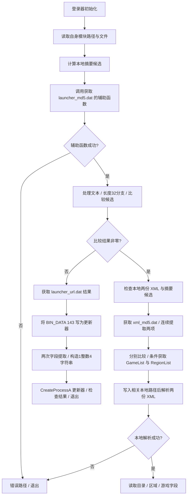
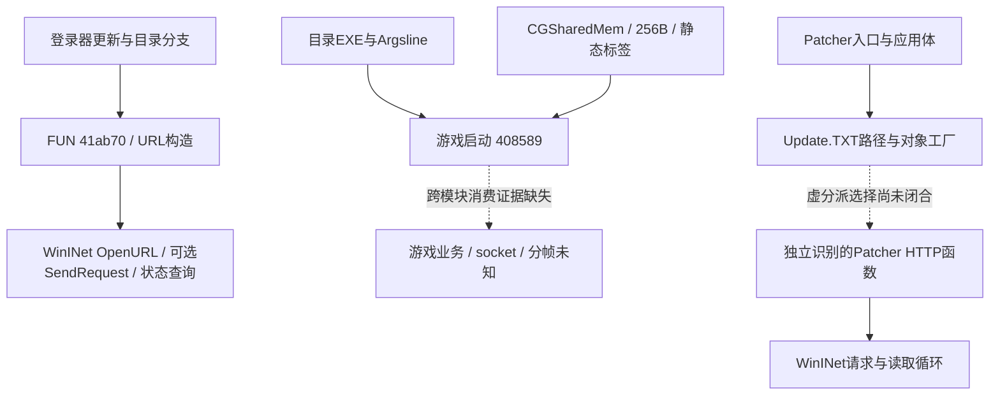

## 固定 SE 普通换图的交互和地图回包

`!DS` 的五个业务整型依次为事件格值、完整递增前序号、X、Y 和交互参数，所查换图入口的末项为 -1。现有外层 `=xE` 两个整型依次为序号和状态。原版以发送时序号低 16 位的符号扩展值进行比较。地图 `TfD`、`Ta>`、`=]M` 和 `=mJ` 沿用已有格式，场景等待、缓存更新与区域发布各使用规格中的条件。 [字段与状态顺序](../analysis/capability-first-v1/game-flow-functional-specification.json#/fixed_se_map_change_readiness)

Item 的同标签收包与 SE 共用主次序号及补片尾部条件。尾部按开关值 1 及第二身份 B 判定等待清除。活动区域重读另查 A、B 和坐标范围，标签字段也有独立发布时点。 [两版来源及本机对照](game-static.md#legacy-map-wait-patch-release)

两版 `@Qu` 的第 3 个整数用于非零地图 A 的缓存路径，现有解码已发出 `cacheVariant`。补片 `=mJ` 按消息 A/B 定位文件，活动第三平面另用 B 和实际窗口条件。写入返回与收包后的重读条件分别处理。 [字段到文件与活动平面](game-static.md#legacy-map-cache-io)

`=]M` 的九项整数依次是 A、B、矩形四值和三个校验值。两版使用活动 A 与通知 B 的缓存比较完整校验字段，不符时按原前六项发送 `!hM`。 [身份与结果](game-static.md#legacy-map-notice)

两版所查的连接退役和初始化保留当时的地图目录值。`@Qu` 写入新值，`TfD` 使用消费时的值。新进程在首次写入前从零开始。 [写入与场景读取](game-static.md#legacy-map-context-reentry)

Item 的所核普通移动在缺格时提交 `!hM`，随后保存等待方向。同一条普通帧再消费区域重读，第三平面复查返回零后由下一次合资格移动继续。 [同帧顺序与两版用例](game-static.md#legacy-map-movement-refresh)

同步窗口退役扫描在清共用占用后读取当前工作上下文。上下文仍启用时提交动作 62 并清标记。最后持有者已处理过释放时，使用扫描结束的实际值决定本轮是否再次发送。 [工作解除和场景帧顺序](game-static.md#fixed-se-shared-scene-frame)

## 固定 SE 的战后结果回包

`>_U` 正文按逗号取四行角色、一个三项名称及图号组、十五组技能结果。角色行有两个十进制字段和一个有符号 base62 字段。名称逐项解两层转义，最多保留 28 字节。技能有一个按有符号低 16 位读取的十进制标志和一个有符号 base62 数值，两者各自将负值归零。`>xG` 直接读取前两个用竖线分隔的有符号 base62 值，分别给 `DP` 和 `Total`，空字段取 `-1`。两条已有外层字节串的解析可复用。 [消息与字段规则](../analysis/capability-first-v1/game-communication-functional-specification.json#/fixed_se_battle_results)

## 固定 SE 的目录检索与迷你邮件

`` _&` `` 携四个有符号整型和一个字节串。每种实际操作复用 `/1I(X,Y,对话编号,参与者ID,按钮,正文)`。目录选择用按钮 0，关键词查找用 1，前后页用 16 和 32，玩家资料查询用 4，迷你邮件提交用 8。迷你邮件先转义收件人名称和文字，再将十进制收件人编号、两段文字与 0 拼成正文，对整段再作一次内层转义。外层继续用现有格式。 [字段绑定及预算](../analysis/capability-first-v1/game-service-invalidation-contract.json#/service_receiver_consumers/fixed_se_classic_directory_mini_mail)

## 固定 SE 的普通用物目标回包与请求

`LC=` 和 `LHm` 都携一项外层字节串。在经典入口，`$fa` 发送当时坐标、用物绝对槽、0。`*~/` 发送一级行序号，`$gW` 发送点击坐标、此时所存来源槽和选中记录的末字段，`*pT` 无业务字段。`6=L` 沿物品选物品发送目标、来源两槽。外层编解码沿用现有格式。实际服务的触发与配对按原用例验收。 [字段与用例](../analysis/capability-first-v1/game-service-invalidation-contract.json#/service_receiver_consumers/fixed_se_item_target_menus)

两条用物回复各携资料文本。实现使用本地操作与场景身份判断是否可提交，窗口取消和实际析构沿已证顺序。原回包配对仍需实际服务验收。 [本地准入与退役](game-static.md#fixed-se-item-target-retirement)

## 固定 SE 的场景回包 `CcL`

`CcL` 携七个有符号整型和一个字节串。第 6 项为 0 时只用外层场景坐标、方向和资源走图形路径。非零时用正文第 2 项登记实体，成功后才按外层第 7 项选择特效。扩展正文有 12 个位置，含 base62 ID、十进制和两层文本。外层第 1 项供特效结束时查活动记录。 [协议与原字段](../analysis/capability-first-v1/game-communication-functional-specification.json#/fixed_se_ccl_scene_publication) · [正文和结束规则](../analysis/capability-first-v1/game-actor-functional-specification.json#/fixed_se_ccl_scene_publication)

## 固定 SE 的简介提交与公开状态

`;+]` 依次携带三组目录编号和说明，最后附自由描述。`=Nd` 携带一个公开状态整型。草稿提交按本次编辑内容构帧，入场与手动公开复用缓存内容。三个成对文本是否改用 `不公开` 由活动编号决定，已保存的模式仍使用缓存编号组包。用不同的草稿与缓存编号验收这条规则。 [字段、次序与差异](../analysis/capability-first-v1/game-communication-functional-specification.json#/fixed_se_player_profile_wire)

目录通知 `]op` 携带四个内层十进制字段。前两字段与当前版本分别比较，差值掩码 1、2 或 3 通过现有 `:_d` 整型请求发出。回包 `^-/` 与 `` ^/` `` 各携一个前置版本和若干三字段行，分别发布贩卖、购买表和描述表。第三个通知字段给迷你邮件邮费提示，第四个写当前角色槽，供 `_EP` 判历史方向。相等写方向 1 随即返回，其余写方向 0 并提示。 [消息格式和原版先后](../analysis/capability-first-v1/game-communication-functional-specification.json#/fixed_se_player_profile_wire/directory_publication)

`;JE` 携带查询类型与真实目标两个整型。`^=0` 携带八个字节串与五个整型，按固定字段位解码。八段文字在外层字段分派后再经内层反转义，资料和类别资源发布完成才请求窗 64。四类查询与实际服务回复按各自的配对证据验收。 [原字段位和发布次序](../analysis/capability-first-v1/game-communication-functional-specification.json#/fixed_se_player_profile_wire/other_player_profile)

## 11 月版登录器更新的两个回执

内嵌更新器用旧 PID 与旧进程创建时间找到接管事件。旧窗请求关闭后，更新器等待旧进程退出。候选进程以另一个参数接收启动确认事件名，所选主窗完成创建、显示请求和刷新后尝试置位。事务提交和清理由更新器根据等待结果决定。D1/D5 用同一回执规格连接更新和启动。 [生产、消费与失败顺序](launcher-static.md#f5a-update-handoff-and-ack)

## 两个历史样本的角色创建和名单刷新

固定 Item 与 SE 使用 `/qW` 和 `U_s`。创建请求依次传槽号、名字、两项图形值、五项及四项分配值。成功回复更新字段 15 和本次变体 17。Item 在创建和 `1?v` 刷新之间共用等待标记，实际回包次序沿对应会话验收。 [请求、结果及刷新](game-static.md#fixed-item-character-creation)

固定 Item 与 SE 共用 `1?v` 无参数请求、`VK0` 的整数状态和字节串回复，以及 `Wb^` 的类别低字节。零状态按两组名字与转义记录处理。非零且详细字串精确为 `OUTOFSERVICE` 时进入维护提示，其他拒绝沿读取失败。两版沿同一组用例查名单、重复槽、时限及后续可选状态。 [回包与字段证据](game-static.md#fixed-item-character-roster)

## 两个历史样本的入场与场景就绪

已有角色的外观与样式动作先更新当前槽。选角后的 `0X@` 读取槽内最终字段 15、17、2，字段 17 取实际准备后的值。控件动作自身的直接调用沿外观规范、对象准备与反馈。 [外观变更到入场的取值](game-static.md#fixed-item-character-appearance)

固定 Item 的 `0X@` 与 SE 同取当前角色字段 15、17、2。`V?S` 在等待标记为 1 时发布回复，按 `successful` 的十个字符及 NUL 判定成功。连接状态先于回复和超时，两份固定样本共用 600,000 毫秒等值继续等待的用例。 [字段及结果](game-static.md#fixed-item-world-entry)

固定 Item 的 `=]M` 校验通过、`=mJ` 合资格的补片尾部和 `H#|` 本机角色分支分别清地图或角色等待位。主状态 9 按当前等待字节选时机进入绘制准备。 [等待条件与普通帧](game-static.md#fixed-item-world-entry)

<a id="legacy-item-disconnect-recovery-protocol"></a>

## 两个历史样本的断线状态与回到选服

固定 Item 的所选接收错误先登记断线，当轮继续检查缓存。标记仍为 1 时，下一次合资格轮询发布状态 11 并置 2。确认后按来源顺序退役提示与旧连接，再发布状态 2。主动返回选服继续沿既有请求和回复合同。原版传输错误与目标宿主 EOF、读失败的对应关系在接线时逐项验收。 [断线提示](game-static.md#legacy-item-disconnect-recovery) · [当轮收包](game-static.md#legacy-receive-retirement-order)

固定 SE 在状态 11 使用同样的按钮就绪、命中和按下条件。确认返回后退役连接并发布选服状态。`58510C` 控制断线与人数提示，当前已核读取和清零。实际非零来源决定人数提示的准入。 [SE 确认和状态](game-static.md#fixed-se-disconnect-recovery)

两版的 `]gQ` 沿既有重置报文清解码就绪位。同轮仍有缓存时进入一次控制请求与消费分支。图鉴和个人、家族来信的原字段沿用既有目录，角色槽由当前业务状态提供。 [来源和用例](../analysis/capability-first-v1/game-communication-functional-specification.json#/receive_retirement_order)

两版的 `W(y` 沿现有外层文本规则解码一个字节串。提示回调按首个 NUL 保存，保留旧值的条件是旧串含完整的新串。所核解析临时输出容量与提示保存区的可用长度各有来源。 [字段与状态寿命](game-static.md#legacy-address-notice-retention)

固定 SE 和 Item 的 `Ok?` 各带四个整型，消费者在完整首项等于零时走同一通用提示。两版的 `Kh>` 均带一项整型，回调保存低 16 位，所核初始化写零。两项的业务触发和后续消费继续沿具名证据核对。 [字段与回执](game-static.md#legacy-unassigned-receive-outcomes)

固定 SE 的一次原始读取可包含多条有效帧。活动解码时，消费后前移余留并重新判断。已完成首条消息后遇到无效起始标记，原版静态路径推进游标并重查其后数据。内层 `M` 仍由 `?+e` 发布到现有战斗队列。 [长接收及余留规格](game-static.md#battle-266-long-receive)

## 固定 SE 的出站字段和准入

固定 SE 的 18 个格式器沿现有目录组包。分别以原业务分支决定是否调用及如何取值。`#Mi` 取类型 2 挂起分支的逻辑 X、Y，固定普通扫描器的所查分支无法产生该类型。`;JE` 按场景、名片、家族或迷你来源取实际槽或实体 ID。`6=L` 的目标槽在源槽前，所查第二套窗先发请求再提交关窗。离队成功的 `/Re` 保留目标 X、Y 与符号扩展朝向。 [逐条字段、条件与回归](game-static.md#fixed-se-outgoing-admission)

固定 SE 明细窗的加点请求 `-gR` 携一项有符号整数，其业务值为 0 至 4。个人称号删除 `->#` 携排序行反查到的原表索引。点数与阵位分别由 `Or@` 的完整 32 位和 `Q=[` 的低 16 位发布。人物窗按此资料决定候选和按钮可用性。 [格式与来源](../analysis/capability-first-v1/game-communication-functional-specification.json#/fixed_se_player_window_wire)

<a id="capability-entry-scope"></a>

## 当前统一分析的入口范围

C82 的普通游戏创建接收显式 EXE、命令缓冲及已发布目录。映射发布结果、进程创建结果及同版游戏接收是交接的三个可分别观察的条件。 [启动器来源](launcher-static.md#c82-game-process-producer)

F5A 在创建进程前按名称发布交接内容。同名复用保留原视图，新视图先通过范围检查再登记和复制。进程创建失败按名称移除记录，普通析构逐项退役。D1 沿这三个完成点验收。 [F5A 交接来源](launcher-static.md#f5a-mapping-lifecycle)

F5A 的进程命令行先放带引号的 EXE，再追加选中记录、非空可选段和合资格的资源尾部。独立映射载荷使用 `gid:`、` glt:` 与无符号 32 进制尾段。普通阶段 3 的所选非空结果先保存本次尾段数值，再按候选及显示行条件执行自动确认。零候选分支消费预设请求并跳过该写入。当前同版接收继续待证。 [两块缓冲的生产规则](launcher-static.md#f5a-handoff-fields) · [结果到确认](launcher-static.md#f5a-result-selection)

F5A 的所选状态 0 回包按候选上限、上下文及 W1 到 W4 的形状准入，列表排序同时交换名称和这四列。普通确认使用显示行映射得到的候选，按 W1 低 16 位和 W2/W4 条件决定是否向原启动交接发布。 [来源规格](launcher-static.md#f5a-profile-list-projection)

F5A 的映射 `gid` 取确认时写入的名称，`glt` 文本取同一主窗的回复上下文。回复单项容量为 42 字节，确认调用的容量为 41 字节，两者都含终止位。保存候选索引的回执与映射及创建结果分别核验。 [选服到字段读取](launcher-static.md#f5a-ordinary-handoff)

固定 F5A 的所选错误回复进入提示前清忙、清准备资格并请求关闭。新连接由合资格的登录定时器和有效候选发起。排队提交先消费编号，普通确认保留自己的前检。旧回调正常结束后归还借用，实际关闭及替换连接的回执分别核验。 [报错与连接准入](launcher-static.md#f5a-modal-connection-admission)

F5A 的本地置顶完成后重建可见列表，普通确认继续按当时的显示行重读候选。置顶数据由 `GameIDNotes` 的读写提供，回复的候选列继续沿原解码及确认。 [保存与确认次序](launcher-static.md#f5a-pin-publication)

正数候选回复读取本地备注及排序数据，再按当前版本重建可见行。后续筛选和移动改变的是行映射，确认仍通过现有映射读取回复中的同一候选与关联列。 [本地候选操作](launcher-static.md#f5a-candidate-management)

F5A 的自动确认可在本次回复借用期间同步走到托盘提示。提示返回后的所选准备早于外层写阶段 3。准备使用当时的编号并检查已尝试位，匹配消息按接收时的阶段决定准入。普通预设应用通过前检后才生成新编号。 [返回和重新准备](launcher-static.md#f5a-start-return) · [编号与预设规则](launcher-static.md#f5a-preparation-generation)

固定 SE 的普通帧在主状态派发前轮询接收。所选接收准入下，计数模 8 归零且就绪返回非零才清三个战斗暂存字。随后按报告的接收前缀逐字节覆盖。所选 1–7 字节用例保持三个零值，结果按各自读取点消费。跳过清理后的值继续按相邻帧实际写入确定。 [原版偏移](game-static.md#battle-receive-scratch-overlap) · [相邻帧取值条件](game-static.md#battle-266-adjacent-frame)

固定 SE 的 `M` 记录中，所选 `CHT` 和同施法者的下一条 SKL 可合入一个命令对象。聊天时长决定后续技能何时解析。独立 266 同帧出现时，普通结果和仅自身 RID 依次读取该帧的暂存值，继续沿用原字段布局。 [合组、字段及回调时序](game-static.md#battle-266-same-frame-producers)

固定 Item 的升级发送由 `57F5BA` 组织为 `5[B`、整数 kind 和字节串。`WDM` 的结果低字节在主状态 13 决定阶段 100 或 200。类别 7 的字节串来源仍待证。 [角色操作来源](game-static.md#legacy-item-character-operations)

Item 普通帧先分派已提取的接收记录，再发布待切换主状态。活动主状态 13 中，`WDM` 更新当前子阶段。期间主状态保持时，后一条同轮结果覆盖前一条。接下来的待切换发布仍会写入自己的主状态和子阶段。 [回包与帧顺序](game-static.md#legacy-item-upgrade-result-flow)

经典宠物训练的 `/1I` 继续使用当前对话序号、角色、按钮及文本。报价和选宠在等待页仍有效的再次点击可以重新提交。选栏先打开确认层，确认才提交按钮 0 和所存栏位，随后登记窗口退役。 [两版控件证据](game-static.md#legacy-pet-training-controls)

固定 SE 另一套报价窗的已证提交复用 `/1I` 五整数和正文。正文为 `page*8+row` 的十进制写法，本地另保存页内行供后继标题使用。 [价格准入、局部状态和样本范围](game-static.md#fixed-se-pet-count-selection)

两版第二套遗忘窗使用 `/1I` 按钮 0，正文为返回 99 或技能行号加一的十进制文本。选择与返回在格式化前经过同一条有符号资料检查。经典窗的返回使用原独立分支。 [提交规则以及具体读取](game-static.md#historical-forget-return)

固定 Item 的 `5[B` 与 `1^t` 复用同一帧提交入口。队列的返回值描述本机入队结果，升级结果由 `WDM` 更新。等待窗的创建与退役沿当前界面阶段。 [提交与等待顺序](game-static.md#legacy-item-upgrade-submit)

固定 Item 和 SE 的类别 7 提交读取 NUL 结束的资料字串。首字节为零时，帧前缓冲仍含 `5[B`、kind `5`、两个相邻字段分隔空格和末尾 NUL，原字节为 `35 5B 42 20 35 20 20 00`。提交正常返回后写等待阶段，发送时的实际资料仍待证。 [两版帧前编码](game-static.md#legacy-upgrade-empty-material)

固定 Item 和 SE 的 `>_U`、`>xG` 在接收门槛为零时，向同一 16 位延后动作字分别写 1、2。战斗入场写 3。普通帧按读取时的值分派结果窗或窗口恢复，先前的写入可被覆盖。 [接收、入场及消费顺序](game-static.md#battle-window-restore-order)

两版 `Ta>` 的文字字段供经典 39 的创建回调及另一套窗口 1 的所选绘制读取。场景提示使用创建时的标签，期限使用恢复阶段采样的计时字。 [字段消费者与时序](game-static.md#legacy-scene-label-window)

固定 SE 的 `Ta>` 沿现有字节串字段解码。第二个内层字段的非负值登记为地图显式调色，空值或负值转为 `-1`，交普通帧恢复跟随时段。索引与版本校验由已有调色请求入口执行。 [固定样本及帧消费](game-static.md#fixed-se-scene-palette-follow)

固定 Item 的 `Wb^` 以一个整数更新实时类别的低八位，选角初始化清该字节。升级请求按发出时的类别读取各自资料。初始化与选服交接中解析的 `gid:`、`glt:` 各有已核的工作字段。 [角色类别和启动交接](game-static.md#legacy-item-startup-handoff)

同一 Item 的状态 7 注销使用零字段 `1^t` 与 `VKW`。发送调用返回后才写等待状态并采样。等待中的回复先标记就绪，再核对成功文本。其余状态下匹配成功时登记待切换的状态 7。轮询优先消费就绪结果，等待超时按单独的请求计时处理。 [回包、状态和计时](game-static.md#legacy-item-logout-clock)

Item 图鉴输入表第 9 项是局部键状态到窗口 23 开关的调用，未添加协议字段或发送语义；正常主循环准入及实际窗口帧分派仍待。 [来源与边界](game-static.md#legacy-item-album-key-registration)

固定 Item 在 `9C1D38` 为零时处理 `?<E`、`?l)` 和 `@Y)` 的受影响槽。前两条在读取槽资料前核对该槽，第三条在双槽操作后按参数顺序核对。当前槽非负且命中时重置选择资料，再将工具栏准入置 1。 [回包来源与状态写入](game-static.md#legacy-item-album-toolbar-and-slot-reset)

固定 SE 的三条同名回包经各自入口更新活记录并触发普通选择核对。已选邮件附件槽仍由表单持有。经典家族提交走 `:+(`，经典个人及另一套已证个人、家族提交走 `(>#`。 [接收、选择和提交顺序](game-static.md#legacy-se-mail-attachment-refresh)

`?<E` 跳过正文首栏，再按 28 个隐式槽各读 13 栏。空名或缺尾槽清存在与名称首字节。`?l)` 通过显式槽号定位，名称分隔符未在原上限内读到时停止。全量背包的发布门与地图、本机角色的入场位各有来源。 [线路和入场规格](game-static.md#legacy-full-inventory-publication)

普通制造的 `+>L` 在截止时读取当前材料关联。背包换位已经迁移的引用以新槽送出，换入装备而释放的引用从正文省略。配方 ID 后先列要求项、再列附材，分别依材料位置次序转换成绝对槽号。Lor kind1 的结果回调释放界面占用，物品与 MP 各由其资料来源发布。 [实际读槽及结果](game-static.md#legacy-se-craft-inventory-selection)

经典交易发布 `+oj` 从两张稀疏位置表取 `源槽|报价位置` 及已存报价金币。主确认发送 `,ua 1` 读取双方阶段和共享时间。`@Y)` 可以先改变下一次发布的源槽。资格重查释放本地位置，显式撤回才沿所选按钮发 `,3K`。`Ofl` 所选结果关闭后沿窗口析构释放剩余位置。 [交易协议和界面次序](game-static.md#legacy-se-trade-inventory-confirmation)

`FBY`、`G:w`、`J_J` 继续归普通宠物资料。`E(9` 的字段 27 更新持有金币，`Mv@` 更新对方报价。经典 `+oj` 从当前持有资料之外的报价位置和已存金额取值。`O#3` 清对方报价及金币，`Ofl` 各结果按已有阶段及关闭分支处理。 [交易消息消费者](game-static.md#legacy-se-trade-pet-gold)

固定 SE 的第二套窗 `+oj` 同用两段字节和一个已存金额。两段是本方缓存的物品槽及宠物槽列表，按十进制与 `|` 连接。合资格发布在金额回调前发送。主动编辑后的撤回、仅余额截低与关闭各按已证分支处理。 [字段和时序](game-static.md#legacy-se-alternate-trade-gold)

第二套窗的物品取放复用既有 `'#Q(int32,int32,int32)`，前两项为缓存索引各加 8。直接放置第三项为 0，数量确认第三项为当前暂存值。当时的源量上限在所选回调尾部夹限。已发报价的合资格双击或首次选起发 `,3K`。 [移动和撤回来源](game-static.md#legacy-se-alternate-trade-selection)

另一套普通背包 14 打开数量窗 16 时保存实际槽号，确认时将这两个整数和当时的非零数量交同一 `'#Q` 格式器。确认先于当帧数字键处理及按源槽数量调整，服务端接受与后续库存发布沿原用例。 [窗口次序和用例](game-static.md#fixed-se-alternate-inventory-quantity)

固定 Item 的普通训练链以四个整数和一个字节串接收 `Q?m`，所选经典窗口控件以五个整数和一个字节串发送 `/1I`。选宠和选技能栏处理还读取经典 54 号窗口的活指针。关闭匹配取活动模式及角色 ID。 [版本与窗口绑定](game-static.md#legacy-item-training-ingress)

固定 Item 与 SE 的选报价及选宠请求发送后，客户端将活动模式置为 `-2`。此值参与 `Q?m` 关闭匹配。普通资料分派先发布来包的四个整数，再由所选解析体检查窗口指针。 [等待及收包顺序](game-static.md#legacy-pet-training-wait-owner)

固定 Item 与 SE 在普通 `Q?m` 的对话分派返回后，按本次来包的第四个整数查询目标身体。场景和目标类型等条件成立时写目标朝向。关闭掩码的路径跳过这项更新。 [来源、时序与适用条件](game-static.md#legacy-dialog-actor-facing)

历史 Item 的鼠标事件字、战斗帧的恢复字和经典窗口回调属于本地窗口状态。回复资料进入既有窗口记录，打开请求与帧回调遵循各自的状态条件。 [输入和窗口规则](game-static.md#legacy-item-window-admission)

固定 SE 与 Item 的经典图鉴用当前角色 bank 的记录有效标记选行。现有共享核心的历史 SE 接收入口已有 `@t-` 摘要和 `B8S` 详情的本地记录投影。键位、点击、活动窗和 bank 内选中行由本地窗口处理，完整图鉴沿既有 SF-D7 的资料规则接入。 [图鉴来源与资料规则](../analysis/capability-first-v1/game-social-family-album-functional-specification.json#/legacy_se_classic_album_ingress) · [现有投影回归](validation.md#legacy-se-classic-album-ingress-validation)

固定 37c4 的角色结果队列由实际身体对象持有。所选护卫路径写前三格，后续 RID 扩展复制同一对象的已有四格结果。第四格依赖该行的分配和写入历史。技能线路字段沿用既有目录。 [角色存储及复制规则](game-static.md#battle-result-tuple-lifecycle)

所选 106 在 RID 位存在时消费身体结果后缀，`0x2000` 决定用传入角色槽或后缀槽。独立身体的非反射查找和 116 的结果游标重叠属于本地执行条件，仍使用原技能线路字段。 [独立结果身体](game-static.md#battle-detached-rid-context)

固定 SE 的 `SKL` 类别 266 变体 2 按施法者及 `FF` 终止的结果序列收集依赖。每条结果的 `0x800000` 控制三个 RID 字，自身结果的 `0x200` 控制护卫槽。护卫槽 50、51 对应角色槽 20、21。所选仅自身 RID 输入可在相关槽可用时通过预检，最终护卫结果写入该角色的现有队列。 [字段与准入](game-static.md#battle-266-source-admission) · [结果写入](game-static.md#battle-266-self-guard-context)

桌面回环桥在原创 TCP 对端回复为零字节时已返回 `written`。它记录连接内的本机写入。邮件发送者的最终投递、拒收、撤销及附件结算继续沿同版关联取证。 [本机回执](network-portability.md#desktop-stream-lifecycle) · [邮件结果范围](../build/analysis/mail-operation-composition-v1/specification.json)

**当前聊天/名片/邮件规格**：Cly bytes、CmV int32+bytes与@iV/ZV'/^Q^的int32+bytes+int32字段数保持；未消费的外层整数不删除，GC清当前家族bank后保存。个人(>#、家族:+(为三int32+bytes+int32，选择器映射后才得到宠物/物品/目标值；(R!单int32后清个人历史，活动名片等回复。接收通知、本地发送历史与服务端投递结果分开；未新增产品字段或81历史登记。[规则/未决](../analysis/capability-first-v1/game-mail-data-contract.json)

<a id="legacy-item-mail-wire"></a>

固定历史 Item 的三条来信均沿用 `int32, bytes, int32`，`GC` 无业务字段。普通个人 `'b2` 和家族 `9%#` 均为 `int32, bytes, int32`，迷你 `<y=` 为 `bytes, int32`。宠物个人 `(>#` 和家族 `:+(` 均为 `int32, int32, int32, bytes, int32`。所选提交路径末项传 0，发件历史在客户端提交调用后写入。发送者结果及附件结算继续按 MM-R1 核验。 [Item 字段与调用锚点](../analysis/capability-first-v1/game-mail-data-contract.json#/item_mail_history)

**当前37c4字段细化**：沿用4f8020的两个整数，现绑定选中宠物索引与生命/力量/防御/速度/魔法索引0..4，保留另一套界面“剩余非零、属性<总点数/2”的来源门槛，不向经典回调补猜测条件。Jl<沿用整数标识和字节文本：人工数字先按%6d格式化，再将空格换0；最小宽度不等于任意整数的%06d或截断规则。窗口type0x43的外层掩码与完整编辑器分开，亦不与518d70选数挑战合并。[逐项规则](../analysis/capability-first-v1/game-ui-producers-contract.json)

**当前37c4来源合同**：4f8760的字节负载为567678处的nr；写空闲严格30秒条件与450640的有符号60秒周期条件分开。466e50/466f50两坐标、47e880四字段、480b40五字段以汇编校正缩短的伪代码。517a80的三组flag/string及第四字符串有实时/缓存差异，518090先发资料再发入场标志；不新增猜测字段。518d70/518de0归正常手动提示/选择/回复恢复，4f87f0归原生完整性/输入报告，不能当普通心跳。未修改协议注册表。[逐项规则](../analysis/capability-first-v1/game-producer-context-contract.json)

**同37c4本地状态合同，非新增线路字段**：关闭active选择、inactive清缓存/dirty、40a090写+1c待删、409fe0摘链和40a0a0向51bd85传附加区后主体为不同步骤。bit40000/global58f6b4/模4相位同时门控回调与删除；当前回调内新增标记须等后续访问。4ea9b0按+2c状态绘制，在状态1/2逐次构造逻辑1并复制到包裹字段，4e94d0只在+170逻辑值正数时处理输入。物理元组/RNG和完整源调度仍另列，不把这些内存偏移变成协议字段。[来源规则](../analysis/capability-first-v1/game-graphics-lifetime-contract.json)

**固定37c4复用规则**：本组39个发送入口均经4fcea0准备tag、4fca70/4fcab0按顺序编码int32/bytes、4fca20追加并交4fce00；共享567db8/567db4不是可跨所有者并发使用的接口。68个收发tag直接核原字节，沿用现有字段目录，未新增线路字段。29接收分别保留待回包ack、普通上下文、地图身份、主状态等门槛；同一个发送机制不合并业务回复所有者。[逐入口合同](../analysis/capability-first-v1/game-entry-review-contract.json)

**来源边界**。4EF580 与 4F2010 沿原汇编继续核对栈参数。4F3310 已在离队成功分支确认 `/Re` 的三个参数。4EEE60 委派 518D70 两个整数，4F0210 的低字节及短文本写入须追实际读者。4F36D0 归战斗队列，`M` 的实际消费条件沿玩家输入流程。已核 18 个发送的出站格式和所选业务准入，其余 21 个已列路径与取消、重入、版本条件沿原问题取证。 [原条目](../analysis/capability-first-v1/game-entry-review-source-check.json) · [后续核验](game-static.md#fixed-se-outgoing-admission)

**同C82宿主状态事实**：模态flags在对象+0x60，结果+0x68，创建期EndDialog标记+0x9c；正常EndModalLoop写结果、清0x10并投递空消息唤醒。0x36a直接idle消息与WM_TIMER的同值timer-ID分开。登录错误停止当前尝试后才提示；这些是本地所有者状态，未新增协议字段或接口。预设列表取消保留已完成修改，编辑/备注/目录各有提交门槛，不能以统一回滚替代。[来源规则](../analysis/capability-first-v1/launcher-modal-recovery-contract.json)

**同C82连接所有权事实**：原生handle有pointer/serial及第三ABI字，选定查找使用前两字；588190的RET0xc保留了伪代码省略的第三字。type11路径在取得回调引用后调用既有16参数回复入口，再释放；消息回调之后重新验证池中对象和接收长度再消费帧。关闭意图与最终释放分开，本地候选计数和独立attemptId均不写成新增协议字段。现有编解码/产品接口未改。[连接来源](../analysis/capability-first-v1/launcher-channel-source-check.json) · [规格与未决](../analysis/capability-first-v1/launcher-channel-contract.json)

**同C82本地状态事实**：main+1a7c/+1a80为候选索引/剩余次数，+1a78为当前DNS job，+1a74/+1a76/+1a77为busy/已提交/DNS阶段，+1a84为32位tick时限。DNS与连接准备共用首个10秒时限，提交接受后另设10秒；取消释放当前job引用、清状态/定时器并停止channel。回复门槛检查busy及关闭请求结果，完整内部旧回复归属仍待证。这些是本地状态规则，未新增协议字段或产品接口；已有16参数回调栈证据保留，不能按伪代码漏参重写ABI。[合同](../analysis/capability-first-v1/launcher-lifecycle-contract.json) · [指令锚点](../analysis/capability-first-v1/launcher-lifecycle-source-check.json)

固定 37c4 样本的 104 个文本接收分支和 60 个 4fcea0 格式化调用者直接复用既有目录，本轮核其全部 164 个标记字；这不覆盖全部二进制/控制消息。与两套窗口和主状态入口联合登记后，2,768 处引用归为 647 个函数；480 个缺口入口已有原字节匹配的派生输出。[目录](../analysis/capability-first-v1/entry-inventory.json) · [调用目标和核验](../analysis/capability-first-v1/entry-source-check.json)

本轮未修改请求字段、编解码或业务状态机。共用传统窗口的事件生产/分派与关闭顺序已形成[来源规格](../analysis/capability-first-v1/window-engine-contract.json)：左/右按下、按住、双击和重复脉冲分开；没有直接转发原始抬起位。通用事件可在 mask0 时调用参与控件。cb30 同时用于初始化与每帧准备，cb34 在控件之后，不能把绘制器当输入分派器。

同步组掩码销毁、8000 延迟关闭、2000 重排是不同路径；业务析构可产生协议效果，49aa00 会经4f8240发送 C 回复，不能由通用清理推导全局静默关闭。操作登记、quick reset、取消钩子有不同字段清理与重读顺序，保持具体版本规则。[源字节核验](../analysis/capability-first-v1/window-engine-source-check.json)

33 个原间接调用点、业务回复归属、完整草稿/重入、另一套窗口和动态注册等仍待逐组关闭；新发现 4a8e20 表明 647 表/协议根入口不是全入口数。`EXTERNAL:...` 调用目标保留其地址空间。下一步归类业务及登录器命令映射，不能把入口有引用升级为完整协议兼容。[计划](development-plan.md#capability-first-workflow)

现已把647根登记地址集/视图复用归并成[静态业务调用索引](../analysis/capability-first-v1/business-entry-map.json)：3,506条所选调用边、160根到已知发送函数的可能路径。遍历停在图外函数，条件/实参/时序未审核，不能据此声称已发送或完整协议闭合。新汇总含34个未决调用点，与旧480派生批次的33点范围不同。

另一套4e9d00从同一raw鼠标数据生成不同mask：左按下/按住为1/2，左右repeat为0x10/0x20，命中为0x40；传统层对应位不同。inactive dirty返回2驱动业务清理，close本身先改活动槽；不能把传统控件位、同步销毁或清理回复政策直接套用。[来源合同](../analysis/capability-first-v1/alternate-window-contract.json)

本组把lookup的6处直接调用全部绑定到所观测5个体；4ea740按图形缓存选择open/close，1/0不是打开/关闭成功回执。两条旧交互生产者保存restore flag，延期4eadc0的action3调用restore；这些源事实仍不构成实际callback列分发和全部顺序的证明。[补充来源与未决](../analysis/capability-first-v1/game-dispatch-findings.json)

固定 c82f 的预设是本地组合记录：七字段、32条上限、名称修剪/重复检查、候选验证/保存后发布、一次撤销和取消/重开顺序已有[来源合同](../analysis/capability-first-v1/launcher-presets-contract.json)。名称UI重复比较与文件解码校验不同，不能把文件内重复名称误拒；MBCS行为不替换成任意Unicode折叠。选择后428c00校验游戏/区服/子区目录的唯一性和归属，普通case3继续要求密码及既有前置检查；正回复后418590消费一次预设并核账号/唯一可用ID，再走普通case4。输入变化、歧义和不可见行转手动；36a键盘提示与100登录进度定时器不混用。同版目录Name/EXE/Code及Galaxy.Name生产、ID筛选/分组/原选择恢复和准备完成/失败子链本组又补证；完整XML/安装、编辑持久化、全部重试/取消/关闭/重入及同版游戏交接仍待关闭；本轮未新增通信字段或运行接口。[应用与回复消费](../analysis/capability-first-v1/launcher-apply-contract.json)

本地ID元数据不新增线路字段：ID回复后分别装载备注/置顶/两类排序值/锚点；账号、当前游戏类型和ID形成键，区服不在该格式中。保存/置顶/排序都依赖显式写入结果，失败恢复是尝试，排序撤销只恢复排序数据。+0x1998表示排序撤销可用，source Win32 INI BOOL不替代跨端持久化验收。7209/720a已绑定为重置/单次撤销，不据其新增导入导出协议或需求。[完整局部合同](../analysis/capability-first-v1/launcher-id-metadata-contract.json)

目录/安装/宿主补证不新增线路字段：Code数值不等于游戏行号；游戏资格、目录发现、手动提交各自有条件。手动目录必须存在且包含EXE/SpeFile，Path节的Game+原Code键写成功才发布对应游戏路径，但对话框已提前修改临时缓冲。关闭登录会释放owner引用并投递Frame关闭；取消/关闭句柄不替代服务/线程完成或所有晚到回调证明。完整协议与平台交接仍待验。[同版合同](../analysis/capability-first-v1/launcher-catalog-install-contract.json)

路径与宿主路由补证不新增网络字段。80CC进展消息及80C9成功布尔/零lParam只属于该版登录器窗口消息，不是游戏线路协议；完成回调取得当前任务，不能推断消息含代次。409bf0三个进程句柄、目录任务两字段、Main登录忙碌保持独立。菜单128与E140/E141等也是本地命令边界，不据库模板或无handler的菜单项补猜游戏协议。[来源合同](../analysis/capability-first-v1/launcher-host-routing-contract.json)

同C82 XML属于配置读取合同，不新增网络字段。原始字节模式决定数值实体和字符串内容；先全文件解码为Unicode再按标准XML解析不保持其结果。文件Load的布尔、Parse指针、error_flag、局部树及共享目录容器门槛分别记录；保留前一版目录不等于局部解析树未变化。现有容器检查器的受限输入策略继续独立，不扩称同版全部接受。[来源及实现缺口](../analysis/capability-first-v1/launcher-xml-contract.json)

+0x1694是游戏ID筛选词：候选由ID+空格+备注经相同MBCS变换后作子串筛选；普通列表先group1再group0，保留原序号映射，筛选后仍可见才恢复选择。准备回调422e20先检查/清pending，失败按当前目录重算恢复0/1/2，成功再入普通42d120；此guard不等于完整防陈旧代次。详细排序F/B:/A:、边界和未决见[目录/状态合同](../analysis/capability-first-v1/launcher-catalog-state-contract.json)。四动态控件及上下文动作7926不构成新增网络消息；c7ba与c82f来源分别限定。

登录器主消息表已按类/模板133定作用域；相同ID不再按跨对话框全局join。预设Surface基类的两个模板调用者写不同末级类，列表/编辑与文件规则已补，完整应用后的请求/状态继续待证。About的模态路径与菜单关闭请求已定位，WM_CLOSE发送不能替代完整取消/退出或服务端接受。[类/菜单绑定](../analysis/capability-first-v1/launcher-dialog-bindings.json)

<a id="stage306-work-context"></a>

## stage306 普通技能上下文的查询、提交及复位

**事实**：+5D [显示X,显示Y,61]启用，62解除；点击满足条件后立即更新本地上下文。开关要求所选技能kind非0、F8%字段15非0、Xz@剩余毫秒为正及普通输入条件；独立实现只支持已证正tier1..6。制造配方或工作子窗口持有计数时不可切换，配方可返回等级再切换。[来源](../analysis/game-work-context-v1/source-check.json)

**事实**。固定 Item 的八个所选工作窗口在非活动清理时也能调用 `+5D` 的 62 动作。活动槽及各自的状态决定是否调用。发送包装器返回后清本地上下文字节。外层帧准入与实际服务端处理仍待。 [Item 清理分支](game-static.md#legacy-item-work-retirement)

**事实**。固定 Item 和 SE 的 `Xz@` 首个整数是秒数，接收后换算为有符号剩余毫秒。第二个整数发布扣时模式。所选普通与战斗帧使用扣时前的剩余值判断动作 62。解除后需重查所选配方时，`'<4` 发送普通槽号。固定 SE 背包 14 的活动回调还在 `F8%` 字段 15 归零时解除，并尝试重建预览。 [两版帧和回包](game-static.md#legacy-work-context-frame-order) · [固定 SE 分支](game-static.md#fixed-se-work-context-publication)

**事实**。固定 SE 的经典退役中，最后一个工作持有者可发 `+5D` 动作 62。清上下文后，活动配方归属失配时用既有 `'<4` 格式查普通槽。整批窗口退役后若上下文仍启用，兜底发同一解除动作，返回后清工作上下文。 [来源与调用条件](game-static.md#fixed-se-work-transition-retirement)

**事实**。固定 SE 的 `@Y)` 使用两个绝对槽号，先换物品，再处理业务引用及占用。上下文活动且一端为装备槽 7 时，计数先按工作规则调整再换位。经典 `+5D` 启停的本地槽占用随发送返回更新。 [回包与启停的组合顺序](game-static.md#fixed-se-work-slot-seven)

**事实**。Item 经典制造选等级时按保存归属和当前状态决定是否查询，查询后继续进入配方视图。`@_i` 在允许接收时按回包槽保存当前上下文字节，再处理配方行。退役时外层计数归零且上下文启用，`+5D` 解除和可能的 `'<4` 重查都发生在窗口活动指针清除前。 [制造与退役调用](game-static.md#legacy-item-classic-work-recipe)

**事实**：制造配方查询 `'<4 [slot+context*100]`；@_i回复使用普通slot并标记接收时的上下文。选等级时若配方上下文不同则重查，收到当前归属回复前不能选配方。最终+>L的第一个参数在制造、物品工作、装饰、目标技能、采集与type5中均为slot+context*100；*[c目标查询仍使用普通slot。

**事实**：上下文的耗时倍率按55b024七字节；制造／修理为signed32乘法和向零除100，装饰／采集用unsigned32乘积除100，7ba仍取截断秒。MP成本公式保持，物品rank上限增加1。Xz@和451be0继续由既有时间所有者处理；普通帧发现启用且剩余<=0时发62复位，有制造配方菜单且归属不同时重查；关闭技能主窗口也发送62。

**事实**：type5仅在等级可用及普通条件满足时发送+>L [有效slot,level,-1,empty]；已有坐骑子体时跳过MP检查，其他条件仍保留。界面停留在等级并说明等待角色同步，无Lor kind5推定或乐观状态变更。[规格与未证边界](../analysis/game-work-context-v1/specification.json)

<a id="stage305-work-targets"></a>

## stage305 两级目标与连续采集协议

**事实**：已知 type3／221..224 和 type4 六个 id 的等级成本为 trunc(int32(level[0x7c]*main[0x34])/100)。进入和结果重试检查当前 MP；采集还检查当前 8..27 背包空位。提交使用所选等级索引，不能复用物品工作 c5bd1b 初始 0。[来源](../analysis/game-work-targets-v1/source-check.json)

**事实**：*[c [skillSlot] → KxC [bytes]。最多 10 个一级目标依次为：非变装模式的自己、排除自己的有效队伍行、服务器 name／flag 对。队伍名读绑定角色，未绑定但有效的行仍占序号；服务器 flag0→type2，非零→type3；变装在 flag 恰为 1 时停止。非变装且 type 非 3 的选择发送 *^X [一级序号]，否则直接 +>L [skillSlot,level,一级序号,emptyBytes]。

**事实**：L<% [bytes] 触发最多六行二级目标。自己的分支读取当前人物及非 mode3 的有效宠物；其余分支每行 name、等级、健康、HP／maxHP、MP／maxMP。变身不显示人物行，但保留源序号；本地宠物序号从 1 压缩递增，不能用实际宠物槽号加一替代。二级选择 +>L 的第三参数是保存的源序号。返回一级和结果重试重新发 *[c，不猜新字段。

**事实**：变装／变身姿势 0，急救／治疗为 13；已持有 13 时不重复发送，关闭恢复 0。Lor kind3 七数字：经验、未知 raw、升级、三属性、模式结果。急救末字段是恢复 HP；治疗区分无需治疗、恶化、掉魂、部分或全部恢复，不套用 kind2 受伤标志。结果不推算生命／魔力／外观更新。

**事实**：挖掘 225／251 姿势 5，打猎 226／253 为 7，伐木 227／250 为 6。普通首次等待 6,500ms，严格 now>deadline 后 +>L [skillSlot,level,-1,emptyBytes]；没有 7ba 或 RNG。Lor kind4 成功七数值加解转义名字（最多 28 字节，超长为 ???），失败忽略负载并清展示增益。结果展示严格超过 2,000ms 后复查 MP／背包，再等 4,500ms 继续；展示期间重启禁用。暂停、继续和关闭受本地所有者约束，迟到回复不重开关闭界面。[规格](../analysis/game-work-targets-v1/implementation-spec.json)

<a id="stage304-work-actions"></a>

## stage304 物品工作与装饰的条件和请求

**事实**：普通上下文 0，type2 主技能 217 武器修理取类别 0..6，218 防具修理取 7..14；均要求首行说明非空、物品等级不超过主技能 0x1c。219 鉴定要求首行说明为空、等级不超过主技能，不能附加未证实类别／数量条件。220 刻印要求说明非空、quantity<=0、类别非 47；qualification 的 0x100／0x200 须清除，除非 0x400 已置位。[来源](../analysis/game-work-actions-v1/source-check.json)

**事实**：修理／鉴定 MP 成本为 int32(itemLevel*10)，一次自有 CRT 抽取决定 int32((rand%6+5+int32(itemLevel*3))*1000)。先发既有 7ba，按原生 uint32 now>=deadline 到时发一次 +>L [skillSlot,0,targetSlot,emptyBytes]。刻印成本 10，直接 +>L [skillSlot,0,targetSlot,markBytes]，没有 7ba 或 RNG 消耗。0 是 c5bd1b 的已证静态初值，独立实现持有该初值，不将 UI 所选等级填入此字段，不宣称所有原生动态别名等价。

**事实**：刻印编码后至多 16 字节。456330 遇 >=0x81 跳过下一字节，仅拒绝独立 0x7c／0x5c；511420 空白检查逐字节移除 0x20／0x81／0x40，不能改写成 Unicode 空格判断。提交原始文字字节；新刻印须通过非空检查，已有 0x400 可用空文字清除。纯字节 API 额外拒绝界面无法输入的控制字符，不宣称完整原生输入法等价。

**事实**：装饰六位至多一件基材、一件类别 25／38／39 附加品。两类均须说明非空；基材还要求 qualification0x800，exchangeCode 出现在任一 identifier200..214 的全部 56 个产品 id 中。替换先清旧位再检查分类配额，失败可留下空位；交换保留分类关联。成本 100、8,000ms、无 RNG 抽取；发送 7ba 后，到时 +>L [skillSlot,0,-1,ascii(baseSlot|extraSlot)]，按分类而非位置顺序序列化。

**事实**：Lor kind2 为七个十进制数：经验、未命名 raw、升级、耐力／灵巧／智力、受伤；status 非零成功。修理／鉴定成功清目标引用，刻印保留；装饰沿 kind1 八数值／丢失名称结果。结果不修改背包／MP，等独立数据包更新。重试、关闭、场景／战斗／所有者退出沿既有生命期处理，迟到结果不重开窗口。语义 UI 使用已证 kind2 结果数值，原生控件旧全局属性别名未宣称等价。[规格](../analysis/game-work-actions-v1/implementation-spec.json)

<a id="stage303-craft-input"></a>

## stage303 普通制造线协议和选择条件

**事实**：普通制造为主技能 kind1、identifier 非 0xff；可见等级 0..9 要求名称非空且字段 0x8c 非零。配方扫描到首个负 id；实现上限 56，字段 0xc 非零可进入。魔力成本为 `trunc(int32(recipe[4] * skill[0x34]) / 100)`。[来源与偏移](../analysis/game-craft-input-v1/source-check.json)

**事实**：六个材料位对应五个必需组；负材料 id 初始满足，数量 0 当作 1，使用 exchangeCode 匹配首个尚缺且数量足够的组。说明首行为空的物品不可选。类别 25／38／39 可作至多一件附加品，技能 215／216 除外；替换先匹配再移除旧位，交换保留关联。当前背包所有者仍是 8..27，原生 `<100` 守卫不证明可扩容。

**事实**：选配方发送 `:J@ [tileX,tileY,pose]`，普通姿势 9，215→10、217／218→12、219→11，关闭回 0。开始先发 `7ba [seconds]`，耗时为 `int32((rand%6+5+int32(recipe[8]*3))*1000)`；uint32 deadline 按原生无符号 `now>=deadline` 比较。到时只发一次 `+>L [skillSlot,levelIndex,-1,bytes]`，bytes 为十进制配方 id 后接必需材料位、再接附加材料位的绝对背包槽；不发送数量。

**事实**：Lor 为 `[status,kind,bytes]`，普通未受战斗门禁且 kind1 时解码八个数值及受八行预算限制的至多六个丢失名称。status 非零成功；显示技能经验／升级、耐力／灵巧／智力／受伤。结果包不修改背包或魔力，沿既有数据包同步。迟到回复不重开关闭窗口。独立选择是自有 CRT seed1、56 行边界和语义控件；不宣称原生全局 RNG／窗口／动画完整等价。[规格](../analysis/game-craft-input-v1/implementation-spec.json)

<a id="stage302-craft-recipes"></a>

## stage302 已有 @_i 回复的配方消费者

**事实：** 既有 receive-00567d78／@_i 的参数为技能槽 int32 与 bytes，进入 4f28b0；既有 send-004f6d00／'<4 查询参数保持不变。普通上下文 0 下，kind1 主技能记录自动请求其原槽。配方回复总按 56 行处理，每行 7 个字段加 5 组材料三元组；缺失数值为 -1，缺失文字为空。[来源](../analysis/game-craft-recipes-v1/source-check.json)

**共享实现：** 15 个技能槽分别拥有配方表。反转义后名称 ≤28、说明 ≤56 字节才替换，超长保留旧文字；技能删除只重置配方和材料编号，不清其他数值／文字。独立版本计数、复制快照和字节预算遵循现有所有权约定；数值未知含义保持原偏移。没有新增网络字段，也不由配方回复消费材料、扣费或制造物品。

制造选择／材料分配／提交／结果以及非零上下文为后续独立消费者；本轮只证明接收与只读状态闭环。[规格](../analysis/game-craft-recipes-v1/implementation-spec.json) · [验证](validation.md#stage302-craft-recipes)

<a id="stage301-battle-item-dispatch"></a>

## stage301 ITM 编号的有限效果合同

**事实：** 固定样本 ITM 的效果入口为 0→432a35、6→432752、7→43269d。其余 32 位值在当前回调返回，不产生该道具队列，也不执行 436930 分组完成。phase0 读取游标前移与 object+84 编号保存是不同字段；后续回调可能读取余下数据。[来源](../analysis/game-battle-item-variants-v1/source-check.json)

**独立实现政策：** 原有 item-variant-handler 拒绝保持命令边界；本轮不修改它，也不声称它等同原生后继行为。没有新增道具效果、HP／MP 变化、认证或网络字段。不能把默认分支实现为成功完成，也不能命名为永久等待。既有 0／6／7 合同保持；工艺配方及其他玩法另循证据实现。[规格](../analysis/game-battle-item-variants-v1/implementation-spec.json)

<a id="stage300-city-water"></a>

## stage300 回城水面使用真实角色与地图消息

**来源绑定：** 普通场景回城先清除逻辑本地对象、保留全局资料；战斗内收到场景则保留当时存在状态。场景main9/205不强制创建本地对象，只有既有H#|本地资料或边界main9/11重建才恢复。缺少本地资料的场景返回停留preparing-scene；不能由淡入完成伪造可移动角色。

**实现：** 等待服务器回复使用普通帧计划，已经advance／present水面时不重复执行外层更新。嵌套地图捕获先consume，再按实际本地存在advance、消费空外层、savePosition；后续缓存淡入仅做外层状态更新。网页与Page共享调度器在awaiting-server继续运行。没有新增认证、角色或地图wire字段；原创对端仅在场景回复附加既有真实格式的本地角色消息。[规格](../analysis/game-city-water-v1/implementation-spec.json) · [验证](validation.md#stage300-city-water)

<a id="stage299-battle-water"></a>

## stage299 战斗水面使用现有来源上下文

**事实与实现：** 正常战斗开始将native水面门槛设1、移除普通本地对象，结束清门槛；main10无本地对象时相位暂停。waterRequested来自真实排队的特殊索引，裁减前保留；缓存背景复制不产生该标记。特殊纹理本身仍为普通RD。返回重建地图时先consume嵌套捕获，再按本地存在advance，最后外层consume及savePosition；过渡画面不重复绘水面，相位仍按实际存在推进。

**接口与策略：** 沿用地图身份、实际位置、相机、中心、本地存在和来源门槛，不新增wire字段。裸战斗所有者遇特殊队列需显式数值上下文，缺失时不猜测；world自动提供正常流程上下文。consume和savePosition分离，present保留组合兼容；passes诊断计准备调用（含空外层／嵌套捕获），不能解释为原506820实际调用数。原RGBA、越界带、视口和资源重试策略保留，其他main9分支未据此推定。[规格](../analysis/game-battle-water-v1/implementation-spec.json) · [验证](validation.md#stage299-battle-water)

<a id="stage298-ordinary-water"></a>

## stage298 普通水面是绘图状态，不新增wire字段

**事实：** 图形索引3096..3105触发type8，资源名称与协议值不能替代索引判断。相位每次普通逻辑更新加0.25，呈现时按玩家实际位置的投影差调整；振幅只随所选呈现尝试推进。无水面标记时不重置振幅；门槛不通过时归零，地图变化在下一次有效请求时归零。

**实现与策略：** 共享不可变waterStrip描述只含phase／amplitude及priority2，没有新增GMN或场景wire字段。world使用现有地图身份、玩家位置及相机；独立所有者允许显式nativeGate作为本地来源上下文。战斗／离开阶段尚未绑定该门槛，保留边界。RGBA8、越界保留、非原视口和进程零前缀见[规格](../analysis/game-special-graphics-v1/implementation-spec.json)，[产品／协议回执](../analysis/game-special-graphics-v1/validation.json)单列。

<a id="stage297-body-draw-flags"></a>

## stage297 身体动作164／165的字段语义

164写309=255，165写309=0；两者保留310的覆盖值、308颜色掩码、原动画ARGB／flags／编号及对象alpha，然后推进一次身体动作。165关闭覆盖，未恢复旧309值，也不清空310。最终绘图按既有309／310方程消费，原动画已经计算的翻转偏移保持。[来源](../analysis/game-battle-gmn-flags-v1/source-check.json)

这两个编号属于身体动作队列，不是新增GMN协议操作码。当前正常GMN21队列不加入它们，正常协议生产链仍待证实。消费者继承substate7及慢帧门控；162／163颜色开关与164／165绘图开关交错时分别生效。未知原样式在164期间可被覆盖，165恢复后仍进入原显式绘制边界。[接口](module-interfaces.md#stage297-body-draw-flags) · [验收](validation.md#stage297-body-draw-flags)

<a id="stage296-actual-battle-product"></a>

## stage296 实际素材与原创对端配置

本阶段不扩展协议。复用既有>HY／C／TfD／地图补丁结构：原创对端的impact角色常量100095选为实际100010，status入场背景1000选为实际300653；普通场景模式1，CUT59510或59526。原本机对端文件、信封／载荷编解码、SKL106结果及防御／退出／移动请求断言保持。[完整规格与来源身份](../analysis/game-actual-battle-product-v1/implementation-spec.json)

两组配置均通过回合1、目标HP58、施法者MP5、一次防御、退出和两次移动。基础请求9个，加真实观察到的保活；生成Page测试中有1次保活，不强制把不同计时环境的请求总数或表现帧数视为相同。地图格排列及战斗配置由原创对端提供，未声称原服场景或账号会话观察。[验收](validation.md#stage296-actual-battle-product)

<a id="stage295-battle-draw-style"></a>

## stage295 对象mask、原动画与ghost的顺序

**来源事实**：最终队列颜色从原动画ARGB开始，按对象308的低四个位覆盖R／G／B／A，再按309／310覆盖绘图flags，actorFlags100000最后覆盖alpha为128。命名选择器透传。对象alpha255在mask8开启时仍覆盖动画自己的alpha；mask0时保留动画alpha。动画加色位8经独立flag覆盖后才决定ONE／ONE混合，透明度0不取消仍启用的加色。[证据](../analysis/game-battle-draw-style-v1/source-check.json)

**实现**：playback.animation保留原动画状态，启用的对象颜色另以drawColorOverride `{mask,color}` 描述。opacity保留为原alpha字节的诊断值，不再作为额外合成因子。GMN162／163、链接对象、静态场景效果、变形副本、元素进入／退出各按原mask写入；副本首次绘制使用实际继承的mask，后续分支再开启，不能凭alpha0推定已启用。原303字节写入通过setColorAlpha实现，并遵循下一动画帧的重写。

准备命令携带最终ARGB／flags／编号，借入精灵和缓存颜色不修改。RGB调制、straight-alpha、点采样、加色覆盖alpha及取整沿stage294的独立RGBA8策略，原GPU／DDRAW精度仍未验。未知样式位及特殊图形保持明确边界，GMN164／165等未移植控制未据此宣称已接入。[接口](module-interfaces.md#stage295-battle-draw-style) · [验收](validation.md#stage295-battle-draw-style)

<a id="stage294-vertex-color"></a>

## stage294 ARGB调制与逐指令合成

**来源事实**：普通／缩放四顶点共用ARGB；alpha字节选择普通覆盖或透明因子，标志8的加色先于alpha。**独立RGBA8规则**：源掩码先判定，每个RGB分量取 `floor((texture*vertex+127)/255)`；正常绘制将顶点alpha与已有portable opacity同式相乘，再使用既有straight-alpha source-over。加色使用调制后的RGB逐分量饱和相加，alpha与opacity不缩放该分支；输出覆盖alpha255沿用独立帧缓冲策略。透明底图的alpha语义与取整不是原生显存精度声明。[原字节与微软资料](../analysis/game-vertex-color-v1/source-check.json)

颜色在准备精灵之后、每次命令合成时生效，颜色调成黑色的可见源像素仍保留覆盖；源索引0继续透明。裁切／翻转／点采样／优先级与同级逆提交顺序不变。文字后的所有图片直接以已绘背景／文字为目标，避免中间透明层的取整或背景参与丢失。

命名调色板允许非空、完整BGR三字节项，最大768字节。每幅图的全部索引必须落入已知项；空／不完整三元组报LEGACY_ASSET_NAMED_PALETTE_LENGTH，引用缺色报LEGACY_RENDER_UNKNOWN_COLOR。未绑定的直接命名精灵、样式位16及以上与战斗专用对象样式仍分别检查。部分调色板的缺项不据默认调色板或尾部内存猜测。[接口](module-interfaces.md#stage294-vertex-color) · [验证](validation.md#stage294-vertex-color)

<a id="stage293-additive-render"></a>

## stage293 ONE+ONE颜色与图层顺序

**事实**：原D3D分支的标志8使用ONE作为源和目标因子；普通非8分支另处理顶点alpha。共享RGBA实现逐RGB分量取 `min(255,destination+source)`，仅处理源精灵非透明颜色键覆盖。ONE+ONE不以opacity缩放源颜色，故包括opacity0在内仍按该分支加色；输出覆盖alpha255是独立帧缓冲策略。

**事实与独立选择**：标志位0／1控制翻转，位2控制中性调色板，位3控制加色，组合0..15进入已有绘制描述。先确定命名／自身／默认调色板和通道变换，再按裁切、位置、缩放、优先级及同优先级逆提交顺序绘制。缩放沿现有点采样策略，不能据此声明原生驱动滤波或边界像素相同。[原文件／SDK证据](../analysis/game-additive-render-v1/source-check.json)

文字高层中的加色指令必须看到已绘的文字与背景，不能先合成到透明层再整层source-over。共享核心可接收借入的初始RGBA并复制；文字合成在存在高层加色时使用这个已有帧缓冲，后续普通与加色命令仍按原顺序执行。普通未新增加色的旧路径保留原像素。直接准备精灵仍要求明确的命名调色板绑定，延迟动画描述可保留已证实的16位编号。

任意顶点color目前仍仅接受ffffffff，其他样式位16及以上继续拒绝；真实GPU、DDRAW、16／24位以及完整资源版本不在本轮像素验收范围。[接口](module-interfaces.md#stage293-additive-render) · [验收](validation.md#stage293-additive-render)

<a id="stage292-animation-named-palette"></a>

## stage292 命名调色板的编号、优先级与样式

**事实**：action非零版本的20字节头在+12／+14／+16提供选择器、标志、颜色；动画状态写入+306／+305／+300，并经普通队列保留选择器。选择器是16位值：有符号原分支只接受1..1494，其他归0。有效值查固定1,495槽表，再用图形资源查找表确定RD材料；该编号不是CGP文件后缀。

**事实**：命名颜色优先于待画图像自己的内嵌／默认调色板。RD尾部按BGR转换为32位RGB，0号像素透明，其他纯黑变RGB000001。标志4选未变换的命名颜色；否则使用已有通道／tint变换，不能改为直接套当前CGP的RGB。相关函数及全部表字节见[来源](../analysis/game-animation-palette-source-v1/source-check.json)。

**独立实现选择**：每库最多缓存64份完整768字节命名颜色，准备精灵的key包含规范化编号，避免同一图像的不同换色共用像素。缺载体、短调色板和读取失败给出明确错误，不复现原生未初始化尾部；取消／关闭后不提交新缓存。当前仅绑定范围资源库和延迟地图动画；直接未绑定精灵提供者仍拒绝非零样式，标志8继续单列。[接口](module-interfaces.md#stage292-animation-named-palette)

<a id="stage291-legacy-minimap"></a>

## stage291 小地图格网、颜色与栅格合同

**事实**：以地图缓存宽高、当前显示地块中心及范围0／1／2形成107／54／27的方窗，起点为中心减范围半宽的截断值，地图外补0。仅loaded位 `0x4000` 的格子读取材料。模式1直接使用 `(worldY*mapWidth+worldX)*3` 的AUT RGB；其他模式先写地面颜色，再按行序覆盖非零物件色，collisionClass0按tileWidth向右、tileHeight向上展开并裁切，其余只写一格。物件元数据查原16位资源号，不加200000。

**事实**：普通颜色生产者扫描最终运行时索引。图形组0／1／2的1000..19999直接作为地块号，220000..265535减200000；后面符合条件的记录覆盖前面，后续组的直接16位资源槽清零。每幅RD图排除像素0，以原CGP RGB平均后取整；最近色初值为0，依次只检查16..239，严格更近才替换，平局保留先项。当前168改黑与嵌入调色板不参与这个平均过程。

**事实**：32位输出为 `(4*n+2)×(2*n+2)`，格心 `(1+2*(x+y),n+1-x+y)` 写左／中／右／上四点，色0替换为RGB000001，菱形外透明。标记在 `(2*n+1,n+1)`；模式1和其他模式各有时钟，先选黑1／白ffffff，再按uint32的last+1000期限翻转。奇数范围的半格偏移保留。

**独立实现选择**：资源准备异步并检查代次，完成后只在下一普通帧同步合成；小地图默认隐藏、右上留12像素。AUT短文件仅允许所需loaded位置落在已有字节内，不复用原生全局缓冲未读尾部。该界面位置和调度策略不声称等同原生窗口。[模块](module-interfaces.md#stage291-legacy-minimap) · [来源](../analysis/game-legacy-minimap-v1/source-check.json)

<a id="stage290-legacy-material-compat"></a>

## stage290 原创场景报文与真实素材的组合边界

**来源事实**：沿用既有资源参数、图形索引、动画和场景模式合同，没有新增游戏报文字段。材料选择通过现有数字后缀参数进入资源计划；文件名后缀只声明本次选择，不自动证明服务器版本。[来源](../analysis/game-legacy-material-compat-v1/source-check.json)

**验收设计**：原创本机对端提供人物／地图和请求校验，客户端选择实际ZIP。场景明确采用 `checksumMode=0`，使用实际素材进入、处理输入并重建场景，四条流程各核对7请求／2移动。另一个 `checksumMode=1` 场景请求 `bin/PUK2/cutdat/23.cut`，当前材料缺失，预期返回 `LEGACY_ASSET_REQUIRED_FILE` 且未呈现场景帧。

**事实**：GraphicInfo按源索引写入，同组重复项由后项覆盖。独立核验同时比较每个物理RD样本与最终槽位，避免混淆两种身份。现有普通绘制计划覆盖索引1000以上，本轮8个更低索引只走直接精灵像素核验；这不扩大未完成的其他绘制消费者。[完整记录](validation.md#stage290-legacy-material-compat)

<a id="stage289-legacy-resource-archive"></a>

## stage289 所选资源的字节范围与所有权

**来源事实**：启动模块摘要与后续资源消费者已有相对文件、长度和范围读取合同。**独立设计**：ZIP只是该合同的本地存储来源，不改变登录、游戏报文或字段。[来源](../analysis/game-legacy-resource-archive-v1/source-check.json)

初始化只读尾部和中央目录；条目首次访问核对本地头／数据描述符。存储型条目直接读取所需范围，完整条目读取校验CRC；部分读取保持散文件的范围语义，不声明已验证整条CRC。Deflate条目流式扫描至结束并核对完整CRC、长度及输入消耗后返回切片；最多32MiB解码缓存，大条目不整条保留。

显式 `rootPrefix` 优先，否则唯一 `cg_se_6000.exe` 的父路径识别安装根；没有模块时保留ZIP根，不猜测剥除Bin。外层UTF8目录可用，游戏相对路径沿用现有ASCII合同；多个模块根需调用者显式指定。文件夹／ZIP互斥选择，同一资源所有者交给启动准备和游戏；取消、失败、断开及关闭释放索引、缓存和迟到结果。[接口](module-interfaces.md#stage289-legacy-resource-archive)

**待验证**：真实wx文件选择／存储／大文件行为、实际资源版本及完整游戏链。[完整目标](../analysis/game-legacy-resource-archive-v1/goal-audit.json)

<a id="stage288-legacy-battle-audio"></a>

## stage288 单次音效的目录、声像与事件所有权

**事实**：沿用固定37c4样本。只有270个明确目录编号进入本轮文件解析；编号可共用路径。默认音效音量15、声像开启。播放入口按编号抑制重复5次更新，使用64槽循环复用；不覆盖环境循环／保护声音所有者。[来源](../analysis/game-legacy-battle-audio-v1/source-check.json)

声像索引为 `clamp(trunc(x/5),0,127)`，中心64。原表将127..1的奇数按 `5000/log(100)` 生成两侧对数衰减，超过5000的表值改为10000，端点为−10000／10000。输出只衰减一侧声道；单声道复制到两侧，立体声保留各自数据。所有目录音高偏移为0，沿用WAV采样率和既有音量转换。

**推测／移植选择**：抑制在每个不同战斗输出前推进；重复输出和旧generation不推进。先消费 `callbacks.body.events` 中的位置音效，再消费 `input.sounds` 的中心音效。异步读取保持同帧顺序；暂停、换战斗、关闭或迟到至少5次更新的输出作废。该适配时序仍需原生完整调度验证。[独立方程](../analysis/game-legacy-battle-audio-v1/original-vectors.json)

合成产品动画的10001信号实际产生编号1；本轮验证菜单56／57和该位置命中音效，未以另一效果分支的134替代它。[验证](validation.md#stage288-legacy-battle-audio)

<a id="stage287-legacy-battle-detached-rid"></a>

## stage287 106的RID2000与源存储行为

线格式继续为106的 `code,cost,word,caster,(target,flags,amount,[RID1,RID2,RID3])*,FF`，未增加字段。接入条件为RID的800000与2000同时存在，且登记槽0存在。每个RID在父库有四行，101为这四行各建一个独立分身；分身各自只复制当前一行。[来源](../analysis/game-legacy-battle-detached-rid-v1/source-check.json) · [机器规格](../analysis/game-legacy-battle-detached-rid-v1/implementation-spec.json)

| 存储／读取 | 原结果 |
| --- | --- |
| 分身第0行 | 当前父行的四格复制 |
| 分身第1行 | 槽−1，其余格为0 |
| 分身第2行 | 四格为0 |
| 436ee0推进三次 | 读到后缀槽−1、资源0／0／0，当前指向第3行 |
| 第3行 | 四格为0 |
| 41a030带2000 | 元数据接收者为登记施法者，忽略后缀槽−1 |
| 14的零数值分支 | 推进原捕获目标，向当前槽号0显示573b |

元数据将登记施法者的实际资源设0并清除13b4／13b0。分身保有复制时的资源，各自经105删除；此RID不按线上amount扣HP。随后普通记录仍按原命中结算。软件帧层按空图像索引0省略身体绘制，消息仍使用槽0的世界位置。

目标动作连续被推进四次。原434a30只检查索引小于200及当前格不是−1，允许读取结束标记之后的实际存储。新夹具的 `[0,119,-1,0,0]` 在四次推进后停于第4格0且忙碌；已有第4格50则按实存动作执行。29种新轨迹中1种自然完成，28种保留540次等待前缀，另由管理器第7,207次回调恢复到回合1。

缺少槽0在排队前返回 `impact-skill-detached-RID-slot0`；其在排队后被移除时，消息查找抛出 `LEGACY_BATTLE_IMPACT_MESSAGE_TARGET_REMOVED`。无2000的106 RID、低等级116 RID仍返回 `impact-skill-detached-RID-storage`；401自身效果保留原拒绝。未将未观察的原索引解释为其他目标。[接口](module-interfaces.md#stage287-legacy-battle-detached-rid) · [验收](validation.md#stage287-legacy-battle-detached-rid)

<a id="stage286-legacy-battle-impact-skills"></a>

## stage286 SKL4／97／106／111／116

共同字段为 `code,cost,word,caster,(target,flags,amount,[RID1,RID2,RID3])*,FF`，资源三词仅在800000时出现。97忽略word，其余四类写入ff4；类别为别名归一后的code/100，等级code%10，槽50／51映射20／21。四格元组与436e60的三行后缀分别保留；五类均不显式追加最终FF元组。初始第四栈字未知，独立实现将其未使用值置零，首个显式RID后保留RID1，不声称原始栈字节等价。[来源](../analysis/game-legacy-battle-impact-skills-v1/source-check.json) · [机器规格](../analysis/game-legacy-battle-impact-skills-v1/implementation-spec.json)

| 类别 | 施法者前缀 | 后续 |
| --- | --- | --- |
| 4 | 24,53,147,68 | 68信号后发出隐藏16身体及独立箭矢 |
| 97 | 24,53,38,147,135,62,78,86,85,84,87 | 蓄唱信号开启上限6震动并播放5／262；85火花；84区域结算 |
| 106 | 24,53,156,75,34,89,101 | 101独立身体逐条执行24,75,89,9,90,14,105 |
| 111 | 24,53,156,7,9,10,73,106 | 最后74,7,11,10；106一次处理目标，首条标记1adbe |
| 116 | 24,53,156 | 等级9先110,62；低等级每目标110,72,62；最后62 |

97设置目标类别／等级，其余四类先排目标0。40排32及本地244或50／49；非97优先8000／4000／2000选择121／120／119，否则2为160、普通26，4还排除20000000。非零数值或108排11，但非97排除E000，4另排除20000000；非97的100追加74。20排44，97另外排除10000。

97的84按区域消费者扣HP和显示数值。106独立身体执行14的普通、E000及动画信号分支；反射修改独立身体的逻辑零HP，登记角色保有各自状态。111的106与投射的112按E000优先8000跳过、4000恢复、2000不扣HP；普通分支扣HP、清状态、数值及KO各按源顺序。116低等级终点取目标世界坐标整数；等级9按目标侧取449／336或188／203，前层Y另加施法者动画drawOffsetY/2。

106／111／116完成后清动画信号及actor2与对应渲染位；三种自身路径保留540次等待前缀，另在管理器第7,207次回调恢复。空目标、106及低等级116的RID、4的隐藏偏转仍未支持；混合上下文及原动态继续核对。[接口](module-interfaces.md#stage286-legacy-battle-impact-skills) · [验收](validation.md#stage286-legacy-battle-impact-skills)

<a id="stage285-legacy-battle-upper-skills"></a>

## stage285 SKL107／108／109／112／114／117

共同前缀为 `code,cost,ignored,caster`，末尾FF，槽50／51映射20／21。108的每个目标为 `target,amount,flags`；其余五类为 `target,flags`。全部通过三字段元组追加，保留旧第四格；仅107／114显式追加FF元组，108／109在列表后追加动作53，112／117直接激活。目标缺失后的尾动作与终止项分别沿源处理。[来源](../analysis/game-legacy-battle-upper-skills-v1/source-check.json) · [机器可读规格](../analysis/game-legacy-battle-upper-skills-v1/implementation-spec.json)

107排24／147／53／102并消费全部目标。108／109先24／147，每个外部目标经7／9／10，再103环绕121次；成功选择自身104或外部55，失败57及相应提示。108设置样式5与数值，正常146／154、特定宠物侧179；109选择131／178，保留原数字样式。114排24／53／38／135／62，153后成功追加140／78／35；图标参数15、声音253。

112排24／53／156／73／107／108；107创建未注册于22槽的独立身体，108负槽分支不修改结果。主身体108成功普通命中写目标HP零，2000反射写自身HP零，E000其余分支跳过该修改；动画5必须给出10000..19999信号，随后按原冷却退回。109在14／28次阈值创建40烟雾、速度32反向离场，越界后开启上限6的震动；87关闭震动。完成时清1004残影开关。117每个目标排0及54或66，施法者排71／72；自身与重复目标可进入原7,200等待恢复。

107结构化观察的成功分支携带已有C值；失败只携带名字。原版成功printf使用装箱存储字，文字等价未完成。空112、额外混合元数据及本地停止组合不扩大为完整支持。[接口](module-interfaces.md#stage285-legacy-battle-upper-skills) · [验收](validation.md#stage285-legacy-battle-upper-skills)

<a id="stage284-legacy-battle-skill99"></a>

## stage284 SKL99–104字段、队列及图标

语法为 `code,cost,ignored,caster,(target,flags)*,FF`；目标没有伤害量或RID尾。槽50／51映射20／21。施法者依次排入 `[24,53,37,38,135,62,38]`，每个目标排153；位 `0x80000` 再排140／78／35。此处标志表达状态效果，不套用普通物理结果。[原版依据](../analysis/game-legacy-battle-skill99-v1/source-check.json)

每个目标及终止项通过三字段帮助函数追加，正常与中断尾均保留原第四格，不重设目标数字样式。153用资源 `0x1ae6d`；140按类别减99选持续图标 `0x1926a..0x1926f`。奇／偶类别声音键为253／274。图标开始缩放0.3、向上偏移50，经原浮点步进恢复；可见指示器使横向偏移趋近10。

既有图标保留原身份及资源。C标志 `0xfc000` 逐位处理，其中清除掩码为 `[0x4000,0x4000,0x10000,0x10000,0x40000,0x40000]`；不改写为统一清空，不因C零值移除该图标。原子字段、角色、资源及合并容量校验继续保留。[接口](module-interfaces.md#stage284-legacy-battle-skill99) · [验收](validation.md#stage284-legacy-battle-skill99)

<a id="stage283-legacy-battle-self-flags"></a>

## stage283 普通成对自身记录的完整结果字

普通20类成对模式保留完整 `uint32` 标志，在元组中按原有有符号32位存储。类别5仅第一条清除位4，后续条目保留。角色、记录终止、可选三个RID资源、其后的护卫槽和合并队列容量继续单独校验；不因完整字透传补造字段或资源。[原版依据](../analysis/game-legacy-battle-self-flags-v1/source-check.json)

| 本轮补核位 | 限定消费者 |
| --- | --- |
| `0x4` | 动作14选110000冲击资源；反应选动画9 |
| `0x800` | 动作25／26／28等已有反应选择中的动画9 |
| `0x08000000` | 动作29每偶数反应次数旋转；退出按当前角度恢复朝向 |
| `0xe4070080` 的八个位 | 本次闭合范围内不解释，完整保留 |

259类等级9的瓦片标记为 `[0,0,15]`，第三字段追加帮助函数保留当前第四格；后续原记录和RID追加顺序不变。原实现多写第四个零已修正。负例改为语法已识别但尚未实现的SKL99类别，继续验证M命令不消费、费用和HP不变化。[原创夹具](../analysis/game-legacy-battle-self-flags-v1/fixture.mjs) · [验收](validation.md#stage283-legacy-battle-self-flags)

<a id="stage282-legacy-battle-self-guard"></a>

## stage282 自身护卫的原始字段和队列

普通20类成对自身记录允许范围为 `0x13f8f77b`，类别5首条为 `0x13f8f77f`。`0x200` 的护卫标量仍位于可选三个RID资源字段之后；槽50／51继续映射20／21。角色相等时仍按原先次序写入同一身体，不能复制角色、清除护卫位或转成普通自身命中。[原版依据](../analysis/game-legacy-battle-self-guard-v1/source-check.json)

护卫重定向的三字段元组保留原第四格，RID追加仍需真实元组存储上下文；独立向量包含自身RID旧第四格。释放条件的128组组合单独验证。49种回调均保留等待恢复：大部分没有HP事件；先普通命中再自身护卫的场景仅保留先前HP70→64。费用由原消费者扣除，恢复后回合1。[原创夹具](../analysis/game-legacy-battle-self-guard-v1/fixture.mjs) · [验收](validation.md#stage282-legacy-battle-self-guard)

<a id="stage281-legacy-battle-self-metadata"></a>

## stage281 自身元数据和RID附加元组

普通20类自身成对记录允许范围为 `0x13f8f57b`，类别5第一条额外允许原先会被清除的 `0x4`。新增 `0x400／0x80000／0x100000／0x10000000` 与 `0x200000／0x400000／0x800000／0x1000000／0x2000000`，分别交给已有命中特效、条件状态、状态清除、零值提示与消息／资源消费者。[来源核验](../analysis/game-legacy-battle-self-metadata-v1/source-check.json)

`0x800000` 仍读取三个资源字段，生产者展开四个元组；辅助函数推进三次，反射结果再推进一次。普通自身的命中时快照可停在游标3，反射为4；259类等级9保留前置原记录和瓦片元组。组合提示顺序与资源变化均有原创回放断言。资源更换后，下一次命中继续依赖新动画的实际信号；无信号不追加伤害，原等待恢复保留。[夹具](../analysis/game-legacy-battle-self-metadata-v1/fixture.mjs) · [验收](validation.md#stage281-legacy-battle-self-metadata)

<a id="stage280-legacy-battle-reentry"></a>

## stage280 同一会话的第二场战斗

**事实**：已有入场和回场所有者继续负责身体、回合及捕获，不添加协议字段。测试端在首场退出并移动后，经同一连接发送原创第二场 S／P／C／A／M。第二场角色变为 `SecondLocal／SecondTarget`，初始 HP90／80、MP9／8，回合0；真实技能结果令目标 HP68、本方 MP4，回合1，再次退出。[固定夹具](../analysis/game-legacy-battle-reentry-v1/original-fixture.json) · [原版依据](../analysis/game-legacy-battle-reentry-v1/source-check.json)

每条流程逐包确认两次护卫、两次退出、四条移动请求，基础请求13条另计真实心跳。首场移动等待64次实际更新，超过独立参考的52帧到达；第二次相同屏幕点击随保留摄像机落在8,3，期望路径从5,3出发，两个请求坐标为5,3与7,3。这些字节由独立 Python 移动／坐标／编码参考生成。普通蓄力保留真实长等待，自动停止保持首场回合0。[验收](validation.md#stage280-legacy-battle-reentry)

<a id="stage279-legacy-battle-self-control"></a>

## stage279 普通自身控制位

**事实（静态与实现）**：普通 20 类成对自身记录允许位范围为 `0xf17b`；类别 5 第一条额外接受并清除 `0x4`，范围为 `0xf17f`。新增控制位为低／高蓄力 `0x10／0x1000`、倒地 `0x20`、散开 `0x40`，继续使用原 SKL 字段，不增加元数据字。E000 优先顺序和 `0x108` 抑制条件沿用上一阶段。[固定样本与偏移](../analysis/game-legacy-battle-self-control-v1/source-check.json)

蓄力动作113分别写目标与施法者冻结状态，自身记录仍使用同一身体。反射双次推进可释放后续倒地或散开动作；主控角色散开进入244，远端角色可以进入49并被移除。普通自身结果仍可能停在等待队列，不能依据倒地／散开标志直接跳到退出或强行完成回合。[实际回放](../analysis/game-legacy-battle-self-control-v1/fixture.mjs)

**事实（本地产品验证）**：蓄力后反射可自然完成回合1；普通自身蓄力沿用第7203次回调的恢复。主控散开自动退出时回合仍为0、MP为7，SKL后的费用记录尚未消费；测试先收到真实退出请求，再允许测试端结束观察，没有发送 C 结束标志来触发该退出。**待验证**：未覆盖的资源／状态元数据、护卫别名及其余玩法／真实平台。[验收](validation.md#stage279-legacy-battle-self-control)

<a id="stage278-legacy-battle-self-special"></a>

## stage278 普通自身记录的 E000 结果

**事实（静态与实现）**：普通 20 类成对自身记录的允许结果位范围扩展至 `0xe10b`；类别 5 仅第一条记录额外接受并清除 `0x4`，对应范围 `0xe10f`。消息仍使用既有 SKL 成对字段，类别 81 仍消费原有额外整数，没有新增线上字段。E000 结果的优先顺序是先 `0x8000`，再 `0x4000`，最后 `0x2000`；多位组合不得同时结算多个结果；`0x108` 的闪避／回避条件仍先阻断结果，不因 E000 位而改写。[固定样本与偏移](../analysis/game-legacy-battle-self-special-v1/source-check.json)

同一身体仍先经目标路径清除类别。自身 `0x8000` 因而跳过普通 HP 结果，`0x4000` 使用普通 HP 治疗和样式 5，`0x2000` 使用普通 HP 反射和样式 6。反射分别推进施法者、目标，即使两者同一也推进两次，并前进元组。这会释放原有后续队列；不能去重推进，也不能统一强制等待恢复。[实际回放](../analysis/game-legacy-battle-self-special-v1/fixture.mjs)

**事实（本地验证）**：28 种回放自然结束，133 种在第 7203 次回调恢复。先自身反射再普通命中他人时，类别已清除，后续走 HP 路径；先自身治疗则仍会停在原等待动作。81 类自身反射后执行保存的额外治疗。整数结果保留已有原版有符号 32 位运算，边界值仅用于原创合成测试。**待验证**：允许范围之外的自身蓄力、散开、资源元数据及其余玩法／实际平台。[验收](validation.md#stage278-legacy-battle-self-special)

<a id="stage277-legacy-battle-self-family"></a>

## stage277 普通成对家族的基础自身记录

**事实（静态与实现）**：成对变体 0 的类别 `0,1,3,5,6,75,76,77,78,79,80,81,84,85,87,95,110,258,259,266` 现在接受结果位范围 `0x10b` 内的自身记录。类别 5 仅首条自身记录额外接受`0x4` 标志位，生产者先清除此位再入队；后续自身记录不因类别 5 自动获得该位。类别 81 的既有额外整数仍按原格式读取。没有增加线上字段。[固定样本与偏移](../analysis/game-legacy-battle-self-family-v1/source-check.json)

目标与施法者解析到同一身体时，动作 14 清除的目标类别也是施法者类别。因而类别 6 自身命中在结果阶段走 HP 路径，84／85／87 的自身结果也不沿用原类别的 HP 跳过判断。先对他人使用类别 6 再对自身使用时，前者扣目标 MP，后者扣自身 HP。类别清除前已选择的命中特效仍由原所有者保留，不能把整个动作提前改成普通技能。[实际回放](../analysis/game-legacy-battle-self-family-v1/fixture.mjs)

**事实（本地验收）**：32 种场景保持初始 `-1 → 技能类别 → -1` 顺序，在第 7203 次回调触发既有恢复，之后回合推进。类别 258、连续记录和闪避会影响恢复后的结束时间，未强制统一时刻。**待验证**：超出上述位范围的自身结果及其余玩法／真实平台。[验收](validation.md#stage277-legacy-battle-self-family)

# 逻辑与通信规格：证据基线及验收缺口

<a id="stage276-legacy-battle-self-pair"></a>

## stage276 普通自身结果保留角色别名和等待

**事实（已实现）**。类别 0／1／3 的成对记录继续为技能号、费用、variant0、演员／目标／标志／数值序列及 255。自身记录在普通结果掩码 `0x10b` 内可规划；同槽共享动作和元组行，不复制为两个身体。槽 50／20 映射仍指向槽 20。[原版来源](game-static.md#stage276-legacy-battle-self-pair) · [规划器](../shared/legacy-game-battle-physical-family.mjs)

普通自身结果 1、数值 12 的同一队列为 `[38,147,53,24,7,9,10,242,14,0,26,7,11,10]`，元组为 `[slot,1,12,0]`。命中时推进当前目标，别名使同一演员进入动作 0，留下等待；未额外推进自身或注入就绪。[原创夹具](../analysis/game-legacy-battle-self-pair-v1/fixture.mjs)

**事实（本地回放）**。普通、暴击、类别 1／3 及别名在第 32 次更新自身 HP 70→58；第 11 次各只扣一次 MP 10→7。零值、闪避、回避没有 HP 更新。先自身后他人只更新自身，目标保持 70；先他人后自身分别在第 70、104 次把他人改为 64、自身改为 58。十种均在第 7203 次恢复：普通排空 7207，闪避／回避 7254，先他后自 7506。这些数字来自原创资源和本地调用，原版动态尚未验收。[明细](../analysis/game-legacy-battle-self-pair-v1/validation.json)

**边界**。反射、治疗、抑制、守卫／蓄力及未核对类别未由本次能力放开。`skill402-empty-side` 和施法底层附加 RID 的拒绝保留；没有新增线字段或扩大身体容量。[测试](../shared/tests/legacy-game-battle-self-pair.test.mjs)

<a id="stage275-legacy-battle-weather-targets"></a>

## stage275 重复天气目标的顺序属于协议行为

**事实（已实现）**。SKL401 线格式仍为技能号、费用、施法者、若干槽／标志对和 255。每次出现追加动作 0；标志 `0x80000` 再追加 35、207 及 `[110074,30,0,23]`。同槽合并为同一规划行，但保留每次动作和元组，数值槽 51 与 21 仍映射到同一身体。[原版来源](game-static.md#stage275-legacy-battle-weather-targets) · [共享规划器](../shared/legacy-game-battle-casting.mjs)

**事实（本地回放）**。先普通后效果为 `[0,0,35,207]`，释放时两次推进后进入 35，在第 68..97 次回调创建 30 个效果，第 100 次自然排空，仍有 4 个效果，后续 4 次清理。先效果后普通或两次效果都在释放时进入 207，创建 30 个效果后停在下一个 0；三次效果则释放到 0，未创建效果。交错两身体共创建 60 个效果。后四种均在 7203 次触发既有恢复，7207 次排空。[原创夹具](../analysis/game-legacy-battle-weather-targets-v1/fixture.mjs)

五种均只在第 3 次扣 MP 10→7，没有 HP 更新；这些调用数来自固定原创资源，不是原版动态帧数。两个入口场景均在后续 CFP 再扣至 MP 5，完成退出及同连接移动。[验收明细](../analysis/game-legacy-battle-weather-targets-v1/validation.json)

**边界**。66 个带效果的重复目标仍可规划并入队，67 个在应用身体队列前触发既有容量错误；自身效果继续返回 `skill401-self-effect-tuple`。不新增线字段、替代效果或提前就绪状态。[测试](../shared/tests/legacy-game-battle-weather-targets.test.mjs)

<a id="stage274-legacy-battle-pursuit-linked"></a>

## stage274 联动位消费已有行，不增加线格式字段

**事实**。SKL400 仍为技能号、费用、施法者、若干槽／标志对及 255 结束符。带 `0x800000` 的活动行 R0 通过类型 31 消费后续三行 R1、R2、R3：读取 R1.slot（不解释其语义）、R1.amount、R1.extra、R2.amount，父游标停在 R3；调用者按 R3.slot 推进目标，再继续遍历。因此不按其他 SKL 家族的格式插入三个资源字段。[原版来源](game-static.md#stage274-legacy-battle-pursuit-linked)

**事实（已实现）**。子效果持有 R0、两行元数据、R0 的副本及终止标记；R3 的槽只影响父调用者的目标重读。SKL400 生产器写出的 amount／extra 均为 0，因此命中元数据将目标或施法者资源设为 0。回调顺序可能让施法者在下一次调用才更新隐藏图形，资源赋值与隐藏帧分别核对。[原创场景](../analysis/game-legacy-battle-pursuit-linked-v1/fixture.mjs)

**事实（本地验收）**。目标、施法者、重复目标和双联动组的源码／生成回放一致；前两种在第 7982 次调用排空，后两种在第 7207 次排空，均在第 7203 次触发既有等待恢复。费用各仅扣一次 MP 10→7，没有 HP 更新。数字来自固定原创资源，不是原版动态帧数。四条产品入口保留真实计时，回合后 CFP 再扣至 MP 5，每条核对 9 个行为请求及 4 个普通心跳。[明细](../analysis/game-legacy-battle-pursuit-linked-v1/validation.json)

**边界**。每个被执行的联动行必须在终止符前拥有后续三行；不足时返回 `skill400-linked-tuple-boundary`，应用身体规划和扣 MP 前拒绝。被联动读取越过的行不再作为独立发射行检查。原图形 0 后端像素和完整 SKL400 验收仍未完成。[测试](../shared/tests/legacy-game-battle-pursuit-linked.test.mjs)

<a id="stage273-legacy-battle-pursuit-targets"></a>

## stage273 同一目标的多段追踪队列

**事实**。SKL400 的目标列表保留重复项。每个非自身目标条目追加两次 0、一次 241、对应结果尾部，并追加一条 `[slot,0,400,0]` 速度元组；自身条目追加一次 0 和结果尾部，施法者原有列表继续拥有每次出现的结果元组。[原版来源](game-static.md#stage273-legacy-battle-pursuit-targets)

**事实（已实现）**。规划器按登记槽保存可累积的队列，取消重复目标拒绝。两个普通相同目标的动作变为 `[0,0,241,11,0,0,241,11]`，并有两条速度元组。别名槽经既有映射合并为同一身体，目标列表顺序保持。[共享规划器](../shared/legacy-game-battle-casting.mjs) · [原创预期](../analysis/game-legacy-battle-pursuit-targets-v1/fixture.mjs)

**事实（共享验收）**。重复远端、交错列表分别在第 300、307 次回调自然排空。提示分支在 58 次排空，仍有两枚效果，后续 54 次回调清理。重复自身在 7203 次触发等待恢复，7730 次完成回合。各场景仅扣一次 MP 10→7，不扣 HP；这些数字来自固定原创资源，不是原版动态帧数。[明细](../analysis/game-legacy-battle-pursuit-targets-v1/validation.json)

**边界**。原有身体容量检查保留：49 次普通远端条目可入队，50 次在写队列和 MP 前拒绝。结果位 `0x800000` 的关联上下文继续待验证，未推断新字段或宣称完整 SKL400 验收。[测试](../shared/tests/legacy-game-battle-pursuit-targets.test.mjs)

<a id="stage272-legacy-battle-round-ack"></a>

## stage272 当前登记表决定 A 的标记槽位

**事实**。A 在回合相等时按当前身体登记表打标，范围为槽 0..19。C 元数据行不是存在性依据。A 的零掩码不清除既有标记；输入初始化先清标，再按保留的 A 和当前回合重标。首 A 建立回合号，之后的 A 只更新接收字段；32 位回合号可环绕到 0。[原版来源](game-static.md#stage272-legacy-battle-round-ack)

**事实（已修正）**。旧共享接收器按 C 行组装 `markedSlots`，使 RID0 B 已登记到槽 5、C 行仍为空时返回空列表。现在按命令所有者的当前身体判断并统一应用标记，`A|20|0|` 正确报告槽 5。该偏差影响返回的标记结果；配置输入时，旧实现已经向身体层应用掩码，不将本修正描述为原先身体从未打标。[接收器](../shared/legacy-game-battle.mjs) · [失败与修正记录](../analysis/game-legacy-battle-round-ack-v1/validation.json)

**事实（共享验收）**。原创场景第 229 次入口调用登记 B，第 238 次登记 A，确认分别落到当前身体。回程第 142 次调用提前收到 P、A、C、M：当前操作席位仍为 0，回合第 370 次排空，第 371 次消费 C 后改为 5。未来 A 在新输入时标槽 5，过期 A 不标；第二回合槽 5 的 MP 9→8。部分 P/A 赋值保留未成功转换的原值。[原创模型](../analysis/game-legacy-battle-round-ack-v1/fixture.mjs) · [测试](../shared/tests/legacy-game-battle-round-ack.test.mjs)

**待验证**。本地 TCP 使用原创对端验证上述席位切换与两回合输入；不等于完整原版或实际平台验收。[明细](validation.md#stage272-legacy-battle-round-ack)

<a id="stage271-legacy-battle-character-queue"></a>

## stage271 C 的到达、消费与退出

**事实**。接收 C 只推进写指针；角色值和缺席槽清理由阶段 2 的消费者执行。阶段 6 回调使回合排空后，先返回阶段 2，下一次入口调用才取一条 C。C 的 `0x20` 结束位沿用相同队列；第二字节 U 的退出标记另行处理。[原版来源](game-static.md#stage271-legacy-battle-character-queue)

**事实（共享验收）**。在实际回程投射物节点出现后经 `receive` 注入 C，连续 228 次入口调用保持读指针不动。旧主体先承受 HP 70→58 的反射，并完成 RID0；第 370 次调用排空回合，第 371 次消费 C。更新将槽 0、2 设为 HP 90、MP 9，并移除槽 5、10。绘制快照仍包含消费前的槽 10，后续帧才消失。三个排队更新分三个回合应用，读写最终均为 0。[原创入口模型](../analysis/game-legacy-battle-character-queue-v1/fixture.mjs) · [测试](../shared/tests/legacy-game-battle-character-queue.test.mjs)

**事实（共享验收）**。排队的 C 结束消息在回合完成后请求阶段 7；独立退出标记于下一次调用请求阶段 7，此时 C 仍未消费、回合计数为 0。局部 TCP 在施法执行期间提前发送下一回合 C/A/M，四种宿主路径均完成两回合、一次退出和返回地图移动。[明细](../analysis/game-legacy-battle-character-queue-v1/validation.json)

**待验证**。本轮不改变核心调度；提前 A/P 的全部排序组合、完整原版动态与实际平台仍未完成。

<a id="stage270-legacy-battle-exit-rid0"></a>

## stage270 致死反射后的停止与退出

**事实**。本地致死反射在死亡动作后进入 244，停止管理器并请求阶段 7。退出清理先遍历回调、处理剩余副作用、清空登记，再完成渐变、标记对象池并发送 `send-004f67f0(0)`。尚未执行的 RID0 对象随对象池退休，回合计数保持未完成值。[原版指令](game-static.md#stage270-legacy-battle-exit-rid0)

**事实（共享验收）**。普通及内联卸载坐骑的致死反射均通过退出与再次入场。隐藏骑乘对象、容器和未登记 A、B 在下一场的回调清理中释放。远端主体死亡时，身体离场会标记并回收其交接对象。[生命周期测试](../shared/tests/legacy-game-battle-physical-missing.test.mjs) · [验收](validation.md#stage270-legacy-battle-exit-rid0)

**事实（共享验收）**。RID0 的 B 占用施法槽后，回程命中当时登记的 B。合成 B 初始 HP 为 0，回程事件为 HP 0→0，其死亡效果完成后离场，A 保持 HP 41、MP 8。该回合在第 448 个回调自然完成。[回放明细](../analysis/game-legacy-battle-exit-rid0-v1/validation.json)

<a id="stage269-legacy-battle-reflected-rid0"></a>

## stage269 反射回程的内联资源与 RID0

**事实**。SKL19 的反射标志为 `0x10000`。生产器累计有符号反射量，并用最后反射记录生成回程，清除此标志后保留其内联资源信息。137 复制回程元组供投射物独立消费，72 随后将反射者的游标推进到下一行。回程的 `0x800000` 字段可以修改施法者的主体、骑乘与附加资源。[原版读取链](game-static.md#stage269-legacy-battle-reflected-rid0)

**事实（共享实现）**。原主体仍拥有待处理 RID0 时，资源卸载会将交接动画对象从角色的骑乘子项移出并隐藏。221 先核验动作索引、所有者及已排入的 `[A,0,A,B]`，再恢复同一对象并完成交接。原主体离场时释放暂存对象及未登记的替换身体。该恢复策略保留服务端 RID0 数据的消费顺序。[接口](module-interfaces.md#stage269-legacy-battle-reflected-rid0) · [验收](validation.md#stage269-legacy-battle-reflected-rid0)

**待验证**。致死反射进入 244 的尾随队列、B 占用施法槽时的回程目标及实际网络 C 到达时序继续核对。无信号反射和反射总量为零的 phase2 等待已在有限回放中复现。[开发顺序](development-plan.md#stage269-legacy-battle-reflected-rid0)

<a id="stage268-legacy-battle-casting-rid0"></a>

## stage268 SKL19 施法与 RID0 元组边界

**事实**。普通 SKL19 尾随同一主体的 RID0 时，目标字段在 `FF` 结束，RID0 追加动作 221 及 `[A,0,A,B]`。带 `0x800000` 的内联目标占初始行与三行扩展。固定样本的动作 135 在信号路径跨过终止行，在动画完成路径先推进再判断终止。动作 62 保持元组读位置。[原版指令](game-static.md#stage268-legacy-battle-casting-rid0)

**事实（共享实现）**。221 首次消费前校验同一施法主体、同一队列所有者、记录的动作索引和完整四元组。游标在四元组处直接读取，在前一终止行时前移，仅空目标列表允许从后一终止行回移。无信号的合成回放完成 RID0，仍走原有的目标等待清理，且无 HP 命中。有信号时投射物在 A 落地后命中，合成目标 HP 从 70 降为 58。[接口](module-interfaces.md#stage268-legacy-battle-casting-rid0) · [验收](validation.md#stage268-legacy-battle-casting-rid0)

**待验证**。反射形成中间队列时的接续、旧版原程序的无信号交接、原主体离场与实际 C 到达时序继续核对。[开发顺序](development-plan.md#stage268-legacy-battle-casting-rid0)

<a id="stage267-legacy-battle-rid0-flight"></a>

## stage267 多帧 RID0 下降

**事实**。动作 221 从当前元组读 A、B，首帧登记 B。骑乘对象仍由原父身体指针提供，后续每帧读取当前 B 的位置及附着点。落地先登记 A，再恢复和激活当时 B 槽的身体。因此同槽正常完成后，A 是该槽最后登记的身份。[固定样本](../analysis/game-legacy-battle-rid0-flight-v1/source-check.json)

**事实（共享实现）**。221 的当前元组与已准备的 A、B 一致时，已开始的交接保留原骑乘对象。B 仍有登记身体时，使用当前 B 的几何继续落地。若已移交的 B 槽为空，且原父身体仍占 A 槽，则完成 A 的落地。同槽已清空或原父身体已经失去该槽时，释放剩余交接对象。空槽处理属于共享恢复策略。[接口](module-interfaces.md#stage267-legacy-battle-rid0-flight) · [本地验收](validation.md#stage267-legacy-battle-rid0-flight)

**待验证**。SKL19 的尾随 RID0 目前读到的元组与准备记录不一致，原版消费者的元组推进待核。B 在实际网络刷新中离场的时序也待验收。[开发顺序](development-plan.md#stage267-legacy-battle-rid0-flight)

<a id="stage266-legacy-battle-rid0-ownership"></a>

## stage266 首配中断与待登记身份

**事实**。首攻击者缺席与首目标缺席分别在读取自己的槽位后中断。后继计数允许扫描且尾随词元精确命中 `RID` 时，原主身体激活后才追加 221。状态 0 的身体没有以 221 自行启动的分支。对掩码内一直忙的身体，计数超过 7,200 后进入 11、38 的归位队列。[固定样本](../analysis/game-legacy-battle-rid0-ownership-v1/source-check.json)

**事实（共享实现）**。尾随 A 可是已有返回队列的原主身体，也可是动作及元组队列空闲的骑乘身体。空闲 A 保持状态 0，按阶段 1 等待。归位覆盖其待启动动作时，回放释放未登记的交接，并恢复先前的骑乘展示。混合输入中已开始并完成的其他交接各自结算。[接口](module-interfaces.md#stage266-legacy-battle-rid0-ownership) · [验收](validation.md#stage266-legacy-battle-rid0-ownership)

**事实（共享实现）**。B 登记后，父身体实际移除仅回收仍由交接持有的 A 和容器。B 槽按现有身份继续处理，仍忙的 B 使用既有等待归位。此回收策略属于共享实现，原版中途离场的完整释放待验证。[源核验](../analysis/game-legacy-battle-rid0-ownership-v1/source-check.json)

<a id="stage265-legacy-battle-rid0-interruption"></a>

## stage265 配对缺席后的尾随词元

**事实**。旧版 SKL72 配对生产者在读取后段缺席槽后进入中断。组内仍有后继时，扫描自未读字段开始，找首个大写字节，比较三个字节并前移四字节。随后尝试从当前游标读取尾随 RID0。尾随检查的首词元必须匹配 `RID` 且变体为 0。[固定样本](../analysis/game-legacy-battle-rid0-interruption-v1/source-check.json)

**推测**。对覆盖的返回分支，原主身体追加动作 7、11、10，激活后再追加动作 221。按两个计数点和合成回放推导，游标精确到达 RID0 时，组内一个后继会在物理等待后耗尽，两个 `CFP` 后继只运行第一条。未读字节和实际分隔符共同决定尾随游标。[源核验](../analysis/game-legacy-battle-rid0-interruption-v1/source-check.json)

**事实（共享实现）**。当前路径限于后段缺席攻击者或目标、具有返回动作的原骑乘主体及同一 A 槽的尾随记录。先检查资源和容量，再重置依赖队列、恢复原主身体及附加交接。被重置的普通前缀保留已生成的赋值，回放省略随即丢弃的动作以免留下等待。其他中断输入沿用已解码边界的本地续接，原版游标行为单独跟踪。[接口](module-interfaces.md#stage265-legacy-battle-rid0-interruption) · [验收](validation.md#stage265-legacy-battle-rid0-interruption)

<a id="stage264-legacy-battle-rid0-receive"></a>

## stage264 物理结果与尾随 RID0 的执行顺序

**事实**。SKL72 先为原身体生成配对动作，再在 RID0 的 A 槽原身体上追加动作 221 和其元组。受击和出手仍消费主段各自的动作与元组。动作 221 从当前元组读取交接槽，先安装 B，后安装 A。同槽时第二次注册写入确定最终身份。[源核验](../analysis/game-legacy-battle-rid0-receive-v1/source-check.json)

**事实（共享实现）**。完整、已解码的双护卫主段可在追加 RID0 前登记先到受击。已接收的结果由旧身体完成自身攻击并推进原等待。B 注册覆盖了尚未起步且尚未接收结果的旧身体时，解除由该身体独占的后续等待。已起步的旧身体继续消费原队列。[模块接口](module-interfaces.md#stage264-legacy-battle-rid0-receive) · [验收](validation.md#stage264-legacy-battle-rid0-receive)

**待验证**。主段缺席中断后的尾随记录边界，以及父身体在动作 221 前离场时的交接对象生命周期。[开发顺序](development-plan.md#stage264-legacy-battle-rid0-receive)

<a id="stage263-legacy-battle-following-results"></a>

## stage263 特殊结果的受击交付

**事实**。旧版后续直接配对按免伤、治疗、反射的优先级选择最终动作 14 分支。三条路径均推进原受击身体，纯反射还先推进攻击者动作并消费其元组。内联 RID 元数据独立按 `0x2000` 选择归属，组合标记可让治疗结算给受击者、资源变化发生在攻击者身上。[源核验](../analysis/game-legacy-battle-following-results-v1/source-check.json)

**事实（共享实现）**。完整且来源可追溯的 SKL72 普通双护卫前缀及后续直接配对，可将结果交付与原身体的受击等待关联。动作 14 结算时登记交付，目标完成自身已排攻击后推进对应等待。已消费 RID 的结果副本遇到重启信号时继续动画，保留下一笔元组。取消时按范围跳过原结果，替换身体保有自身状态。[接口](module-interfaces.md#stage263-legacy-battle-following-results) · [回放](validation.md#stage263-legacy-battle-following-results)

**待验证**。尾随 RID0 的复合交接、更多守卫和反应组合及原版运行时顺序。[开发顺序](development-plan.md#stage263-legacy-battle-following-results)

<a id="stage262-legacy-battle-late-recipient"></a>

## stage262 先到的普通命中与后续等待

**事实**。M 后续配对的普通结果由现有攻击者、目标、标记和数值字段产生。原版检查目标当前类型并按其当前动作指针推进，攻击者的元组指针单独消费。[固定 PE 核验](../analysis/game-legacy-battle-late-recipient-v1/source-check.json)

**事实（共享实现）**。完整且含两段普通护卫结果的 SKL72 可登记先排攻击、稍后被引用为受击者的身体。身体提交前须处于空闲且拥有空队列，提交后按原身份与命令所有者核对。首个到达动作 24 的有效发送者取得该身体的先到结果位置。动作 14 实际结算后，原身体继续自身攻击，随后在对应等待处继续反应。命中与扣费各由原消费路径执行一次。[接口](module-interfaces.md#stage262-legacy-battle-late-recipient) · [验收](validation.md#stage262-legacy-battle-late-recipient)

<a id="stage261-legacy-battle-independent-following"></a>

## stage261 已排队但未起步的后续攻击

**事实**。普通后续配对沿用 M 中的攻击者、目标、标记和数量字段。旧版在排队后激活主施术者，身体之间由具体元组和动作回调交接。等待超过 7,200 次时，依赖身体改排归位队列 11、38。[固定 PE 核验](../analysis/game-legacy-battle-independent-following-v1/source-check.json)

**事实（共享实现）**。提前归位仅适用于已解码、完整且含两段普通护卫结果的 SKL72 回合。后续攻击者的队列从 24 开始，其他元组中无该槽引用。提交时捕获空闲身体，等待时核对预约掩码、身体身份、所有者和读指针。主施术者结束且所有仍忙碌的身体停在已知队列位置后，调用原归位流程。只改变恢复时机，两条本地输入的已结算数值和后续 CFP 一致。[接口](module-interfaces.md#stage261-legacy-battle-independent-following) · [验收](validation.md#stage261-legacy-battle-independent-following)

<a id="stage260-legacy-battle-missing-lookahead"></a>

## stage260 后续目标缺席时的物理结果

**事实**。SKL72 和 SKL113 的共用配对生产器先为已存在的角色写结果。前瞻只读取数字字段，后续目标的身体查找在 `0x425f30`，空槽时先清理再到施术者的返回段。普通身体清理队列，死亡和动作 13 的身体保留其队列。[固定 PE 核验](../analysis/game-legacy-battle-missing-lookahead-v1/source-check.json)

**事实（共享实现）**。只有已解码 M 的后续配对明确缺席的目标，才可在即将清理的身体上作为前瞻目标。转向元组保留在规划中，清理范围内的普通身体只提交字段赋值，避免空队列产生新的忙碌。末条命令仍排入返回动作。组内后继按既有已解码边界恢复，两条原创输入中只有 CFP 改变 MP。原版中断游标与忙碌等待有单独的静态记录。[接口](module-interfaces.md#stage260-legacy-battle-missing-lookahead) · [验收](validation.md#stage260-legacy-battle-missing-lookahead)

<a id="stage259-legacy-battle-following-strikes"></a>

## stage259 后续配对的独立攻击与受击位置

**事实**。原版为每条后续配对查找攻击者和目标。普通分支在攻击者写 24、移动及可能的 113、242、14，在目标写等待 0。蓄力 113 启动子动画，157 收到完成状态后推进动作。[源证据](../analysis/game-legacy-battle-following-strikes-v1/source-check.json)

**事实（共享实现）**。普通直接配对的标记范围为 `0x1013`，攻击者为已登记的护卫或此前已登记攻击的受击者，目标与攻击者及初始施法者各为独立身体。每条记录绑定自己的动作范围、结果元组与受击等待。同一目标的第二击在前一段等待和反应完成后启动。执行中攻击者离场时，释放其未消费的受击段。目标离场时，推进对应的转向或攻击元组并结束该次蓄力。已结算的伤害和同槽新身体独立保留。提交前缺席和独立后续攻击者的起步另有待验证记录。[规划](../shared/legacy-game-battle-physical-guard-plan.mjs) · [回调](../shared/legacy-game-battle-physical-guard-playback.mjs) · [验收](validation.md#stage259-legacy-battle-following-strikes)

<a id="stage258-legacy-battle-repeated-protection"></a>

## stage258 同一角色的两段保护与零结果后续转向

**事实**。外层保护队列末尾的动作 1 后有归位动作 11。内层保护仍追加独立的 `[0,27,71,72,62,1]`。`0x436c20` 从复制的游标找后续攻击者对应的目标。数量为零且有目标时，`0x4241f0` 在返回段追加 3、`[目标槽,0,0,0]`、72。[源证据](../analysis/game-legacy-battle-repeated-protection-v1/source-check.json)

**事实（共享实现）**。两个结果的 `0xe168` 位均为零时，第二次靠近先让同一身体完成已排入的第一次归位，等它进入内层动作 0 后继续。外层返回的 71 仍推进护卫自身，受保护角色已消费的等待只推进一次。共享护卫的外层转向元组排在内层返回元组之前。下一条普通配对由同一护卫发出时，使用原身体实例及队列范围处理任一方离场。多个后续配对的离场以及原版运行顺序待验证。[队列规划](../shared/legacy-game-battle-physical-nested-plan.mjs) · [回调](../shared/legacy-game-battle-physical-guard-playback.mjs) · [验收](validation.md#stage258-legacy-battle-repeated-protection)

<a id="stage257-legacy-battle-guard-wait"></a>

## stage257 护卫返回顺序和结果消费

**事实**。固定样本的护卫段给受保护角色排入 `[0,27,71,72,62,1]`。71 推进当前元组指向的目标及自身，72 推进元组后推进自身。62 会推进到 1，1 处理站立。`0x4241f0` 在结果为零时追加 35，再排入 71、72。[源证据](../analysis/game-legacy-battle-guard-wait-v1/source-check.json)

**事实（共享实现）**。护卫的返回 71 遇到同一命令的原角色仍在指定的 62 时，让该角色进入 1，下一回调再推进双方。SKL72 的两个不同受保护角色共用护卫时，若两个结果的 `0xe168` 位均为零且后续护卫目标为 `−1`，四个元组依次用于外层靠近、内层靠近、外层返回、内层返回。外层的 35 和返回动作仍由原队列消费，内层 232 等到该护卫的结果等待位再结算。退场按原身体实例及已提交游标释放等待，若护卫只属于外层，独立的内层结果和 CFP 照常执行。原版的实际回调先后待验证。[队列规划](../shared/legacy-game-battle-physical-nested-plan.mjs) · [回调](../shared/legacy-game-battle-physical-guard-playback.mjs) · [验收](validation.md#stage257-legacy-battle-guard-wait)

<a id="stage256-legacy-battle-skl113-wire"></a>

## stage256 SKL113 的预约和执行边界

**事实**。预读把 SKL113 的嵌套目标读成下一组配对的攻击者，把嵌套标记读成该组目标。原始数值 50、51 分别映射到槽 20、21。执行端按类别 113 及外层标记的低位读取真正的嵌套结果。固定样本的标记扫描按大写首字节定位，复制三字节并推进四字节。同组回调跳过未知标记，管理器单独以预读结束位置推进新命令。[源证据](../analysis/game-legacy-battle-skl113-wire-v1/source-check.json)

**共享实现决策**。预读成功后，规划器可以从原始数值段的较早 FF 收尾。管理器保留预约和全局位置。若下一记录已归入同一对象，写入动作队列前先从执行端模拟标记扫描，首个可识别标记必须与预约的字节位置及类型一致。独立后续命令沿预读端进入，附带 RID 在执行提前结束时按边界错误处理。[接口](module-interfaces.md#stage256-legacy-battle-skl113-wire)

**事实**。本机夹具中的第一个 FF 结束于字节 32，预读结束于 35。一个额外分隔字节让同组 CFP 从 36 被准确读取。无此分隔时 CFP 的首字节会被前一标记消耗。共用结束位置的夹具使用负的嵌套数量与一条带护卫的后续配对，两个读者均在 51 结束。三种形态已实际经过本机 M 命令及回调。[验收](validation.md#stage256-legacy-battle-skl113-wire)

**待验证**。真实原版服务器发出的 SKL113 数据、其他外层护卫组合、现行版格式及真实环境兼容。[已知限制](known-issues.md#stage256-legacy-battle-skl113-wire)

<a id="stage255-legacy-battle-guard-alias"></a>

## stage255 SKL266 同槽自身结果与 SKL72 提前退场

**事实**。固定旧版 SKL266 变体 2 保存最后一条自身结果。带 `0x200` 标记时，读取并转换额外护卫槽，追加相应角色队列。动作 71 在当前元组的目标角色与本体上依序执行推进。动作 22 返还到距离小于 20 时，266 分支会清计数，下一动作等于 216 则先放行再移除飞行物。[源证据](../analysis/game-legacy-battle-guard-alias-v1/source-check.json)

**共享实现决策**。同槽时仍按原字段解析，生产者在内部元组上消除第二份护卫交接，让施法者持有一次 216。已有飞行物继续走外部命中及返还，下一动作是 216 时才走本阶段的近距离放行。自身结果沿用最后一条记录及已有 RID 规则。[实现](../shared/legacy-game-battle-physical-family.mjs) · [验收](validation.md#stage255-legacy-battle-guard-alias)

**共享实现决策**。对可独立登记的 SKL72 嵌套护卫，队列提交后保存原角色、所有者和专属位置。护卫在 71 前离场时，消除本次 72 和 232 元组中的护卫槽，并把尚未进入的等待替换为可推进动作。受保护角色的交接仍按原队列次序处理，前置 PLV 的实际移除继续执行。[接口](module-interfaces.md#stage255-legacy-battle-guard-alias) · [验收](validation.md#stage255-legacy-battle-guard-alias)

**待验证**。原版同槽运行、护卫同时承担外层角色的所有队列组合、原版 266 无后续 216 时的通用计数行为、SKL113 嵌套预读及现行版线上行为继续追踪。[已知限制](known-issues.md#stage255-legacy-battle-guard-alias)

<a id="stage254-legacy-battle-guard-departure"></a>

## stage254 SKL266 飞行护卫与 SKL72 退场

**事实**。SKL266 变体 2 的外部元组先由飞行物消费，返程读取自身终止元组的护卫位，沿下一元组取得护卫槽。进入 217 后，飞行物接近护卫并放行 216，再返还施法者。受击角色兼任护卫时可在 71 前等待其前段动作。[REA 证据](../analysis/game-legacy-battle-guard-departure-v1/source-check.json)

**跨平台处理**。第二趟飞行开始后保留同一对象直至交接。已登记护卫退场时，按角色身份和等待位置接续，保留此前外部命中。SKL72 嵌套护卫在交接开始后离场时，消除两个仍指向该护卫的目标字段，并推进施法者与原目标的专属等待。动作 232 消费当前缺席元组。继任角色的队列和生命值逐帧核对。[验收](validation.md#stage254-legacy-battle-guard-departure)

<a id="stage253-legacy-battle-guard-release"></a>

## stage253 SKL72 与 SKL266 的护卫交接

**事实**。固定样本的护卫动作 71 先推进当前元组所指角色，再推进护卫。原目标的后续 71 使用指向施法者的元组。SKL266 的自身 RID 保存首字段，结算时的后两个字段从外部 RID 的栈槽取得。[REA 证据](../analysis/game-legacy-battle-guard-release-v1/source-check.json)

**跨平台处理**。实际启动护卫时记录原目标身份、命令所有者与施法者的等待位置。原目标已退场时，首次放行推进仍在原等待位置的同一施法者。回调开始后的同槽替换保有自己的队列。SKL266 变体 2 无飞行目标且有独立护卫时，借用动作 71 启动护卫，并从末尾元组推进到实际 216。只有自身 RID 且缺外部字段来源的组合由预检拒绝。[验收](validation.md#stage253-legacy-battle-guard-release)

<a id="stage252-legacy-battle-physical-boundaries"></a>

## stage252 嵌套目标与自身结果的协议边界

**事实**。SKL72 的预读消费嵌套目标、结果、可选资源与护卫字段。预约涵盖外层配对及护卫槽。SKL113 执行端有相同的嵌套生产者，M 预读的嵌套边界另行跟踪。通用正变体把自身结果与飞行目标分开，只有 SKL266 变体 2 结算最后保留的自身记录。[REA 证据](../analysis/game-legacy-battle-physical-boundaries-v1/source-check.json)

**跨平台处理**。嵌套目标在排队前缺席时，从解码边界结束本条并继续回合。动作 232 已排队后遇到缺席目标时，只消费当前元组并出队，保留此前耗魔及后续指令。正变体遇到 `-1` 终止元组时完成动画，不构造飞行物。无飞行目标的变体 2 省略对子对象的等待，沿已有动作继续结算。缺少外部 RID 来源的自身 RID 仍走预检拒绝。[验收](validation.md#stage252-legacy-battle-physical-boundaries)

<a id="stage251-legacy-battle-physical-registry"></a>

## stage251 物理记录的预约与执行槽

**事实**。`M` 预约使用预读依赖计数，C 换表和动作 49 会改变执行时的角色槽。线值 `32`、`33` 经十六进制读入并映射至槽 20、21。正变体在自身结果带 `0x200` 时读并预约护卫槽，通用生产者只在 SKL266 变体 2 的最终自身结算使用选中的护卫。[REA 证据](../analysis/game-legacy-battle-physical-registry-v1/source-check.json)

**跨平台处理**。真实解码记录在实际所需的护卫或正变体施法者缺席时，按已验证的 `nextOffset` 结束本条及其附带 RID0。该条的动作、伤害和耗魔均在提交前取消。同组下一条回到阶段 0。未选中的自身护卫保留原预读字段与预约，结算只使用最终记录。原版空槽路径的运行后果仍待验证。[验收](validation.md#stage251-legacy-battle-physical-registry)

<a id="stage250-legacy-battle-assist-terminator"></a>

## stage250 协作者终止与 RID 归属

**事实**。SKL98 变体 12、13 的协作者字段取值 `FF` 时，该条预读结束，保留施法者依赖、主槽 255 与分组递增标志。后面的 `RID` 按下一条操作码解析。有效协作者之后的目标列表 `FF` 走不同路径。[静态分析](game-static.md#stage250-legacy-battle-assist-terminator)

**实现**。命令所有者从已解析的记录边界完成协作者 `FF` 记录，省去未激活的准备队列。同组后续进入阶段 0，独立记录按现有依赖掩码调度。有效协作者的命中、回复和缺席路径沿用各自规则。[模块接口](module-interfaces.md#stage250-legacy-battle-assist-terminator) · [验收](validation.md#stage250-legacy-battle-assist-terminator)

<a id="stage249-legacy-battle-physical-missing"></a>

## stage249 物理记录中断顺序

**事实**。已解码的物理 `M` 记录包含配对和目标列表两类。缺席位置决定清理前的有效前缀。首目标缺席只排准备动作。后续配对与链目标缺席可追加归位或击倒尾部。普通正变体与 SKL73 的收尾不同，SKL266 变体 2 可处理已保存的自身结果。[静态分析](game-static.md#stage249-legacy-battle-physical-missing)

**实现**。只有正常命令所有者持有的解码记录启用物理缺席恢复。沿用现有队列重置和忙碌等待。释放时提交该分支尾部，同组续接使用经校验的 `nextOffset`、阶段 0 与重置后的队列，省去中断记录的尾部及附带 RID0。已保存自身回复由原有 216 回调处理。[模块接口](module-interfaces.md#stage249-legacy-battle-physical-missing) · [验收](validation.md#stage249-legacy-battle-physical-missing)

<a id="stage248-legacy-battle-family-missing"></a>

## stage248 技能族中断与续接

**事实**。固定旧版的缺席施法者分支直接进入命令清理。目标列表遇到缺席槽时，清理之前已经为存在的目标提交前缀。数值和施法分支可以在清理后写入累计反射，状态列表只写施法者终止元组，SKL82 的缺席分支直接激活施法者。[静态分析](game-static.md#stage248-legacy-battle-family-missing)

**实现**。继续使用已解码的 `M` 记录与依赖掩码。共享层只提交到第一个缺席槽之前，对受影响的角色队列沿用原有重置与忙碌等待。所有者释放时写入各分支的尾部。若同一所有者还有下一条，则从校验过的 `nextOffset` 进入阶段 0，省去已中断记录的尾部和附带 RID0。这个续接选择避免用原版的中途字段扫描和阶段覆写处理下一条完整记录。[模块接口](module-interfaces.md#stage248-legacy-battle-family-missing) · [验收](validation.md#stage248-legacy-battle-family-missing)

<a id="stage247-legacy-battle-missing"></a>

## stage247 SKL98 缺席角色与续接

**事实**。对已解析的 SKL98，按执行时角色注册表判断缺席。变体 7 顺序处理每个目标，缺席前的注册表交换及本方槽修改已发生。协作者缺席走提前返回。目标缺席走清理及尾部。变体 12、13 的协作者 FF 哨兵走单独的原版返回分支。[源证据](../analysis/game-legacy-battle-missing-v1/source-check.json)

**实现**。当前命令只提交缺席前的前缀，再重置该命令所有依赖队列。命令所有者释放时写入对应的收尾元组。若同组还有后续记录，则由已解析的 `nextOffset` 进入下一条的阶段 0，复用重置后的队列。中断记录的附带 RID0 随该条记录丢弃。仍忙碌的角色由现有等待处理，第 7,201 次等待进入归位队列。[模块接口](module-interfaces.md#stage247-legacy-battle-missing) · [验收](validation.md#stage247-legacy-battle-missing)

<a id="stage246-legacy-battle-status-assist"></a>

## stage246 SKL98 变体 12、13

**事实**。`M|SKL` 的技能编号、费用、忽略字、变体、施法槽后读取协作者槽，再读以 FF 结束的目标记录。两种变体的每条记录含目标槽、标志和有符号结果值。变体 12 在标志含 `0x800000` 时多读三个资源字段。变体 13 始终读固定三个字段。预检为施法者、协作者和各目标登记依赖，调度合并使用协作者槽，运行时施法与扣费使用施法槽。[源证据](../analysis/game-legacy-battle-status-assist-v1/source-check.json)

**实现**。动作 135 在信号 10000 至 19999 到达时启动协作者。变体 12 的动作 84 消费命中结果和附带资源元组。变体 13 的动作 88 接近每个目标时启动回复，样式 5 更新 HP 并按当前最大 HP 截断。协作者和本方槽相等时触发动作 244，其余经 50、49 离场。变体 12 的空目标列表在提交前返回依赖未满足。变体 13 可飞离并结束空列表。[模块接口](module-interfaces.md#stage246-legacy-battle-status-assist) · [验收](validation.md#stage246-legacy-battle-status-assist)

<a id="stage245-legacy-battle-status-position"></a>

## stage245 SKL98 变体 7

**事实**。`M|SKL` 在技能编号、费用、忽略字和变体 7 后读取施法槽与 FF 结尾的目标槽列表。线上字段 `32`、`33` 按十六进制解析为 50、51，并映射到槽 20、21。每次以当时的注册表处理目标，槽 0 至 4、10 至 14 的配对槽为原值加 5，其余槽为原值减 5。目标在动作 135 收到动画信号后执行提示和走位，配对角色的移动受状态 32 限制。已收 P 的本方槽保留到下一份 C 应用时。[源证据](../analysis/game-legacy-battle-status-position-v1/source-check.json)

**实现**。共享层先预检队列容量、角色和附带 RID0 所需资源，再按原顺序交换注册槽。施法者和本方槽在其值等于目标槽时随之迁移。注册表迁移之后，施法者的目标元组可以指向空槽，回调仍按元组槽更新种子。选中目标缺席时实现返回依赖未满足，原版清理分支待补。[接口](module-interfaces.md#stage245-legacy-battle-status-position) · [验收](validation.md#stage245-legacy-battle-status-position)

<a id="stage244-legacy-battle-status-slots"></a>

## stage244 SKL98 变体 6 与 8

**事实**。在 `M|SKL` 中，技能编号之后为费用、忽略字、变体和施法槽。变体 6、8 接着读取目标槽列表，FF 终止。线上的 50、51 对应实际槽 20、21。施法动作沿用 24、53、37、38、135、62，目标在动画信号 10000 至 19999 进入自己的队列。

**实现**。变体 6 逐步放大目标并设置 `0x1000`，保留目标当前 HP 和 MP。变体 8 在必要时清理死亡目标的旧队列，随后缩小并释放角色体。本方配对目标在缩小前消费 `-2` 宠物缓存元组。各自的施法者附带 RID0 由既有队列在终止元组之后处理。

[字段及调用证据](../analysis/game-legacy-battle-status-slots-v1/source-check.json) · [验收](validation.md#stage244-legacy-battle-status-slots)

<a id="stage243-legacy-game-stream"></a>

## stage243 旧版出站空闲维护

**事实**。发送器 `send-004f8760` 接受一个字节串。网络泵传入 `6e72`，由已有分派和空格分隔格式组成明文 `3$} nr `，十六进制为 `33247d206e7220`。写入使用本会话的游戏编解码和外层帧。正数发送结果刷新计时，接收消息不刷新发送计时。[源字节及调用](../analysis/game-legacy-game-stream-v1/source-check.json)

**实现**。网页游戏与微信 Page 入口显式启用保活。启用角色流程、源登录已完成且密钥可用时，传输端口确认上次写完成后至少过 30,001 毫秒才向同一写队列提交。宿主按 32 位差值处理回绕，选角期限可提前唤醒同一个定时器。待提交写、回城和退场优先。保活写成功后重算下一次期限。已有会话关闭路径统一清理定时器和在途操作。

**待验证**。服务端对 `nr` 的处理、原版每八次泵调用的实际节奏及现行协议对应行为。[验收](validation.md#stage243-legacy-game-stream)

<a id="stage242-legacy-battle-status-variant"></a>

## stage242 SKL98 共用目标记录

**事实**。在 `M` 的 SKL98 结果中，技能编号之后依次为费用、一个忽略字、变体及施法槽。共用分支的目标记录含目标槽和结果位，变体 11 再读取有符号金额。FF 结束列表。0 至 5 的目标先播放效果，结果位 `0x80000` 决定是否施加对应状态。9 以同一结果位决定是否进入 HP 清零和击倒。10 以它决定是否清除状态。11 据此决定是否执行复活和 HP 增加。14 保留目标登记及施法动作。

**事实**。施法者缺席时释放命令。普通完成分支等待忙碌标记后恢复朝向。等待判定可跳过已标记死亡的身体，同轮后续 CFP 可能先于其复活动作更新 MP。回合完成仍由现有全体等待门控制。

**实现边界**。其他五个变体、缺席目标的原版退场顺序及附带 RID 待接入。

[字段与调用证据](../analysis/game-legacy-battle-status-variant-v1/source-check.json) · [验收](validation.md#stage242-legacy-battle-status-variant)

<a id="stage241-legacy-battle-summon"></a>

## stage241 SKL93 结果记录

**事实**。在已有 `M` 结果记录内，技能编号按百位归类为 93 时，编号后依次为费用、一个忽略字和施法者槽。后续每条含槽位、最多 28 字节的名称、角色资源、`1d0`、当前 HP、最大 HP、当前 MP、最大 MP 和状态位。FF 终止列表。槽号 50 和 51 映射到 20 和 21。

**事实**。每条目标记录替换槽位并追加一条施法者元组。重复槽位以最后一次登记为准。阶段一等待这些目标的动作完成。收到空列表时保留施法者动作，施法者缺席时释放命令。

**实现边界**。共享层遇到施法者自身替换、未建模的状态位或缺少必要好友上下文时返回不可用原因。已在本机验证后续 `CFP` 可修改同轮替换体的 MP。

[样本与字段核验](../analysis/game-legacy-battle-summon-v1/source-check.json) · [专项与入口](validation.md#stage241-legacy-battle-summon)

<a id="stage240-legacy-battle-city-return"></a>

## stage240 战斗回城协议与画面顺序

1. 已进入战斗后点击“注销回城”。原连接发送一次零字段 `4}o `，页面冻结旧战斗画面，播放一次音效 60 并执行战斗清理及 type14。
2. type14 末帧提交后释放普通角色门，发送 `$!~ 0 `，进入三十步地图重建。回城标志期间收到的 `>HY` 独立进入同一重建点并回包。若旧退场末帧尚未提交，旧帧作废。若前一个边界已提交，这次仍需独立回包。
3. 战斗退出前的 `TfD` 仅更新目标场景。退出后的 `TfD` 按普通换图路径接管剩余重建，可从已清空的画面执行 type14。最终由目标场景完成 type15，再恢复普通输入。

[源条件](game-static.md#stage240-legacy-battle-city-return) · [模块接口](module-interfaces.md#stage240-legacy-battle-city-return)

<a id="stage239-legacy-city-return"></a>

## stage239 普通地图注销回城

1. 已在普通地图时选择“注销回城”，会话在原连接立即发送零字段 `4}o `，页面播放音效 60 并暂停玩法输入。
2. `TfD` 选择换图路径。用上次提交的图像播放 type14，再等待五次空白更新和可用的目标地图、角色数据。带回城标志的 `>HY` 选择提前重建路径，回送 `$!~ 0 `，保留一帧后等待三十次空白更新。后续 `TfD` 可接管未完成的重建。
3. 捕获可用的重建画面并执行 type15。末帧提交后解除输入限制。回城中的 `M6c` 按固定样本回送 `,ua 0 `。

没有可用的旧画面时从空白重建。目标图块晚到时保持连接并等待，已知的服务端结束通知可以接管转场。

[静态链路](game-static.md#stage239-legacy-city-return) · [模块接口](module-interfaces.md#stage239-legacy-city-return)

<a id="stage238-legacy-battle-alternate-exit"></a>

## stage238 主动返回选服的顺序

1. 角色已进入普通地图或战斗时可发起回选服。宿主取最近提交的画面运行 type14，同时播放音效 60 并渐隐当前音乐。
2. 退场结束后，由会话通过现有封装发送一次零字段 `1^t `。画面不可用时直接继续会话握手。若退场中已收到主动结束会话的成功 `VKW`，直接结束连接。
3. 等待中的 `VKW` 首字段必须等于 `successful`。成功自动回连接设置，其余首字段、应答前断线和超过 600000 毫秒分别按失败收尾。第二字段不用于判定。原生回到服务器选择的内部状态映射为宿主的连接设置。

服务端先发成功 `VKW` 时继续沿用原有退场和确认流程。回城的 `4}o` 与标志位已取证，待明确场景重建顺序后接入。

[静态链路](game-static.md#stage238-legacy-battle-alternate-exit) · [模块接口](module-interfaces.md#stage238-legacy-battle-alternate-exit)

<a id="stage237-legacy-music-phases"></a>

## stage237 音乐的场景和战斗边界

平台游戏页从用户发起连接时播放编号 17。人物进入主状态 5 或 6 时开始渐隐，首次场景就绪时播放已选曲目。初始未收到有效场景选择时使用编号 0。

普通战斗以 `>HY` 的模式和背景参数、当前 `TfD` 的场景模式和地图号选曲。首个战斗帧完成后应用选曲，原生地图号覆盖在宿主合并为一次最终选择。退出捕获帧触发渐隐，返回地图的重建帧应用待用曲目或恢复上次场景曲。

`S)B` 的一个整数在 200–249 时成为待用选择。已进入角色会话时记录此值，在下一个场景资源交接或普通战斗返回的重建点消费。现有曲目表覆盖 200–244，218 停止音乐。表外的待用值被消费时保留当前场景选择。

[静态链路](game-static.md#stage237-legacy-music-phases) · [模块接口](module-interfaces.md#stage237-legacy-music-phases)

<a id="stage236-legacy-audio"></a>

## stage236 场景选曲与退出

固定旧版 `TfD` 的第 10 个数值在场景资源交接后用于选曲。范围 200–244 中有 44 个曲目映射及停止码 218。零、负值和表外值保留当前选曲。单次播放与带循环区间播放由曲目记录决定。

同一会话首次进入 `returning-server` 时播放一次音效 60。音乐从当前默认曲目档位逐次减一，到零后一拍停止。确认仍按画面过渡开放，用户确认或离开页面时一并释放声音。

[静态链路](game-static.md#stage236-legacy-audio) · [模块接口](module-interfaces.md#stage236-legacy-audio)

<a id="stage235-legacy-server-return-fade"></a>

## stage235 退出通知后的画面与确认

固定旧版已入场的 `VKW` 成功通知进入退出状态。普通和战斗调度随即停止。退场使用最后提交的全幅游戏图像，按第 14 类逐行合成完成后再开放确认。宿主画布按现有约定清空未覆盖的像素。若当前会话尚无可用的 640×480 画面，直接开放确认。

原有连接在退场与提示期间保持待关闭状态，点击“返回连接设置”走已核验的会话关闭。隐藏或卸载页面会释放画布任务和本轮连接。

[静态链路](game-static.md#stage235-legacy-server-return-fade) · [接口](module-interfaces.md#stage235-legacy-server-return-fade)

<a id="stage234-legacy-server-return"></a>

## stage234 服务端退出通知

`receive-00567c34` 的标记为 `VKW`，含两个字节串字段。固定旧版已入场的会话仅在首字段逐字节匹配小写 `successful` 时进入服务端退出状态。第二字段可随包出现，退出判定只读取首字段。其他结果沿用原消息分发。

会话停止取后续包，拒绝新的游戏发送并释放仍在排队的字节。确认后关闭连接并释放画面和资源所有者。服务端主动通知路径没有后续的退出请求。

[静态链路](game-static.md#stage234-legacy-server-return) · [接口](module-interfaces.md#stage234-legacy-server-return)

<a id="stage233-legacy-frame-startup"></a>

## stage233 普通入场帧条件

固定旧版普通地图推进使用子状态 3 和音效主状态 9。体标志从 `0x34` 起始，本机及各类远端体由现有构造器合并来源位。初始门控为零，之后实际角色动作更新本机或记录门控。队伍倍率来自既有移动推进。主状态与场景字段 8 保持独立。

主 9 时，动画帧带 `0x80200` 中任一体标志会跳过声音事件。信号事件仍按既有动画逻辑处理。收到已证动作 99 后，当前帧的本机或远端记录门控阻止对应角色继续推进。

[静态链路](game-static.md#stage233-legacy-frame-startup) · [接口](module-interfaces.md#stage233-legacy-frame-startup)

<a id="stage232-legacy-ordinary-context"></a>

## stage232 普通移动时段与输入门

**事实**。`@Qu` 的现有收包带来时钟锚点。时段采用 `floor((uint32(serverSeconds - 0x3ae805e7 + offsetSeconds + elapsedWallSeconds) % 7200) / 300)`，供已有地砖 6、7、8 的时段分支使用。

**实现**。源移动在收包时取得本机墙钟秒，取用时段时再算经过秒数。源输入逐次核对动作锁清除条件和转向门。对话和交易活动时，场景指针按已有状态封锁。换场重建运动时延续事件序号、转向及点击节流。初次点击沿用已核对的 UInt32 初值。

[静态证据](../analysis/game-legacy-ordinary-context-v1/source-check.json) · [共享接口](module-interfaces.md#stage232-legacy-ordinary-context)

<a id="stage231-legacy-display-startup"></a>

## stage231 相机采用同一位置输入

**事实**。普通场景坐标和 `=X#` 位置修正都能写入旧版相机。坐标以地图格乘 64 进入投影。初始画幅、投影中心及节奏字段来自本地初始化。

**实现**。选用源显示的会话在本地场景和角色可用后，以角色位置建立相机。活动场景内已有的位置修正效果同步相机，再进行下一次指针换算。场景重新建立时使用新场景的位置。材料里的显示选择只用于本地呈现。

[静态证据](../analysis/game-legacy-display-startup-v1/source-check.json) · [模块接口](module-interfaces.md#stage231-legacy-display-startup)

<a id="stage230-legacy-config-startup"></a>

## stage230 旧版启动参数与资源解析

**事实**。Config.dat 的可见首行放在命令尾前。两段之间沿用材料本身的字节。源函数对同一资源前缀取第一次匹配，`binfolder:` 以 `%s` 取词。

**实现**。`commandTailHex` 提供已去掉程序名的命令尾。共享层按 CRT 文本边界合并并交既有 ASCII 资源解析。应用保留字节优先级与相对路径规则。配置文件存在时，合并后至多 5,119 字节，另留 C 字符串终止位。短读和超限会中止启动准备。

[静态证据](../analysis/game-legacy-config-startup-v1/source-check.json) · [材料格式](resource-formats.md#stage230-legacy-config-startup)

<a id="stage229-legacy-startup-materials"></a>

## stage229 旧版首包模块字段

**事实**。固定旧版的普通启动从模块文件读入字节，MD5 输出依字节顺序写为 32 个小写 ASCII 字符。首包 `/b1` 依序序列化摘要、`glt`、`gid`。以独立 Python 对端解析并核对这三个字段，再应答人物列表请求。

**实现**。v2 输入明确声明固定旧版身份。文件长度和 SHA‑256 校验通过后计算 MD5，摘要直接生成 ASCII 字节，再交已有启动、资源与会话规则。缺失、短读或身份不符会在连接前拒绝。映射字节、资源参数与上下文仍由材料提供。

**待验证**。现行交接和真实认证。旧版文件的读取失败路径未用于 v2 生成。

[静态证据](../analysis/game-legacy-startup-materials-v1/source-check.json) · [模块接口](module-interfaces.md#stage229-legacy-startup-materials)

<a id="stage228-wechat-special-dialogs"></a>

## stage228 交接、双字段与外观回复

**事实**。物品交接的第三字段控制给予或接受。选择该服务发送按钮 0 与正文 1，选择不用了发送正文 2。给予分支可打开 `0x1f` 的已有折算窗口，确认沿用共享报价与回复编码。

**事实**。双字段每项最多 46 编码字节，确认时分别校验，再按源规则合并转义。取消携带当前两项。外观控件 3/5、6/8、9/11 更新脸型、眼睛、嘴型草稿，按钮 1 发送十进制外观编号。图文确认的按钮 1 与 2 都使用开窗时的资源编号正文。线上回复均沿用 `/1I`。

**事实**。普通图文窗口保留已有行序与选择编号，图形指令由共享解析器读取。微信画布绑定和渲染状态独立于回复内容。

[固定样本](game-static.md#stage228-wechat-special-dialogs) · [独立 TCP](network-portability.md#stage228-wechat-special-dialogs)

<a id="stage227-wechat-family-board"></a>

## stage227 家族权限与地图窗口回复

**事实**。家族资料、称号、全量名单、单员更新、移除与重置依次走 `Y&3`、`Y0[`、`[qD`、`]^M`、`ZCY`、`Zi8`。 `7nu` 的参数 2 和 3 写家族名和会馆名。 `80i` 保存称号槽、权限掩码与名称，保护槽 0 和带 `0x80` 的权限。可编辑位 1、2、4、8、16 以外的位由共享核心保留。

**事实**。相邻邀请用 `8^J` 携带当前坐标，沿用大于 500 毫秒的快捷操作间隔。 `8MV` 携带成员 ID 和称号槽，`8u6` 携带待移除成员 ID。相关资料、同槽称号、目标成员或家族重置回包解除对应等待。

**事实**。家族兽用 `I|槽位` 喂食和 `N|名称` 改名。权限位 4 控制普通饲料，类别 `0x35` 保留已证特例，位 128 控制改名。关闭回送 `C`。留言板用按钮 `0x10` 与 `0x20` 翻页，按钮 1 发布，按钮 `0x40` 携带可删除留言的原行号。留言板在本地关闭。

[固定样本](game-static.md#stage227-wechat-family-board) · [独立 TCP](network-portability.md#stage227-wechat-family-board)

<a id="stage226-wechat-storage-trade"></a>

## stage226 仓储转移和交易确认规则

**事实**。固定样本的仓储模式为 `0x17/0x21/0x22`。接收 `A` 全量状态，`I/P/G` 分别更新物品、宠物和余额。背包槽编号为 8–27，携带宠物为 0–4，仓储端槽从 100 开始。物品转移使用 `I|来源|目标|数量`，整组数量为 -1。宠物用 `P|来源|目标`，金币存入和取出用 `G|金额` 与 `D|金额`。银行和仓储关闭走 `/1I` 的 `C`，饲料箱静默关闭且只处理物品。

**事实**。玩家交易的候选请求和选择用 `+BQ` 与 `+i@`。发布用 `+oj` 携带物品、宠物的槽位与顺序以及金币。撤回用 `,3K`，确认和退出用 `,ua` 的参数 1 和 0。直接开窗由对端触发。确认依据双方阶段、500 毫秒间隔与当前持有记录。

**事实**。微信的选择和报价草稿由窗口维护。物品、宠物和金币结算由共享核心处理接收数据。测试覆盖回包到达前保持原持有记录、更新后刷新页面。

[固定样本](game-static.md#stage226-wechat-storage-trade) · [独立 TCP](network-portability.md#stage226-wechat-storage-trade)

<a id="stage225-wechat-map-services"></a>

## stage225 治疗和技能服务的回复规则

**事实**。固定样本 `Q?m` 的 `0x13` 是治疗。有效行使用来源行序号加 3，完整治疗为 9。选择用按钮 0 与单个十进制字节，取消用按钮 2 与空文本。窗口显示回包给出的费用、伤势级别和当前余额。

**事实**。人物师范、学习、遗忘使用 `0x10/0x11/0x12`。师范选择 1 学习、2 遗忘、3 在本地关闭。学习的确认与返回分别为 1、2。遗忘使用已有技能列表中的选择序号，99 返回。收到技能名单更新时，旧名单的确认失效，返回仍可用。

**事实**。宠物训练使用 `0x18/0x19/0x1a` 与 `0x2a/0x2b/0x2c`。共享核心按服务端名单序号选宠物，检查可用金币、宠物名单和窗口给出的资格。扩展窗口还检查类型。栏位回复使用从 0 开始的编号。初始报价窗口可在本地关闭，宠物或栏位选择窗用按钮 2 和空文本取消。全部线上的回复走 `/1I`。

**事实与待验证**。历史 Item 样本另有 55–59、67 六个训练资料构造函数。其输入字段、列表初始化、共享字段和请求打开的顺序已成规。实际输入分派和对应版本适用性待证，经典回复规则继续沿已证路径。 [Item 条件规则](../analysis/capability-first-v1/game-training-services-contract.json)

[固定样本](game-static.md#stage225-wechat-map-services) · [独立 TCP](network-portability.md#stage225-wechat-map-services)

<a id="stage224-wechat-inventory-shop"></a>

## stage224 物品与商店请求顺序

**事实**。固定样本的普通使用、移动、定向使用、丢弃和拾取分别走 `$fa`、`'#Q`、`6=L`、`&E1`、`&?S`。现有共享核心校验槽位版本，使用负一作为整组移动的数量参数。拾取、物品使用和丢弃依赖当前场景和源逻辑坐标。

**事实**。 `Q?m` 的商人和兑换员模式为 `0x05`、`0x1b`。买入、卖出、鉴定、修理、兑换、折算模式依次为 `0x06`、`0x07`、`0x14`、`0x16`、`0x1c`、`0x1f`。已有共享核心按模式保留商品序号、绝对槽位、折算数量等参数，统一使用 `/1I` 发送。商店离开使用按钮 2 和空文本。

**事实**。微信在编辑、核对与提交时调用已有报价规则。余额或背包版本更新后，订单回到编辑。物品和金币结算由接收侧处理。

[固定样本](game-static.md#stage224-wechat-inventory-shop) · [本机 TCP](network-portability.md#stage224-wechat-inventory-shop)

<a id="stage223-wechat-creation"></a>

## stage223 固定旧版建角在微信的接入

**事实**。空槽进入主状态 4。外观可在 14 个编号、4 个配色和类别许可的外观组中选择。名称按当前文本编码校验，五项分配合计 30 点，四项分配合计 10 点。共享草稿应用已有的范围、互斥和保留名称规则。

**事实**。显式确认后提交一次 `/qW`。等待状态收到匹配 `U_s` 且内容为 `successful` 时，重新请求角色列表。用户从更新后的列表选角，随后走已有 `0X@` 入场链。拒绝或超时显示错误，确认返回后重新显示先前列表。

**待验证**。原版外观预览、完整角色管理、当前版本入场与官服。

[固定样本证据](game-static.md#stage223-wechat-creation) · [既有完整建角合同](../analysis/game-character-lifecycle-v1/implementation-spec.json)

<a id="stage222-wechat-page"></a>

## stage222 选角、场景和战斗的微信接入

**事实**。固定旧样本的 `0X@` 选择信息来自角色字段 15、17、2。 `V?S` 的成功分支核对 `successful`，进入普通主状态前仍有初始化步骤。本机主角、场景和资源就绪后，触控页面才开放普通移动。

**事实**。微信页面调用既有共享会话与输入端口。对话复用模式 0、1、2、10 的回复规则和修订号。地图聊天复用编码后 76 字节上限、范围、颜色、字号和小队切换。战斗操作使用共享命令可用性、目标和服务端结果。

**待验证**。微信完整菜单、创建角色、其他地图窗口和战斗操作，及现行登录器到游戏的凭据交接。

[样本依据](game-static.md#stage222-wechat-page) · [阶段验收](validation.md#stage222-wechat-page)

<a id="stage221"></a>

<a id="stage221-chat-presentation"></a>

## stage221 地图聊天过滤和两类公告的收包规则

**事实**。Cz> 的第一个整数给出角色 ID。P| 后正文经内部反转义，原版黑名单以冒号空格前的姓名比较字节。姓名前的 [GP] 与 [MIC] 分别剥掉 4 与 5 字节。过滤与名单修改均为本地操作。

**事实**。DMK 含 [GM 或 [gm 时进入滚动分支，以 [玩家公告] 开头使用玩家位置。含 [公告] 或以 [玩家公告] 开头的行跳过普通历史。普通 [GM 或 [gm 行可同时进入历史与运营滚动位置。

**事实**。两个滚动位置按各自时钟在经过时间严格大于 10 毫秒时前进一像素，从横坐标 640 到越过负文字宽度减 2 后回起点。运营位置在 y=60 使用颜色 4，经过四遍清理。玩家位置在 y=76 使用颜色 5，经过三遍清理。替换重置已循环次数，沿用当前位置。

[本轮计划](../analysis/game-battle-shared-storage-v1/chat-presentation-plan.json) · [REA 字节核验](../analysis/game-battle-shared-storage-v1/chat-presentation-source-check.json) · [阶段验证](../analysis/game-battle-shared-storage-v1/validation.json)

<a id="stage221-ordinary-chat"></a>

### 前序检查点 · 普通聊天、频道位和系统文字的消息合同

**事实**。)bX 顺序为本机 X、Y、P| 加内部转义的正文、颜色、范围和字号。颜色 4 归为 5，已验证的范围为 1 至 5，字号参数为 0 至 2。之后经通用外层编码。

**事实**。K0c 的设置字先与 0xfffd 取交集。0x469a10 切换小队位 8，0x469d32 通过 *(2 发整个低 16 位。只有小队成员且位 8 有效时走原版小队限频例外。普通发送间隔小于 1,000 毫秒触发禁言，经过严格大于 180,000 毫秒后解除。

**事实**。Cz> 带发送者 ID、文字、颜色、显示参数。读取 P 前缀后的字段并反转义。颜色为负时采用 0 与显示参数 1。DMK 普通系统文字走 4、3 的记录路径。公告标记和玩家公告前缀走其他显示分支。

**待验证**。气泡时序、字体与颜色外观、黑名单及公告的真实展示。

[本轮计划](../analysis/game-battle-shared-storage-v1/ordinary-chat-plan.json) · [REA 字节核验](../analysis/game-battle-shared-storage-v1/ordinary-chat-source-check.json) · [阶段验证](../analysis/game-battle-shared-storage-v1/validation.json)

<a id="stage221-family-members"></a>

### 前序检查点 · 邀请、除名和分配称号的消息合同

**事实**。8^J 使用两个 base62 整数，分别为本机当前 X 和 Y。正对第一格要有类型 8 的角色，检查自己的称号位 1、普通输入状态，以及无符号时钟严格超过 500 毫秒。0x614884 也供组队及交易快捷请求使用。

**事实**。8u6 发送名单成员 ID。有权限位 2 时允许移除未受 0x80 保护的成员。没有位 2 的原版名单分支 0x493ad6 可选择自己。8MV 依序发送成员 ID 和实际称号槽 1 至 31。分配要求自己的 0x80，并保护当前拥有 0x80 的目标。

**事实**。]^M 和 [qD 可更新对应成员和称号，ZCY 移除成员，Zi8 重置匹配家族。邀请已发送仅表示本机提交请求。

**待验证**。邀请应答、入会以及真实结算。

[本轮计划](../analysis/game-battle-shared-storage-v1/family-members-plan.json) · [REA 字节核验](../analysis/game-battle-shared-storage-v1/family-members-source-check.json) · [阶段验证](../analysis/game-battle-shared-storage-v1/validation.json)

<a id="stage221-family-management"></a>

### 前序检查点 · 家族资料、称号和成员的消息合同

**事实**。Y&3 使用 base62 掩码，低位 1 表示全量。2、4、8、0x10、0x100、0x1000 分别选择家族 ID、家族名、会馆名、自己的称号槽、家族兽权限和自己的成员 ID。Y0[ 使用十进制行数及槽位、权限、称号三元组，32 槽，权限 -1 清槽。

**事实**。[qD 是 200 槽、每槽八字段的名单快照，首字段为有效标志，次字段为成员 ID，第三字段是嵌套转义的两段姓名，第八字段为称号槽。]^M 带一个额外整数和同格式单行，ZCY 移除指定成员，Zi8 核对家族 ID 后重置。

**事实**。7nu 的动作 2、3 分别写家族名和会馆名，80i 携带称号槽、权限和称号。两者文本先做内部转义，再经外层字段编码。可修改位为 1、2、4、8、16，分别关联审批入会、移除成员、喂食、仓储及删除留言。原样保留其他位，保护槽 0 及管理称号的权限位。

**待验证**。未解释字段、成员管理的发送入口、真实拒绝或结算。

[本轮计划](../analysis/game-battle-shared-storage-v1/family-management-plan.json) · [REA 字节核验](../analysis/game-battle-shared-storage-v1/family-management-source-check.json) · [阶段验证](../analysis/game-battle-shared-storage-v1/validation.json)

<a id="stage221-family-pet"></a>

### 前序检查点 · 家族兽权限、回复编码和饲料箱存取

**事实**。Y&3 首字段为 base62 掩码。0x101 选择权限字段，位置由此前七个可选字段决定，权限值为十进制。0x04 许可普通物品喂食，物品类别 0x35 是例外。0x80 控制改名入口。共享层保留未选择的字段，明确选中但无有效权限数值时收回相应操作。

**事实**。0x20 喂食正文为 I|背包槽位，原样交给 /1I 外层编码。改名先转义名称，拼接 N| 再转义一次，然后交给 /1I。两者使用按钮 0、当前坐标和打开时的序号与对象。窗口关闭在有效上下文回复 C。

**事实**。0x22 保留 20 个物品槽，使用 I|来源|目标|数量及一层内部转义。背包物品的 0x60 标记与类别 0x26、0x34 限制存入。匹配服务端关闭或本地离开均结束窗口，独立 TCP 对端在两处的静默断言均通过。

**待验证**。真实拒绝、结算顺序和当前线上协议。

[本轮计划](../analysis/game-battle-shared-storage-v1/family-pet-plan.json) · [REA 字节核验](../analysis/game-battle-shared-storage-v1/family-pet-source-check.json) · [阶段验证](../analysis/game-battle-shared-storage-v1/validation.json)

<a id="stage221-bank-storage"></a>

### 前序检查点 · 仓储快照、增量和存取请求

**事实**。A 全量记录含 20 个六字段物品、5 个 33 字段宠物及第 287 字段的余额，空槽由哨兵表示。I 和 P 分别按槽号加记录的 7 与 34 字段步进。G 更新第二字段的余额。共享层在 A 打开同一窗口，按收到的快照和增量更新当前投影。

**事实**。I|来源|目标|数量使用背包线号 8 至 27 和仓储线号 100 至 119，整组使用 -1。正数量要求空目标、正的来源数量及有效槽位。背包来源按标记 0x60 限制。P|来源|目标使用携带宠物线号 0 至 4 和仓储线号 100 至 104。

**事实**。G|金额存入金币，D|金额取出金币。钱包和仓储余额分别受一百万上限约束。C 关闭窗口。上述正文在内部转义后走 /1I 的外层编码，参数包括当前坐标、打开窗口时的序号及对象、按钮 0。

**待验证**。实际服务端确认顺序、拒绝分支、登录认证和其他仓储所有者。

[本轮计划](../analysis/game-battle-shared-storage-v1/bank-storage-plan.json) · [REA 字节核验](../analysis/game-battle-shared-storage-v1/bank-storage-source-check.json) · [阶段验证](../analysis/game-battle-shared-storage-v1/validation.json)

<a id="stage221-map-special-dialogs"></a>

### 前序检查点 · 交接、双项回复、外观和图形编号

**事实**。0x1e 的第三字段为零时显示给予，非零时显示接受。选择服务发送按钮 0、正文 1，选择“不用了”发送按钮 0、正文 2。窗口关闭只改本地状态。

**事实**。0x23 确认要求两项分别通过源字节验证。独立逗号、竖线、反斜线以及仅含空格的项会被拦截。两项各自转义，用竖线连接，再转义到 254 字节边界。取消同样发当前两项。外层编码仍沿用现有规则，包括双字节尾 0x5c 映射到 0x66。

**事实**。0x24 的箭头只改本地草稿，确认发送按钮 1、十进制外观。0x25 使用打开窗口时的十进制图形编号，确认与取消保留各自的按钮值。两者均复用 /1I 的坐标、序号和对象参数。

[本轮计划](../analysis/game-battle-shared-storage-v1/map-special-dialogs-plan.json) · [REA 字节核验](../analysis/game-battle-shared-storage-v1/map-special-dialogs-source-check.json) · [阶段验证](../analysis/game-battle-shared-storage-v1/validation.json)

<a id="stage221-pet-training"></a>

### 前序检查点 · 宠物训练的原始回复编号和取消

**事实**。普通与扩展报价窗口的选择正文是从零开始的报价行号。选宠正文是原始已占用宠物槽中的从零开始编号，空宠物位跳过。技能栏正文是从零开始的实际栏号，空栏仍占位置。

**事实**。三阶段均用 /1I，按钮 0，十进制正文。报价窗口取消只关闭本地。选宠与选栏的取消发送按钮 2、空正文。点击栏位后另行确认；预览取消回到选栏。

**事实**。0x2b 对非负种族要求做精确比较，候选尾字节为零会切换原提示。该字节不控制提交分支。0x4b1218 用选定宠物的第二个候选数值作为技能栏总数。

[本轮计划](../analysis/game-battle-shared-storage-v1/pet-training-plan.json) · [REA 字节核验](../analysis/game-battle-shared-storage-v1/pet-training-source-check.json) · [阶段验证](../analysis/game-battle-shared-storage-v1/validation.json)

<a id="stage221-npc-services"></a>

### 前序检查点 · 买卖、兑换和技能的回复编号

**事实**。Q?m 0x05 的第 4 字段中，最低两位分别开启买和卖，正文 1 和 2。窗口仅对前两个可见选项发送回复。两项服务都开启时，“不用了”只关闭本地窗口，其他标志组合下选择该项发送 3。0x1b 的兑换发送 1，退出只关闭窗口。

**事实**。0x10 的学习和遗忘分别发送 1 和 2，退出只关闭窗口。0x11 确认学习和返回分别发送 1 和 2。0x12 返回发送 99。所有这些请求沿用 /1I，按钮为 0，选择为十进制正文。

**事实**。0x12 按既有技能投影的排序呈现。每项选择的正文是该技能在原始占用槽位中的一基序号。0x4b08e8 统计此槽之前的空位，0x4b08fa 保存差值，0x4b2c46 再加一。

[本轮计划](../analysis/game-battle-shared-storage-v1/npc-services-plan.json) · [REA 字节核验](../analysis/game-battle-shared-storage-v1/npc-services-source-check.json) · [阶段验证](../analysis/game-battle-shared-storage-v1/validation.json)

<a id="stage221-map-dialog-services"></a>

### 前序检查点 · 治疗行号和图文回复

**事实**。Q?m 模式 0x13 每组四字段，依次为等级、伤势值、名称和金币费用。负等级结束，零等级保留空位，后续位置不前移。费用与伤势各自累加。

**事实**。选择从显示行 2 开始。/1I 使用按钮 0 和原显示行加一后的十进制正文，单项为 3 至 8，完整治疗为 9。窗口固定提供按钮 2 和空正文的取消。持有金币来自 E(9 的 field-27。

**事实**。文字模式 0、1、2、10、11 识别成对的 @g, 指令，移除后再按原字节列宽换行。@@ 保留两个 @ 并消耗紧随其后的一个字节。菜单序号与输入回复继续走 /1I。

[本轮计划](../analysis/game-battle-shared-storage-v1/map-dialog-services-plan.json) · [REA 字节核验](../analysis/game-battle-shared-storage-v1/map-dialog-services-source-check.json) · [阶段验证](../analysis/game-battle-shared-storage-v1/validation.json)

<a id="stage221-player-trade"></a>

### 前序检查点 · 玩家交易的原始消息与阶段

**事实**。请求 +BQ 无字段，选人 +i@ 携带 LsH 列表从零计的原行号。M6c 携带名字和整数，本开窗路径使用名字。LsH 候选读取至多十个以竖线结束的名字。

**事实**。+oj 依次携带物品槽位串、宠物槽位串和整数金币。每对由持有槽在前、报价位置在后，均为十进制，中间用竖线。Mlt、N)u、N4( 和 Mv@ 分别提供对方物品、宠物、技能和金币。

**事实**。本方发布后为阶段 1，MP? 将对方置为 1。确认要求本方为 1、对方至少为 1，并满足 500 毫秒间隔，发送 ,ua 1 后本方为 2。Ofl 1 将对方置为 2。O#3 清对方数据，本方 2 回到 1。主动 ,3K 清本方阶段，并把对方 2 退回 1。

**事实**。本地退出发送 ,ua 0，Ofl 0 或 2 关闭而无追加发送。持有记录由 ?l)、FBY 和 E(9 分别更新。

[本轮计划](../analysis/game-battle-shared-storage-v1/player-trade-plan.json) · [REA 字节核验](../analysis/game-battle-shared-storage-v1/player-trade-source-check.json) · [阶段验证](../analysis/game-battle-shared-storage-v1/validation.json)

<a id="stage221-message-board"></a>

### 前序检查点 · 留言板的双层字段与回复

**事实**。Q?m 模式 0x15 的正文先做整段内层解码，按竖线读取标题和最多四组条目。每组依次是图形选择值、时间戳秒数、删除标志、作者和内容。作者与内容再做一次字段级解码。

**事实**。/1I 复用当前位置、序号与角色。发布使用按钮 1 和转义正文，删除使用 0x40 和从零计的原条目序号，上一页与下一页分别使用 0x10 与 0x20 和空正文。关闭控件只在本地关闭。服务端关闭继续匹配模式和角色。

**事实**。同模式有效更新替换整个页面和操作版本。发送后由入站页面提供更新内容。网页把多行编辑转换为 CR，再按原版两行、每行 70 字节的边界核对。

[本轮计划](../analysis/game-battle-shared-storage-v1/message-board-plan.json) · [REA 字节核验](../analysis/game-battle-shared-storage-v1/message-board-source-check.json) · [阶段验证](../analysis/game-battle-shared-storage-v1/validation.json)

<a id="stage221-shop-conversion"></a>

### 前序检查点 · 单项给予协议和两套数量边界

**事实**。Q?m 模式 0x1f 依次给出图形、标题、分支标志、四段提示、折算比例、匹配代码、名称、说明、限量、确认图形、配额上限和配额计数，共 15 个字段。

**事实**。标志为零时，上限取 999、第 12 字段和第 14 字段减第 15 字段后的非负剩余量的最小值。标志非零时，原版确认要求持有匹配物品的数量为正，增量同时受 999、第 12 字段、第 15 字段和金币比较约束。比较使用递增前的折算值，因此比例和金币为正时金币约束是金币除以比例后向上取整。比例为零且金币为正时，金币不额外限量。

**事实**。确认用 /1I 按钮 0，内层正文为 1|数量，按已有规则转义竖线。离店用按钮 2 与空正文。物品和金币随各自入站记录更新。

[本轮计划](../analysis/game-battle-shared-storage-v1/shop-conversion-plan.json) · [REA 字节核验](../analysis/game-battle-shared-storage-v1/shop-conversion-source-check.json) · [阶段验证](../analysis/game-battle-shared-storage-v1/validation.json)

<a id="stage221-shop-exchange"></a>

### 前序检查点 · 兑换窗口、付款和提交协议

**事实**。`Q?m` 模式 0x1c 先给图形、标题、三段说明、兑换代码和兑换物标签。后接最多 20 行，每行依次为名称、图形、单价、每格堆叠量和描述。堆叠量非正时以 1 计算。

**事实**。余额统计槽 0 至 27 中匹配物品的数量。容量先计背包空格，再按槽 8 至 27 的顺序用总价抵扣匹配的堆叠，计入完全付清的格子，在首个部分付款处停止。所需空格为各行数量除以堆叠量后向上取整再求和。

**事实**。确认用 `/1I` 按钮 0，正文按原报价行序写从 0 起计的行号和数量对。竖线使用内层转义。离店用按钮 2 与空正文。共享端提交前重算余额与容量。

[本轮计划](../analysis/game-battle-shared-storage-v1/shop-exchange-plan.json) · [REA 字节核验](../analysis/game-battle-shared-storage-v1/shop-exchange-source-check.json) · [阶段验证](../analysis/game-battle-shared-storage-v1/validation.json)

<a id="stage221-shop-service"></a>

### 前序检查点 · 鉴定与修理的服务报价和槽位回复

**事实**。`Q?m` 模式 0x14 为鉴定，0x16 为修理。两者以窗口图形和标题开头，后接最多 20 行七字段记录。每行依次是名称、图形、费用、绝对背包槽、显示标志、替代标签和描述。模式自身提供本地说明提示。

**事实**。背包槽 8 至 27 取首条匹配报价。每槽可选一次，费用为所选行的费用之和。提交按 `E(9` 的金币检查余额，并复核当前槽位修订。

**事实**。`/1I` 的按钮 0 携带按原报价行顺序排列的十进制槽号列表。竖线经过内层转义。按钮 2 携带空正文，服务端关闭仍用第二个整数为 -1。收到物品或金币回包后才更新相应状态。

[本轮计划](../analysis/game-battle-shared-storage-v1/shop-service-plan.json) · [REA 字节核验](../analysis/game-battle-shared-storage-v1/shop-service-source-check.json) · [阶段验证](../analysis/game-battle-shared-storage-v1/validation.json)

<a id="stage221-map-shop"></a>

### 前序检查点 · 购买和出售的字段与确认协议

**事实**。模式 6 的前五字段为窗口图形、标题和三段说明。之后最多 20 行，每行依次为名称、图形、单价、描述、装备标志、堆叠量。装备标志的低字节为零时显示当前无法装备。购买每行最多 20 件，所需空格为各行数量除以堆叠量后向上取整再求和，堆叠量非正时以 2 计算。

**事实**。模式 7 的前三字段为窗口图形、标题和说明。之后最多 20 行，每行依次为名称、显示数量、图形、单价、绝对槽位、标志、替代标签、描述、可选数量字节、辅助显示值。每个背包槽 8 至 27 取首条对应报价。数量低字节为零禁选，非零且有符号值非正时初始选择 1。标志 0x100 选择替代标签，0x200 控制显示样式。

**事实**。确认以当前逻辑格和收到的窗口上下文发送 /1I，按钮 0。正文按源行顺序串联十进制键与数量，购买键为从 0 起计的商品行，出售键为绝对背包槽。竖线先做内层转义，再进入现有外层转义。离开商店发送按钮 2 和空正文。服务端关闭仍按第二个整数 -1 与同模式同角色处理。

**事实**。金币取 E(9 的 field-27。购买检查余额与空格，出售检查成交后金币至多 1,000,000。共享端绑定出售报价与开窗时槽位修订，提交前按最新状态复核。

[本轮计划](../analysis/game-battle-shared-storage-v1/map-shop-plan.json) · [REA 字节核验](../analysis/game-battle-shared-storage-v1/map-shop-source-check.json) · [阶段验证](../analysis/game-battle-shared-storage-v1/validation.json)

<a id="stage221-actor-interaction"></a>

### 前序检查点 · 角色请求、普通对话与应答字段

**事实**。`;JE [3, 角色 ID]` 在右键转身和拾取之后发送。该分支查点击格与掩码 8，选择首个匹配槽。距离与冷却沿用各自的转身及拾取分支条件，角色请求本身直接发送。

固定 SE 的经典窗 21 在相应控件及有效行使用同一格式器的类型 0、1、2。三个名单按当次可见行映射提供名片槽、家族成员 ID 或迷你联系人 ID。 [名单来源与用例](../analysis/capability-first-v1/game-social-family-album-functional-specification.json#/classic_contact_detail_request)

**事实**。`Q?m` 依次携带模式、按钮位掩码、序号、角色 ID、内层文本。普通文字模式为 0 和 10，单行输入为 1 和 11，菜单为 2。第二个整数即按钮掩码为 -1 时，按模式和角色匹配关闭。第三个整数保留为序号。普通重复包保留已开窗口，六个特定序号可按原版分支替换。

**事实**。`/1I` 依次发送当前逻辑 X、Y、序号、角色 ID、按钮和回复字节。菜单行发送按钮 0 与标题后从 1 起计的十进制行号。菜单按钮发送该按钮位和标题行数的负值。普通按钮位依次为 1、2、4、8、16、32。

**待验证**。服务端是否用 `Q?m` 响应某个 `;JE` 由实际服务决定。原版其余窗口和内嵌图形另行追踪。

[本轮计划](../analysis/game-battle-shared-storage-v1/actor-interaction-plan.json) · [REA 字节核验](../analysis/game-battle-shared-storage-v1/actor-interaction-source-check.json) · [阶段验证](../analysis/game-battle-shared-storage-v1/validation.json)

<a id="stage221-ground-pickup"></a>

### 前序检查点 · 转身、拾取和服务端更新

**事实**。`!0b` 依次发送本机当前逻辑 X、Y、大写方向字节与场景第 11 字段。右键指向不同格时，本机须有活动身体、两轴速度为零，且 `0x614882`、`0xbff33c` 均为零。

**事实**。`&?S` 依次发送本机当前逻辑 X、Y 与朝向目标的数字方向。目标每轴相差至多 1，可与本机同格，须存在活动身体且记录类型与 7 相交。原版另查 `0x55e4d4 == -1`。共享实现覆盖普通场景。移动中可拾取，坐标仍取当前逻辑格。

**事实**。右键转身和拾取分别用 `0xbff354` 与 `0xf5f174`，无符号的上次时间加 500 须严格小于当前时间。走路结束转身使用独立的 `0xbff358`。`H#|`、`IZL` 与 `?l)` 分别承担地面公告、删除和背包更新。

[本轮计划](../analysis/game-battle-shared-storage-v1/ground-pickup-plan.json) · [REA 字节核验](../analysis/game-battle-shared-storage-v1/ground-pickup-source-check.json) · [阶段验证](../analysis/game-battle-shared-storage-v1/validation.json)

<a id="stage221-item-targets"></a>

### 前序检查点 · 特殊目标、丢弃和战斗卸武器报文

**事实**。编码 `0x67c9` 且普通使用位有效时，`6=L` 依次发送目标槽、来源槽。目标须为存在且未标记的背包记录，类别排除 47，数量至多 0。第 10 字段的位 8 须清零，位 9 置位时还须置位 10。

**事实**。`&E1` 依次发送当前逻辑 X、Y 和物品槽。普通地图丢弃检查本机 `0xf536b6` 位 7 和主状态 `250–252`。

**事实**。战斗原版拖放以手位 2 或 3 为来源。两手中类别异于 7 的现有记录计入卸下数量，空背包槽数须足够。`$T5` 的单字段为 `Q|FF|`，计入一次人物指令。

[本轮计划](../analysis/game-battle-shared-storage-v1/item-targets-plan.json) · [REA 字节核验](../analysis/game-battle-shared-storage-v1/item-targets-source-check.json) · [阶段验证](../analysis/game-battle-shared-storage-v1/validation.json)

<a id="stage221-ordinary-items"></a>

### 前序检查点 · 普通用物和本地物品槽移动

**事实**。`?l)` 的第 5、6、7、8、10、12、13 字段依次为物品编码、普通使用标志、战斗标志、有符号目标掩码、战斗资格值、类别和数量。`@Y)` 交换两槽。

**事实**。普通直接使用读第 6 字段的位 0，特殊编码 `0x67c9` 走另一条分支。直接分支还检查 `0xf536b6` 位 7 和主状态 250 至 252。`$fa` 按顺序发送逻辑 X、逻辑 Y、槽号和 0。

**事实**。`'#Q` 发送来源槽、目标槽和数量。经典直接移动用 `-1`，固定 SE 所选第二套窗口的直接放置用 `0`，数量确认携带其暂存值。背包移向空背包槽且原数量大于 0 时，按偏好与 Ctrl 按住位决定是否打开数量窗口。当前共享普通动作入口的显式数量范围为 1 至原数量。 [点击偏好与用例](game-static.md#fixed-se-stack-quantity-input-preference)

[本轮计划](../analysis/game-battle-shared-storage-v1/ordinary-items-plan.json) · [REA 字节核验](../analysis/game-battle-shared-storage-v1/ordinary-items-source-check.json) · [阶段验证](../analysis/game-battle-shared-storage-v1/validation.json)

<a id="stage221-item-input"></a>

### 前序检查点 · 物品字段、资格与出站格式

字段纠正和复测见[本轮记录](#stage221-ordinary-items)。

**事实**。?l) 内层按 14 字段推进。第 1 字段是槽号，第 2 字段是名称，第 12、7、8、10 字段分别提供类别、标志、16 位有符号目标掩码和鉴定值。第 5 字段为物品编码。空名称停用该槽，@Y) 携带两个槽号。

**事实**。类别 0 至 7 走装备，其他类别须有使用位 0。两者都要求鉴定值非零。两只手有装备且背包已满时，装备分支额外检查未加 8 的网格索引行上的位 3。

**事实**。I 按槽和目标大写十六进制编码，无尾分隔符。无需目标选择时填当前人物槽。Q 按装备槽编码，保留尾分隔符。两者都用 $T5 的一个字节串字段。

[本轮计划](../analysis/game-battle-shared-storage-v1/item-input-plan.json) · [REA 字节核验](../analysis/game-battle-shared-storage-v1/item-input-source-check.json) · [阶段验证](../analysis/game-battle-shared-storage-v1/validation.json)

<a id="stage221-mp-items"></a>

### 前序检查点 · CFP 与 ITM 的字段和结算顺序

**事实**。CFP 读取映射槽和有符号 32 位金额，按 32 位减法更新当前 MP，负结果归零。目标槽为空时直接释放。

**事实**。ITM0 读取使用者、一个忽略字段、若干目标与金额对，遇到 FF 结束。使用者排入 24、38、134、69，目标排入 146、155。69 启动目标动作，155 在各自效果完成后按样式 5 增加 HP，最多到最大 HP。同一目标重复时，各次结果读取该目标最后写入的金额。

**事实**。ITM7 读取使用者，依次执行 78、200、36、35。提示音事件编号为 0x1b6，动作 200 播放动画 16 一次，动作 36 与 35 分别等待 120 与 60 次回调。

[本轮计划](../analysis/game-battle-shared-storage-v1/mp-items-plan.json) · [REA 字节核验](../analysis/game-battle-shared-storage-v1/mp-items-source-check.json) · [阶段验证](../analysis/game-battle-shared-storage-v1/validation.json)

<a id="stage221-actor-transitions"></a>

### 前序检查点 · REB 和 PLV 的收包、动作与完成条件

**事实**。M 中的 REB 读取槽号、标记和资源。标记 0x80000 置位时还读取 0 至 3 的元素序号，并排入 24、38、158、62。四元组保留序号、标记、0 和归一化资源。解除分支以 -1 表示未使用的序号。

**事实**。变身每步降低 7 级透明度，切换资源并等待过渡结束后挂接四个元素子对象。当前资源与目标相同时跳过淡出，保留备份。解除时清除绘制掩码，换资源并每步增加 7 级透明度。

**事实**。PLV 排入 12、66、78、13、49。横、纵坐标各从 20 行中取一次，槽 10 的结果为 (-77, 0)。完成 49 时移除角色。服务器提前结束时，中断的回合不计入完成次数。

[本轮计划](../analysis/game-battle-shared-storage-v1/actor-transitions-plan.json) · [REA 字节核验](../analysis/game-battle-shared-storage-v1/actor-transitions-source-check.json) · [阶段验证](../analysis/game-battle-shared-storage-v1/validation.json)

<a id="stage221-friend-roster"></a>

### 前序检查点 · 好友位图、明细与战斗匹配

**事实**。@t- 的首字为有符号版本，第二字段按竖线分为最多十个十进制位图字。清位停用行，置位且行缺失或版本更新时按 1 至 320 递增发送 'q=。首个空字段终止本轮扫描。

**事实**。B8S 有 15 个整数和两个字节串。第 1 个整数是行号，第 11 至 14 个整数各比较非零，最后字段为名称。超过 16 字节时使用 ???。C 的对应四位来自状态字的第 24 至 27 位。

**事实**。本机槽与配对槽设置友方位，同侧其他槽清该位，对侧比较名称原字节和四项布尔值。已入场的角色保留上次分类，下一次 C 或 MON 读取最新名单。

[本轮计划](../analysis/game-battle-shared-storage-v1/friend-roster-plan.json) · [REA 字节核验](../analysis/game-battle-shared-storage-v1/friend-roster-source-check.json) · [阶段验证](../analysis/game-battle-shared-storage-v1/validation.json)

<a id="stage221-side-effects"></a>

### 前序检查点 · 聊天、动作 161 和服务器计时字段

**事实**。CHT 依次读发言槽、频道、样式、时长、最长 255 字节的解转义文本。槽 50、51 映射至 20、21。频道上界 12、样式上界 14，命令按有符号时长逐帧推进。受控实现额外过滤负频道和负样式。

**事实**。BST 读槽与有符号秒数。正常播放等目标空闲再写数值和动作 161。本机槽的毫秒值以有符号 32 位算术扣减并钳制下限。远端仍绘制数字。Xz@ 的两个整数初始化秒数和运行标志，独立于选招的 30 秒倒计时。

**事实**。退场只补处理尚未消费的命令。活动命令继续用自己的游标，待调度部分用独立全局游标。原始名称内的合法大写片段可命中。格式不完整的原始操作数会在清理前返回错误。

[本轮计划](../analysis/game-battle-shared-storage-v1/side-effects-plan.json) · [REA 字节核验](../analysis/game-battle-shared-storage-v1/side-effects-source-check.json) · [阶段验证](../analysis/game-battle-shared-storage-v1/validation.json)

<a id="stage221-weather"></a>

### 前序检查点 · SKL401 字段、模式与游标

**事实**。M 依次读取技能号、费用、施法者、目标槽和结果位的列表，255 终止。50、51 映射到 20、21，等级取技能号个位。

**事实**。施法者队列为 24、53、38、211、206、62、35、206。目标进入 0，含 0x80000 时再进入 35 和 207。天气元组为 [0,1,3] 与 [0,1,0]。目标效果元组为 [1adfa,30,0,23]。

**事实**。没有施法信号时，206 仍读取当时的游标。普通单目标夹具会消费目标和终止元组，空目标夹具在第二次 206 才读到模式 3。效果目标和施法者同槽，或同一目标重复出现且含效果位时，当前在入队前报告边界。

[天气实现计划](../analysis/game-battle-shared-storage-v1/weather-plan.json) · [REA 字节核验](../analysis/game-battle-shared-storage-v1/weather-source-check.json) · [阶段验证](../analysis/game-battle-shared-storage-v1/validation.json)

<a id="stage221-pursuit"></a>

### 前序检查点 · SKL400 的 M 字段和结果位

**事实**。依次读取技能号、费用、施法者、零至多个槽及结果位，255 终止。50 和 51 映射到 20 和 21，等级取技能号个位。源 241 消耗第三字 400 的元组并写速度 4。

**事实**。目标 8 或 0x100 追加 11，含 0x100 再追加 74。其余记录含 0x10000000 时走提示完成，含 0x80000 时按本机 244 或远端 50、49 离场，普通记录回归登记位置。回调只处理费用 MP 和目标动作，没有 HP 数值写入。

**待验证**。重复目标、0x800000 关联资源路径。当前对这些记录显式报告边界。

[追踪与离场计划](../analysis/game-battle-shared-storage-v1/pursuit-plan.json) · [REA 字节核验](../analysis/game-battle-shared-storage-v1/pursuit-source-check.json) · [阶段验证](../analysis/game-battle-shared-storage-v1/validation.json)

<a id="stage221-side-casting"></a>

### 前序检查点 · SKL402 字段及完成条件

**事实**。M 中依次读取技能号、费用、暂未解释的设置字、施法者和侧选择器。等级取技能号个位。施法者 50、51 映射到 20、21。SKL402 已接入共享战斗流程。选择器为零时扫描 0–9 槽，非零时扫描 10–19 槽。登记中的倒地角色也参与。施法自然完成后放行目标，各自等到效果结束才释放。

**事实**。主队列为 24、53、38、135、62。各已登记目标追加 212，施法者若位于本侧则在 62 后执行自身的 212。目标三元组为槽、0、0，沿用已有第四字和终止值 −1。中途动画信号清除后继续施法，命令以源 phase2 等待释放。

**待验证**。设置字的更广泛消费者。选中侧无登记对象时，当前实现显式返回上下文错误。施法者缺席时沿原分支释放。

[侧选施法计划](../analysis/game-battle-shared-storage-v1/formation-plan.json) · [REA 字节核验](../analysis/game-battle-shared-storage-v1/formation-source-check.json) · [阶段验证](../analysis/game-battle-shared-storage-v1/validation.json)

### 前序检查点 · 同槽回合恢复与 SKL405 字段

**事实**。SKL404 同槽交接保留两次登记，在第 7,201 次忙碌检查时追加 11、38 归位动作，随后释放命令并结算。技能等级取编号个位，40491 走等级 1。

**事实**。SKL405 依次读取技能号、费用、施法者、背景资源。每条目标读取槽、1d0、主体、骑乘和附件，255 结束。主体更新由真实动画信号触发。没有信号时观察到正常释放及一次正 MP 费用，目标与背景保持当时状态。

### GMN 呈现与前序字段

**事实**。GMN 首字是身体槽，次字是模式。模式 0 结束参数，模式 1 或 2 继续读选中槽、音效、场景资源、最多 28 字节名称、身体资源、1d0 值、4 个有符号 HP/MP 值和动态标志。50 和 51 映射为 20 和 21。现有名称与动作字段已足以驱动 CGP 和名称窗。

**事实**。窗口居中于 640×480。宽为最长行的源字节度量加 80，高为 0 号字体 18 加 80，多行另按源行数计高。11 次展开回调后建立文字门闩。普通速率下从创建后第 12 次回调起提交 101 次文字，最后一次提交后删除窗口和名称对象。多行沿用相同的 +40/+40 锚点。慢速只对名称回调应用四分之一频率。

**事实**。SKL404 读取费用和附加字，队列无对应 MP 扣费。自身记录包含目的槽、交换标志和两组身体数据，第一组带附着资源。其他记录包含目标、结果掩码、数值和条件性的 RID 三资源字。首个非自身普通槽用于坐标组选择，最后一条自身记录提供交接槽。附带 RID0 进入 4236d0 的独立动作 221。

[恢复与变形计划](../analysis/game-battle-shared-storage-v1/recovery-plan.json) · [REA 字节核验](../analysis/game-battle-shared-storage-v1/recovery-source-check.json) · [阶段验证](../analysis/game-battle-shared-storage-v1/validation.json)

<a id="stage220"></a>

## stage220：CMB累计元组与70到齐

**事实**：固定37c4旧样本的CMB（opcode8）已接入shared实际四阶段命令执行。依次准备参与者、等待动作70到齐、按源计数器放行、再由434b90等待归位与释放；普通结果先累计32位有符号伤害，1038标记让前序命中只产生反馈，最后一次扣累计HP。没有生成动作53或MP扣费。

**事实**：70与14更新实际所属命令计数器，125/126/127创建原结果光效后立即pop；不是119/120/121的157等待。最后E000保留4349e0写出的当前动作-1和原等待恢复。RID3仍插入两条元数据和原元组，附带RID0继续走4236d0/221的当前元组与注册槽位交接。

**待验证**：CMB首个RID3之前的原生第四元组字来自未初始化栈，本实现使用明确标记的portable0，不宣称原字节为0；空参与者、缺身体及超过20人会触及未证实上下文或原生命令存储重叠，显式拒绝。完整原生CMB、对象池/指针/全局RNG/x87/调度/声音/完整渲染、其余共用105c/13b4消费者和159、好友表423500及完整游戏仍须继续。网页截图使用原创小像素夹具，不代表完整游戏画面；手机真机、微信原生gamePage/DevTools/设备、当前版本与官服兼容尚未验收，仍无测试账号。本轮无VM、原程序、账号或官服操作；完整目标保持active。

[需求计划](../analysis/game-battle-combination-v1/implementation-plan.json)、[规格](../analysis/game-battle-combination-v1/implementation-spec.json)、[源核验](../analysis/game-battle-combination-v1/source-check.json)、[源修正](../analysis/game-battle-combination-v1/source-corrections.json)、[测试与构建](../analysis/game-battle-combination-v1/test-results.json)、[验收边界](../analysis/game-battle-combination-v1/validation.json)、[完整剩余目标](../analysis/game-battle-combination-v1/goal-audit.json)、[交付审计](../analysis/game-battle-combination-v1/delivery-audit.json)。


<a id="stage219"></a>

## stage219：RID字段、原始槽位与动作10

**事实**：固定37c4旧样本的附带RID0生产者4236d0及动作221已进入shared。每条21字段，名称上限28字节、两组有符号HP/MP、状态与资源按源保留；创建两个隐藏且暂不回调的身体、8个整数盒及16字节逻辑交接对象，再向旧身体追加221和[a,0,a,b]。它与结果RID三资源字属于不同语义。

**事实／纠错**：40c7a1的动作10读取actionRead-1，检查前一个动作11；40c7ca再取global[body.slot]进行朝向恢复，空指针由419f60忽略。旧核心与独立模型都误查下一个动作，本轮同时纠正。23套旧模型完成重算，134份旧生成器/金样中12份有意改变、122份不变；1,648条轨迹、50,731帧状态摘要改变，输入、动作队列、资源/geometry、帧数与RGBA记录不变。三个最终附件动画的nextFrame变化均伴随lastFacing变化。历史218只在完整before视图重验，未改写旧验收事实。

**待验证**：本轮为附带RID的有限逻辑交接切面，完整attachedRID/CMB、其他共用105c/13b4状态和159元素分支、好友表423500、原生对象池/指针/全局RNG/x87/调度/声音/渲染、其他处理者及完整游戏仍须继续。页面/TCP验证使用普通本地玩家加独立骑乘受击者；本地玩家骑乘时保留实际骑宠菜单。手机真机、微信原生gamePage/DevTools/设备、当前版本与官服兼容尚未验收，仍无测试账号。本轮未操作VM、原程序、账号或官服；完整目标保持active。

[需求计划](../analysis/game-battle-attached-rid-v1/implementation-plan.json)、[规格](../analysis/game-battle-attached-rid-v1/implementation-spec.json)、[源核验](../analysis/game-battle-attached-rid-v1/source-check.json)、[源修正](../analysis/game-battle-attached-rid-v1/source-corrections.json)、[测试与构建](../analysis/game-battle-attached-rid-v1/test-results.json)、[验收边界](../analysis/game-battle-attached-rid-v1/validation.json)、[完整剩余目标](../analysis/game-battle-attached-rid-v1/goal-audit.json)、[交付审计](../analysis/game-battle-attached-rid-v1/delivery-audit.json)。


<a id="stage218"></a>

## stage218：73配对生产者与远程变体

**事实**：固定37c4样本的73类variant0已接入共有近战生产者424310；十个等级都以38/53开始，不加入147，按实际M记录扣一次MP。护卫、RID元数据、反射/治疗/跳过、击倒、普通后续记录与自身目标保留原始动作顺序。73没有14专用资源映射，普通命中使用1adb1～1adb3随机效果。原先73的variant1/2/3仍走独立远程路径，不增加近战MP扣费。

**事实**：73初始分派selector7指向4294ac，variant0调用424310后以434a70重启主身体；完成分派selector6指向42912e，434b90(command,0)等待后，仅对仍存在且非死亡的599ba4主身体调用419f60，再释放命令。436c20前瞻只跳amount和RID三字，不跳后续guard；实际解码73命令私有持有原始数值尾部，只有真正NUL才反复返回0。复制命令缺少必要上下文时原子拒绝，不补写或归一化协议。

**待验证**：本轮只闭合有限73近战切面。完整共有物理家族/所有消费者、113嵌套与前置差异、radial238、attachedRID/CMB、其他游戏处理者、原生指针/全局RNG/x87/渲染/UI/声音/调度，以及完整游戏仍须继续。手机真机、微信原生gamePage/DevTools/设备、当前版本及官服兼容尚未验收，仍无测试账号。本轮没有VM、原程序、账号或官服操作；完整目标保持active。

[需求计划](../analysis/game-battle-pair73-v1/implementation-plan.json)、[规格](../analysis/game-battle-pair73-v1/implementation-spec.json)、[源核验](../analysis/game-battle-pair73-v1/source-check.json)、[源修正](../analysis/game-battle-pair73-v1/source-corrections.json)、[测试与构建](../analysis/game-battle-pair73-v1/test-results.json)、[验收边界](../analysis/game-battle-pair73-v1/validation.json)、[完整剩余目标](../analysis/game-battle-pair73-v1/goal-audit.json)、[交付审计](../analysis/game-battle-pair73-v1/delivery-audit.json)。


<a id="stage217"></a>

## stage217：两种读取顺序及204结算

**事实**：按固定37c4样本的424310与40a120接入260首对生产者、201/203移动朝向、204第二目标和14主命中，十个等级、守护、RID、普通后续记录及255结束标记均有独立证据。204在dead*14+24帧处理第二目标，先保存原攻击者再替换父关联；主攻击1af89朝向0，原攻击者仍为260/9时连击朝向1。202单独验证为“元组slot与flags坐标”，不是amount；260生产者并不发出202。

**事实**：435000前置计数先读连击再读主守护，424310运行生产者先读主守护再读连击，未发现归一化。4,608条原字段样例保持4,368条准备与240条边界拒绝，928条260运行记录闭合，336条保留角色顺序差异。解析字段顺序未改。为原始解码260命令私有保存数值尾部，436bb0在真正NUL才反复返回0；255后仍可前瞻下一条原始命令。复制命令缺少该上下文时明确拒绝。

**待验证**：260正常原生指针/全局上下文、前置与运行顺序差异、压力信号与自身/守护别名正常完成、保留图形0仍未闭合；配对73、113嵌套/RID、radial238、attachedRID/CMB、其他处理者、完整渲染/UI音频/RNG/x87/调度及完整游戏继续 required。手机真机、微信原生gamePage/DevTools/设备、当前版本与官服兼容尚未完成，仍无测试账号。本轮未操作VM、原程序、账号或官服；完整目标保持active。

[需求计划](../analysis/game-battle-chain260-v1/implementation-plan.json)、[规格](../analysis/game-battle-chain260-v1/implementation-spec.json)、[源核验](../analysis/game-battle-chain260-v1/source-check.json)、[源修正](../analysis/game-battle-chain260-v1/source-corrections.json)、[测试与构建](../analysis/game-battle-chain260-v1/test-results.json)、[验收边界](../analysis/game-battle-chain260-v1/validation.json)、[完整剩余目标](../analysis/game-battle-chain260-v1/goal-audit.json)、[交付审计](../analysis/game-battle-chain260-v1/delivery-audit.json)。


<a id="stage216"></a>

## stage216：105动作与结果的两种优先级

**事实**：固定37c4旧样本的105首条pair/variant0及真实156/97/98已接入shared，保留前置蓄力、残影、速度25、逐次动画反应和声音，再由14统一结算HP/RID。游标属于同一客户端播放所有者，在两个施术者之间共享；自身反应中断后保留1，清理身体后下一次从动作8继续，完成时才按源重置。既有正变体105路径保持。

**进出战斗**。所证入场及退出直接清表从共享动画游标之后开始。子状态 7 跳过动作分派，子状态 9 的合资格回调可先消费游标。当前本地探针经普通退出和同一所有者再次入场验证游标保留。 [来源与适用范围](game-static.md#battle-105-cursor-lifecycle)

98的反应选择顺序为2000、8000、4000，14结果顺序仍为8000、4000、2000；不得合并成一套结果标签，98不逐次扣HP、不消费RID或推进元组。现有前置解析未改。

**事实／范围**：原200字节观察不足以判断105高等级。REA扩展读取533940处512原字节，其中533968起472字节作为已观察窗口；十等级从零游标出发首次负值偏移依次9、10、163、143、123、103、83、63、43、23。高等级会读到相邻数据37/115/32及533a33的-126，缺少该动作时4fd5f0返回1。没有恢复出472字节的声明类型，不能把相邻数据叫作完整动画表；原生间接写入、整个进程生命周期和超出已观察窗口仍未验证，越界明确报LEGACY_BATTLE_SEQUENCE_CONTEXT。

**待验证**：260主护卫与串联字段在435000前置解析和424310生产者间的顺序差异、201..204完整链条，配对73、113嵌套前置/RID、自身别名正常等待、radial238、attachedRID/CMB和其他处理者仍未闭合。原生全局内存与竞态、保留图形0区域及完整渲染/对象池/RNG/x87/调度/UI音频、完整游戏、手机真机、微信原生gamePage/DevTools/设备、当前版本与官服兼容仍未完成，仍无测试账号。本轮未操作VM、原程序、账号或官服；完整目标继续active，原32条剩余要求逐字保留并追加本轮结果。

[需求计划](../analysis/game-battle-special-context-v1/implementation-plan.json)、[规格](../analysis/game-battle-special-context-v1/implementation-spec.json)、[源核验](../analysis/game-battle-special-context-v1/source-check.json)、[源修正](../analysis/game-battle-special-context-v1/source-corrections.json)、[测试与构建](../analysis/game-battle-special-context-v1/test-results.json)、[验收边界](../analysis/game-battle-special-context-v1/validation.json)、[完整剩余目标](../analysis/game-battle-special-context-v1/goal-audit.json)、[交付审计](../analysis/game-battle-special-context-v1/delivery-audit.json)。


<a id="stage215"></a>

## stage215：额外标量和护卫/结果的字面顺序

**事实**：固定37c4旧样本的94、257、262首条pair/variant0队列及真实消费者已接入shared。94使用额外104c标量、78声音与96前置动画，再由14按字面优先级分派条件和HP；257/262保留73/74、最高级tile2/3、额外效果及262的205冲刺和1af89朝向1。护卫、RID旧第四字、E000、别名自身与普通后续记录分别核对。0x106=262、0x10a=266的先前纠错保持；本轮没有新增平台专用功能。

**待验证**：105高等级动画表没有已观察到的负终止标记，共享58fac0游标的真实上下文未明；260主护卫与串联字段在435000前置解析和424310生产者间顺序不同。两类继续拒绝为未接入，不改已证前置解析；配对73关联路径及此前113嵌套前置/RID、自身别名正常等待、radial238、attachedRID/CMB仍未完整闭合。

**待验证**：完整原生对象池、全局RNG/x87/调度/UI音频/渲染及其他处理者和完整游戏、手机真机、微信原生gamePage/DevTools/设备、当前版本与官服兼容仍未完成，仍无测试账号。本轮未执行VM、原程序、账号或官服动作。完整目标继续active，原31条剩余要求逐字保留并追加本轮结果。

[需求计划](../analysis/game-battle-special-pairs-v1/implementation-plan.json)、[规格](../analysis/game-battle-special-pairs-v1/implementation-spec.json)、[源核验](../analysis/game-battle-special-pairs-v1/source-check.json)、[源修正](../analysis/game-battle-special-pairs-v1/source-corrections.json)、[测试与构建](../analysis/game-battle-special-pairs-v1/test-results.json)、[验收边界](../analysis/game-battle-special-pairs-v1/validation.json)、[完整剩余目标](../analysis/game-battle-special-pairs-v1/goal-audit.json)、[交付审计](../analysis/game-battle-special-pairs-v1/delivery-audit.json)。


<a id="stage214"></a>

## stage214：源类别映射与特殊pair规格

**事实／纠错**：原424310的`0x106`是262，`0x10a`才是266。旧实现和独立模型曾把262的205冲刺、最高等级73/74套给266；本轮修正shared的配对生产者及护卫路径，266恢复普通9接近。此前stage209相关“266/205”结论已被新证据纠正；正变体和自身266的独立规则继续区分。其余五类特殊pair并未因此启用。

**事实／边界**：105使用533968处按等级步长20的有符号动画表与共享58fac0游标；已核200字节只有前两行带负终止标记，后八行全0，不能推定高等级正常完成。260带主护卫的串联字段在435000前置解析与424310实际生产者之间顺序不同。4608个原创字段流对照中，实际shared解析准备4368个、240个触发跨平台边界拒绝；4128个在两个源读取器都完整，336个已准备流呈现不同字段角色顺序。未把这些静态方程当作游戏执行或修改已证前置解析。

**待验证**：94/105/257/260/262完整生产者与消费者仍须接入；105高等级/共享游标的真实上下文、260主护卫读取差异、113嵌套前置/RID、自身与别名等待、radial238、attachedRID/CMB、完整原生对象/RNG/x87/调度/UI音频/渲染及完整游戏、手机真机、微信原生/DevTools/设备、当前版本和官服兼容仍未完成；仍无测试账号。完整目标继续active，原30条剩余要求逐字保留并追加本轮结果。

[需求计划](../analysis/game-battle-pair-specials-v1/implementation-plan.json)、[规格](../analysis/game-battle-pair-specials-v1/implementation-spec.json)、[源核验](../analysis/game-battle-pair-specials-v1/source-check.json)、[源修正](../analysis/game-battle-pair-specials-v1/source-corrections.json)、[测试与构建](../analysis/game-battle-pair-specials-v1/test-results.json)、[验收边界](../analysis/game-battle-pair-specials-v1/validation.json)、[完整剩余目标](../analysis/game-battle-pair-specials-v1/goal-audit.json)、[交付审计](../analysis/game-battle-pair-specials-v1/delivery-audit.json)。


<a id="stage213"></a>

## stage213：特殊96不套普通伤害协议

**事实**：REA6.7.0/Ghidra12.1.4，样本SHA256 `37c4dfd29efaa665eeb7bdc95486b3f704452ad50ff024f48812cad2f74013bd`。742个canonical函数不变，有限Evidence并集2600（新增24条指令、135原字节）；47段保留范围92063字节、22个完整动作组。另核验原始52d420处4字节float180。435000仍是28字节partial函数，461字节续段未冒称边界修复；派生4260b0仍按14120指令/54685原字节核对，非新canonical或原程序运行。REA已关闭。

**事实**：92复制目标float坐标，角度减180并单次归一，speed50移动一次后朝向目标。93只在counter0执行一次动作3动画，speed6移动16次，第17次结束并把目标HP设为0；执行到该分支时不按收到的amount扣血，也不被108/E000/RID直接改成通用伤害/治疗。临时零值盒只消耗一次rand，已与背景另外两次RNG区分验证。95/94写目标2d4冻结位；78/79/80分别发出62/210/133声音事件，消息为5783。

**事实**：HP先归零再经45/44/46/47/49移除目标；下一C会重建目标，已验证70→0、下一C58→0及最终移除，未把移除误记为HP缺失。44完成还会清理状态子节点，新独立模型继承时的该遗漏已修正；旧参考生成器与golden全部未改。两处旧“未实现96”的负向对端夹具改为仍未实现的262，独立Python对端与JS预期同步；历史证据不改写。初次完整源码912项中911通过，1个旧unsupported96对端失效；精确旧输入与日志已归档，修正为262后重跑完整912项。早期测试括号、seed字段/背景RNG及替代配置错误均保留日志。

**事实**：96默认后端的4160组队列、80条轨迹、32959帧状态、11836帧双selector完整RGBA与实际共享核心一致。另两条替代渲染轨迹的927状态/578像素/50样式观察仅为独立源方程；实际公开配置仍报LEGACY_BATTLE_SKILL_CONFIGURATION，未放宽门禁、未计入运行或像素通过。当前仍无替代渲染/半透明后端的完整实现。

**待验证**：替代渲染配置/原生半透明像素、6条等待的正常前提、此前自身护卫正常完成、113嵌套前置解析和RID旧存储、其他特殊pair94/105/257/260/262、radial238、attachedRID、CMB、完整物理族及原生对象池/x87/RNG/调度/UI音频/后端像素、完整游戏、手机真机、微信原生/DevTools/设备、当前版本与官服兼容仍未完成；仍无测试账号。原29条剩余要求逐字保留并追加本阶段结果，完整目标继续active。

[需求计划](../analysis/game-battle-special96-v1/implementation-plan.json)、[规格](../analysis/game-battle-special96-v1/implementation-spec.json)、[源核验](../analysis/game-battle-special96-v1/source-check.json)、[源修正](../analysis/game-battle-special96-v1/source-corrections.json)、[测试与构建](../analysis/game-battle-special96-v1/test-results.json)、[验收边界](../analysis/game-battle-special96-v1/validation.json)、[完整剩余目标](../analysis/game-battle-special96-v1/goal-audit.json)、[交付审计](../analysis/game-battle-special96-v1/delivery-audit.json)。


<a id="stage212"></a>

## stage212：232结果与前置解析差异

**事实**：REA6.7.0/Ghidra12.1.4，样本SHA256 `37c4dfd29efaa665eeb7bdc95486b3f704452ad50ff024f48812cad2f74013bd`。742个canonical函数不变，有限Evidence并集2558→2576；18条新指令77原字节，38段保留范围89281字节，12个完整动作组。435000的canonical函数体仍只有28字节，其461字节续段独立按原文件反汇编核验，不冒称边界已修复。4260b0仍是明确标注的分析者派生主函数，14120指令/54685原字节复核；REA已关闭。

**事实**：原435000只给72读取嵌套记录，且不把嵌套目标本身标成依赖（护卫会标记）；424310运行时同时处理72/113。保留原解析边界：113嵌套的4480组队列/104条轨迹仅为运行时命令夹具；可经真实前置解析的部分为4640组队列/157条轨迹。真实TCP/页面只验证72嵌套及113无嵌套，不将113嵌套标成协议兼容。

**事实**：232先移动并按距离/计数处理命中，HP位优先为108跳过正常处理、8000不改HP、4000治疗目标、2000反射伤害攻击者、普通伤害目标；全部先signed32运算再按源钳位。普通零值仅显示573b/57bb；反射会先弹自己与目标动作，组合位可在计数后重处理外层tuple。5实际移动16次，第17次才结束。未知嵌套RID旧存储上下文在写入前明确拒绝。

**待验证**：113嵌套前置解析差异的原生/当前官方有效上下文、嵌套RID旧存储、四条等待的正常前提、此前自身护卫正常完成、其他特殊pair（含96）、radial238、attachedRID、CMB、完整物理族及全部原生对象池/x87/RNG/调度/UI音频/后端像素、完整游戏、手机真机、微信原生/DevTools/设备、当前版本与官服验收仍未完成；仍无测试账号。完整目标继续active，保留原28条剩余要求并追加本阶段结果。

[需求计划](../analysis/game-battle-nested-physical-v1/implementation-plan.json)、[规格](../analysis/game-battle-nested-physical-v1/implementation-spec.json)、[源核验](../analysis/game-battle-nested-physical-v1/source-check.json)、[源修正](../analysis/game-battle-nested-physical-v1/source-corrections.json)、[测试与构建](../analysis/game-battle-nested-physical-v1/test-results.json)、[验收边界](../analysis/game-battle-nested-physical-v1/validation.json)、[完整剩余目标](../analysis/game-battle-nested-physical-v1/goal-audit.json)、[交付审计](../analysis/game-battle-nested-physical-v1/delivery-audit.json)。


<a id="stage211"></a>

## stage211：216即时结果与前后游标

**事实**：REA6.7.0/Ghidra12.1.4新增28条指令观察、128B核原件，复核32个保留函数范围76223B和27状态条目/25完整case组；742规范函数不变、有限Evidence并集2558。既有analyst-seeded4260b0的14120条指令/54685B再次核原件，非新增规范函数或原始源码。REA已关闭且cleanup=false；样本SHA256为37c4dfd29efaa665eeb7bdc95486b3f704452ad50ff024f48812cad2f74013bd。

**事实**：216先消费攻击者记录，再消费自身/护卫结果记录与可选RID，随后推进动作与tuple游标。8000跳过HP、4000对HP作signed32加法并仅按maxHP上限截断、2000抑制数值；108与flags3不阻止该结果。非零治疗即使有10000000仍显示style5，只有零治疗改57bb；伤害有10000000时改57bb，否则含零也用style6。自身RID仅保存首字，后两字来自最后一条非自身RID；缺少此前可确定的RID尾部时提交前拒绝，不猜默认值。

266 variant2保存最后自身记录；普通variant1/3及其他通用类自身记录只解析后跳过，73自身200不消费scalar。护卫脚本保持0/39/78/67/34/73/7/4/42/71/10/74/62/24/71/72/0的源顺序和主角等待。

**待验证**：源护卫脚本的原生正常完成仍未观测；自身-only发射目标与缺少前序RID的输入保持明确边界。nested72/113、其余特殊pair（含96）、radial238、attachedRID、CMB、完整物理族及所有原生对象池/x87/RNG/调度/UI音频/后端像素、完整游戏、手机真机、微信原生/DevTools/设备、当前版本与官服验收均未完成；仍无测试账号。保留原27条剩余要求并追加本阶段结果，完整目标继续active。

[需求计划](../analysis/game-battle-self-physical-v1/implementation-plan.json)、[规格](../analysis/game-battle-self-physical-v1/implementation-spec.json)、[源核验](../analysis/game-battle-self-physical-v1/source-check.json)、[源修正](../analysis/game-battle-self-physical-v1/source-corrections.json)、[测试与构建](../analysis/game-battle-self-physical-v1/test-results.json)、[验收边界](../analysis/game-battle-self-physical-v1/validation.json)、[完整剩余目标](../analysis/game-battle-self-physical-v1/goal-audit.json)、[交付审计](../analysis/game-battle-self-physical-v1/delivery-audit.json)。


<a id="stage210"></a>

## stage210：body16/21与正变体生产者结果契约

**事实**：REA6.7.0/Ghidra12.1.4新增31条指令观察，117B与原件逐字节相同；复核28个保留函数范围75627B、19状态条目/17完整case组。另复核既有analyst-seeded主生产者14120条指令/54685B及三处完整词法跨度；它不是新增规范函数，默认库中其procedure仍未定义。规范函数742、有限Evidence并集2530；REA关闭且cleanup=false。原件SHA256为37c4dfd29efaa665eeb7bdc95486b3f704452ad50ff024f48812cad2f74013bd。

**事实**：正变体结果与直接body14不同。body16/21在8000跳过HP、4000对实际目标HP做signed32加法并仅按maxHP上限截断、2000只抑制数值并释放目标，不在该回调扣攻击者HP；class6正变体也使用HP而非MP。RID仍独立按2000位写真实principal身体，不能写匿名投射物。单弹掩码为7e000/48000/24000/12000，多目标为e000/8000/4000/2000；skip→heal→suppress有先后。6000组合仍显示style5治疗数字；单弹30000与多目标30000保留各自源行为。

普通正变体按amount!=0与flags3选择目标121→120→119；scatter40先于这些动作。generic返回11/74被2000e000阻断，73被e000阻断。原始主函数为显式派生静态观察，不能充作新增规范函数或真实运行。

**待验证**：self266 variant2、带guard scalar的自身记录、nested72/113、特殊pair（含96）、radial238、attachedRID、CMB与完整物理族仍继续开发。6条重复/自身链只证明有源等待恢复，原生实际运行结果未观测。完整原生对象池/x87/RNG/调度/音频/后端像素、完整游戏、手机真机、原生微信/DevTools/设备、当前版本与官服均未完成；仍无专用测试账号。原26条剩余要求逐字保留并追加本轮进展，完整目标继续active。

[需求计划](../analysis/game-battle-projectile-results-v1/implementation-plan.json)、[规格](../analysis/game-battle-projectile-results-v1/implementation-spec.json)、[源核验](../analysis/game-battle-projectile-results-v1/source-check.json)、[源修正](../analysis/game-battle-projectile-results-v1/source-corrections.json)、[测试与构建](../analysis/game-battle-projectile-results-v1/test-results.json)、[验收边界](../analysis/game-battle-projectile-results-v1/validation.json)、[完整剩余目标](../analysis/game-battle-projectile-results-v1/goal-audit.json)、[交付审计](../analysis/game-battle-projectile-results-v1/delivery-audit.json)。


<a id="stage209"></a>

## stage209：E000实际值优先级与反射游标

body14值归属：8000不改HP；4000给实际目标HP做signed32加法后仅按maxHP上限截断；2000对攻击者HP做signed32减法后下限0。class6在8000/4000仍扣实际目标MP，在2000扣攻击者MP。84/85/87在E000同样参与HP；不能套用普通分支的HP排除规则。RID按2000位写攻击者，护卫则保留三角色与原生3字tuple旧第四格。反射弹出双方动作并推进攻击者tuple，后续cooldown重新读取新tuple。

119/120/121分别构造1ae1d/1ae25/1ae2d，复制世界坐标加trunc(drawOffsetY/2)，不跟随且不初次animate；actual41b640在有效父对象状态1时完成为2，157清自身冻结/状态。删除父对象并复用slot后，旧效果不能写入新身体。CMBtype8的command-owner阶段写入未实现，不能把106c命令指针当保存坐标；本轮只覆盖已支持SKL type0计划。

**事实／修正**：native1004是afterImageEnabled，1000是残影计数器，FD4才是attackFinishCounter；73/74、defense100和positive105现使用正确字段，8优先于100。266首段应使用205，level9使用147→73及源74清理；205每次回调恰调用一次rand并选择1adb4..7烟尘。共同body尾部生成冻结副本，队列重置清FD4但保留1004/1000。此结论更新stage204～208相关旧字段/266描述；历史本地绿色测试不构成原生等价证明。精确修改前3275文件副本与历史源核验均保留；12组旧模型重新生成，仅5个预期文件改变，所有旧场景输入、资源字节及geometry不变。

**待验证**：正变体1/2/3的E000/F210仍在提交前拒绝；nested72/113、特殊pair（含96）、self266、radial238、attachedRID、CMB及完整物理族继续开发。完整原生对象池/x87/RNG/调度/音频/像素、完整游戏、手机真机、原生微信/DevTools/设备、当前版本与官服均未完成；仍无专用测试账号。25条旧剩余要求逐字保留，再追加本阶段进展；完整目标保持active。

[需求计划](../analysis/game-battle-physical-results-v1/implementation-plan.json)、[规格](../analysis/game-battle-physical-results-v1/implementation-spec.json)、[源核验](../analysis/game-battle-physical-results-v1/source-check.json)、[源修正](../analysis/game-battle-physical-results-v1/source-corrections.json)、[测试与构建](../analysis/game-battle-physical-results-v1/test-results.json)、[验收边界](../analysis/game-battle-physical-results-v1/validation.json)、[完整剩余目标](../analysis/game-battle-physical-results-v1/goal-audit.json)、[交付审计](../analysis/game-battle-physical-results-v1/delivery-audit.json)。


<a id="stage208"></a>

## stage208：423fa0、4241f0与436c20

**事实**：固定37c4样本的20类已支持pair路径接入三角色护卫、连续0x1010 look-ahead和113状态的0/3蓄力；护卫者承担真实结果，被保护者保留受击移动。RID与三字tuple保留原有第四字，113按源逻辑冻结自身与当前tuple目标。

436c20复制owner payload+64到栈上局部游标，只扫描连续0x1010记录，首条不匹配即停止，不改变主游标；跳过amount和可选3字RID，不额外跳过guard标量。434a90只写3格、保留旧第四格；436e60追加RID后复制之前的完整raw tuple，禁止清零或改复制来源。

被保护者的27固定14/34/54阈值；烟尘41f310不耗RNG，不能套用dead26双倍时长。护卫G与保护T均保留cross-role71/tuple72的实际队列；guard解除只启用已核验nonE000分支，E000继续原子拒绝。

113先Action5/animate1，再构造(parent,-32,type0/3,filter0,parentlink1)，1000位选择1ae49，否则1adb9；效果复制世界坐标且不跟随，无初次animate。父状态1→2由实际效果完成回调产生，157清自身冻结并弹出。护卫蓄力的被保护者可能保留frozen=1直到队列重置，当前按原始脚本保留并验证nextC/reset，不擅自解除。

**待验证**：E000反射/治疗/跳过等结果路由、nested72/113、其余特殊pair生产者（含96）、正变体F210/self266、radial238、attachedRID及完整物理族仍未闭合。完整原生对象池/x87/RNG/调度/音频/像素、完整游戏、手机真机、原生微信/DevTools/设备、当前版本和官服均未完成；仍无专用测试账号。原24条剩余要求完整保留并追加本轮进展，完整目标继续active。

[需求计划](../analysis/game-battle-physical-guard-v1/implementation-plan.json)、[规格](../analysis/game-battle-physical-guard-v1/implementation-spec.json)、[源核验](../analysis/game-battle-physical-guard-v1/source-check.json)、[测试与构建](../analysis/game-battle-physical-guard-v1/test-results.json)、[验收边界](../analysis/game-battle-physical-guard-v1/validation.json)、[完整剩余目标](../analysis/game-battle-physical-guard-v1/goal-audit.json)、[交付审计](../analysis/game-battle-physical-guard-v1/delivery-audit.json)。


<a id="stage207"></a>

## stage207：240与259重追加队列

**事实**：固定37c4样本的258类variant1/3已接入71b1（最高等级71b2）瞬时叠图，variant2保留无叠图分支；258/259/266正变体最高等级240平铺前缀、259最高等级直接路径及命中平铺进入shared核心。瞬时图复制当次世界坐标，不跟随父节点。

259直接路径最高等级保留原始结果A，动作72只跳过这一条raw tuple，240消耗平铺tuple，随后14读取重新追加的C；RID元数据位于C之后，不能由72提前跳过。正变体最高等级前缀selector分别258→3、259→5、266→0，命中259另创建selector0。

41f5b0的pulse序列为1..15、14..0、1..，不重复端点；每次先提交10×10格点（X外层）再判断counter>=limit，最后仍加1。duration15实际提交16批；被标删除节点若遇慢放门控可暂留，但门控期间不重复提交。新的directSubmissions共用有序绘制队列，不以开启casting背景状态替代平铺。

**事实**：266直接路径漏147的既有差异已按424310的257≤class<406分支修正；独立204模型同时修正，仅802组队列和class266两条轨迹变化，原输入/原创素材/几何未变。历史206生成器身份账本针对唯一已修正204源码读取精确改动前备份，当前修正另有回执；没有改写旧源证据或制造旧验收全绿。

**待验证**：guard/redirect/look-ahead/charge、nested72/113、特殊直接生产者（含96）、266 variant2 self、radial238、attachedRID和完整物理族仍在开发；全局原生x87/RNG/对象池/调度/音频/像素、完整游戏、手机真机、原生微信/DevTools/设备、当前版本和官服均未完成。没有专用测试账号。原有23条剩余要求逐条保留并追加本轮进展；历史“258/平铺待实现”已由本轮有限实现更新，完整目标继续active。

[需求计划](../analysis/game-battle-physical-specials-v1/implementation-plan.json)、[规格](../analysis/game-battle-physical-specials-v1/implementation-spec.json)、[源核验](../analysis/game-battle-physical-specials-v1/source-check.json)、[测试与构建](../analysis/game-battle-physical-specials-v1/test-results.json)、[验收边界](../analysis/game-battle-physical-specials-v1/validation.json)、[完整剩余目标](../analysis/game-battle-physical-specials-v1/goal-audit.json)、[交付审计](../analysis/game-battle-physical-specials-v1/delivery-audit.json)。


<a id="stage206"></a>

## stage206：generic与related73分别实现

**事实**：基于固定37c4样本，实现25个generic选择器及独立73类的有限variant1/2/3发射路径：真实动画probe、单弹、多目标回收、连续发射和28反应；73不使用generic耗蓝前缀。95/105/110前缀与6/84/85/87的正变体HP结果保留各自源规则。公共消息工厂改为当次世界浮点坐标，修复95移动后仍取旧屏幕缓存的问题。

**事实**：generic以38/optional147/53、24及15/41或18发射并收尾72；105设置1004，95不加入74，94/96省略147。related73没有generic cost赋值、38/147/53、显式末尾tuple或72；不跳过self，也不吃self200额外guard标量。200相关结果消费者仍明确拒绝。

独立原创Python源方程生成61920队列、879轨迹、134538状态和16606帧完整RGBA，两种selector均逐项匹配；873轨迹身体收敛。自身73及重复目标各3条在3000次观察内保持未收敛，不能算成功回合；实际源码/生成包管理器均由wait counter>7200恢复这6条，未注入ready。原作可执行文件未运行，本机方程匹配不等于原生运行证明。

**待验证**：258发射overlay420170、259/266的level9平铺240、266 variant2 self、radial238、guard/redirect/look-ahead/charge、nested72/113、direct96、attachedRID及完整物理族仍在开发。原生全局x87/RNG/对象池/调度/音频/像素、完整游戏、手机真机、微信原生/DevTools/设备、当前版本和官服仍须验收；没有专用测试账号。原有22条剩余要求逐条保留并追加本轮进展，完整目标保持active。

[需求计划](../analysis/game-battle-physical-projectiles-v1/implementation-plan.json)、[规格](../analysis/game-battle-physical-projectiles-v1/implementation-spec.json)、[源核验](../analysis/game-battle-physical-projectiles-v1/source-check.json)、[测试与构建](../analysis/game-battle-physical-projectiles-v1/test-results.json)、[验收边界](../analysis/game-battle-physical-projectiles-v1/validation.json)、[完整剩余目标](../analysis/game-battle-physical-projectiles-v1/goal-audit.json)、[交付审计](../analysis/game-battle-physical-projectiles-v1/delivery-audit.json)。


<a id="stage205"></a>

## stage205：从生产者到消费者保持源语义

**事实**：本轮依据固定37c4样本的41f310/41f2d0，修正公共26/160反应烟雾：使用身体当次移动前世界坐标、无父链接、不消耗模型随机数；12/13逃跑烟雾沿用独立随机工厂。没有新增正变体或特殊技能可用范围。

**事实**：related73正变体有自己的24/15/41/23或18脚本，不带generic38/147/53前缀。规范helper直接调用均已留存，不等于动态状态、非alias fallthrough、x87参数、间接调用或全族闭包。消费义务10组继续保持未完成。

**待验证**：完整物理族仍在开发中。244-case全函数索引包含其他处理器；117-case/93-group机械候选图未计算一般fallthrough，14个动态动作及1个动态状态写入未闭合。正变体、guard/redirect/charge/nested/self/attachedRID/特殊脚本、原生全局RNG/音频/像素/调度、完整游戏、手机真机、微信原生/DevTools/设备、当前版本与官服仍须验收。原有21项剩余要求逐条保留并追加本轮进展；目标保持active。

[需求计划](../analysis/game-battle-physical-consumers-v1/implementation-plan.json)、[规格](../analysis/game-battle-physical-consumers-v1/implementation-spec.json)、[源核验](../analysis/game-battle-physical-consumers-v1/source-check.json)、[测试与构建](../analysis/game-battle-physical-consumers-v1/test-results.json)、[验收边界](../analysis/game-battle-physical-consumers-v1/validation.json)、[完整剩余目标](../analysis/game-battle-physical-consumers-v1/goal-audit.json)、[交付审计](../analysis/game-battle-physical-consumers-v1/delivery-audit.json)。


<a id="stage204"></a>

## stage204：pair直接命中与数值语义

**事实**：6扣目标MP（含0仍有反应/等待），84/85/87非零直接命中不扣HP；10000/40000在此处不采用其他数值技能的反射/回复解释。0/1/3/5等style6扣HP，正负值及int32溢出照源式处理。pack RID3在正式结果前消费，75..80/259条件状态、81额外回复与258移动分别拥有。

**事实/本地运行**：zero/20会出现原生规则派生的长等待；434b90的7201恢复由实际manager触发，未人为提前结束。原模型multi/actor-switch两条body-only流在3000次回调仍未收敛，保持有界观察，不称成功回合；实际counter-pairs单独验收。

正变体投射物、护卫/转移/前瞻/蓄力/嵌套/自身/attached RID、72/73/94/96/105/113/257/260/262及259-level9特殊脚本仍需实现，当前均在提交该分支动作、元组与数值结果前明确拒绝。完整族、原生窗口/音频/后端/全局RNG与节奏、其他游戏业务、手机实机和原生微信/DevTools/设备、当前版本及官服兼容仍未验收；没有测试账号。本轮没有VM/CUA、原程序执行或官服会话。全部20条旧剩余需求逐字保留，完整目标继续active。

[需求计划](../analysis/game-battle-physical-family-runtime-v1/implementation-plan.json)、[规格](../analysis/game-battle-physical-family-runtime-v1/implementation-spec.json)、[源核验](../analysis/game-battle-physical-family-runtime-v1/source-check.json)、[测试与构建](../analysis/game-battle-physical-family-runtime-v1/test-results.json)、[验收边界](../analysis/game-battle-physical-family-runtime-v1/validation.json)、[完整剩余目标](../analysis/game-battle-physical-family-runtime-v1/goal-audit.json)、[交付审计](../analysis/game-battle-physical-family-runtime-v1/delivery-audit.json)。


<a id="stage203"></a>

## stage203：公共物理族游标与实际拥有者

**事实**：424310保留首actor作为原principal，后续actor可变；后续pair的类别为-1，不重复首击额外字段。200护卫与436c20的1010后续查找决定新的动作/元组拥有者，不能仅换UI目标。6在数值0时仍有反应/返回分支；2000/4000/8000不是普通14结果的同义标志。

**事实**：15先真实探测7动画，18按当前目标及实际信号产生结果；41a8c0和41ab20复制剩余元组/RID并产生不同身体对象。空哨兵、源等待和原生阻塞时序未获完整运行证据，不能写成成功回合。

本轮是来源证据进展；公共物理族的完整分析、生产者与播放实现仍进行中，未把新类别标为可玩。原19条剩余要求逐字保留并追加第20条，其他SKL/处理者/玩法/原生窗口、命中、音频、数值容器、RNG与全程序节奏/后端、真实手机、原生微信gamePage/DevTools/设备、现行及官方兼容继续未完成，暂无测试账号；完整目标active，phase_complete=false。

[需求计划](../analysis/game-battle-physical-family-v1/implementation-plan.json)、[来源规格](../analysis/game-battle-physical-family-v1/implementation-spec.json)、[消费者义务](../analysis/game-battle-physical-family-v1/consumer-obligations.json)、[源核验](../analysis/game-battle-physical-family-v1/source-check.json)、[验收边界](../analysis/game-battle-physical-family-v1/validation.json)、[完整剩余目标](../analysis/game-battle-physical-family-v1/goal-audit.json)、[交付审计](../analysis/game-battle-physical-family-v1/delivery-audit.json)。


<a id="stage202"></a>

## stage202：82逐值结果、目标启动和结束

**事实**：82目标没有预先追加0；8/100即使数值为0也追加11，否则40追加32和本地244/非本地50/49，非零且flags3追加26/160。非零仍追加11，20且非10000再加44。保留完整顺序，不删看似被前置删除抢先的尾动作。

**推导并本地核验**：84先设置反应/方向和资源元数据，再按当前原结果做状态/数字/HP更新、434a70激活目标；目标仍0才推进。RID游标已回到复制原元组，因此每个真实结果只改变一次HP。10000没有反射phase2，重复7/9伤害从70到54，不沿其他类别重复使用最后数值。

source83动作生长完成后，34等30、89隐藏、84结果并开震动、35等60、87关震动。源停止仍不同于身体结束或正常回合；空哨兵不凭空当作成功。82空目标会进入未加哨兵检查的目标循环，原生结果未证，当前修改前明确拒绝。另两处震动全局引用没有Ghidra规范函数边界，未冒充已恢复的其他技能消费者。此前83删除后反射、其他技能/变体/独立attachedRID、自身31/好友表、完整连接/骑乘/状态和其他处理者、工艺上下文及玩法、原生HP数值容器与全程序RNG/窗口/命中/音频/整体节奏、43 HUD/完整199非不透明效果/完整DDRAW/D3D等后端、真实手机、原生微信gamePage/DevTools/设备和现行/官方兼容仍未完成；暂无测试账号。全部原始要求保留，完整目标active、phase_complete=false。

[需求计划](../analysis/game-battle-skill82-v1/implementation-plan.json)、[规格](../analysis/game-battle-skill82-v1/implementation-spec.json)、[源核验](../analysis/game-battle-skill82-v1/source-check.json)、[验证修正](../analysis/game-battle-skill82-v1/source-corrections.json)、[测试/构建](../analysis/game-battle-skill82-v1/test-results.json)、[TCP](../analysis/game-battle-skill82-v1/network-validation.json)、[页面](../analysis/game-battle-skill82-v1/browser-validation.json)、[验收](../analysis/game-battle-skill82-v1/validation.json)、[完整剩余目标](../analysis/game-battle-skill82-v1/goal-audit.json)、[交付审计](../analysis/game-battle-skill82-v1/delivery-audit.json)。


<a id="stage201"></a>

## stage201：83移动激活、残影时序与本地停止语义

**事实**：83共同数值记录之外追加8/6/10移动与133、88/193及死亡/本地244。88以speed10、最短角差上限20度追目标；实际距离小于20重启目标当前动作，若仍为0才推进目标；cooldown4立即递减，归零后旋转朝向、动画/移动，严格越界x[-200,840]/y[-200,680]才退出。

**推导并已核验**：本地244不会等所有数字/反射/KO清理走完才退出；不能把普通回合后的角色消失当成本地停止前置条件。非本地删除能进入源phase2的未证空施术者访问，非零与自身反射边界在修改前拒绝；零和非自身反射等待保留。特殊193不伪造目标激活，实际7201恢复另以原管理器核验。

非本地83删除施术者后，非零反射或自身反射者的原生运行结果仍未证实，修改前明确拒绝；零和反射与特殊20/21等待按源保留，不标回合成功。其他技能/变体/独立RID、自身31、对侧423500好友表、完整连接/骑乘/缩放/状态与其他处理者、工艺上下文和其他玩法、原生43 HUD/完整199非不透明效果/窗口/命中/音频/整体节奏、完整DDRAW/D3D/alternate/tint/additive像素、真实手机、原生微信gamePage/DevTools/设备和现行/官方兼容仍未完成；暂无测试账号。所有原始要求保留，完整目标active、phase_complete=false。

[需求计划](../analysis/game-battle-moving-numeric-v1/implementation-plan.json)、[规格](../analysis/game-battle-moving-numeric-v1/implementation-spec.json)、[源核验](../analysis/game-battle-moving-numeric-v1/source-check.json)、[验证修正](../analysis/game-battle-moving-numeric-v1/source-corrections.json)、[测试/构建](../analysis/game-battle-moving-numeric-v1/test-results.json)、[TCP](../analysis/game-battle-moving-numeric-v1/network-validation.json)、[页面](../analysis/game-battle-moving-numeric-v1/browser-validation.json)、[验收](../analysis/game-battle-moving-numeric-v1/validation.json)、[完整剩余目标](../analysis/game-battle-moving-numeric-v1/goal-audit.json)、[交付审计](../analysis/game-battle-moving-numeric-v1/delivery-audit.json)。


<a id="stage200"></a>

## stage200：样式、目标与反射的不同语义

**事实**：输入主技能/等级仍来自接收J/P和实际身体MP；S只发送选择，M提供真实类别/费用/数值。61..63不是状态对字段或普通物理攻击。0x20000/0x40000/0x10000的源优先级与20/21特殊槽按实际队列保留，不能单凭某位推导伤害。

**推导并已核验**：普通154/155 style0显示57bb、跳过字形和生命值；特殊179→199可显示style0字形，而生命值保持。每个源动作只消费实际值一次；重复目标最终赋值可在多条动作中重复使用。反射phase2以动作状态交接，不用actor busy或时间替代。

共同分支83的8/6/10移动、133/88/193/死亡与local244、其他技能/变体/独立RID、自身31游标、对侧423500好友表、完整连接/骑乘/缩放/状态和其他处理者、工艺上下文及其他玩法、原生43 HUD备份/完整199非不透明效果/窗口/命中/音频/整体阻塞节奏、完整DDRAW/D3D/alternate/tint/additive像素、真实手机、原生微信gamePage/DevTools/设备、现行与官方兼容仍未完成；暂无测试账号。零和/重复反射是保留的源等待，不标回合成功。全部原始要求保留，完整目标active、phase_complete=false。

[需求计划](../analysis/game-battle-numeric-skills-v1/implementation-plan.json)、[规格](../analysis/game-battle-numeric-skills-v1/implementation-spec.json)、[源核验](../analysis/game-battle-numeric-skills-v1/source-check.json)、[证据纠正](../analysis/game-battle-numeric-skills-v1/source-corrections.json)、[测试/构建](../analysis/game-battle-numeric-skills-v1/test-results.json)、[TCP](../analysis/game-battle-numeric-skills-v1/network-validation.json)、[页面](../analysis/game-battle-numeric-skills-v1/browser-validation.json)、[验收](../analysis/game-battle-numeric-skills-v1/validation.json)、[完整剩余目标](../analysis/game-battle-numeric-skills-v1/goal-audit.json)、[交付审计](../analysis/game-battle-numeric-skills-v1/delivery-audit.json)。


<a id="stage199"></a>

## stage199：效果标记与可见状态的独立拥有者

**事实**：输入仍来自收到的主技能/十等级、P2和实际MP，发送精确S；返回M拥有实际类别、费用和结果标记。状态共同分支没有伤害量字段。80000分支按源排138/144/139等回调，C元数据和当前动态位分开，不能把标记直接当HP变化。

**推导并已核验**：源135只在9999<signal<20000释放，434a70不会推进动作。C头20跳过管理器效果更新，其他情况按1/2/4/8/10首置位选择资源，无位才删除；已有节点只改资源号，不人为重置动画。逐角色C800拥有覆盖节点，C0清其800位及节点；C0的普通状态位清理不自动删除1050，139才删除。

源自身68先重置施术者动作，可能没有53扣蓝；按实际队列保留而不修饰成通用费用规则。86的KO按真实动作删除身体，不造伤害包或HP=0回执。其他技能/变体/独立RID、数值类61..63、自身31游标、零和/重复反射等待、对侧423500好友表、完整连接/骑乘/缩放/状态与其余处理者、工艺上下文和其他玩法、原生43 HUD备份字段/窗口/命中/音频/整体阻塞节奏、完整199透明度及DDRAW/D3D/alternate/tint/additive像素、真实手机、原生微信gamePage/DevTools/设备、现行和官方兼容仍未完成；暂无测试账号。所有原始要求保留，完整目标active，phase_complete=false。

[需求计划](../analysis/game-battle-status-skills-v1/implementation-plan.json)、[规格](../analysis/game-battle-status-skills-v1/implementation-spec.json)、[源核验](../analysis/game-battle-status-skills-v1/source-check.json)、[旧参考修正](../analysis/game-battle-status-skills-v1/source-corrections.json)、[测试/构建](../analysis/game-battle-status-skills-v1/test-results.json)、[TCP](../analysis/game-battle-status-skills-v1/network-validation.json)、[页面](../analysis/game-battle-status-skills-v1/browser-validation.json)、[验收](../analysis/game-battle-status-skills-v1/validation.json)、[完整剩余目标](../analysis/game-battle-status-skills-v1/goal-audit.json)。


<a id="stage198"></a>

## stage198：输入费用与服务器结果继续独立

**事实**：现有人物主/等级/P2/当前MP资格菜单发出精确S；结果M中的cost由施术者回调按源顺序更新实际MP，点击时不先扣款。135释放真实投射节点，四种已证家族分别在动画信号、落点/距离或结束条件触发命中；初步20000信号与后续10000信号分开，不能用等待毫秒数造伤害或回合。

**推导并已本地核验**：13类十等级队列、目标flags/反射总和/最后记录、critical/HP/KO、800000的三资源、100000状态子节点删除和C元素属性均保留不同拥有者。实际1101取普通标签记录的value，经入战捕获为源标记5；对侧好友匹配缺失时只给明确反馈缺口。

**待验证**：自身31在FF之后的游标、零和或重复反射的源等待没有运行身份结论；保留等待或原子拒绝，不伪造安全消费者。自身31吸取游标在FF之后的原运行结果、零和/重复反射等待、对侧423500好友属性表、独立附RID消费者、其他技能/变体/处理者/角色/状态/连接/骑乘/缩放、工艺上下文、原生窗口/命中/音频/整体调度、原DDRAW/D3D/alternate/tint/additive及非不透明像素、其他玩法，真实手机、原生微信gamePage/DevTools/设备、现行和官方兼容仍未完成；暂无测试账号。整个原始目标active，phase_complete=false。

[需求计划](../analysis/game-battle-casting-v1/implementation-plan.json)、[规格](../analysis/game-battle-casting-v1/implementation-spec.json)、[源核验](../analysis/game-battle-casting-v1/source-check.json)、[旧参考修正](../analysis/game-battle-casting-v1/source-corrections.json)、[测试/构建](../analysis/game-battle-casting-v1/test-results.json)、[TCP](../analysis/game-battle-casting-v1/network-validation.json)、[页面](../analysis/game-battle-casting-v1/browser-validation.json)、[验收](../analysis/game-battle-casting-v1/validation.json)、[完整剩余目标](../analysis/game-battle-casting-v1/goal-audit.json)。


<a id="stage197"></a>

## stage197：普通command2选择、目标与真实结算

**事实/推导：** 48a8b0在limitedSecondary禁用；选中后清旧选择、设599d94=2/599da8=1，471140打开技能主列表，intro真实11次推进。470b20过滤present且2c为0/5，473370按实际槽检查599d28/P2位；473510按name、8c及当前本地身体MP检查，费用=trunc(imul32(7c,34)/100)，不是主当前/最大等级推测门限。

48a7d0存主槽/等级，目标mask来自84。4374e0返回false时立即S到实际本地槽，state2/count++、39/33再等级33；有目标则只设置targeting，48b810等真实目标代码后发S，39并走普通关闭。目标模式中再点技能走471180回到记忆主槽等级，清目标。471e00 back回主列表音33，471240在等级页回主列表、主列表关闭，通用关闭49fdd0音39。下一C命令记忆2自动打开主列表；二次人物行动受原limitedSecondary约束。

S选择不改MP；后续已实现SKL0/1/3 variant0的真实队列/body53按M费用扣MP，真正动画信号更新HP/critical/KO，49删除后池回收，再按真实manager进下一轮/返回。类19未移植时保留明确等待，无物理替代和伪回合完成。完整其他SKL/魔法/variant/RID/自身或死亡目标/状态/连接及骑乘分支、工艺配方与普通非零上下文、特殊地图/原生窗口/翻页/命中/悬浮提示/音频、其余角色/动作/对象池/全局RNG与调度、原DDRAW/D3D像素等价、其他玩法，以及真实手机、原生微信gamePage/DevTools/设备、现行和官方兼容仍未完成；暂无测试账号。整个原始目标active，phase_complete=false。

[需求计划](../analysis/game-battle-player-skills-v1/implementation-plan.json)、[规格](../analysis/game-battle-player-skills-v1/implementation-spec.json)、[源核验](../analysis/game-battle-player-skills-v1/source-check.json)、[测试](../analysis/game-battle-player-skills-v1/test-results.json)、[TCP](../analysis/game-battle-player-skills-v1/network-validation.json)、[页面](../analysis/game-battle-player-skills-v1/browser-validation.json)、[验收](../analysis/game-battle-player-skills-v1/validation.json)、[完整剩余目标](../analysis/game-battle-player-skills-v1/goal-audit.json)。


<a id="stage196"></a>

## stage196：普通换宠、缓存与MON三阶段

**事实/推导：** 普通命令4在limitedSecondary时禁用；关闭目标后通过46c6b0/46c560创建window28的intro，46c4e0前计数>9才创建实际窗口，共11次自有推进。列表仅present且mode1/2，mode1+cachedHP>0选择发M|slot，mode2/零HP回调只发37音效事件；收回首个mode2发M|FF。接受才设完成并走原state1/2菜单关闭与记忆，不提前改接收记录。

MON phase0读actor/配对槽，配对busy1则phase2只等待，不先改剩余字段/身体；不存在actor明确未支持。actor队列39、按local/mode/opaque门限可加(-2,218)、配对tuple、66消息5742/5743、65，结束tuple为-1。配对召回78/51/49或召唤78/52，等actor65的10000..19999信号启动。phase1等真实434b90与配对busy0后转向/finish。218=-2在当时实际身体值上刷新旧active，再置-1；下一非结束C才赋findBattlePet。

51/52每步加减真实f32(.02)，51次才到0/1；效果20/21循环到父回调显式删除。49真正标记池对象删除，不能落入50。零mode且配对不存在时，源提前finish可能保留actor state0/busy1；保留实际manager等待，不伪造成功。完整其他技能/动作/附RID、对侧召唤423500好友匹配、其余角色/骑乘分支、原生弹窗/命中/音频/对象池/全局RNG与调度、完整DDRAW/D3D及alternate/tinted/additive像素等价、其他玩法，以及真实手机、原生微信gamePage/DevTools/设备、现行与官方兼容仍未完成；暂无测试账号。整个原始目标active，phase_complete=false。

[需求计划](../analysis/game-battle-pet-transition-v1/implementation-plan.json)、[规格](../analysis/game-battle-pet-transition-v1/implementation-spec.json)、[源核验](../analysis/game-battle-pet-transition-v1/source-check.json)、[测试](../analysis/game-battle-pet-transition-v1/test-results.json)、[TCP](../analysis/game-battle-pet-transition-v1/network-validation.json)、[验收](../analysis/game-battle-pet-transition-v1/validation.json)、[剩余目标](../analysis/game-battle-pet-transition-v1/goal-audit.json)。


<a id="stage195"></a>

## stage195：实际挂载门限、两次选择与记忆

**事实/推导：** state0读取当前身体真实13b4，而不是P5替代挂载判断；mode4骑乘选择由P5索引，mode3普通宠物使用437430首个present+mode2索引与419840配对槽。P3允许位、实际身体MP>=cost和targetMask决定记忆技能复用；未满足返回petStage1。源begin只按rememberedPet差异清技能。

技能回调设stage2，驱动下一次到stage3；有目标经原掩码/编码发W，无目标即时W|skill|pet-index。负回调发送W|FF、双39音效事件、计数+1、state5；重选清技能/目标，无网络。state5等真实菜单close，仍骑乘且petCount<2回state0，否则phase5。flag8/20000及30000ms/uint32回绕超时保留；不先扣MP。

36新增/1847全量Node、四构建/173生成检查（166neutral/7App/Page）通过；555输入/34输出身份一致，0external。15独立场景833输入状态、53完整接收记录状态通过。38新真实本机TCP含6实际页面，核190启动、120宠物接收包、86输入（34 W|FF、28 W|0|A、5 W|1|0、3 W|2|29、10 G、6 N）、31退出/62移动与31次正常返回；24张独立原创夹具截图在源码外。

完整其他技能/动作/附RID、未移植角色与骑乘分支、原生弹窗/命中/音频/缩放渲染/对象池与全局RNG调度、其他玩法，以及真实手机、原生微信gamePage/DevTools/设备、现行与官方兼容继续未完成；暂无测试账号。整个原始目标active，phase_complete=false。

[需求计划](../analysis/game-battle-mounted-input-v1/implementation-plan.json)、[规格](../analysis/game-battle-mounted-input-v1/implementation-spec.json)、[源核验](../analysis/game-battle-mounted-input-v1/source-check.json)、[测试](../analysis/game-battle-mounted-input-v1/test-results.json)、[TCP](../analysis/game-battle-mounted-input-v1/network-validation.json)、[验收](../analysis/game-battle-mounted-input-v1/validation.json)、[剩余目标](../analysis/game-battle-mounted-input-v1/goal-audit.json)。


<a id="stage194"></a>

## stage194：CBC即时8字段与真实13b4/13b0生命周期

**事实/实现：** M|CBC的8字段为slot、base、HP/maxHP/MP/maxMP、raw rider、raw attachment，50/51映射保留。它立即写当前资源/四值并完成，既有C来源行/名字、pending/aux资源与P/当前操作者不改。关联子对象由真实C/命令创建和父回调推进，不由ready标志制造。

**事实/待验证：** source13b4本地输入仍需原生控制，未知CFP/其他handler、RID/技能/角色分支等继续 required。矩阵revision91、55行42observed/13unknown；旧54行及全部13unknown不变。新增observed只证明固定旧样本的本地CBC/关联回调及相应独立参考/TCP/网页，不等于完整骑乘或游戏。完整其他技能/动作/附RID、原生骑乘输入及未移植角色分支、菜单/命中/音频/缩放渲染/池与全局RNG调度、其他玩法，以及真实手机、原生微信gamePage/DevTools/设备、现行与官方兼容继续未完成；无测试账号。完整目标active，phase_complete=false。

[需求计划](../analysis/game-battle-character-change-v1/implementation-plan.json)、[源核验](../analysis/game-battle-character-change-v1/source-check.json)、[规格](../analysis/game-battle-character-change-v1/implementation-spec.json)、[测试](../analysis/game-battle-character-change-v1/test-results.json)、[TCP](../analysis/game-battle-character-change-v1/network-validation.json)、[验收](../analysis/game-battle-character-change-v1/validation.json)、[剩余目标](../analysis/game-battle-character-change-v1/goal-audit.json)。

<a id="stage193"></a>

## stage193：POS与EQU保持原字段和当前操作者门限

**事实/实现：** 既有M|POS一个slot与EQU的slot/资源/aux三整数继续按源50/51映射。普通POS交换真实对象与记录，当前599dc4仅命中原位才改；接收P0对应599dc8，下一C后才重取。对象池ID/优先级随对象，wireSlot保留接收来源。普通EQU写待用1014/aux13a8，在实际64动画5完成中切换当前资源并清信号。

PSN通过源共用完成标签恢复身体角度；附RID、链接/骑乘/缩放/32与其他handler等仍保持依赖。矩阵revision90、54行41observed/13unknown；旧53行和全部13unknown不变。新增observed仅覆盖固定旧样本的本地普通消费者/独立参考/原创对端和实际网页。完整其他技能/动作/附RID、链接/骑乘/缩放等角色分支、原生菜单/命中/音频/渲染与池调度、其他玩法，以及真实手机、原生微信gamePage/DevTools/设备、现行与官方兼容继续未完成，无测试账号。完整目标active，phase_complete=false。

[需求与计划](../analysis/game-battle-change-v1/implementation-plan.json)、[源核验](../analysis/game-battle-change-v1/source-check.json)、[规格](../analysis/game-battle-change-v1/implementation-spec.json)、[测试](../analysis/game-battle-change-v1/test-results.json)、[TCP](../analysis/game-battle-change-v1/network-validation.json)、[验收](../analysis/game-battle-change-v1/validation.json)、[剩余目标](../analysis/game-battle-change-v1/goal-audit.json)。

<a id="stage192"></a>

## stage192：PSN五字段和有符号结果保持源语义

**事实/实现：** 既有M|PSN的selector、level、slot、flags、amount不新增字段；50/51按已证slot映射。普通selector0扣HP、1回HP、2扣MP，对应style6/5/3；先signed32运算，再按源做单侧限制，负值/溢出不擅自变成双侧钳制。flags&0x20进入源KO，不按HP自行判断。新C继续替换当前值。

**待验证：** 4236d0可继续消费附RID；该分支、其他选择值及完整角色/渲染依赖仍明确未支持。矩阵revision89、53行40observed/13unknown，全部旧52行及13unknown保留。新observed仅覆盖本地普通PSN消费者与运行证据。完整其他技能/动作/附RID、原生菜单/命中/音频/渲染与池调度、其他玩法，以及真实手机、原生微信gamePage/DevTools/设备、现行与官方兼容继续未完成，无测试账号。原完整目标active，phase_complete=false。

[需求与计划](../analysis/game-battle-status-v1/implementation-plan.json)、[源核验](../analysis/game-battle-status-v1/source-check.json)、[规格](../analysis/game-battle-status-v1/implementation-spec.json)、[测试](../analysis/game-battle-status-v1/test-results.json)、[TCP](../analysis/game-battle-status-v1/network-validation.json)、[验收](../analysis/game-battle-status-v1/validation.json)、[剩余目标](../analysis/game-battle-status-v1/goal-audit.json)。

<a id="stage191"></a>

## stage191：产品基础战斗不扩展协议范围

**事实/实现：** 实际game.html现在经已证entry/input/loop/exit/return和物理SKL消费者显示画面与当前值；attack/guard/position/escape/target只形成已证的H|A/G/P/E请求，不替代server C/M或认证。源菜单未就绪/目标不允许时不发送，像素重试也不重放输入。640×480仅为呈现端口，不是新协议字段。

**推导/界限：** 语义按钮是独立可访问网页UI，不能据此认定原生菜单图像/命中/音频或手机系统能力已移植。无新native query；675函数/2210记录和固定37c4证据复用，9个原创位图参考与2次真实Canvas核对另列，未推定现行同版。

矩阵revision88、52行、39observed/13unknown；保留全部旧51行和13unknown。新增observed只覆盖实际本地网页的已证基础战斗适配和局部运行；完整技能/handler/人物分支/其他玩法/原生调度/平台/设备和现行/官方继续未完成。

[来源核验](../analysis/game-battle-web-v1/source-check.json)、[规格](../analysis/game-battle-web-v1/implementation-spec.json)、[测试](../analysis/game-battle-web-v1/test-results.json)、[实际页面](../analysis/game-battle-web-v1/browser-validation.json)、[位图核验](../analysis/game-battle-web-v1/canvas-browser.json)、[网络](../analysis/game-battle-web-v1/network-validation.json)、[验收](../analysis/game-battle-web-v1/validation.json)、[目标审计](../analysis/game-battle-web-v1/goal-audit.json)。

<a id="stage190"></a>

## stage190：普通物理消费者的事实与未完成范围

**事实/实现：** 固定37c4的424310、40a120及实际子回调驱动普通物理SKL队列、HP/MP和命中/反应/倒地。mask0x1000012f的窄分支中，源look-ahead的1010条件不能命中，仍按源11回位；不是由客户端填入完成信号。实际动画10000结果与20000前置受击分开，真实C替换当前数值。

**推导：** REA未识别41b7f0入口，独立静态导出和536指令字节是派生证据，不并入675规范函数。新快照失败不影响已导出的2210记录与原字节核验，不能把失败文件当可重放快照。

矩阵revision87、51行、38observed/13unknown，旧unknown不提升。新增observed只覆盖本次旧样本普通物理家族和局部实际客户端；其余SKL/RID/状态/自己/已死/挂件/坐骑/缩放、其他handler、完整UI/音频/原生池/产品/设备/现行/官方继续未完成。

[源证据](../analysis/game-battle-skill-v1/source-check.json)、[规格](../analysis/game-battle-skill-v1/implementation-spec.json)、[测试](../analysis/game-battle-skill-v1/test-results.json)、[TCP](../analysis/game-battle-skill-v1/network-validation.json)、[验收](../analysis/game-battle-skill-v1/validation.json)、[目标审计](../analysis/game-battle-skill-v1/goal-audit.json)。

<a id="stage189"></a>

## stage189：普通返回的限定来源规格与验收

**事实/实现：** 501a50/3先清旧远端记录和本地本体；实际9250c8数值在入战1、退出0，4f16d0/4f2010按其值限制，其他消费者不混同。返回9/1→11，clear30次后本地全局重建/真实普通捕获，13淡入完成后20/3普通首帧成功才清pending并恢复输入。source f5f18c=1属于正常来源路径推导，非新协议字段或客户端伪就绪位。

矩阵revision86共50行，37observed/13unknown，旧unknown未提升；新observed限固定37c4正常返回、实际本机请求与局部生命周期，完整原生池/UI/音频、其他分支、技能/其他玩法、三个产品平台和现行/官方仍未完成。[源证据](../analysis/game-battle-return-v1/source-check.json)、[规格](../analysis/game-battle-return-v1/implementation-spec.json)、[测试](../analysis/game-battle-return-v1/test-results.json)、[TCP](../analysis/game-battle-return-v1/network-validation.json)、[验收](../analysis/game-battle-return-v1/validation.json)、[目标审计](../analysis/game-battle-return-v1/goal-audit.json)。

<a id="stage188"></a>

## stage188：7/8到主状态9/1的有限实现

**事实/实现：** 普通分支0的7清理并捕获战斗帧，同次进入8；源exit12完成才准备$!~ int0和记录main9/1。仅自有battle池删除已接，440570原生普通池去投影、9250cc数值拥有和main9真实重建仍未完成，pending不清。原始CHT/BST扫描依赖阻止提前清理；真实A按当前拥有主状态10及轮次标记40。

矩阵revision85共49行、36observed/13unknown，旧unknown未提升；新observed只覆盖固定37c4退出复制/源请求/9边界及相应局部消费者，不等于完整退出、完整游戏或官方兼容。[源证据](../analysis/game-battle-exit-v1/source-check.json)、[规格](../analysis/game-battle-exit-v1/implementation-spec.json)、[测试](../analysis/game-battle-exit-v1/test-results.json)、[TCP](../analysis/game-battle-exit-v1/network-validation.json)、[验收](../analysis/game-battle-exit-v1/validation.json)、[目标审计](../analysis/game-battle-exit-v1/goal-audit.json)。

<a id="stage187"></a>

## stage187：5图后M、6回调及下一轮C/A

**事实/实现：** 固定37c4的5调用409fe0、419930/506e80后才读一个M，6只推进回调/画面。复用源命令管理器，EOF必须等mask和真实body wait，才轮次+1并请求2；END请求7且不加轮次。自动拥有者同步轮次使下一A正确标记40，下一C只能在新一次case2图后消费。

固定 SE 的 10/6 在对象回调返回后再进行排序、绘制、历史键和窗口更新。所选键盘输出与 404、405 写入的三个暂存字分开。SKL266 的读取仍取决于下一轮接收清零及其余实际回调。 [相邻帧的所选写入](game-static.md#battle-266-frame-intervening-writes)

经典指令窗 26 达到关闭标记仍可收到当帧事件位，所选关闭态按钮路径只处理呈现。BF-D1 验收关闭时有无按下及回放可用两种顺序。BF-T36 按实际接收及帧写入核 SKL266 结果。 [窗口回调、标志及绘制顺序](game-static.md#battle-266-window-control-writes)

窗 26 的所选图形、频道 3 文本、覆盖层和回收入口已按同一帧相对地址核验。BF-T36 复用所核范围，取值由最后具名写入和接收清零共同决定。 [图文与回收写入](game-static.md#battle-266-window-draw-retirement)

固定 SE 的所选 SKL266 交接后以第二次测距决定是否标记飞行物。已标记对象在后续遍历等待摘链，角色自身的 216 按实际槽和游标结算。原版完整恢复和跨帧原始值仍沿 BF-U1 验证。 [动作与摘链规格](game-static.md#battle-266-relay-retirement)

矩阵revision84共48行，35observed/13unknown，旧unknown未提升；新增observed仅限显式配置的部分M5/6和回合反馈。其他15 handler/完整body、退出7/8/9/普通返回、实际UI与平台/官方仍待完成。[源证据](../analysis/game-battle-loop-v1/source-check.json)、[规格](../analysis/game-battle-loop-v1/implementation-spec.json)、[测试](../analysis/game-battle-loop-v1/test-results.json)、[TCP](../analysis/game-battle-loop-v1/network-validation.json)、[验收](../analysis/game-battle-loop-v1/validation.json)、[目标审计](../analysis/game-battle-loop-v1/goal-audit.json)。

<a id="stage186"></a>

## stage186：基础输入推进至phase5边界，M仍未执行

**事实/实现：** 48b810基础phase4输入以源菜单运动/计数驱动，4374e0和437080计算目标与编码，48b5b0按有符号uint32期限差和源控制/行动计数发送N/W|FF。H/G/P/E走send-004f88f0/$T5的一bytes字段；收到M不会提前完成输入。只有源条件达成才请求phase5，完整M消费者仍未闭合。

13个代码指针回调通过原创独立Ghidra脚本显式定义并逐指令核字节，列为派生分析；REA规范函数639。矩阵revision83共47行、34observed/13unknown；新增observed限定固定37c4部分基本语义输入，不提升旧13unknown，不表示完整游戏、原生控件或官方兼容。[源证据](../analysis/game-battle-input-v1/source-check.json)、[规格](../analysis/game-battle-input-v1/implementation-spec.json)、[测试](../analysis/game-battle-input-v1/test-results.json)、[TCP](../analysis/game-battle-input-v1/network-validation.json)、[验收](../analysis/game-battle-input-v1/validation.json)、[目标审计](../analysis/game-battle-input-v1/goal-audit.json)。

<a id="stage185"></a>

## stage185：入场调度是源消费者，输入/M/退出仍未知未完

**事实/实现：** 源main10的0/1渐变、2图后C和3图后到位已经拥有式移植；C与M时点分开，4不借M可读跳过输入。源P local/control驱动转向，第一20槽到位控制state2，54调用是固定参数独立参考的结果，逻辑完成仍检查row0。popup依赖未实现时明确unavailable，不能注入ready。

矩阵revision82共46行、33observed/13unknown，新增observed只声明固定37c4部分入场/真实资源像素规则；13个旧unknown没有提升。完整输入/菜单/后续M/退出、其他动作、当前版本/官方兼容仍待实现或验证。[源证据](../analysis/game-battle-entry-v1/source-check.json)、[规格](../analysis/game-battle-entry-v1/implementation-spec.json)、[测试](../analysis/game-battle-entry-v1/test-results.json)、[TCP](../analysis/game-battle-entry-v1/network-validation.json)、[验收](../analysis/game-battle-entry-v1/validation.json)、[目标审计](../analysis/game-battle-entry-v1/goal-audit.json)。

<a id="stage184"></a>

## stage184：可观察的基础战斗绘制规格

**事实/实现：** 源419930→派生4198d0→51c1a2/51c2f6的pointer排序、506e80可见性/提交、真实animation与RD/CGP像素已绑定owned battle/client/library；绘图不消费C/M、不推进动画或busy，不凭帧数宣告完成。字段270初值0及signed比较、byte优先级回绕、脱槽body仍在池中、bit4覆盖、priority5背景投影与4093提交预算均有用例。

矩阵revision81共45行，32observed/13unknown；新增observed只声明上述固定37c4局部规则与基础像素，13个既有unknown不提升。完整main10/fade/C选择、其余M/body分支、原捕获/缩放/混色、输入与退出、现行/官方兼容仍未实现或待验证。[源证据](../analysis/game-battle-scene-v1/source-check.json)、[规格](../analysis/game-battle-scene-v1/implementation-spec.json)、[测试](../analysis/game-battle-scene-v1/test-results.json)、[TCP](../analysis/game-battle-scene-v1/network-validation.json)、[验收](../analysis/game-battle-scene-v1/validation.json)、[目标审计](../analysis/game-battle-scene-v1/goal-audit.json)。

<a id="stage183"></a>

## stage183：源body完成与命令等待的有限闭合

**事实：** manager、command和body按源调用顺序前进；队列弹出到231不立即清busy，下一次231才清0并走idle动画。source55用实际mode1动画返回码决定pop，且只重置帧/延迟。source49解除全局槽后落入50，不调用40a090；该body继续由pool拥有。source244置ready0/stop1，manager下一次请求7。END仍等所有body busy，EOF仍等待安定后请求2，两者不等同。

23类基础body分支使用真实动画、源查表和float坐标/counter；五类子回调参与priority/FIFO和四拍门控。ACT追加为实际420750 indicator行为。sourceC构造/强制重置、条件死亡循环和末尾额外mode0都有独立元数据轨迹，C删除先标子对象；不靠延时器、测试ready布尔或固定次数伪造成功。

**待验证：** ESC2到209、剩余15个M opcode及完整body/坐骑/变形/特效，C选择4235f0/423500，自动main10/渲染/输入/退出返回。全应用随机状态与任意x87位一致仍未知。矩阵rev80新增限定body回调条目，完整战斗未知项保持未完成。[规格](../analysis/game-battle-body-v1/implementation-spec.json)、[证据](../analysis/game-battle-body-v1/source-check.json)。

<a id="stage182"></a>

## stage182：调用级命令生命周期规格

**事实：** manager在main10且unsigned substate>5（或stop=1）时可调度；无活动mask则group归0，有活动mask且ready≠0则等待。预约计数从所有在用对象的依赖位重建。预检按槽扫描，只有同principal且当前槽等于该principal可共用已预约槽；冲突之前已写的预约保留，执行游标不消费。同principal，或经过冲突检查的CHT/BST，可合并进前对象。32槽掩码按uint32保留bit31。

命令初始delay=group×22；delay≥0每次减1并返回，即0也需要一次调用才变-1。436930减少剩余记录，切换下一条时phase/delay/wait归0并重置依赖队列；最后一条则清位/槽并标记删除，ready清0。安全端口使用拥有的handle和预解码记录，拒绝不符合原token扫描的游标和原越界写。

**已移植的限定行为：** ESC/CLR/SUP/ANR/PUE/PNO/PDN的有源队列/metadata与434b90等待，END忽略归位比较但仍检查busy，完成后请求7。正常M耗尽待所有依赖体安定后轮次uint32+1并请求2；不是战斗退出。C角色位置按照旧死亡位与新status bit0选择entry/target，保持更新顺序。

**待验证：** 其余16个命令及完整body运动/动画/特效、native主循环/输入/渲染/退出返回，现行/官方全玩法。显式函数调用和TCP不等于battle gameplay。矩阵rev79增加限定调用级条目，不提升完整战斗未知项。[规格](../analysis/game-battle-commands-v1/implementation-spec.json)、[源码证据](../analysis/game-battle-commands-v1/source-check.json)。

<a id="stage181"></a>

## stage181：24类M准备规格

**事实：** 4351d0按token类准备计数与源字；4234e0仅把50/51改20/21，419840按0..4与10..14配对+5，其余-5。SKL按顺序别名及类别/子类/状态决定消费，并在指定分支由434e60前看附带RID。436500预检依赖冲突；manager4365d0拥有32槽与occupied/group/结束状态，本轮未实现其执行。

M的24类token、字段消费、22槽字节计数/掩码、principal及groupAdvance、SKL类别/状态分支、55条顺序别名与可选RID前看已独立实现。新增共享字节/字段读取器保留C原行为；显式world.copyBattleMotionPlan返回自有预处理结果，不消费环、不运行main10或动作回调。32个原生对象槽是并发容量，4095B包内1023条短命令已验证。

默认未识别的4365d0/4260b0/4198d0在独立分析副本补建入口，导出682/54685/96B；另435000仍报告28B。四体55491指令字节全部等于原件，属于分析者播种的派生边界，不计入24个规范REA函数。435000另以461B原始范围和LLVM21核对所有非调用分支闭合，未宣称修好provider边界。

[源证据](../analysis/game-battle-runtime-v1/source-check.json)、[规格](../analysis/game-battle-runtime-v1/implementation-spec.json)、[测试](../analysis/game-battle-runtime-v1/test-results.json)、[TCP](../analysis/game-battle-runtime-v1/network-validation.json)、[进行中核验](../analysis/game-battle-runtime-v1/validation.json)、[完整目标](../analysis/game-battle-runtime-v1/goal-audit.json)。

**原战斗阶段及stage181仍在进行，phase_complete=false。** 动作预处理不等于动作执行；main10调度/渐变/C真实循环、完整manager/body状态/特效/宠物/影子/渲染、输入与退出/返回仍未实现。其他完整玩法、微信原生gamePage/设备、现行和官方兼容未完成，没有真实测试账号。本轮无新网页交互；未重跑浏览器或增加截图，stage180两流程/6图证据保留，不能计成本轮新验收。整体目标active，0 VM/CUA/WER/CDB/原程序/账号/官方会话，旧诊断不重放。


<a id="stage180"></a>

## stage180：入场、环与C角色记录规格

**事实：** 5015a0按main10调用437b30，main9调用501a50，两者状态域不同。普通4f3430 mode>0设置pending/mode/background、mode2/mode3/2-4-5-6标志、firstAck并reset两环；非正不取消旧pending。4f36d0先C、P、A，再second-U，再M；P/A未赋部分保留；第一次A把实际round复制counter，436f50仅main10且counter匹配时对现有slot0..19 OR40。

C 433cd0的flags20早退不删除；其他记录按大写hex32位、slot非法归0、重复顺序、未见删除消费。安全owner替代原指针、4095B预算。当前world仍是普通main9实现，接收A时不伪造进入main10；显式battle owner接口单独验证main10门槛。

真正的战斗分派为main10→437b30，不是普通场景main9的250..252。现已把>HY/4f3430普通入场、?+e/4f36d0的C/P/A/M/U分支、两个四槽环、P/A部分字段保留和显式C角色记录消费接入共享核心与world。真实客户端收到入场后关闭旧地图runtime、保持session接收，网页/移动网页隐藏旧地图、禁用普通操作并显示“已收到战斗数据，战斗画面尚不可用，连接保持”。

[源证据](../analysis/game-battle-transition-v1/source-check.json)、[规格](../analysis/game-battle-transition-v1/implementation-spec.json)、[测试](../analysis/game-battle-transition-v1/test-results.json)、[TCP](../analysis/game-battle-transition-v1/network-validation.json)、[进行中核验](../analysis/game-battle-transition-v1/validation.json)、[完整目标](../analysis/game-battle-transition-v1/goal-audit.json)。

**阶段180仍在进行，phase_complete=false。** C消费目前是显式world接口，尚未接入真实战斗主循环；画面、M完整执行、动作/输入、特效/宠物/影子、渐变与退出/返回未完成。普通队伍其余控制、完整纠偏/input/reset/生产启动及其余玩法、微信原生gamePage和设备、现行与官方兼容也未完成。没有真实测试账号，整体目标active。本轮0 VM/CUA/WER/CDB/原程序/账号/官方会话，stage131已执行恢复的诊断未重放。


<a id="stage179"></a>

## stage179：组队toggle与源回复规格

**事实：** 467060要求三个guard为0，以及((lastTick+500)>>>0)<now；相等阻止。mode0的加入还须facing0..7、相邻indexed body DISPLAY匹配/type&28/primary400清和本机leader100清；非0离开跳过邻格、朝向与leader检查。请求后不改mode/会员；实际发起才更新本切面timer，其他共享快捷键仍未知。

Kk0(1,1)只OR200；HFs拥有实际mode/行。Kk0(0,1)清会员、mode0、源解散队列/引用，再发/Re target/facing；其余不变成员。普通消费者门控外的modal未补猜值。

实际人物aux04队长/模式图标按源规则创建、重建、移除和推进：创建当帧无动画/绘制，保留帧用当前偏移/原点与人物高度，NULL样式固定palette0/flags0/白色。共享核心拥有并回收子图像。网页/移动网页新增加入/离开按钮；*Cc发本机display及1/0，Kk0仅按真实回复改源状态，HFs到达才显示已加入；离队成功自动经真实session队列发送/Re，使用target及朝向低字节符号扩展。

[源证据](../analysis/game-party-actions-v1/source-check.json)、[规格](../analysis/game-party-actions-v1/implementation-spec.json)、[测试](../analysis/game-party-actions-v1/test-results.json)、[TCP](../analysis/game-party-actions-v1/network-validation.json)、[验收](../analysis/game-party-actions-v1/validation.json)、[完整目标](../analysis/game-party-actions-v1/goal-audit.json)。

**待验证：** 完整队伍控制/其他快捷键/modal、战斗/宠物/特效/复合转场、其余纠偏/输入/reset/生产启动/资源/玩法、微信原生gamePage和设备、现行及官方兼容仍未完成。无真实测试账号。完整目标active，本轮无VM/CUA/WER/CDB/原程序/账号/官方操作；stage131已执行恢复的诊断不重放。


<a id="stage178"></a>

## stage178：普通队长/队员分支规格

**事实：** 实际HFs/进入初始化的队伍mode与本机primary标志已驱动pointer、localMovement、world/runtime和client；队长普通寻路向第一队员送旧显示格，队员按紧凑有效槽位队列依次跟随。移除成员按461f40的slot0队列/对齐/前驱距离门限级联旧target；会员200位抑制普通人物重复步进。 队长：旧display→compact1，然后依次准备队员队列，最后无scale前进。队员：先依次准备所有队列，remote首项开始时由出队前数量更新全局scale，再一次前进本机/远端；首项未新开队列时scale持续。解散不取消本机进行中的插值或已存目的。

**实现选择：** 只在观察进入初始化或HFs后覆盖两个实际队伍上下文字段；其他guard仍需显式一致，低层未观测源状态保留原契约。重复身体/battle/复合转场安全拒绝，未模拟原生无效指针结果。

[源证据](../analysis/game-party-follow-v1/source-check.json)、[合同](../analysis/game-party-follow-v1/implementation-spec.json)、[测试](../analysis/game-party-follow-v1/test-results.json)、[网络](../analysis/game-party-follow-v1/network-validation.json)、[验收](../analysis/game-party-follow-v1/validation.json)、[完整目标](../analysis/game-party-follow-v1/goal-audit.json)。

**待验证：** 完整队伍UI/加入离开响应、aux04队长/模式图标、战斗/宠物影子/活跃复合转场、其他文字/UI与完整纠偏/输入/reset/生产启动/玩法、微信原生gamePage及设备、现行和官方兼容仍未完成；原生x87与非法重复身体/空指针行为未复现。完整目标active。本轮无VM/CUA/WER/CDB/原程序/账号/官方操作。


<a id="stage177"></a>

## stage177：值条与五槽记录的有限源规格

**事实：** 普通人物状态值条已进入actor/world/scene/resource与网页开关：本机E(9前四槽、远端]_g最多五组四值、源32位SHL/IDIV及16位宽、零分母跳过、资源原点裁剪、中性调色板4和priority207均有来源。HFs五槽掩码记录、成员/队长标志及普通解绑/解散已接；这仍不等于完整队伍玩法。 HFs的name更新超16B是???替换，未选字段保留；删除/解散仅清指定active/id/bodyref，其他行字段可继续保留。C0后绑定第一项活动同ID；普通清成员200与队长100/force各有来源，不作概念化清空。

**推测/独立边界：** 副作用461f40已追踪，但仅保留未实现的坐标转移候选；不宣称本机预测或跟随队列已同步。销毁身体清理全部自有引用，不保留原生悬空指针。

**待验证：** 队伍跟随/本机输入上下文同步、aux04队长/模式图标、宠物影子及战斗条源、其他文字/UI、完整纠偏/输入/reset/生产启动与玩法、微信原生gamePage/设备、现行与官方兼容仍未完成。HFs已存状态尚未动态桥接f5f170/f536b2到现有显式输入上下文；完整目标active。本轮无VM/CUA/WER/CDB/原程序/账号/官方操作。

[源证据](../analysis/game-actor-vitals-v1/source-check.json)、[合同](../analysis/game-actor-vitals-v1/implementation-spec.json)、[测试](../analysis/game-actor-vitals-v1/test-results.json)、[网络](../analysis/game-actor-vitals-v1/network-validation.json)、[验收](../analysis/game-actor-vitals-v1/validation.json)、[完整目标](../analysis/game-actor-vitals-v1/goal-audit.json)。


<a id="stage176"></a>

## stage176：固定旧版姓名逻辑与Hr]消息

**事实：** 普通人物姓名与选中标签已进入实际actor/world/client/scene/resource链：六档显示、源字节宽度居中、font1/lane0、priority210、插入顺序/黑影、48行Hr]与E(9字段28均有静态来源。局部全局label2/3跨身体重建保留；重复根和resource1过滤不吞已排队文字，离屏/门控及state1/2/3跳过普通名字。 选中标签来自Hr] receive-00567ce8/4f06f0的一项bytes参数，索引来自E(9 state-4efad0 field28（f53628），不是目录排序后的行。实际actor删除仍为receive-00567ce0的IZL，不另造包。

**推测/独立实现：** 模式初始0与显式ASCII/Windows936选项是客户端决定；font1的逻辑宽度用于居中，host mask宽度不替换源公式。19B有效目录上限、悬空高位字节和索引拒绝代替原生越界行为。

**待验证：** HP/队伍、其他文字通道/聊天/头顶气泡/aux04/菜单、完整本机纠偏/输入/reset/生产启动与中文语义、战斗及其余玩法、微信原生gamePage/设备、现行消费者和官方兼容仍未完成；整体goal active。本轮0 VM/CUA/WER/CDB/原程序/账号/官方操作。

[源证据](../analysis/game-actor-text-v1/source-check.json)、[合同](../analysis/game-actor-text-v1/implementation-spec.json)、[验收](../analysis/game-actor-text-v1/validation.json)、[测试](../analysis/game-actor-text-v1/test-results.json)、[网络](../analysis/game-actor-text-v1/network-validation.json)、[完整目标](../analysis/game-actor-text-v1/goal-audit.json)。


<a id="stage175"></a>

## stage175：状态动作与图标规格增量

**事实：** 45的p1==1置secondary1否则清；46非0置2并保存variant、0清2和variant；47 OR24；48按p1==1切8；49 OR50；63包括0在内总置2/variant，64清；99 OR180、写body31c和朝向。均不赋值包坐标。远端40非负置400并action0、负清1400；42/44非负分别置4000/8000并保存参数、负清相应位，均纠偏/朝向；41只切force/100和朝向，mode2清force保留100。

普通primary/瞬时/side的源顺序、前帧坐标、601回调清位、隐藏计时、创建音437、shadow原位清除、helper返回值无条件入type1与1024槽已接入。原生空瞬时指针/未采样variant域明确unsupported；本机40/41/42/44仍unmodeled，不把远端纠偏复制为本机语义。

矩阵revision72仍40项、27observed/13unknown；有限源行为增量不新增完整游戏/现行兼容结论。[源证据](../analysis/game-actor-presentation-v1/source-check.json)、[合同](../analysis/game-actor-presentation-v1/implementation-spec.json)、[验收](../analysis/game-actor-presentation-v1/validation.json)、[测试](../analysis/game-actor-presentation-v1/test-results.json)、[网络](../analysis/game-actor-presentation-v1/network-validation.json)。

姓名/文本/HP及队伍成员、custom图标生产者、完整本机纠偏/输入/reset/生产启动/中文、战斗与其余玩法、微信原生gamePage/设备、现行消费者及官方兼容仍未完成；整体goal active/incomplete。无测试账号，不重问；本轮0 VM/CUA/WER/CDB/原程序/官方操作，不重放stage131诊断。


<a id="stage174"></a>

## stage174：source60 aux34的有限端到端规格

**事实：** 本机4ffe10/远端43e610 case60将参数1归一化为正常/身体资源，参数2非零时创建或复用aux34并归一化资源，0则标删除并清槽。包坐标/朝向不在此分支赋值。普通43d150尾段按身体8→附属3、其他→0，复制实际朝向，以一次mode0/helper0判据提交type1；特殊回调跳过。[合同](../analysis/game-actor-attachment-v1/implementation-spec.json)、[原字节核验](../analysis/game-actor-attachment-v1/source-check.json)。

27新增/1328Node、1760独立计划/540场景、6实际TCP/1300帧通过。矩阵revision71仍40项27observed/13unknown，在已有演员/帧/场景/生命周期项追加有限证据，不把整个43d150、现行消费者、微信设备或官方协议标完成。


<a id="stage173"></a>

## stage173：70号动作的有限源规格

**事实：** 本机4ffe10/远端43e610的70参数1>=0会创建/复用坐骑、归一化子资源、映射正常人物资源并设置state1/counter0；负数设置state2，本机已state2时不重复重启。包坐标/朝向与参数2不作为本轮转换字段。state1/2分别使用110096/110097效果并沿真实AP完成；463仅在退出快进后counter仍为0时播放。[可追溯合同](../analysis/game-actor-ride-v1/implementation-spec.json)。

5262组独立规则与110完整场景、6实际TCP/380帧已核对。矩阵revision70保留40项27observed/13unknown，在既有演员/帧/场景/生命周期项追加证据。source60只到构造，队伍、完整UI/输入/其他玩法、现行消费者、原生微信和官方协议不作已完成声明。


<a id="stage172"></a>
## stage172：80号状态3与恢复的有限规格

**事实：** 动作80写身体状态3/资源、辅助计数0；0..360帧执行旋转action3，之后action4/mode1只有返回1才恢复state0/action0，仍跟进mode0并计数+1。静态/冻结返回0时持续等待。特殊回调绕开普通远端运动、范围/重复过滤和local深度flag；事件用未旋转身体投影，显示使用旋转偏移。[源事实](../analysis/game-actor-spin-v1/source-check.json)。

**派生实现：** 演员拥有控制状态，纯算术与实际资源/动画player、源排序和scene raster相连。正常源与身体分离，真实写入、单位刷新和场景重建各按来源处理，转向资格比较实际身体。完成后保留身体最终朝向至真实写入，不能把正常全局每帧回填。未知骑乘/子对象不默认成普通绘制。[接口合同](../analysis/game-actor-spin-v1/implementation-spec.json)。

**待验证：** 原生x87/溢出、state1/2/party/child/UI与全量生产者、生产启动/中文/原生微信、余下玩法/current/官方仍未闭合。矩阵revision69仍40项27observed/13unknown；3309独立算术例、400场景帧和[跨端验收](../analysis/game-actor-spin-v1/validation.json)只支持已列范围，不代表完整游戏完成。


<a id="stage171"></a>
## stage171：逐实体已知字段与普通物件回调规格

**事实：** C0类别决定新注册type与当前draw，body位逐次OR累积；已证motion仅低16位及flag11/12两位。新远端构造朝向的场景mode直接由wire8写957e88，显式主5准备设0，声音消费者读另一个f5f17c。4fdb40的资源区间为[100000,200000)。源栈、表字节、函数及Evidence均见[核验](../analysis/game-actor-context-v1/source-check.json)。

**派生实现：** 已知type完整替换16位，draw只替换0x401700，body与来源位OR，motion只替换已证掩码；未知record gate/special/frozen/child保留显式上下文。body0x400支持本机逻辑±16的包含边界和逐帧100个graphicIndex/X/Y键去重，溢出键不存储、不抑制重复。事件与动作先更新；重复对象继续存活，越界远端在所有权检查后释放。[实现合同](../analysis/game-actor-context-v1/implementation-spec.json)。

**待验证：** 完整原生main9/UI/party/复合处理器、所有标志生产者与封装数值物理存储未恢复。矩阵revision68仍40项27observed/13unknown，本轮只补已有项目的有限证据；508独立例、18新/1257Node、实际TCP/Chrome不能推成完整协议、当前版本、设备或官方可玩。[验收与缺口](../analysis/game-actor-context-v1/validation.json)。


<a id="stage170"></a>
## stage170：本机角色构造与入场的有限规格

**事实：** main5设置源等待3与已知raw初值，main9以(resource,X,Y,facing)调4ff3b0→43c000。resource来自f536a0，identity由@Qu写f536a8，appearance为f536a4；field15不是ID。初始构造getter无栈参数，已由PUSH/CALL汇编核对。首个本机C0在对象已存在时不改其坐标，并用当前朝向；非负朝向不被行值覆盖。源局部单位与地图路径分别清等待位。[原字节/Evidence](../analysis/game-local-bootstrap-v1/source-check.json)。

**派生实现：** 在明确人物进入准备、身份与真实场景坐标后建立普通本机逻辑对象；源等待未释放时不建立移动运行时/启动画面。ready普通场景重建局部对象key/动画，采用新坐标与已知资源/朝向/速度/标签。迟到身份只完成尚未消费的初始化，不自行复活移除对象。保守地图验收与局部等待不等同完整原生UI状态机。

**待验证：** 封装数值物理布局不重建；main9 party/child/culling/模态及全量reset、生产文本/digest/启动材料、余下玩法/current/官方仍未闭合。288独立顺序例、19新/1239Node和[跨端运行证据](../analysis/game-local-bootstrap-v1/validation.json)只验收已列范围。矩阵revision67仍40项、27observed/13unknown，没有把局部实现扩大为完整协议或游戏完成。


<a id="stage169"></a>
## stage169：主游戏阶段事实与派生宿主规则

**事实：** 5015a0case9调用501a50；其0/100初始化走4ff160/44e7d0/4405a0/4fe580等并到101等待922c4c，普通阶段20经5028a0转3。6新函数、36原字节/映射核对，完整native UI/上下文和state-backed本机物化参数仍未闭合。[Evidence](../analysis/game-browser-owner-v1/source-check.json)。

**派生实现：** portable client拥有world/library/session/runtime/CUT，依真实源入场/scene/map/local actor/速度与当前格标记就绪；缺少真实材料不启动Canvas，丢就绪即停旧runtime。pause/resume、scene epoch/close/EOF及新owner重连是明确宿主策略，不标为native phase等价。context严格显式，派生startup JSON不恢复未知原生字段或认证生产链。

固定web/game.html由正常产品模块/File输入驱动，源协议和资源路径复用，不在测试里注入世界/场景逻辑。双目标端点ordinal保持桥完整顺序，未加游戏wire字段或放宽地址规则。矩阵revision66共40项，27observed/13unknown；新增项只记录限定主9事实及独立实现，不提升current/官方或原生微信完成状态。[矩阵](../analysis/protocol-v2/spec-matrix.json)、[合同](../analysis/game-browser-owner-v1/implementation-spec.json)、[验收](validation.md#stage169)。


<a id="stage168"></a>
## stage168：外观变换与已知版本升级规格

**事实：** 458900/4593b0通过category低8位、record存在和variant控制action3..6；field2/临时36/field17按四函数转换。3/4跳过33100/33101，不重跑预览；5/6等价toggle后数值准备，可得到variant2。原MOV默认值0x814c=33100已直接核对并纠正旧33000参考；旧历史测试不作为正确fallback证明。

**事实：** main13→455f90/459bc0已知kind2/4及marker、WDM→4f4a80 AL回复、独立phase/无deadline、成功确认回main3重新查和失败确认phase1均有源证。类别7kind5的运行材料生产者仍待验证；gen1源入口可停滞而本机明确门槛gen>=2。源码回复不推官方许可/category。

**独立实现：** 纯拥有变换/既有flow/session/真实外观与升级控件；14项逆表外访问原子拒绝；main5仅把selected appearance写同址state4f0000/field16。完整重置、wrapped字段、actorID、native预览不补造。完整分支/偏移/Evidence/接口见[合同](../analysis/game-character-options-v1/implementation-spec.json)、[源核验](../analysis/game-character-options-v1/source-check.json)。

矩阵revision65，共39项：26observed/13unknown。两项新增只记录限定旧版外观及升级事实，不把完整游戏、current、native平台或官方从unknown提为完成。[矩阵](../analysis/protocol-v2/spec-matrix.json)、[验收](validation.md#stage168)。


<a id="stage167"></a>
## stage167：旧37c4创建控制与握手规范

**事实：** 空槽选择→main4/459f30→45a1a0/45a970提供14造型、四配色、五项共30/单项15和四项共10的源单步约束；互斥项的绘制禁用和实际hitbox转移算术分别保留。名称与默认CRT字节过滤、53c1e4/52d9b0原表和500dd0/501200公式已核对。无预览像素或未证属性名称。

**事实：** 4ef3a0→4f8460发/qW的slot/name/两外观数值/五+四分配值。U_s→4ef480只在ack1接受精确successful，返回字段15和非零mode→1的字段17；4ef430先ack再600001ms。成功回main3sub0查询，拒绝/超时对话后回main3sub10保留连接。独立session/表单已接通；sourceCreated不等于列表已刷新/已进入世界。

**未知/验证范围：** 删除455820固定完整体恒return0，V)b为no-op；未闭合删除发送消费者，不推断其他构建/路径。profile.dat/native preview/full reset、locale变更、正式编码与标签绑定、fullpage/current/官方仍未完成。矩阵rev64为37项24observed/13unknown，新增GAME-LEGACY-CHARACTER-CREATION-001；18新增/1179全Node、独立参考、实际原创TCP和Chrome通过。[源](../analysis/game-character-lifecycle-v1/source-check.json)、[合同](../analysis/game-character-lifecycle-v1/implementation-spec.json)、[验收](validation.md#stage167)。


<a id="stage166"></a>
## stage166：人物列表与已有角色入场规范

**事实：** main3/458900经4eed10发送1?v（无参数），VK0→4eef20/500630在ack1解析两槽148B记录。成功/OUTOFSERVICE/其他失败分别给poll1/-3/-2；未答复unsigned elapsed≥600001给-1，ack2优先。Wb^→4f4a70取AL；4544e0五资源index!=0探测代际，sub9执行category阈值并锁存aux，sub10修预览数值，下一sub11轮询才武装菜单。

**事实：** 已有槽选择→main5重置→main6，经4ef060发送0X@参数field15@76、已预处理field17@80、field2@24。V?S→4ef130只在ack1消费，精确C串successful置成功；4ef0c0先连接，再ack2，再600001ms，成功请求nextmain9。该字段未赋actorID语义，也未传slot ordinal或名称。

**独立实现/待验证：** 纯记录/数值/阶段与可选session/picker已实现；首次空world、错阶段reply whitelist和显式UI生命周期为宿主政策，native完整main5 reset/UI/preview pixels未模拟。211/1566/1128独立参考、实际corpus、原创TCP/Chrome通过。矩阵rev63为36项23observed/13unknown，新增GAME-LEGACY-CHARACTER-ENTRY-001；creation/deletion/look/aux、完整game/runtime/page/current/官方仍未知。[源](../analysis/game-post-login-v1/source-check.json)、[合同](../analysis/game-post-login-v1/implementation-spec.json)、[验收](validation.md#stage166)。


<a id="stage165"></a>
## stage165：旧37c4 post-connect登录规范

**事实：** 457c30消费gid/glt，经505610/505670写入中间缓冲并由505640/5056a0取回；4ee730调用4f83d0序列化“模块摘要、glt、gid”。摘要边界由505540→404c40→404d30定位，完整算法未实现。初始化bootstrap之后发一次，native73..80等待。UJt→4eec00只处理ack1；完整status0成功，WORD存低16位，非零busy改1234。成功后进入82，逐次到99，下一poll返回1→主阶段3。outer455500先判返回1，再判elapsed≥20001；内部600001另列，nativeResult/nativeOuterResult区分。

**独立安全实现：** 有限NUL/50B token、127B成功前缀；超出原生安全覆盖直接拒绝。流端口以连接成功事件替代未建模socket阶段0..70，借用genuine world；有界写、关闭/晚到结果与挂起阶段deadline是明确宿主政策。重新bootstrap不自动重发初始认证，不凭statusWord0判成功，不向current票据赋旧版身份。aux405620和时间全局副作用不模拟。

**验证/未知：** 24输入/131轨迹4315状态、原创真实TCP与实际Chrome通过；sourceLoginComplete仍与officialAuthentication=unverified并列。矩阵rev62为35项22observed/13unknown，新增限定GAME-LEGACY-LOGIN-SESSION-001；旧full/current auth、生命周期、摘要完整绑定、后续主阶段及官方仍未知。[源核对](../analysis/game-session-runtime-v1/source-check.json)、[可追溯合同](../analysis/game-session-runtime-v1/implementation-spec.json)、[验收](validation.md#stage165)。


<a id="stage164"></a>
## stage164：资源合同，不增加认证或wire字段

**事实：** 源参数按第一次子串定位、%d有符号扫描；V2别字分支先写，graphicbinv2后写，不按文本最后一项猜覆盖。Coordinate默认*3在参数之后复制组3最终名，AP重复名共享原句柄。graphics archive/index组0/3/6与animation组0必需。binfolder影响资源前缀/CGP，但CUT路径始终bin/PUK2/cutdat，选择来自已证scene.resolvedSelector。

506030呈现消费者证明图像I/O可位于源逻辑队列和skip决定之后；独立drawPlan因此只保存数值，逻辑不因读取重播。CGP/flag4/embedded仅在显式中性上下文实现，动态palette/LUT/global不猜。缓存预算、File句柄根和drawPlan都是本地独立接口，不是恢复出的认证、版本或wire字段。

矩阵revision61新增GAME-LEGACY-RESOURCE-RUNTIME-001，34项21observed/13unknown；现行/auth/battle/official等unknown未升级。source-window与collision-window同公式的stage163更正继续有效。[合同](../analysis/game-resource-runtime-v1/implementation-spec.json)、[源证据](../analysis/game-resource-runtime-v1/source-check.json)、[矩阵](../analysis/protocol-v2/spec-matrix.json)。

完整登录页→游戏接线、微信游戏Canvas与原生文件/调度、真实runtime/record/UI上下文、动态LUT/命名调色板/效果、骑乘组队/primitive/小地图、战斗/其余业务及认证、现行与实际三端/官方可玩仍未完成。旧版37c4源码与当前安装资源能按格式组合验证，不构成9baa/6e2ff消费者或官方接受证明。

<a id="stage163"></a>
## stage163：源输入和正常clock合同

**事实：** screenY<456与显式opaque UI门分别决定cursor提示和input；pressed与held分离，up不抹掉同轮down，double-down含普通down位。目的地请求采用unsigned(last+250)<=now。长按>=500开启auto，release继续auto，再press取消且该轮不发新目的地。源action guard可在ownGate早退前清除；普通local update之后camera跟随，网络position修正之前的camera仍用于当轮拾取。右键选择业务尚不推定。

原正常clock period/lag为16⅔ double，graphicsMode非0才常规清raw边沿，logic/maps/actors先更新，最多skip19轮后呈现；force bypass含mode0，mode1仅非force正常分支变2。呈现先于now>deadline的严格等待，uint32 wrap不静默修正，需要显式reset；不复制完整性检测、系统清理或账号流程。runtime的单次tick采样、finite/budget/ftol越界拒绝是明确独立实现边界。

矩阵revision60新增GAME-LEGACY-INPUT-CLOCK-001，33项20observed/13unknown；没有提升现行移动/认证/战斗/官方等unknown。[合同](../analysis/game-input-runtime-v1/implementation-spec.json)、[矩阵](../analysis/protocol-v2/spec-matrix.json)。**更正：** stage162 对“渲染窗口不同于碰撞窗口”的表述有误；45f1c0/45f250 同输入使用相同矩形公式，100 组跨模块比较通过。旧数值代码未改，旧阶段正文作为历史保留，以本节与更新后的 source-check 为准。

完整资源与原生 runtime/record/UI 上下文绑定、右键交互、小地图/primitive/特殊角色/特效、战斗/其余业务及认证、现行版本、实际三端与官方可玩仍未完成。旧版37c4不等同9baa/6e2ff；本轮没有VM、WER、CDB、账号、官服或原生IDE新操作，也未重放已消费停止点。

<a id="stage162"></a>
## stage162：普通源场景规格与仍需原生上下文的字段

**事实/实现：** CUT12B头/18B记录/20B运行内存、原生渲染窗口与地形对角顺序、静态/动画物件生成、占地/屏幕比较及三队列合并、源矩形绘制已闭合并独立实现。动画物件创建轮次无绘制，后续每可见轮次一次helper，捕获资源/锚点且隐去保留；actor队列过滤声明ID1，直接入正常物件队列的动画项不套用该过滤。[源核验](../analysis/game-legacy-scene-frame-v1/source-check.json)、[目录](../analysis/game-legacy-scene-frame-v1/scene-frame-catalog.json)。

tileCenter、drawPrimitives与runtime/record上下文仍由调用者明确提供，未自动恢复全部原生状态，也不是新增协议字段。完整普通场景数据已接world，真实输入/帧时钟/资源宿主、minimap/primitive/特殊效果、战斗/其他业务/认证和现行/三端/官方可玩仍必做。矩阵rev59为32项/19observed/13unknown，只新增`GAME-LEGACY-SCENE-FRAME-001`源切面observed，未升级其他unknown。[矩阵](../analysis/protocol-v2/spec-matrix.json)、[完整目标审计](../analysis/game-legacy-scene-frame-v1/goal-audit.json)。

<a id="stage161"></a>
## stage161：普通实体回调与世界帧规格

**事实：** wire动作重置motion.phase=−1后，普通帧适配器invalidate动画缓存；调用源helper相应次数后写回lastAction，本地移动控制器同步该值。创建顺序、四轮门、stage/own/record门、出队后2/4阈值或抑制运动时1.2f/1.6f阈值、loop动作表、static flip、投影偏置与原生深度qsort均有固定37c4源证据和独立参考。[目录](../analysis/game-legacy-frame-v1/frame-catalog.json)、[源核验](../analysis/game-legacy-frame-v1/source-check.json)。

source/runtime字段仍是原生上下文输入，尚未全由网络/record语义导出；不凭字段名发明wire认证/控制指令。body特殊处理与完整地形物件合并未实现时明确列缺口。矩阵rev58为31项/18observed/13unknown，新增`GAME-LEGACY-ACTOR-FRAME-001`仅标本次源切面observed，其他unknown未升级。完整玩法/认证、现行及三端/官方接受未完成。[矩阵](../analysis/protocol-v2/spec-matrix.json)、[目标审计](../analysis/game-legacy-frame-v1/goal-audit.json)。

<a id="stage160"></a>
## stage160：旧版动画消费者单列observed

矩阵rev57新增GAME-LEGACY-ANIMATION-001，旧29项状态保留，总30项/17observed/13unknown。索引/action/frame/AP、4fd0d0每helper调用counter与freeze/one-shot/loop/event、4fdaf0→462fc0→463120→506d50普通图形位置链有55REA/26源检查及旧callback1520B支持；20dossier对应19唯一，内址查询不重复计函数。[矩阵](../analysis/protocol-v2/spec-matrix.json)、[合同](../analysis/game-legacy-animation-v1/implementation-spec.json)。

新模块不新增wire字段或猜认证；历史motion.phase仅澄清为cached action，player的same-action restart用显式invalidate，不能以独立状态测试宣称完整actor/network/scene生命周期接通。native callback重复次数、named palettes/特效、input/frame/resource host、battle/control/auth/current/平台/官方接受继续保留未知。


<a id="stage159"></a>
## stage159：真实图像消费者单列为旧版规格

矩阵rev56新增GAME-LEGACY-INDEXED-RENDER-001 observed，旧28项状态保留，总29项/16observed/13unknown。source-bound范围为453030/511470字节解码、449cf0 CGP、447b10 native32颜色、4497c0/449a10倒序行、4468b0零key、446e00普通翻转/viewport、507200排序及GraphicInfo archive元数据。49源核对和原创/本地摘要证据可追溯。[矩阵](../analysis/protocol-v2/spec-matrix.json)、[合同](../analysis/game-legacy-render-v1/implementation-spec.json)。

实现不增加wire opcode或猜测认证字段；新frame为普通图像软件投影，尚无actor动画时间线、实际scene/game host接线。partial palette只标已知triples、未对齐stride/越界数据拒绝，default与explicit黑色不同保留。旧版观察不提升AUTH/NET-VERSION/GAME-BATTLE/官方接受状态，当前9baa/6e2ff仍独立。


<a id="stage158"></a>
## stage158：普通本机移动与补图/地块事件

**事实：** 方向53d4d4为[0,−1]/[1,−1]/[1,0]/[1,1]/[0,1]/[−1,1]/[−1,0]/[−1,−1]；source planner限制初始方向邻域、0/+1/−1优先、corner/merge再xy fallback，cap100，不是通用A*。批次≤2，经send004f6470发送当前display origin、lowercase direction bytes、scene.fields[11]；turn走uppercase、native idle/guard和strict500 tick检查。[源/合同](../analysis/game-legacy-local-movement-v1/implementation-spec.json)。

**事实：** 满51window按leading raw plane2零构造≤2缺块rect，send004f6610后wait；fill完整才继续scaled运动。低byte2停前，3/9/10/11/13及6/7/8 selector停后，prior-arrival扣counter后下一帧用send004f6530发送tilecode/sequence/current xy/direction，并置源guard。当前只实现已证普通本机数学/请求/状态，native UI/audio/response、party/附件/正arrival counter及完整scene生命周期未完成，source context由调用方明确提供，不命名为认证字段。

矩阵rev55为28项/15observed/13unknown，旧27项状态保持，新增旧版navigation子合同。当前版本移动/完整业务/control auth、实际三端/官方可玩仍unknown。[矩阵](../analysis/protocol-v2/spec-matrix.json)、[验收](validation.md#stage158)、[目标](../analysis/game-legacy-local-movement-v1/goal-audit.json)。

<a id="stage157"></a>
## stage157：实体与普通移动子合同

**事实：** `@Qu`四整数首项own ID；`H#|`tab实体三型；`Hx!`comma动作（列4 action/列5 facing）；`IZL`comma base62删除，空/-1停止。注册表1000远端与本机指针分开；重复列表公告位置与body运动分开，场景远端清理有源。普通远端action1队列/速度、0 idle清队列仍保留活动速度、40/42/44/51校正、50近对角筛选及部分动画/资源有已证投影；81/82及其他复合效果未知。本机只实现已证动画/速度/源globals，不模拟输入预测。[源](../analysis/game-legacy-actors-v1/source-check.json)、[完整列/边界](../analysis/game-legacy-actors-v1/implementation-spec.json)。

**事实/待验证：** 队列10、源float32插值/65方向表/等轴投影、有序资源ID关系与路径byte+0x61序列化已实现；send-004f6470的origin/bytes/scene字段11由461b70/4f2c10来源闭合。独立政策拒绝危险容量/坐标/字节域，显式时钟/模式，未知本机初始速度/null/display和native条件保留；无x87逐位/renderer或可玩证明。矩阵rev54为27项/14observed/13unknown，旧26状态不升格；现行移动、完整auth/玩法与平台/官方保持unknown。[矩阵](../analysis/protocol-v2/spec-matrix.json)、[审计](../analysis/game-legacy-actors-v1/goal-audit.json)。

<a id="stage156"></a>
## stage156：场景与48槽增量协议

**事实：** `TfD`的12整数经4ef870准备MAP01、地图身份/尺寸、位置与mode；`Ta>`内层标签语法、`E(9`/`F8%`按掩码更新30/18源槽有完整子合同。bit0选择全部已知槽，未选槽不消费字段；numeric与byte更新/截取/超长保留行为明确。wire8校验mode和缓存+4/+8来源已证，属性和标签更高名称未猜测。[源核对](../analysis/game-legacy-scene-v1/source-check.json)、[状态目录](../analysis/game-legacy-scene-v1/state-catalog.json)、[合同](../analysis/game-legacy-scene-v1/implementation-spec.json)。

**独立政策/待验证：** world工厂启用场景/标签/状态投影，raw工厂只处理已设上下文的旧行为；两者共享byte/key/目录编码。world只持有当前缓存且不执行场景guard/viewport/actor/render，未观察槽初始null。矩阵rev53新增场景/状态项，共26/13observed/13unknown，旧25状态保持。剩余89业务、完整控制auth/玩法、现行和三端/官方仍未完成。[矩阵](../analysis/protocol-v2/spec-matrix.json)、[完整审计](../analysis/game-legacy-scene-v1/goal-audit.json)。

<a id="stage155"></a>
## stage155：地图notice、patch及缓存投影

**事实：** `=]M`九整数为身份对、半开矩形及三校验；读取active identityA/message identityB的缓存，460240比较固定1458B/层校验，不符时4f6610发送原notice前六字段（`!hM`）。`=mJ`六整数加bytes经三pipe/comma列表、510f00和45f850写缓存，plane2 OR0xc000。其余原生guard/刷新未投影，字段身份的更高领域命名未推定。[规格](../analysis/game-legacy-world-v1/implementation-spec.json)、[源核对](../analysis/game-legacy-world-v1/source-check.json)。

**独立政策/待验证：** 只接受完整有界三层与显式既有缓存，缺失/未初始化或原生危险域拒绝；notice只给request描述符，不自动联网。位置与地图缓存为数据投影，场景、actor/renderer/移动战斗、剩余93业务和完整认证仍未实现。矩阵rev52新增地图观察，25项/12observed/13unknown，原24项状态保持；当前版本/三端和官方未验。[矩阵](../analysis/protocol-v2/spec-matrix.json)、[完整审计](../analysis/game-legacy-world-v1/goal-audit.json)。

<a id="stage154"></a>
## stage154：文本目录、ready状态及网络位置意图

**事实：** 37c4已保留formatter的60调用者与dispatcher104文本分支全部提取，164标签原字/字段顺序匹配；7无效果RET、1ready reset、96业务分支。base62机器边界、字节有损转义、空间token/C边界、主循环清表及两种binary长度有直接证据。ready reset仅清标记，112B更新条件与旧材料可用边界已组合进独立协议对象。[源核对](../analysis/game-legacy-message-v1/source-check.json)、[目录](../analysis/game-legacy-message-v1/dispatch-catalog.json)、[实施合同](../analysis/game-legacy-message-v1/implementation-spec.json)。

**模型/待验证：** 仅位置消费者的数据意图投影（整数对/×64 float32/原第三码/零motion）落入core；actor条件回写与其他95业务、binary实际消费者、地图/renderer/移动战斗、完整认证和现行9baa/6e2ff、平台/官方仍未完成。缺失0/empty与额外忽略按主循环清表上下文，INT32_MIN写入/dangling byte等危险域及fail-close为明确独立政策。矩阵rev51新增旧版消息项，共24项/11observed/13unknown，原23项状态不变。[矩阵](../analysis/protocol-v2/spec-matrix.json)、[完整审计](../analysis/game-legacy-message-v1/goal-audit.json)。

<a id="stage153"></a>
## stage153：限定旧版的正文与初始材料子合同

**事实/静态推导：** 37c4的405110/4051f0源与两表绑定，8B重排+64B循环XOR、0字节直写、0x11补齐/去尾边界已恢复。404db0与4ee470组成112B输入/64B结果分支；8192 SHA256、AES256-CBC、ciphertext HMACSHA256由实际调用/常量/表生成/摘要格式推导。14指令/8读/4映射与原件一致。[源核对](../analysis/game-legacy-transform-v1/source-check.json)、[实施规格](../analysis/game-legacy-transform-v1/implementation-spec.json)。

**独立政策：** 32760B预算、零长decode拒绝、只接结果64B/非NUL、tag先验再解块、失败无候选泄露及拥有材料close清理。普通XOR层无已证完整性，初始HMAC不证明官方身份；特殊binary/control/完整认证未实现。矩阵rev50新增`NET-LEGACY-PAYLOAD-001`，23项/10observed/13unknown；原22项状态不变，现行版本的crypto/auth未知保持。下一步沿已定位escape/base62/text/dispatcher闭合业务合同。[矩阵](../analysis/protocol-v2/spec-matrix.json)、[完整审计](../analysis/game-legacy-transform-v1/goal-audit.json)。

<a id="stage152"></a>
## stage152：限定旧版的外帧规格

**事实：** 37c4的4fce00写AFEF/LE16/opaque/EFAF，4ee470消费外帧并进入转换，4edef0收发循环实际引用。接收原文为MOVSX16、最少8B候选及256KiB队列；首AF/错误第二标记/噪声的消费边界已追溯。10指令/4读/3映射均与原文件一致。[源核对](../analysis/game-legacy-network-v1/source-check.json)、[完整子合同](../analysis/game-legacy-network-v1/implementation-spec.json)。

**独立实现：** high-bit长度和完整坏尾终止/清空是本实现明确政策；0/1B正文仍等后续字节，不能在EOF强行输出。未复刻原生负长度指针与正文越界，也没有给特殊前缀赋业务含义。矩阵rev49另增`NET-LEGACY-ENVELOPE-001` observed（共22项/9observed/13unknown），原21项状态不变，现行`NET-FRAME-001`保留unknown。正文转换、key、序列化、认证及状态/移动/战斗后续逐消费者闭合。[矩阵](../analysis/protocol-v2/spec-matrix.json)、[验收](validation.md#stage152)。

<a id="stage151"></a>
## stage151：新增旧版消费者，不合并当前协议

39REA记录/8函数与16处源指令/字节/映射核对，使37c4旧版的Config/资源名/CGSharedMem消费可追溯。gid:/glt:仅为实际静态前缀，未证明其会话身份、传输帧或当前9baa接受；updated子串也不是来源/更新完整性认证。原8 observed/13 unknown、21项状态保持。[REA与源字节核对](../analysis/game-release-current-v1/source-check.json)、[首批静态合同](../analysis/game-release-current-v1/static-contract.json)。

矩阵rev48仅给EVID-SAMPLE、LCH-HANDOFF、CFG-GAME和COMPAT-OFFICIAL补此独立来源及范围。旧版配置reader语义与配置器不同，后续按样本分开实现；原游戏网络/状态/移动/战斗和官方可玩仍未验收。[完整目标审计](../analysis/game-release-current-v1/goal-audit.json)。

<a id="stage150"></a>
## stage150：资源命令模型不补齐游戏消息字段

独立实现RD v1/v3命令计数/值与未知位置mask，27,785条压缩记录与Python一致，34条仍为模型越界拒绝。它是源字节/结构模型层；没有新的固定主游戏消费者、认证、帧、状态、移动或战斗规格，C/D/E颜色和候选palette也保留未知。[源与限制](../analysis/game-rd-runs-v1/source-check.json)、[实施合同](../analysis/game-rd-runs-v1/implementation-spec.json)。

矩阵rev47保持21项、8 observed/13 unknown，只向EVID-SAMPLE和COMPAT-OFFICIAL补实现证据及限制，原21项状态保持。838Node/2portable/7生成工程不提高官方/业务消费者验收状态。[验收](validation.md#stage150)、[完整目标审计](../analysis/game-rd-runs-v1/goal-audit.json)。

<a id="stage149"></a>
## stage149：新增配置器来源规格，业务协议未知项不变

**事实：** Config.exe9389add9的writer/reader、四flag控件与default路径已通过REA/原件字节/资源结构核对。独立配置模块与64写入/31读取向量完成。[源](../analysis/game-config-v1/source-check.json)、[合同](../analysis/game-config-v1/implementation-spec.json)。

新增CFG-GAME-001仅观察配置器格式/有界替代，矩阵rev46为21项：8 observed/13 unknown，原20项状态保持。主游戏配置应用效果、消息/认证/移动/战斗消费者仍无新证明；不把Config.exe当游戏业务分发表。[验收](validation.md#stage149)。

<a id="stage148"></a>
## stage148：原创资源记录与原游戏协议边界

**实现事实：** 已实现MOLIRES1、双slot端口及检查→恢复候选→明确选择/保存的宿主流程，保留现有资源v1/v2来源ordinal。20新/822Node、7生成工程及实际原创文件新JS恢复通过。[接口](module-interfaces.md#stage148)、[测试](../analysis/launcher-wechat-resource-cache-v1/test-results.json)。

**待验证：** 本轮没有REA/样本/官方协议字段新增，矩阵rev45仍7 observed/13 unknown。缓存摘要不是来源认证，重开可读不是断电/跨进程保证；原生平台及认证、移动、战斗/业务消费者仍待证。

<a id="stage147"></a>
## stage147：调用者版本事实与游戏协议未知项

**事实：** 当前c82补丁程序路径用435a10→431f90引用/转义，CreateProcessA传明确applicationName，timer0x2329/250ms轮询；1800000ms只提示一次继续观察，100受有效选择约束，102最多三次。旧601b raw命令不能当当前字节契约。[函数/偏移/工具](../analysis/launcher-current-patch-v1/source-check.json)。

**实现/待验证：** 已实现独立转义器、规范ASCII路径计划与纯轮询/退出数据；无Windows文件系统或完整MBCS仿真。矩阵rev44仍7 observed/13 unknown，未添加任何游戏认证/移动/战斗字段。当前原生行为、目标平台及原游戏消费者/可玩仍未完成。[验收](validation.md#stage147)。

<a id="stage146"></a>
## stage146：rev43记录资源候选接线，协议证据等级不提升

共享计划/执行器和原路径/预算拆分后供Web与微信复用；固定PUK3清单/ZIP/MD5消费者保持，新增桥接route与页内基础资源/候选仅是独立端口和状态。明确sourceOrdinal与资源快照binding保留原值，默认不请求、错误不自动备用。[源](../analysis/launcher-wechat-patch-v1/source-check.json)、[接口](module-interfaces.md#stage146)。

19新/792完整Node和5生成工程为本机原创实现层，UPD-GAME/EVID-SAMPLE/NET-DEPENDENCIES/COMPAT-OFFICIAL补证据，rev43仍20项/7 observed/13 unknown。Patcher同hash副本已核，旧601b调用方原件未定位，c7ba/c82不等同；没有新REA记录、游戏业务字段或真实官方接受。[矩阵](../analysis/protocol-v2/spec-matrix.json)、[完整审计](../analysis/launcher-wechat-patch-v1/goal-audit.json)。

<a id="stage145"></a>
## stage145：rev42记录独立目录缓存，不新增官方字段

MOLICAT1为原创本地持久格式，复用已证目录校验/当前raw-pair比较，新增微信双slot与显式host检查/恢复/保存。原Web默认包装及既有协议驱动保持，当前来源/认证unverified；22新/773完整Node及4生成工程通过，仅本机原创资料/服务/测试文件。[源](../analysis/launcher-wechat-cache-v1/source-check.json)、[格式](resource-formats.md#stage145)、[测试](../analysis/launcher-wechat-cache-v1/test-results.json)。

EVID-SAMPLE、LCH-CATALOG、COMPAT-OFFICIAL补证据/缺口，rev42仍20项/7 observed/13 unknown；未增加REA记录、原生微信、账号/官服或游戏业务消费者证据。真实平台/多worker/存储耐久性、资源补丁与原游戏可玩仍未完成。[矩阵](../analysis/protocol-v2/spec-matrix.json)、[完整审计](../analysis/launcher-wechat-cache-v1/goal-audit.json)。

<a id="stage144"></a>
## stage144：rev41记录微信初始化端口，证据等级保持

已证current初始化由同一bootstrap执行，新增微信HTTP/文件/期限/解码接线；32新/751完整Node与4生成工程检查通过。GB18030是固定公开标准的跨平台目录政策，不是新认证字段或官方Windows代码页推断。EVID-SAMPLE、LCH-CATALOG、NET-DEPENDENCIES、COMPAT-OFFICIAL补绑定/测试与缺口，rev41仍20项、7 observed/13 unknown。[源](../analysis/launcher-wechat-bootstrap-v1/source-check.json)、[测试](../analysis/launcher-wechat-bootstrap-v1/test-results.json)、[矩阵](../analysis/protocol-v2/spec-matrix.json)。

没有新原生/官服/账号/游戏观察；已有DevTools服务关闭回执原样保留，本轮不重试。原生文件选择、HTTP/域名/证书、WXML、设备、完整更新/补丁资源与原游戏可玩仍待验收，完整goal active/incomplete。[完整审计](../analysis/launcher-wechat-bootstrap-v1/goal-audit.json)。

<a id="stage143"></a>
## stage143：rev40记录宿主实现，不提升官方与游戏状态

微信host将既有目录、显式文本、四页本地review及current会话接入App/Page，保留原选择gate与认证unverified。10新/719完整Node和2生成工程JS检查通过；原生SDK因服务关闭未连接。EVID-SAMPLE、LCH-CATALOG、AUTH-SESSION与COMPAT-OFFICIAL补证据/缺口，rev40仍20项/7 observed/13 unknown，没有新协议或游戏字段。[源](../analysis/launcher-wechat-host-v1/source-check.json)、[测试](../analysis/launcher-wechat-host-v1/test-results.json)、[矩阵](../analysis/protocol-v2/spec-matrix.json)。

原生WXML/游客配置是否接受、实际微信手机/域名/账号、完整更新/HTTP资源与原游戏消费者/可玩均未完成。[完整目标](../analysis/launcher-wechat-host-v1/goal-audit.json)。

<a id="stage142"></a>
## stage142：rev39记录微信适配实现，协议状态不提升

复用当前6d459/c82fc98的握手、record、登录/选择证据接入微信TCP/CSPRNG薄端口。实际验证是原生API形状夹具、独立原创Python及无DOM CommonJS，未取得真实微信/官方会话或游戏消息。EVID-SAMPLE、NET-DEPENDENCIES和AUTH-SESSION补证据/实现边界，rev39仍20项/7 observed/13 unknown。[来源](../analysis/launcher-wechat-v1/source-check.json)、[测试](../analysis/launcher-wechat-v1/test-results.json)、[矩阵](../analysis/protocol-v2/spec-matrix.json)。

没有以平台API、TCP写接受、候选选择或构建通过代替真实认证与可玩接受；当前完整目标仍未完成。[完整审计](../analysis/launcher-wechat-v1/goal-audit.json)。

<a id="stage141"></a>
## stage141：rev38补充恢复消费者，网络和游戏状态保持

EVID-SAMPLE、UPD-HANDOFF和UPD-INTEGRITY补当前7eb173的日志读取、恢复和delete/move helper分支；6份新调查/12记录、6段2760B原件匹配。无日志查询分支、stage1、stage2..4及stage5分别记录，阶段/AL返回不当当前文件、认证或游戏成功证明。[源](../analysis/launcher-recovery-state-v1/source-check.json)、[合同](../analysis/launcher-recovery-state-v1/static-contract.json)。

rev38仍20项/7 observed/13 unknown；不新增网络/认证/游戏字段，产品与header格式不改。真实文件事务、游戏业务消费者/可玩与三平台官方接受仍未完成。[矩阵](../analysis/protocol-v2/spec-matrix.json)、[完整目标](../analysis/launcher-recovery-state-v1/goal-audit.json)。

<a id="stage140"></a>
## stage140：rev37增加启动ACK与候选声明的有限证据

当前新登录器在frame-painted后消费第一个UPDATEACK参数并置位；更新器把[event,child]等待结果0视为确认，再走所选提交分支。候选所选PE资源声明已接入现有shared decoder，畸形拒绝，声明元数据明确not-observed。[源](../analysis/launcher-startup-ack-v1/source-check.json)、[合同](../analysis/launcher-startup-ack-v1/static-contract.json)、[实现与测试](../analysis/launcher-startup-ack-v1/test-results.json)。

矩阵rev37只更新EVID-SAMPLE、UPD-HANDOFF和UPD-INTEGRITY证据/下一步，20项仍7 observed/13 unknown；声明、MD5和窗口事件都不证明来源认证、登录或游戏成功。原游戏业务合同/可玩实现、真实平台和官方接受未完成。[矩阵](../analysis/protocol-v2/spec-matrix.json)、[完整目标](../analysis/launcher-startup-ack-v1/goal-audit.json)。

<a id="stage139"></a>
## stage139：rev36补充接管就绪合同，网络与游戏状态不提升

仅EVID-SAMPLE与UPD-HANDOFF补当前父/内嵌更新器的正常就绪交接证据：100ms轮询、60秒就绪等待、就绪且更新器仍运行才请求父关窗；更新器置位后须等父退出才到后续恢复/更新。此事件和新登录器启动ACK不是同一成功条件。[源与限制](../analysis/launcher-handoff-ready-v1/source-check.json)、[合同](../analysis/launcher-handoff-ready-v1/static-contract.json)、[矩阵](../analysis/protocol-v2/spec-matrix.json)。

rev36仍20项/7 observed/13 unknown；没有新增协议字段、纯核心或页面改动，没有把事件名/父路径比较当认证。原游戏消费者与完整实现、平台和官方接受均未完成。[完整目标](../analysis/launcher-handoff-ready-v1/goal-audit.json)。

<a id="stage138"></a>
## stage138：rev35记录固定指纹未能绑定游戏消费者

矩阵仍20项/7 observed/13 unknown，仅EVID-SAMPLE与LCH-HANDOFF补本轮既有转储64B查询：初始化候选未捕获；故障32B与任意delta参考有31B不同，不能据此解释为对应源函数。原件精确模式无命中只是有限负向观察。[查询及比较](../analysis/game-text-observer-runtime-v1/code-fingerprint-stage138.json)、[矩阵](../analysis/protocol-v2/spec-matrix.json)。

没有新增认证、帧、状态、移动或战斗字段，已有登录器参数encoder不变。只有独立绑定模块/源字节与业务效果的证据才能推进游戏消费者规格；旧栈警告、无测试账号/PDB及三平台/官方未验收边界保留。[完整目标](../analysis/game-text-observer-runtime-v1/goal-audit-stage138.json)。

<a id="stage137"></a>
## stage137：rev34补齐现行更新参数来源与实现

矩阵仍20项/7 observed/13 unknown，仅EVID-SAMPLE与UPD-HANDOFF补当前c82fc98五字段生产、内部空格变换、纯ASCII encoder及663Node证据，并更新过期scope文字。旧七槽观察与新版本五参数分别绑定，不混为同一协议；字段数据生成不代表父进程/事件/ACK或文件恢复成功。[源](../analysis/launcher-update-arguments-v1/source-check.json)、[实现](../analysis/launcher-update-arguments-v1/implementation-spec.json)、[矩阵](../analysis/protocol-v2/spec-matrix.json)。

游戏固定64B比对未执行，既有指针对的差值不证明映像重定位或代码归属。没有新增游戏认证/帧/状态/移动/战斗字段，没有提升官方或设备验收。[实际输入](../analysis/game-text-observer-runtime-v1/access-stage137.json)、[完整目标](../analysis/launcher-update-arguments-v1/goal-audit.json)。

<a id="stage136"></a>
## stage136：rev33记录来源接线，状态不升级

矩阵rev33仍20项、7 observed/13 unknown。只更新EVID-SAMPLE、UPD-SELF、UPD-CATALOG、AUTH-SESSION的证据/下一步：直接核当前c82fc98初始化子链，页面同时选current bootstrap和channel/record，有限本地认证输入与候选选择已有实际浏览器证据。sourceProfile/rtm路由是适配政策，没有新增游戏帧/认证字段，完整官方会话仍unknown。[矩阵](../analysis/protocol-v2/spec-matrix.json)、[源](../analysis/launcher-current-page-v1/source-check.json)、[目标审计](../analysis/launcher-current-page-v1/goal-audit.json)。

<a id="stage134"></a>
## stage134：rev32纠正材料历史，状态不升级

EVID-SAMPLE补入stage40 gzip原证据，纠正stage133“首次”表述；NET-DEPENDENCIES将“新成员”改为同一已知成员。只两行内容受影响，rev32仍20项/7 observed/13 unknown；四DLL直接名称搜索为0，没有新的读取源、协议字段或实现准入。[矩阵](../analysis/protocol-v2/spec-matrix.json)、[逐项审计](../analysis/game-material-gzip-v1/continuation-audit-stage134.json)、[需求](development-plan.md#stage134)。

<a id="stage133"></a>
## stage133：rev31同步证据边界，不新增游戏合同

矩阵rev31仍20项、7 observed/13 unknown。仅同步三个条目：EVID-SAMPLE加入普通gzip外壳与不同成员身份；LCH-HANDOFF记录stage131运行已用、stage132初始化/有限栈对应及游戏消费者未知；NET-DEPENDENCIES记录普通工具可用而既有成员格式仍未知；stage134核对该gzip事实已见stage40，并非新材料发现。LCH-HANDOFF的5个既有根形式证据路径按矩阵所在位置规范化，原始证据不改。[矩阵](../analysis/protocol-v2/spec-matrix.json)、[完整目标审计](../analysis/game-material-gzip-v1/completion-audit.json)。

Apex成员500154B→706686B的CRC/长度只证明普通gzip格式完整；REA不支持成员格式、标准PE候选检查失败和精确文字零匹配均不证明游戏业务语义。没有新增认证、帧、状态、移动或战斗字段，没有把Win32初始化结构移植为游戏协议。[材料及限制](../analysis/game-material-gzip-v1/material-audit.json)、[分析](game-static.md#stage133)。完整实现/三平台/官方接受仍未完成，现有产品代码及接口保持；后续须有可绑定消费者的合法材料或格式/协议合同，不能重放旧运行或猜控制字。[需求](development-plan.md#stage133)。

<a id="stage126"></a>
## stage126：崩溃关联与节表没有补出游戏协议语义

两条1000已对应上次实际进程，WER选定签名和REA/独立PE范围检查均未给出消费者函数。首条错误记录早于最早固定读取时点属于按记录时钟和等待顺序的推导；它不提供认证、IPC、游戏帧、状态或玩法规则。[事件](../analysis/game-text-observer-runtime-v1/events-stage126.json)、[REA边界](../analysis/game-text-observer-runtime-v1/rea-fault-layout-stage126.json)。rev30仍7 observed / 13 unknown，产品解析器/API/资源格式未改，无新测试/构建或三平台/官方可玩验收。继续核既存报告是否有堆栈/映射，只有真实消费者证据才能驱动实现。

<a id="stage125"></a>
## stage125：一次零代码段观察未新增游戏协议字段

安装版游戏的本次固定1753452B读取返回 `TEXT_ZERO`/exit1，无快照；游戏随后 `0xc0000005` 退出。只有执行与失败路径证据，没有新的业务消费者、认证、帧、状态或玩法语义，rev30保持7 observed / 13 unknown。[运行证据](../analysis/game-text-observer-runtime-v1/game-runtime-stage125.json)。源码/解析器未改，后续先读取本次错误详情，再由可追溯的REA消费者证据决定实现。

<a id="stage122"></a>
## stage122：具体执行确认已答复，规格没有新增字段

本次一次游戏启动与固定代码段观察已获确认；普通输入恢复后 Mac 锁定，尚未完成新鲜来宾前检、原游戏运行或 REA 消费者分析。rev30 保持 7 observed / 13 unknown，shared/web/native 与解析器未改；授权、恢复点元数据和输入画面均不能替代协议字段、认证或玩法证据。[授权](../analysis/game-text-observer-runtime-v1/authorization-stage122.json)、[实际边界](../analysis/game-text-observer-runtime-v1/input-recovery-stage122.json)。

正常恢复后沿已审阅的一次方案取得实际结果，只有可追溯消费者才能驱动规格和跨平台实现。

<a id="stage119"></a>
## stage119：工具资格不增加游戏协议字段

Windows原始6624B文件的全量比较已通过。新游戏证据只含静态i386文件头/五个直接库描述符及来宾前提；原游戏未执行/读取，无新消费者、字段或玩法合同。rev30的7 observed / 13 unknown与产品源码保持不变。下一步按[限定诊断方案](../analysis/game-text-observer-runtime-v1/game-startup-plan-stage119.md)取得代码，再由REA追溯消费者；真实认证、三平台及官方可玩仍未完成。[完整资格](../analysis/game-text-observer-runtime-v1/qualification-stage119.json)。

<a id="stage118"></a>
## stage118：原创工具实测不生成游戏协议字段

原创fixture单次6624B读取、完整缓冲摘要和自然exit0已有Windows证据；原始文件直接比较尚未完成，更没有原游戏消费者、消息字段或玩法代码。本轮不改协议矩阵rev30（7 observed/13 unknown）或shared/web/native产品源码。真实认证、游戏和网页/移动网页/微信/官方可玩验收继续未完成。[实证与限制](../analysis/game-text-observer-runtime-v1/fixture-runtime.json)、[顺序](development-plan.md#stage118)。

<a id="stage114"></a>
## stage114：缓存来源合同已由浏览器往返验证，游戏字段仍未知

事实：生产资源缓存的固定profile/ordinal在真实IndexedDB及重启后保留；v2不同来源拒绝互相恢复，默认v1键和读取仍兼容，页面恢复不自动成为已选择。83项只扩展独立缓存运行证据，35模块hash与stage113相同，没有新增或猜测原游戏消息字段。[浏览器](../analysis/launcher-cache-source-browser-v1/browser-results.json)。

9baa原.text仍无文件字节；CodeView文件头直接核对，REA头部读超时不当成功，两精确公开PDB请求404不当全球不存在结论。矩阵rev30保留20项7 observed/13 unknown；认证、原游戏通信/移动/战斗和完整网页/手机/微信可玩未完成。[源检查](../analysis/launcher-cache-source-browser-v1/game-source-check.json)、[符号结果](../analysis/launcher-cache-source-browser-v1/symbol-observation.json)。

<a id="stage113"></a>
## stage113：新增更新来源合同，不外推游戏协议

事实：固定Patcher195f源码和新鲜配置共同绑定怀旧Code11/Patcher_PUK3.exe/主PIP221.122.108.10:80；对已支持的精确主地址，native备选为221.122.119.156:80，清单路径`/cg50/Update.TXT?t=`。shared profile只返回来源数据；web显式选择一个来源并固定整个候选的清单/包origin，不自动执行native failover。[可追溯规格](../analysis/launcher-current-entry-v1/implementation-spec.json)。

清单字节语法不变；独立操作容量256→512，仍512块/256KiB。两份51700B响应均378操作（312 create/66 append），只有一处资源size字段不同。3000长度/MD5匹配已有9baa样本；6000虽CRC/MD5通过，原.text仍未初始化，不能把更新语法、摘要或登录器消息外推为游戏字段。[真实输入重解析](../analysis/launcher-current-entry-v1/manifest-reanalysis.json)、[游戏证据](../analysis/launcher-current-entry-v1/game-capability.json)。

矩阵rev29保持20状态7 observed/13 unknown，新增证据只扩展样本/更新/版本边界；认证、游戏消息/移动/战斗和三平台/官方可玩继续待验证。

缓存所有者原先投影丢失profile/ordinal，导致键相同、不同来源可误恢复；3项新回归已实际失败再修复。现在固定来源进入资源键并使用resources.v2，默认/旧缓存仍为v1；79项回归包含键、格式、页面恢复和旧缓存路径，浏览器V2持久化仍待验。

<a id="stage112"></a>
## stage112：连接控制字节已证，业务语义继续保留未知

**事实：** type1应用体为tag1+wordA UInt32BE+wordB UInt32BE，共9B，使用正常BE16队列；wordA/B来自调用者。type2的两词按原顺序传至虚表slot0x10，本次AA回调没有用它们建立版本接受状态。正常待登录段在channel ready/容量可用后选slot0xc发送type10。[源合同](../analysis/launcher-current-control-v1/implementation-spec.json)、[7处原字节](../analysis/launcher-current-control-v1/source-check.json)。

**待验证：** type1调用者/业务词值/版本用途，以及真实加密认证与游戏消费者。矩阵rev28补NET-VERSION/AUTH/LCH-HANDOFF的证据边界，20状态仍7 observed/13 unknown。现有opaque codec/notice不变，相关45Node通过；Windows只读身份/Win7前检不提升协议或兼容验收。[矩阵](../analysis/protocol-v2/spec-matrix.json)、[验收](validation.md#stage112)。

<a id="stage111"></a>
## stage111：登录器record已证子范围，游戏层不外推

**事实：** 现行selector1/key8正常无压缩路径为BE32(cipher,plain)+LE32 Blowfish块，writer ceil(n/8)*8+8，reader接受0<=cipher<=32760且整8、0<=plain<=cipher（含0/0），只取声明前缀；队列内帧BE16。旧472e70 floor规则不能外推现行592300。[源合同](../analysis/launcher-current-record-v1/implementation-spec.json)、[4原区间](../analysis/launcher-current-record-v1/source-check.json)。

现行API和flow/session已补差异，独立13 ECB记录/最大摘要、3接收边界/3会话、65分片和78Node通过。本轮没有真实加密记录/账号观察；stage110实际只8B hello。矩阵rev27对AUTH/NET-FRAME/NET-CRYPTO补登录器子范围，所有20项状态仍7/13，原游戏协议/玩法、认证和平台/官方可玩仍未验。用户暂无测试账号，继续无账号正常连接控制。[矩阵](../analysis/protocol-v2/spec-matrix.json)、[验收](validation.md#stage111)。

<a id="stage110"></a>
## stage110：认证前置已证子范围与完整认证未知分开

**事实：** 同hash现行客户端hello为BE(1,8)，三1..256B hex字段/784B缓冲；g必须字面2，p必须编译时固定256B字符串，1<peer<p含p-1。源程序的公开组值、构造/字段/谓词位置有REA和原字节对应。[规格](../analysis/launcher-current-channel-v1/implementation-spec.json)、[参数](../analysis/launcher-current-channel-v1/public-group.json)、[源核验](../analysis/launcher-current-channel-v1/source-check.json)。

**事实：** 新配置BIP的一次独立Node hello收529B（字段1/256/256），现行profile通过后关闭。没有回答、公钥或账号请求、原始challenge留存；不是原Windows进程网络跟踪或认证成功。[实际范围](../analysis/launcher-current-channel-v1/network-observation.json)。shared/flow/session新增显式current，78相关Node通过。

矩阵更新rev26，AUTH-HANDSHAKE、NET-VERSION只补已证子范围；LCH下一步不再沿过期锁屏/夹具计划。7 observed/13 unknown保持；当前加密记录、合法账号接受、游戏消费/通信/玩法和三平台/官方兼容仍待验证。[矩阵](../analysis/protocol-v2/spec-matrix.json)、[验收](validation.md#stage110)。

<a id="stage109"></a>
## stage109：现行登录字节布局与状态选择有源对应

**事实：** c82fc…c152对应正常更新6d459…c987。588c00发送type10、45B预算/18B字段/BE word；588d00解type11五列和双尾word，5878d0丢W0后交4316c0/423c30。16/10个实际栈参数由RET/push证明，不能据伪签名少参数更改协议。[REA事实/ID](../analysis/launcher-current-login-v1/implementation-spec.json)。

**事实：** native用16位存储和读取状态，选择门槛是signed low16∈{0,-4}且不是billing!=0与expired!=0。两纯模块已取消额外canonical扩展要求、保留raw32。48原创合成报文和78相关Node通过。[源码锚点](../analysis/launcher-current-login-v1/source-verification.json)、[测试](../analysis/launcher-current-login-v1/test-results.json)。

**待验证：** 真实代码页/认证接受、版本transport与会话、原游戏消费/通信/玩法和三平台/官方兼容；矩阵rev25的7 observed/13 unknown保持，未因局部producer/合成测试升级AUTH/LCH-HANDOFF或游戏未知项。

<a id="stage108"></a>
## stage108：自更新进程链和文件变化新增事实，游戏网络字段不升级

**事实：** 首次9732→2484只证明创建；补库后的正常流程取得9280→10436→9012、V2.01主界面和EXE/RegionList更新hash。旧更新器0x401180与五槽检查已REA复核，88锚点/8区间hash通过；实际原游戏参数/IPC消费者、认证及网络消息仍未取得。[REA](../analysis/game-install-context-v1/rea-updater-stage108.json)、[新运行](../analysis/game-install-context-v1/vc71-remediation-runtime-stage108.json)。

新版EXE与既有当前版本完整hash相同，可复用选定配置刷新静态规格；磁盘旧更新器与新版内嵌更新器分别处理。协议台账rev25仍7 observed/13 unknown，SHA256 `cefe12157e39339fa938a9be5e28d4397616939a204697a785cd2f0ad09b7b62`；本地进程/文件更新不替代游戏网络消费者。[版本对应](../analysis/game-install-context-v1/updated-source-bridge-stage108.json)、[验收](validation.md#stage108)。

<a id="stage107"></a>
## stage107：旧更新器源对应复核，协议台账不升级

本轮正常安装599040/46080旧版配对与REA1735168B/601b…e31源相符，BIN_DATA143及4015a0→401d46交接的7处源锚点已重核；复用下方既有生产者/消费者表，不将首整数擅称正确父PID，也不把新版814080B的journal规则分配给旧版。尚无新的运行参数消费、帧、认证或游戏状态证据，20项仍7 observed/13 unknown。[完整对应与限制](../analysis/game-install-context-v1/rea-bridge-stage107.json)。

<a id="stage106"></a>
## stage106：平台安装停在许可页，规格门槛未提升

当前InstallDir两视图缺项/值已有新鲜查询，正常平台安装器已到实际许可页，尚未接受或点Install。许可字段及页面互证不产生游戏消费者、认证、IPC或网络帧规则。矩阵rev25仍7 observed/13 unknown，产品协议源未改，完整可玩及各平台/官方验收未完成。[实际运行](../analysis/game-install-context-v1/platform-runtime-stage106.json)。

<a id="stage105"></a>
## stage105：正常安装目录确认，业务协议未知项不变

实际安装验证HKCU CrossGatePUK3/Path及四文件身份，补的是正常目录上下文。新增固定 `game-installed` 观察配置且原创fixture一次8B读通过；它没有取得原游戏回调消费者、argv/CGSharedMem、认证或网络帧。[安装](../analysis/game-install-context-v1/guest-installed-context-stage105.json)、[工具运行](../analysis/game-entry-runtime-v1/windows-observer-stage105.json)。

矩阵rev25仍7 observed/13 unknown，shared产品源与协议字段本轮未改。下一步先核平台正常启动链，再据消费者证据补规格和独立核心；安装、编译或夹具成功均不提升可玩/网页/移动网页/微信/官方验收。

<a id="stage103"></a>
## stage103：补的是本地安装谓词，不是认证/游戏协议

静态证据现在支持“HKCU Launcher/InstallDir字符串非空”这一选定安装谓词；没有把它命名为平台健康、账号认证或游戏就绪。两函数体/8原字节锚点、工具解释和待运行部分分别列明。[所选规格依据](../analysis/game-install-context-v1/install-conditions-stage103.json)。当前两注册表视图的缺项/值查询不证明未来安装分支。

`analysis/protocol-v2/spec-matrix.json` rev25仍7 observed/13 unknown，没有新业务字段或共享产品实现。仍需正常安装路径/身份与消费者证据，再推进游戏核心和网页/移动网页/微信/官方验收；完整目标未完成。

<a id="stage102"></a>
## stage102：安装目录契约没有扩为业务协议

**事实：** 游戏安装器声明由自身登记HKCU Path={app}，CG5Reg的所选模块目录注册链得到静态证据。postinstall条件和UTF16LE占位符解释各自留证，实际条件、registry view和安装结果仍待验证。[声明](../analysis/game-install-context-v1/installer-metadata-stage102.json)、[代码证据与推测](../analysis/game-install-context-v1/cg5reg-static-stage102.json)。

矩阵rev25仍7 observed/13 unknown；本阶段没有新增业务字段、认证规则、游戏帧或共享产品API。镜像传输/只读挂载与快照只是正常安装准备，不能补成argv/CGSharedMem或消费者证据。继续正常安装→核实际路径/身份→正常消费者观察→据证共享实现，完整可玩及网页/移动网页/微信/官方验收均未完成。

<a id="stage101"></a>
## stage101：新增分析能力，不提升未知业务规格

20项规格仍为rev25的7 observed/13 unknown，本轮未改矩阵。REA补充的是原更新器所选本地journal/log路径构造，来宾候选不存在也不是更新ACK或恢复结果。[路径证据](../analysis/launcher-update-recovery-v1/path-audit-stage101.json)。

原创fixture一次8B读及独立自然退出只验证观察工具所列案例；其两个回调地址不属于原游戏消费者，不能补成argv/CGSharedMem、socket、认证/帧/状态字段。先解析正常游戏完整安装上下文，再决定消费者观察。[Windows实证](../analysis/game-entry-runtime-v1/windows-observer-stage101.json)、[当前上下文](../analysis/game-entry-runtime-v1/game-context-stage101.json)。游戏、网页/手机网页/微信与官方兼容未验收。

<a id="game-stage96"></a>
## stage96：回调注册是证据边界，尚非游戏协议

**事实：** 固定游戏9baa0d26…的PE入口经CRT接到 `1179000→11970f0→11967d0`；`1195380`接收 `SetFunctionAddresses` 输出并写槽，`1197031/1197056`间接调用。槽VA1265db8起8B、RVAe65db8，顺序是cleanup/entry，静态均零；7指令源锚点一致。[具体证据](../analysis/game-entry-v1/static-audit.json)。

**待验证：** 运行槽值、正常执行/归属和argv/CGSharedMem/资源/socket/帧/认证/游戏状态规则。控制流中有调试器相关分支，未更改、强制或还原保护负载。`analysis/protocol-v2/spec-matrix.json`维持20项中7 observed/13 unknown；本轮不增补未知协议字段或产品模块。

观察器只以固定路径/hash/架构/模块大小和存活/创建时间约束一次8B读取，非零值只查页元数据。`ok`是读完成，不是调用/认证/游戏兼容；两DWORD不保证原子，磁盘hash不证明可变运行页。工具Windows实测仍缺。[先行工具规格与限制](../analysis/game-entry-v1/observer-plan.json)。

<a id="launcher-stage95"></a>
## stage95：更新事务日志头的已证格式

**事实：** 新updater7eb173b0…的0x40ebd0/0x40e7d0读写四个uint32le：偏移0=0x554c4f50，4=1，8=阶段1..5，12=阶段XOR0xf016ea0b；原生读取请求16B，选定函数无文件总长检查。0x40edb9/0x40eddc证明AL真/假返回，不能使用void伪签名作ABI。新旧仅26字节构建元数据不同，18旧函数体源一致。[原字节/函数/工具身份](../analysis/launcher-update-recovery-v1/static-audit.json)。

阶段1/2/3来自替换前/后备搬移/新文件安装分支，4来自启动ACK前，5来自commit记录；这是最后持久标记，不能据日志头单独证明实际文件或ACK成功。独立API只接受精确16B header；尾随原生文件需要调用者显式取头，不隐式读取或截断。XOR是可伪造的一致性检查，不认证来源。[先行规格](../analysis/launcher-update-recovery-v1/implementation-spec.json)。

本轮未扩大游戏协议/认证字段，20规格仍7 observed/13 unknown；615Node与Chrome纯字节结果不提高原生事务、游戏消费者或平台/官方验收状态。

<a id="launcher-stage94"></a>
## stage94：新版本的配置对提交边界

**事实：** 新packed6d459ddbdf80a86cf7a1e41b99ab7fb575b42842d7163522efb3c9fa6e6ac987、分析副本c82fc98d3d274beadee91254e3343974d7c7fdaf2b2a32bc21cc81b76e85c152的0x406a00/40a320仍有先准备双XML→容器校验→原始双字节比较→按对提交链；0x40d720仅双原件存在时flush恢复marker，顺序MoveFileExA(flags9)；0x40bcf0要求marker及双backup，复制/加载/校容器后清理。伪签名void的0x406810返回EAX经汇编核实。[47条REA台账](../analysis/launcher-current-runtime-v4/static-audit.json)、[10原字节锚点](../analysis/launcher-current-runtime-v4/source-check.json)。

**独立实现政策：** 浏览器用已有IndexedDB单记录事务与revision，而非复刻NTFS顺序替换；只有byte/编码选项都相同时跳过写。commit已完成时，迟到取消/超时如实返回committed；未知回执返回REFRESH_COMMIT_UNCONFIRMED，需读回，不宣称恢复。元数据工厂仍为既有声明profile，未由八个选定函数宣称新版全部HTTP/更新器语义相同。[先行规格](../analysis/launcher-current-refresh-v1/implementation-spec.json)。

**推测/待验证：** 早期parent退出、updater存在和最后新hash支持自动更新/重启链，但未捕获窗口映像、完整子进程/提交API/ACK。新内嵌updater7eb173b0…与旧22d56137…同大小不同hash；游戏20项矩阵仍7 observed/13 unknown，不新增认证/消费者/帧字段。

<a id="launcher-stage93"></a>
## stage93：完整规格仍缺消费者，必要运行链受阻

本轮仅新增普通来宾策略查询及静态身份复核，没有新协议语义或实现。固定cg_se_3000.exe缓存hash与旧证据相同，独立PE节表重核原.text raw_size0；载入器/维护helpers不能命名为已恢复的游戏消费者，缺失argv/CGSharedMem到socket/帧/认证会话语义的结论保留。[观察](../analysis/launcher-current-runtime-v3/observation.json)。

20项矩阵revision24仍7 observed/13 unknown；已有旧profile自身契约门槛通过与新版元数据/候选实现均有范围，不能推广为完整登录器/游戏。inventory/MAP01已实现的事实取代旧提案。当前有效执行策略Restricted已直接实测，后续正常运行需此前仅进程RemoteSigned具体回复；同条件四轮审计已达blocked门槛，完整四步及目标平台/官方验收未完成。[要求与备选路线](../analysis/launcher-current-runtime-v3/blocked-audit.json)。

<a id="launcher-stage92"></a>
## stage92：新版元数据与完整配置对请求

**事实：** 当前样本的自摘要响应按SP/CR/LF集合修边、截32字节并保留大小写与本地小写摘要比较；更新locator第二token是声明archive字节数，最终1..10位十进制、1..256MiB。配置摘要请求的正文在完整worker中无token消费者；成功返回后按GameList→RegionList顺序下载，两文件后续按stage91原始字节比较。样本hash、指令/函数及证据ID见[规格](../analysis/launcher-current-metadata-v1/implementation-spec.json)。

**已实现子集：** 显式新版纯计划与HTTP工厂。自摘要不匹配则下载严格Win32单EXE候选并同时核声明包长/CRC/MD5/头；匹配则请求marker及两XML，检查容器、独立完整字段规则和字节对。main-worker元数据/配置请求追加rtm，package不推定采用同一规则。本地配置MD5仅用于候选完整性，不冒充未消费的服务端摘要。

**独立政策：** ASCII非NUL元数据4096B、URL255B前缀子集、128token、1MiB每XML和32MiB包；HTTP只允许明确origin、2xx且无重定向，总截止默认10秒/最多60秒。这些小于原生8MiB响应/256MiB包边界，不是完整WinInet兼容。旧默认profile保持原摘要选择刷新语义。[实际测试](../analysis/launcher-current-metadata-v1/validation.json)。

**待验证：** 原版正常运行、文件事务/恢复、真实认证与CGSharedMem/游戏协议消费者、可游玩实现及平台/官方验收；本切面没有新账号、凭据、保护绕过或未知字段。

<a id="launcher-stage91"></a>
## stage91：配置容器门槛与原始字节比较

**事实：** 新版主程序`0x409060`检查两XML document错误标志和精确根/直接容器，不验证Game/Region业务字段；`0x4067c0`使用文件长度/逐字节比较，非MD5判相同。callback仅两文件相同时跳过成对提交；提交及启动恢复消费者已定位。样本hash、函数体与Evidence ID见[审计](../analysis/launcher-current-catalog-v1/static-audit.json)。

**独立实现：** 新`inspectWin32LauncherCatalogContainers`/`compareWin32LauncherCatalogPair`为纯输入检查与判断，1MiB字节/既有XML预算是独立限制；单个内部PI语法差异明确排除。未改旧摘要/HTTP刷新规则，不把新纯函数套进未经验证的当前网络生命周期。没有新增认证帧、CGSharedMem消费字段或游戏行为；原生文件提交/恢复、完整登录器与可游玩游戏及官方/设备验收仍未完成。[先行规格](../analysis/launcher-current-catalog-v1/implementation-spec.json)、[验证](../analysis/launcher-current-catalog-v1/validation.json)。

<a id="launcher-stage90"></a>
## stage90：来宾工具结果未增加业务协议规格

本轮仅增加数据CD的实际来宾hash、Windows5.1语法检查及真实脚本策略拒绝。新版候选未执行，没有认证帧、游戏argv/CGSharedMem消费者、ACK运行或官方兼容新证据；现有已证字节契约保持原范围。[实际结果](../analysis/launcher-current-runtime-v2/guest-preflight.json)。

仅进程RemoteSigned的[待确认方案](../analysis/launcher-current-runtime-v2/policy-proposal.json)是运行工具条件，不是游戏协议字段或验收替代。游戏原.text无文件字节的缺口、完整可游玩实现及目标设备/官方验收均保留；无新产品代码，548Node仍为stage88历史实跑。

<a id="launcher-stage89"></a>
## stage89：观察工具不增加业务协议字段

现有新版候选/旧登录器请求及资源交接契约保持。本轮新文件只是原创运行工具：精确旧/新EXE与三相关文件hash、受控本地备份JSON、普通启动及父进程元数据观察，不解释/生产认证帧或游戏CGSharedMem消费字段。没有伪造ACK、跳过更新检查或绕过保护。[执行前具体范围](../analysis/launcher-current-runtime-v1/run-plan.json)。

主机12项工具测试、微软PowerShell自身启动和数据ISO9成员回读不证明Windows原程序或官方协议接受。当前Mac锁定，全部来宾步骤待执行；548Node为stage88已有核心证据。完整目标不缩减，下一步仍是正常来宾启动及消费者证据。[当前验收](../analysis/launcher-current-runtime-v1/validation.json)。


<a id="launcher-stage88"></a>
## 新版更新器本地控制与候选字节契约（stage88）

**事实：** 新更新器SHA256 `22d56137a48d3c95f4a779c5c68ba85b3ea4fe2439e3e561159d003c697ce479`的40dd30接PID、URL、目标路径、archiveSize、MD5；4071c0交接父进程最长60000ms，404990完成条件检查累计下载字节等于声明值。这是新版本明确参数，不将旧locator进度分母追认为所有版本可信长度。[具体证据](../analysis/launcher-current-updater-v1/static-audit.json)。

**事实：** 402a00检查RCDATA `POLCN_LAUNCHER_ACK_PROTOCOL`，21字节`POLCN_LAUNCHER_ACK_V1`或带尾NUL的22字节有效；缺标记走legacy分支，坏标记报错。406920对标记客户端等待30000ms的启动确认；已有主样本只静态确认该资源，不伪造ACK/事件或更改正常认证。文件事务/恢复完整矩阵仍待验证。

**独立实现：** 新共享函数只校验调用者给的ZIP/声明长度/摘要及单EXE头profile，输出拥有的候选与元数据。32MiB/ASCII较原生范围更窄；旧候选接口保持原profile。未新增认证帧、CGSharedMem消费字段、网络会话或原生进程执行。548Node与真实包校验通过，Windows启动、游戏和官方互操作未验。[实施规格](../analysis/launcher-current-updater-v1/implementation-spec.json)、[接口](module-interfaces.md#launcher-stage88)。


## 运行交接及不同版本的规格边界（stage87 / 2026-10-28）

旧登录器一次正常运行的日志与成功创建更新器/exit0路径相符；当前主程序/两XML hash不变，隐藏Updater匹配。进程exit0及日志不能单独证明替换、再启动或认证完成；没有游戏消费者/实际映射数据。[运行后证据](../analysis/launcher-runtime-v2/postrun-files.json)。

当前公开摘要已变化，独立候选实现验证了真实新ZIP的方法8/CRC/MD5，并与Python逐字节一致。新packed SHA25671180e5b…07cb69a及UPX副本c7ba69f7…bb32384是另一版本。REA14条仅定位新启动、更新worker/回调、CGSharedMem producer引用及资源；旧函数偏移、映射ABI、全协议接受不继承。[候选](../analysis/launcher-runtime-v2/independent-candidate.json)、[REA完整身份台账](../analysis/launcher-runtime-v2/rea-followup.json)。

没有新增未证字段或修改现有接口，规格矩阵revision24/20项状态保持。移动网页、微信小程序、完整游戏/官方验收仍待完成；旧MFC依赖、ReadOnly及输入不响应为不同候选/环境问题，不当协议结论。[下一切面](../analysis/launcher-runtime-v2/next-slice.json)。

## 当前真实补丁清单获取界限（stage86 / 2026-10-28）

**最后访问复查：** 电脑控制在读取窗口前再次报告Mac locked且自动解锁失败，未提交原启动命令。需正常手动解锁并恢复既有终端焦点操作；当前Windows/联网授权保持。[最新工具结果](../analysis/launcher-patch-live-v1/access-recheck.json)。

复用UPD-GAME-001的固定Patcher静态语法与现有纯内存实现，本轮没有取得新清单正文：当前目录HTTP响应前关闭、正常HTTPS握手EOF；明确历史快照中的怀旧首区域PIP:80单次Update.TXT请求15秒超时。[当前目录](../analysis/launcher-patch-live-v1/network-observation.json)、[HTTPS](../analysis/launcher-patch-live-v1/https-catalog-followup.json)、[历史清单地址](../analysis/launcher-patch-live-v1/retained-source-probe.json)。

因此未增加格式字段、游戏消息或协议接受结论，规格矩阵当前revision24、20项状态不变。无响应是该时点的请求结果，不是游戏服务不存在、访问被拒或兼容失败证明。全目标仍需真实消费者与平台/官方验收，普通guest终端输入阻碍单列。[全目标审计](../analysis/launcher-patch-live-v1/blocked-audit.json)。

<a id="game-consumer-v1"></a>
## 当前游戏交接联合核验（stage76）

**事实：** Code11游戏的GetCommandLineW缓存读取已由REA定位到`1194850`，其13个注册/维护开关和34处字节锚点通过。**推测：** 这是载入/许可维护路径；不将SERVER/TRANSFER等词填入游戏协议。**待验证：** CGSharedMem读取、字段边界/终止、会话、socket与帧语义仍无证；空xref不是不存在的证明。登录器producer已证与游戏consumer未证继续分别记录。[样本/证据/覆盖](../analysis/game-consumer-v1/static-spec.json)。

没有新增游戏认证、消息、移动或战斗字段。后续需匹配可分析构建或权威版本规格；PDB只补名字/类型且需GUID/age核验，不能代替缺失代码。规格矩阵保留20项ID/status/dependencies，只增加LCH-HANDOFF与NET-DEPENDENCIES的本轮证据和停止边界。

## 当前首次配置／刷新分支与阶段门槛（stage75 / 2026-10-27）

首次Config是用户名摘要分组下的`Game{Code}_Config`本地标记，不是license section或认证状态；原始ConfigEXE命令、创建/等待/写0/失败继续已闭合。onlyRefresh只改变既有CG进程/资源分支，不进入请求类型10的新槽；真实原创对端对5次请求逐字节核对通过。[规格](launcher-static.md#launcher-v30)、[接口](module-interfaces.md#launcher-v30)。

矩阵revision23保留20项ID/status/dependencies，只增加LCH-CATALOG/LCH-HANDOFF生产与UI局部证据。516Node、26锚点/3反例、24+9独立向量/固定配置24项和9新/32旧浏览器流程通过。门槛审计接受登录器自身已证契约在声明profile内的实现，可进入游戏argv/CGSharedMem静态消费者联合验证；完整登录器/身份/原生事务/平台/游戏和官方仍未完成，原目标与未验条件不删减。[门槛审计](../analysis/launcher-v30/launcher-gate-audit.json)、[验收](../analysis/launcher-v30/validation.json)。

## 保留资源快照与存储增量（stage74 / 2026-10-27）

v29把已证候选bytes进入独立own-format、完整记录CAS和实际页面保存/恢复；仅准确配置/ordinal/目录/编码相同才读入当前候选，恢复后再次选择。新的cache schema、摘要/绑定门槛、事务和取消是独立实现政策，不增加游戏协议、身份/opaque含义或原Windows回滚事实。[来源](launcher-static.md#launcher-v29)、[接口](module-interfaces.md#launcher-v29)。

矩阵revision22保持20项ID/status/dependencies，只扩UPD-GAME/LCH-CATALOG局部实现证据。Node501、真实IDB12、页面13及13补丁/6默认回归通过；来源信任、原生事务、完整容量/平台、游戏消费者与官方认证仍未证实。下一步按当前需求审计登录器自身门槛，并把依赖游戏消费者的接受条件留给后续联合验证，不以新增缓存冒称完整登录器。[验收](../analysis/launcher-v29/validation.json)。

## 保留补丁页面与资源交接增量（stage73 / 2026-10-27）

v28复用已证Patcher/入口规格，实际页面可准备/取消、审阅并明确选择候选，再将候选路径接资源参数。Blob/File预算、完整候选门槛、代次隔离和精确本机HTTP许可属于独立政策；没有新原程序协议字段、认证含义或游戏消息。[来源](launcher-static.md#launcher-v28)、[接口](module-interfaces.md#launcher-v28)。

矩阵revision21保留20项ID/status/dependencies，仅扩UPD-GAME/LCH-CATALOG实现证据与局部验收。Node491、Chrome13新/6默认流程及交付示例通过；来源信任、原生提交/恢复、真实服务/opaque与游戏消费者保持未验，未知状态不因UI通过提升。[验收](../analysis/launcher-v28/validation.json)。

## 保留配置到补丁下载增量（stage72 / 2026-10-27）

v27已关联所选Code/PatchEXE、region PIP/PPort、目录与406110生产/退出规则；它们进入纯字节计划和显式来源的顺序下载，而非游戏认证参数。100完成标记不推广为文件可信或会话有效。[静态规格](launcher-static.md#launcher-v27)、[接口](module-interfaces.md#launcher-v27)。

矩阵revision20保持20项ID/status/dependencies，只增加UPD-GAME/LCH-CATALOG的配置绑定与候选准备证据。32源锚点/3负例、32生产/21退出码、固定配置8命令、Node478与Chrome11流程通过；原生写入/错误恢复、来源信任、游戏业务协议和完整平台仍待验。[验收](../analysis/launcher-v27/validation.json)。

## 保留补丁清单增量（stage71 / 2026-10-27）

UPD-GAME-001的事实范围推进到固定Patcher的Update.TXT字节语法、字段map、三操作分派和ZIP消费者；按status_legend从inferred改observed，只表示限定样本的直接静态观察。矩阵revision19保留20个ID/依赖及其余19项状态；该项验收仍为partial，真实下载、来源认证/原生事务/回滚未验。[来源](launcher-static.md#launcher-v26)、[矩阵](../analysis/protocol-v2/spec-matrix.json)。

独立字节实现以原创ZIP/文件验证create/append/replaceto，最终摘要和候选事务是严格政策；URL的.bz2字面不能推出bzip2，更新HTTP不能推出游戏消息、握手或状态。Node457、28锚点/3负例、31语法/10候选/Chrome8坏包通过。[验收](../analysis/launcher-v26/validation.json)。游戏阶段继续留在登录器可独立验收缺口之后。

## 保留Galaxy增量（stage70 / 2026-10-27）

v25闭合Galaxy的Name/Gamecode/正文、按当前game筛选/原index映射、选中正文1b4c到额外参数链。分组字段不进入请求类型10的新槽，不修改BIP allowlist，也不等同身份/票据。独立strict choice/重名拒绝/预算与原inclusive-loop/按名first-match风险分开记录。[源规格](launcher-static.md#launcher-v25)、[接口](module-interfaces.md#launcher-v25)。

矩阵revision18保留20项ID/status/dependencies，只扩LCH-CATALOG/HANDOFF的配置选择与参数生产子集。Node436、63独立向量、26锚点/3负例、Chrome6新/9旧及固定旧配置回归通过；固定配置没有Galaxy，不能将原创夹具视为真实服务器配置或改变AUTH-SESSION未知状态。[验收](../analysis/launcher-v25/validation.json)。

## 保留登录器增量（stage69 / 2026-10-27）

v24把已证process/resource与mapping生产端组成单一lease，并接当前配置ordinal/区域/实际回包候选。argv与gid/glt仍分通道；共享gameCode不是身份认证，传输返回/候选可选/数据就绪都不提升AUTH-SESSION未知状态。用户目录、路径编码和浏览器长名匹配属于独立适配政策，不伪造原Windows行为。[来源](launcher-static.md#launcher-v24)、[契约](../analysis/launcher-v24/implementation-spec.json)。

矩阵revision17保留20项ID/status/dependencies，只补LCH-HANDOFF局部编排/生命周期证据。Node421、45联合独立向量及Chrome9新+8旧流程通过；游戏消费者、官方认证/会话寿命、源信任和目标设备仍未知。[验收](../analysis/launcher-v24/validation.json)。

## 保留登录器增量（stage68 / 2026-10-27）

v23闭合407a00→408840的raw命令/cwd与七组资源参数生产：原字段空格规则、末条枚举、directory位、title/ASCII大小写子集、最后非首位下划线与首关键字家族替换。命名映射gid/glt仍是独立通道，不补进argv。非零refresh跳过客户端创建的已证Code集合扩展为0/1/2/4/11，不能把1708作为认证状态。[事实](launcher-static.md#launcher-v23)、[49源锚点](../analysis/launcher-v23/process-anchor-audit.json)、[接口](module-interfaces.md#launcher-v23)。

矩阵revision16保留20项ID/status/dependencies，只补LCH-HANDOFF局部生产证据/验收；游戏消费者、身份/有效期、实际OS/locale/官方接受均未完成。Node404、独立48+4向量及Chrome运行通过，不能据此提高AUTH-SESSION未知状态。[验收](../analysis/launcher-v23/validation.json)。

## 保留登录器增量（stage67 / 2026-10-27）

v22把已证候选选择来源接到命名映射写入producer。新REA确认raw C-string/NUL、tailWordA调整后unsigned32→base32、尾空格与只写前缀；这条通道与argv分开，字段不命名为已验证票据。7新记录/4函数、21源码锚点、126原创字节向量/42选择投影通过。[事实/限制](../analysis/launcher-v22/static-spec.json)、[契约](../analysis/launcher-v22/implementation-spec.json)。

Node390、Chrome8交接/9编码/17配置回归+1测量通过；UI只准备本页lease、生命周期变化清除，尚未调用游戏消费。矩阵revision15只补LCH-HANDOFF/AUTH-SESSION证据/局部验收，20项ID/status/dependencies保持；游戏接受/身份/服务寿命与官方兼容仍未知。[验收](../analysis/launcher-v22/validation.json)。

## 保留登录器增量（stage66 / 2026-10-27）

v21补追主窗口析构及4个异常展开函数；两个字段字面偏移经REA两段完整搜索与原文件720384B `.text`独立核对，共26处。新增5函数/9记录至267，已导出关闭。结果支持已查字段释放链，不证明零化、间接路径或全程序无账号存储。[事实/限制](../analysis/launcher-v21/static-spec.json)。

依据已有UserMode整数读写，新增严格独立mode-only记录与浏览器明确保存/回读/刷新恢复；账号/勾选/编码/文本确认不进入存储，原网络字段未变。Node380、Chrome12设置/9编码/17配置会话回归+1测量通过；恢复后实际请求由Python独立核对。20项矩阵revision14只补AUTH-SESSION证据/局部验收，ID/status/dependencies保持；真实身份、票据/opaque寿命、游戏与官方仍未知。[契约](../analysis/launcher-v21/implementation-spec.json)、[验收](../analysis/launcher-v21/validation.json)。上一轮历史回执事故仍按原限制阅读，本轮不重写该回执。

## 保留登录器增量（stage65 / 2026-10-27）

v20复用已证ANSI控件/16B与原名bytes事实，增加独立显式ASCII/Windows-936/UTF-8适配；用户名同一编码bytes进入许可MD5和类型10请求，XML编码另选。名称严格无损解码、不改变原bytes排序与数值状态，无法解释的名称不可选。[契约](../analysis/launcher-v20/implementation-spec.json)、[原证据](../analysis/launcher-v18/static-spec.json)。不能由该选择能力推导原程序实际ACP或官方接受的中文编码。

Node369、9个编码浏览器检查和17个配置会话回归/1测量通过，中文真实回环请求由Python独立核对。20项矩阵revision13只增加AUTH-SESSION证据及局部验收范围，ID/status/dependencies保持；真实认证、服务/opaque寿命和游戏/官方仍未知。[验收](../analysis/launcher-v20/validation.json)。历史v19详细回执误覆盖，须结合[事故记录](../analysis/launcher-v20/artifact-output-incident.json)限定其证据层；重验结果另存v20。

## 保留登录器增量（stage64 / 2026-10-27）

v19复用REA所选Gamecode请求word、原Code文本许可键及区域BIP/初始化事实，把配置文件/缓存/HTTP候选、游戏区域选择与浏览器会话接通。Code11不做+1；每个所选BIP都须匹配明确允许列表。没有新增原协议字段或游戏格式；新HTTP描述符/本地路由、许可决定/计数/失效政策均明确属于独立适配。[证据](../analysis/launcher-v19/reused-native-spec.json)、[契约](../analysis/launcher-v19/implementation-spec.json)。

Node358、Chrome17流程+1总时限测量通过，5个完整浏览器请求经Python独立核对，1次取消。20项矩阵只补证据/验收范围，ID/status/dependencies不变；AUTH-SESSION与游戏/官方项仍未知。配置读出/MD5匹配/本地对端接受不证明来源身份、真实认证或游戏会话。[验收](../analysis/launcher-v19/validation.json)。继续代码页/账号与服务生命周期、更新信任等登录器缺口，再转游戏；下方按历史保留。

## 保留登录器增量（stage63 / 2026-10-27）

v18先REA核查ANSI输入/CRT代码页调用，实际ACP保留待验证；新增明确ASCII子集与可操作的当前页四文本/输入保留/交换/候选选择流程。浏览器通过原生WebSocket及显式回环Node适配实际执行原有字节协议，Python独立核对4次最终浏览器请求；没有新增游戏或认证字段。[静态证据](../analysis/launcher-v18/static-spec.json)、[独立政策](../analysis/launcher-v18/implementation-spec.json)。

桥接JSON v1/capability/endpointOrdinal/ready/written/eof是自有本地传输控制，绝不当作官方消息。20项矩阵只补证据/验收范围，ID/status/dependencies不变；AUTH-SESSION、交接及游戏/官方项仍待验证。Node347、Chrome10通过，只证明原创回环实现。[当前规格](launcher-static.md#launcher-v18)、[验收](../analysis/launcher-v18/validation.json)。后续继续初始化/配置合流、实际条款/代码页/账号存储与服务生命周期；游戏消费者需要版本绑定的可读证据。

## 保留登录器增量（stage62 / 2026-10-27）

v17把v7/v9已证字节/交换控制接入实际流I/O，补平台CSPRNG/单调时钟/总截止、取消与迟到清理，Node白名单端口通过原创TCP对端独立解密/请求frame比较。没有新REA或线上字段，attemptId/截止点/熵来源/I/O计数仍仅本地状态；来源/认证始终未验证。[契约/政策](launcher-static.md#launcher-v17)、[接口](../web/README.md#launcher-v17)、[验收](../analysis/launcher-v17/validation.json)。Node335、Chrome6项通过，后者为注入流而非浏览器TCP。

登录器字节流可执行不等于游戏`NET-FRAME/NET-CODEC/AUTH-SESSION`已恢复。20项矩阵ID/观察状态/依赖保持；AUTH-SESSION仍unknown，只增加本地执行证据。网页/小程序真实传输、条款/账号/会话与游戏消费端仍待验证。

## 保留登录器增量（stage61）

v16补核模式对话框、输入状态与Profile的实际引用；实现非秘密UserMode初始化/切换计划，初始化mode2保留用户名勾选、切换清两项输入、2→1单独确认，明确cancel无写入。模式、clearInputs及writeRequested只为本地效果，不加入认证/游戏消息，输出始终未认证/持久化未确认。[事实/独立政策](launcher-static.md#launcher-v16)、[接口](../shared/README.md#launcher-v16)。29操作数/54独立政策向量、Node300与Chrome5项通过，[验收](../analysis/launcher-v16/validation.json)。

Profile IAT5处静态调用及注册表分支只限定所查路径；不能推导账号记忆不存在或已兼容。AUTH-SESSION继续unknown，20项矩阵ID/状态/依赖不升级；模式UI/实际持久化、条款/账号/服务会话及完整登录器仍未知，游戏阶段未开始。

## 保留登录器增量（stage60）

v15把已证双XML与独立候选缓存接入实际本地配置页；显式保存、恢复、重新检查和取消，冲突保留当前模型，恢复清旧计划/目录，晚取消区分已提交。原始字节与解码选项一起保存，来源/认证仍未验证。revision/profile/schema及页面generation都是本地实现状态，不加入登录或游戏消息。[政策/事实边界](launcher-static.md#launcher-v15)、[接口](module-interfaces.md)、[验收](../analysis/launcher-v15/validation.json)。

本轮无新增REA/线上字段或游戏规格；复用v6与v14固定样本证据。Node288、Chrome实际页14项、独立窄视口及GB18030原字节往返通过，仅证明本机配置流程。HTTP初始化尚未接页面，真实条款/账号/会话、来源信任、原生更新/回滚与完整登录器仍待验证；20项矩阵ID/依赖/观察状态保持，UPD-CATALOG增加有限UI验收，UPD-INTEGRITY仍unknown。

## 保留登录器增量（stage59）

v14将已有self/locator/两XML规则、GET、ZIP与显式解码解析串成prepare；成功仅产生自更新候选或完整可解析目录候选。候选缓存单独调用，按本地revision进行成对事务；revision/profile/schema均是独立存储bookkeeping，不发到官方消息、不当来源信任或账号状态。原CFile写入的异常、3001/OPEN_ALWAYS与分开覆盖后解析边界见[当前规格](launcher-static.md#launcher-v14)。Node285/Chrome12通过，[验收](../analysis/launcher-v14/validation.json)；官方接受/完整登录器仍未完成。

## 保留登录器增量（stage58）

v13已证HTTP虚槽+34→InternetReadFile、文本逐块strlen追加和正常关闭，新增显式来源/总截止点/预算GET平台适配，未新增登录或游戏字段。严格2xx/拒绝重定向/原始bytes等是独立政策，与原查询失败仍读取分开。Node263、Chrome本机原创服务6项及独立18项对照通过。[规格与未知](launcher-static.md#launcher-v13)、[验收](../analysis/launcher-v13/validation.json)。真实官方HTTP/CORS、可信来源、事务/回滚和会话仍未验。

## 保留登录器增量（stage57）

本轮先登录器、后游戏。stage51..56配置/字节/交换/许可/更新包保留，新增[登录器v12](launcher-static.md#launcher-v12)：主摘要三次singleton trim/cut、两个XML token和locator/progress消费、原文件MD5及正常启动分支。Node245（新13）、15响应/4目录组合、历史66B正文SHA重建及Chrome6项通过。[台账](../analysis/launcher-v12/static-spec.json)、[验收](../analysis/launcher-v12/validation.json)。实际HTTP/locale、来源信任和文件事务仍未知，不能由离线计划推导更新或登录成功。

| 登录器规格 | 本轮可证明的子集 | 未闭合 |
|---|---|---|
| LCH-METADATA-001 | 主摘要空格→LF→CR边界修剪及32cut；XML前二token绑定且不cut；locator/progress分开；原文件MD5/正常分支计划 | ASCII/正整数是有界政策；实际HTTP/locale/写后验证/信任与事务未验，metadata-current不是ready |
| LCH-UPDATE-BYTES-001 | ZIP首中央条目→Stored/raw Deflate→实际长度/CRC/MD5；返回来源未验证的候选bytes | 完整清单/归一化、可信来源、真实下载/事务替换/回滚；不自动运行候选 |
| LCH-LOCAL-001 | Game＋原Code＋_License / 原bytes MD5键 / 版本5/force/四页决定；会话内清理及UserMode初始化/切换效果 | 真实条款、模式UI与INI实际读写/耐久性、磁盘账号记忆；不新增消息字段或认证结论 |
| LCH-REQUEST-010 | 类型10布局；wordA计数器与wordB Gamecode；UI+1484用户名/+1488密码直接字节提交，UI各16B | 实际活动代码页、输入通知/本地许可与平台文本适配；不把XML编码移用 |
| LCH-KEYEXCHANGE-001 | hello BE32(1,8)、成功挑战三段hex、两次模幂、公值消息与前8B派生材料 | peer身份、群参数安全/当前服务接受、随机源与完整状态机 |
| LCH-RECORD-001 | 固定flag1/key8的未压缩Blowfish；LE32块、BE32双长度、零补齐与按长截取 | 压缩、其他模式、实时协议兼容及完整性/会话证明 |
| LCH-REPLY-002/011 | BE16内层封装、位置字段、扩展计数与分段；v8候选列关联、排序、低16状态和收费/到期选择检查，补第16/10实参 | opaque材料身份/生命周期、完整失败/会话；选择通过不证明认证 |
| LCH-FLOW-001 | SetTimer100/10000、超时清理、异常索引轮换/父栈延续和回调关闭；独立有界交换控制已实现 | 原EH/调度全行为、真实传输与服务接受；时钟/代次/有限重试为显式实现政策 |

这些是本登录器的**静态字节、算术、候选及交换控制子集**，不更新下方游戏`NET-FRAME/NET-CODEC/AUTH-SESSION/COMPAT`为完成。接口接收显式数据，本轮只用原创常量；不读取系统账号，不提供socket或认证成功决策。全流程字节/状态向量通过也不证明真实服务可用。严格政策与原行为差异列在v8/v9主报告及共享接口。

登录器独立模块的验收与后续游戏消费端联合验收分开记录。当前本轮游戏REA/实现均未开始，已有游戏报告仅为历史证据。

本文件是项目的逻辑/协议规格入口，后续持续在此维护。目标已扩展为网页、手机端和小程序；本阶段暂将手机端理解为移动网页，小程序理解为微信。技术主线为 **证据 → 规格 → 独立实现 → 兼容性验收**。Swift 离线原型保留为已有实现与本地取证入口；平台网络能力单独见[网络可迁移性](network-portability.md)。

**当前结果：**已补齐更新器五槽消费者、登录器四处分支启动与更新HTTP导入链。游戏侧CGSharedMem/argv消费者到socket仍未闭合。下面保留第二阶段基线，第三阶段新增证据及停止边界见本文件末节。尚未获得足以实现官方游戏通信的帧、认证、会话或消息规格。更新器命令行不是游戏登录协议，页面能够渲染也不是官方兼容证明。

## 证据规则与版本

- **事实 / `observed`**：在明确哈希样本中直接读取的配置、字节、导入或静态调用关系；不表示实际执行成功。
- **推测 / `inferred`**：由事实支持的语义解释，缺少消费者、算法或行为的独立闭合验证。
- **待验证 / `unknown`**：目前不足以制定兼容实现；原创模拟器通过不能把此状态改为事实。

每个规格 ID 的机器可读状态、依赖、下一验证目的、授权类别及验收条件见 [spec-matrix.json](../analysis/protocol-v2/spec-matrix.json)。`S` 为当前已授权的静态/离线工作；`D` 为需另行说明和授权的未知程序动态运行；`N` 为需适当许可、具体目标和授权的官方连接/账号会话验证。D/N 均不授权绕过认证、付费、DRM、反作弊或访问限制。

| 来源 | 身份与范围 |
|---|---|
| POLCN 安装包 | SHA256 `dc90bb88e35a82a649f1c026bd0b7b6e7039ddbe5e872f40ffebfb4b16b0fb11` |
| 静态 UPX 解压后的登录器 | SHA256 `601b79565e4ac4c71605744a5087bb24582dde164f417514c74190cd4cdc6e31`；本文件中的登录器 VA 以 image base `0x400000` 表示 |
| CrossGate 安装包 | SHA256 `e593e47fa09ac03e2213c7dc7bb80575e0295f0dc48a0e1edc73c4ac1982f983`；模块各有独立哈希，见 [modules.json](../analysis/game/modules.json) |
| GameList / RegionList | SHA256 分别为 `be8f1213d77bd294fbb79b2fb51a5e7fecdc9aa3c0854db7a6d821fad20ef85a` / `0c94ca78c40c1940f241940a97aabef7849e9ad3285310046f346b69128a8438` |
| REA 函数 dossier | REA 6.7.0 / Ghidra 12.1.4；Evidence `ev_4ea494bd8b8e5faa814b6cf1b3bee5baca6625e3e7de0fc364901b54a7ee8e17`；原 JSON SHA256 `c31c584a2cdd52a1ce2f86d36044ef1685e30a8d64ccb87643f6847568e6508c` |
| 本阶段独立复核 | GNU objdump `2.47.20260726` 直接静态读取、Python 3.9 字节锚点核验；[29个锚点全部通过](../analysis/protocol-v2/verified-anchors.json) |

Ghidra 将相关代码识别为 `FUN_004015a0`，范围 `0x4015a0..0x405199`，15354字节。高层 p-code 保留3000操作并明确截断，至少遗漏1操作，另有3处未解析调用；因此不把这一 dossier 描述为完整语义证明。存在 `FID_conflict`、宽窄字符串等类型推断问题。参数顺序优先以调用指令、局部存储位置和导入表交叉复核。

原安装内容及完整反编译结果只留临时本地分析目录。交付只包含原创解释、短字段名、地址、摘要与核验器，不包含官方二进制、资源正文或大段伪源码。新样本不得自动沿用本版本事实。[EVID-SAMPLE-001]

## 已知启动与更新逻辑

**事实：目录是数据驱动的多分支模型。** 当前 GameList 声明道具/时长/怀旧/测试分支，对应 `cg_item_6000.exe`、`cg_se_6000.exe`、`cg_se_3000.exe`，并关联补丁器和配置程序。Code 11 有两个记录，不能只用 Code 作为唯一键。GB18030 解码、5处裸 `&` 和旧版头字段均有样本证据。RegionList 中的 BIP/PIP/端口/IP参数只表示配置声明，节点角色、可达性和当前版本均未验证。[LCH-CATALOG-001；[配置摘要](../analysis/launcher/config-summary.json)]

下面是**静态代码路径概览**，不是已执行网络轨迹。中文节点名为本项目的解释性命名，证据锚点列在图后；摘要算法、文本处理细节和真实清单字节仍有待验证。



| 规格 | 状态与可复核锚点 | 当前解释的边界 |
|---|---|---|
| UPD-SELF-001 | **事实**：`40187b→4230a0`读取原文件做MD5；主摘要响应经singleton trim/cut/ASCII hex比较，401a5b分更新/继续XML路径 | v12已核对helper，不依赖冲突自动名；HTTP与完整locale/异常语义仍未知 |
| UPD-SELF-001 | **事实**：`4019de/ee/fe`按空格→LF→CR修剪首尾；>32后`4097a0→40c980`写长度/NUL32；实际case helper通向`__mbsupr_s_l` | 严格ASCII/32hex的独立实现已验；不扩大到任意MBCS或现代CRT全部等价 |
| UPD-HANDOFF-001 | **事实**：`0x401aeb` 引用 `/Launcher/launcher_url.dat`（VA `0x4b1a18` / offset `0xb0c18`）；`0x401b9d` 将资源143及输出名传给辅助函数 | 已从“字符串存在”推进到实际控制分支引用；仍没有获取任何真实返回字节 |
| UPD-HANDOFF-001 | **事实**：`FUN_0041b610` 在 `0x41b64d..0x41b6f5` 经 FindResource/LoadResource/SizeofResource/LockResource/CreateFile/WriteFile 物化 `BIN_DATA` | 该路径是程序静态行为；本任务仅解析资源，未运行此辅助函数或更新器 |
| UPD-CATALOG-001 | **事实**：`0x40213f`、`0x402148` 连续调用字段提取辅助函数；条件分支引用两份XML路径；`0x402569`、`0x4025b7` 调本地解析器，失败进入退出路径 | 两项分别关联两个本地摘要的控制关系可见；清单分隔符、字段预算、下载后重算等完整规则尚未确认 |
| UPD-INTEGRITY-001 | **部分已证/整体待验证**：v11已证更新器产物完整MD5与ZIP/CRC；完整清单、签名/信任根及恢复策略仍未知 | 来源信任不由MD5/CRC相等导出；主登录器清单文本与更新器载荷处理分别维护，见[当前v11](launcher-static.md#launcher-v11) |
| UPD-GAME-001 | **事实（stage71/72，限定样本）**：Patcher语法、三操作/ZIP消费者及登录器配置生产端已证 | 原创内存候选/显式HTTP准备已验；原生提交/故障恢复、真实包和来源信任仍待验，见[当前规格](launcher-static.md#launcher-v27) |

详细原创来源投影：[updater-argument-provenance.json](../analysis/protocol-v2/updater-argument-provenance.json)。旧版初始分析继续见 [launcher-static.md](launcher-static.md) 与 [game-static.md](game-static.md)；本节补充函数级证据，不改变其中未验证的官服结论。

## 第二阶段更新器参数生产者基线（消费者进展见第三阶段）

格式串位于解压登录器 file offset `0xb0cd4` / VA `0x4b1ad4`，`0x401d0a` 引用，`0x401d16` 格式化，`0x401d46` 调 `CreateProcessA`。字符串为 `LauncherUpdater.exe %d %s %s %s %s`。[UPD-HANDOFF-001]

| 槽位 | **事实：生产者** | **待验证：用途/消费者** |
|---|---|---|
| 1 `%d` | `0x401be0` 经 IAT `0x4b1670` 调 `GetWindowThreadProcessId`；第二实参为NULL；返回值存于 EBP−0x770，`0x401d09`压栈 | 更新器如何使用此值。保留为“API返回整数”，不擅自标为PID、账号ID或票据 |
| 2 `%s` | `launcher_url.dat` 结果经过连续两次 `FUN_0040af60` 提取中的第一项；`0x401ccd` 用空格和竖线字面值作文本处理，`0x401d02`压入指针 | 第一项究竟是URL还是路径、字符替换与转义的精确规则、消费者验证 |
| 3 `%s` | 当前登录器模块路径；`0x401ce2` 同样用空格和竖线字面值处理，`0x401cfb`压入指针 | 消费端路径规范化、带空格/竖线/长路径的行为 |
| 4 `%s` | 上述连续提取的第二项，缓冲地址在`0x401cf4`压栈 | 字段语义、长度、分隔符和消费者 |
| 5 `%s` | 先前 `launcher_md5.dat` 处理结果的副本；`0x401a7c`保存，`0x401ced`压入指针 | 具体摘要算法、更新器如何校验以及是否另有签名策略 |

**推测：**前两项文本处理意图与命令行中带空格的定位符/路径传递有关。没有检查消费端前，不把竖线替换方式作为跨平台兼容规范，也不直接复刻原命令行执行方式。

**待验证：**真正游戏进程的完整参数与平台认证数据交接。其他 `CreateProcessA` 引用点 `0x406b14`、`0x407c6b`、`0x408589`、`0x4148ca` 是后续静态追踪候选；这里只确认调用点存在，尚不命名哪个为登录/启动/配置。更新器槽位不能移用为游戏票据格式。[LCH-HANDOFF-001；[调用点摘要](../analysis/launcher/call-site-summary.json)]

## 游戏通信与规则的已知/未知矩阵

| 规格ID | 当前状态 | 缺失的兼容规格与独立验收要求 |
|---|---|---|
| NET-DEPENDENCIES-001 | **事实** | WinINet/Winsock/VCE/密码诊断存在；须分别绑定更新、平台认证、游戏数据的调用链，不能从共享库推出实际用法 |
| NET-FRAME-001 | **待验证** | 帧头、长度、字节序、消息号、序号、校验、最大长；需要合法/截断/超长/粘连/分段向量，TCP读取边界不能当作应用帧边界 |
| NET-CODEC-001 | **待验证** | 文本编码、转义、整数表示、压缩算法与先后次序；目录XML的GB18030不证明消息编码 |
| NET-CRYPTO-001 | **待验证** | 算法、模式、协商版本、随机数、密钥角色和完整性；RSA/VCE日志不能推出游戏加密协议，更不能代替授权 |
| AUTH-HANDSHAKE-001 | **待验证** | 平台请求/挑战/响应、错误码与登录版本检查；成功状态不能用占位返回或绕过路径产生 |
| AUTH-SESSION-001 | **待验证** | 平台与游戏身份关系、票据绑定/有效期、退出、过期、重复与重连；不保存真实凭据或会话作夹具 |
| NET-VERSION-001 | **待验证** | 当前区服接受的版本、资源摘要、能力协商；EXE文件名和配置端点不构成证明 |
| MSG-STATE-001 | **待验证** | 角色列表/选择/入场、实体快照与增量、聊天、背包和错误的方向、字段、前置状态与效果 |
| GAME-MOVE-001 | **待验证** | 坐标变换、碰撞、移动时序、地图切换、服务端权威及纠正；MAP长度关系或原创网格不证明这些规则 |
| GAME-BATTLE-001 | **待验证** | 回合开始、命令、目标、结果、超时、取消、结算及服务端裁决；需合法参考轨迹 |
| NET-RECOVERY-001 | **待验证** | 心跳、退避、同步、重复/重放、断线恢复；操作系统socket选项不能代替应用级恢复规格 |
| COMPAT-OFFICIAL-001 | **待验证** | 适当许可、明确版本/区服、合法测试方式下，从会话到入场、移动、战斗、退出和恢复的完整验证 |

三个游戏EXE的可见代码受打包/保护候选布局限制。本任务不执行它们或绕过保护；未看到某函数不能作为“该功能不存在”的证明。具体现有原始字符串位置与样本哈希由 [game-static.md](game-static.md) 和 `analysis/game/` 提供。

## 独立实现如何跟随证据

以下是**本项目设计要求**，不是对官方协议的事实陈述，也不是宣称这些模块已经完成。现有实际代码/API状态仍以 [module-interfaces.md](module-interfaces.md) 为准。

1. 先把已观察目录模型和有界本地资源读取实现为纯数据接口；输入必须携带样本/版本身份，处理重复记录与错误输入，不能自动执行配置中的URL或EXE。
2. 维护纯数据的启动/更新计划与本地校验结果，把“决定需要什么”与“联网/文件替换/进程执行”分开。官网更新清单语法未闭合前，只可使用明确标识的原创测试格式。
3. 协议层以后按传输、分帧、变换、字段、会话与游戏状态依次实现。每个字段注明方向、来源、字节范围、单位、上限、允许状态和错误结果；未知部分保留为 opaque，不编造含义。
4. 未有官方状态机证据前，可以使用本地假会话支持UI，但名称、文档和测试明确标识为模拟。假会话测试通过不解除任何 AUTH/MSG/COMPAT 的待验证状态。
5. 网页/移动网页/小程序共用经验证的逻辑规范；平台网络可用性与官方协议兼容分别验收。不得为了让页面连通而臆造服务端网关、代理认证、协议字段或票据。

同一套自写编码器与解码器互相回环，只证明内部一致。兼容验收还必须有独立来源的字段/帧/行为基准；可以先以另一实现的原创测试向量核对已知离线格式，但不能把它等同于官服验证。

## 阶段验收和下一步

| 验收 | 本阶段结果 | 后续门槛 |
|---|---|---|
| 样本绑定与来源链 | **通过**：固定登录器与原dossier SHA256检查 | 新样本另建证据版本 |
| 字节级锚点 | **通过**：10个直接调用、8个IAT调用、11个短字面值，共29项；均只读验证 | 继续核对关键消费者；检查通过不覆盖全部控制流 |
| 更新参数来源 | **部分完成**：5槽生产者和调用关系已解释 | 消费端语义、清单语法、异常输入与摘要实现仍未闭合 |
| 协议/业务规格表 | **完成文档基线**：20个ID，状态/依赖/下一验证/授权/验收均明确 | 每次新增事实需新证据和对应验收，不能靠改状态升级 |
| 独立协议实现 | **本任务未实现、未测试** | 先完成相应已知字段与帧规格 |
| Windows动态、真实清单获取、账号/官服 | **未运行** | 具体目的、风险、适当许可与授权后才提出受限验证 |

文档/证据结构校验已通过：20个ID唯一、依赖与链接可解析、哈希及Evidence ID一致、每项在报告有入口；原创非匹配样本被哈希门槛拒绝。记录见 [validation.json](../analysis/protocol-v2/validation.json)。一次初检发现报告缺少 UPD-INTEGRITY-001 的文字入口，已补充并重新通过全部检查。这些是证据质量检查，不是协议兼容测试。

第二阶段提出的消费者与非更新启动任务已在第三阶段推进；后续优先级以文末停止边界和当前[问题清单](known-issues.md)为准。任何一步若仅靠当前样本无法继续，应记录缺失项和所需证据，不用虚构消息填补。

工具复核命令：

```sh
python3 analysis/protocol-v2/verify_anchors.py \
  --pe /tmp/moli-analysis/polcn/POLCN_Launcher.unpacked.exe \
  --dossier /tmp/moli-analysis/polcn/function-updater.json
```

证据核验器只输出地址、预期/实际目标、短字符串和摘要；不加载PE、不调用网络、不修改源样本。完整临时 dossier 并未复制到交付。

关于许可条件和账号风险，沿用[官方渠道与条款核查](official-terms.md)的具体来源。当前静态观察、原创实现或工具审批均不构成运营方许可或官方联机完成证明。


## 第三阶段：消费者、启动与网络边界

本节为当前增量，不把前面的历史未知项自动升级为完整规格。机器可读20项台账仍是6事实、1推测、13待验证；更新的是证据覆盖与下一验证，而非官服完成状态。所有地址为相应模块首选ImageBase `0x400000`的VA，精确文件offset见各核验JSON。

| 样本 | SHA256 / 角色 |
|---|---|
| 解压登录器 | `601b79565e4ac4c71605744a5087bb24582dde164f417514c74190cd4cdc6e31`；目录/启动/平台更新 |
| 解压更新器 | `62dbd66e6eac296862e214a2d92e5332b87cd811bb4f555dd5d49fe8e426b0a4`；内嵌资源143的标准UPX解压副本 |
| Patcher_PUK3.exe | `195f3afda41f342147b0616a4c005a4cb308ae6869b52c4a558fded5f5d9aaa8`；游戏补丁程序，不能当作游戏数据会话 |
| 三份游戏EXE | 独立哈希、节表、导入和入口见[固定游戏样本边界](../analysis/protocol-v3/game-network/packed-boundary.md)；不由安装包名推断版本相同 |

### 更新器五槽消费者

**事实，高置信度（固定字节与导入核验）：**`FUN_00401180`在`40127d/401283/401289/40128f/401295`经标准字符串流连续提取五个char* token。它不是已证明的完整Windows argv引号解析器；畸形、超长、负数、溢出或多余token的行为未验证。

| 槽 | 已观察消费者 | 仍不作出的结论 |
|---|---|---|
| 1 | atoi结果检查非零，作为OpenProcess第三实参；之后调用等待API | 上游来源是GetWindowThreadProcessId返回值，其他OpenProcess实参也异常；不能称为正确PID/账号ID或成功父进程等待 |
| 2 | `4012fa`处把竖线替为空格，结果在`40147a`传入OpenURL helper | 当前URL内容、访问策略、编码和响应可信性未知 |
| 3 | `401310`处作同样替换，作为本地替换/再次启动目标 | 路径引号、规范化、回滚、文件系统错误没有运行验证 |
| 4 | atoi结果为下载累计字节×100的除数并用于显示 | “预期下载总长”是推测；该循环未见最终长度相等检查，不把进度分母当完整性校验 |
| 5 | 与`.new`经摘要helper得到的文本作大小写归一化比较；相等后进入替换 | MD5初始常量与结构仅支持算法推测；完整轮函数、输出规范、清单信任/签名未闭合 |

消费者证据：[consumer-evidence.json](../analysis/protocol-v3/updater/consumer-evidence.json)。**事实**：主文件流程是下载到`.pak`→helper变换至`.new`→摘要候选比较→删除目标/复制/删除`.new`→按`%s ID:%d`再次CreateProcess。`4018cd`是CopyFileA，`4019a4`是再次启动调用。局部替换路径没有按删除/复制返回值分支；再次启动失败分支也可exit0。因此返回0不证明更新/重启成功，独立实现不应照搬这些失败行为。[文件生命周期证据](../analysis/protocol-v3/updater/lifecycle/lifecycle-summary.md)

### 登录器字段到进程启动

**事实，高置信度：**EXE、Argsline、PatchEXE、ConfigEXE的XML字段定位、记录位置、选择对象与命令构造已经关联。四处CreateProcessA分别为：`406b14`补丁路径、`407c6b`首次配置、`408589`游戏客户端、`4148ca`另一设置路径。补丁命令先经过`.EXE`/`.BAK.EXE`转换，不能简写成直接执行原Patcher文件。游戏启动函数为`407a00`，直接调用点为`410d10`；上游状态名和全部可选参数语义仍未知。[52锚点及字段链](../analysis/protocol-v3/launch/notes.md)

**事实**：特定Game Code分支在游戏启动前选择`CGSharedMem`，先OpenFileMappingA，必要时CreateFileMappingA，容量`0x100`，再MapViewOfFile/复制局部文本。文本含静态`gid:`/` glt:`标签，与argv是不同缓冲；没有读取运行值。**推测**是进程间身份/会话交接；字段类型、编码、长度、有效期与认证含义全部待验证。

### 三条网络关系分别记录



这是静态图，虚线为未证明的边，不是一次运行轨迹。

1. **登录器平台更新HTTP，事实。** 五处更新/目录调用进入`41ab70`；经`445d98`、`446731`分别抵达InternetOpenA(`445dd0`)和InternetOpenUrlA(`446849`)，可选SendRequest抵达HttpSendRequestA(`4462b7`)，状态查询抵达HttpQueryInfoA(`445801`)。共17个调用/字面量锚点通过；读取循环`41ae63`仍为未解析虚调用。[HTTP辅助链](../analysis/protocol-v3/http-helper/notes.md)
2. **Patcher游戏更新HTTP，部分闭合。** 入口`4152c7`经CRT到应用体`409240`，`40983e`引用`/cg50/Update.TXT?t=`。另识别`FUN407cb0`的InternetOpen/Connect→HttpOpen/Send/Query/Read路径；但REA仅给出数据槽`477950`引用，没有直接caller。应用体到具体HTTP函数的虚分派选择尚未完整闭合，不能拼成已执行网络轨迹。[Patcher函数证据](../analysis/protocol-v3/game-network/patcher-http-function-summary.json)
3. **游戏数据通信，待验证。** 三游戏原`.text` raw size均为0，附加节中入口和可见代码不能直接等同原游戏主体。真实13个导入descriptor/651个符号里没有WinSock/WinINet网络导入；se3000保留相关字符串，但它们不是IAT或可执行xref。仍有LoadLibrary/GetProcAddress导入，所以不能据缺失断言没有联网功能。[打包边界](../analysis/protocol-v3/game-network/packed-boundary.md)

se3000中的`CGSharedMem/gid:/glt:`字面量与登录器吻合，但没有找到可追溯消费者。已检查的MapViewOfFile局部链使用**匿名0x1000映射**，与命名0x100映射不符，不能拿它补齐交接边。没有访问任何运行共享内存。

### 本轮停止条件与实现决定

**停止条件已满足为“可复核增量＋具体静态阻碍”，不是完整游戏链完成。** 已交付五槽消费、启动分类、更新HTTP链及游戏入口/导入边界。未能从当前磁盘样本闭合`argv/CGSharedMem → 游戏消费者 → socket → 分帧`；因此未新增认证/会话/帧codec或UI演示。仅新增原创只读证据核验脚本及合成测试。

最小下一证据优先为：合法来源、版本可绑定的未打包调试/符号材料，或仍在现有可读代码内取得消费端引用。当前仍可静态补齐更新摘要/`.pak`变换与Patcher虚分派；它们不会自动解决游戏认证。若必须动态运行或观察会话，应先明确对象、隔离方式、数据范围、停止条件、许可与授权；本轮没有提出或执行这类操作，也不把动态分析当作绕保护许可。

REA均使用已安装免费后端。普通沙箱的标准Swift缓存写入失败后，对明确静态分析命令逐次执行审查并成功；没有修改全局审批或工具设置。函数dossier有p-code截断、未解析调用和边界局限，详见各证据文件，不以工具成功等同全程序恢复。阶段测试与未运行项见[验收记录](validation.md)。

## 隔离环境准备对规格的影响

2026-10-25已准备UTM空白ARM64测试配置并核验隔离开关，仅执行UEFI固件；未执行游戏或观察账号/网络会话。该准备不产生新的游戏逻辑/协议证据，20项台账及6事实/1推测/13待验证状态不变。后续观察需先完成Windows许可/安装与隔离验收，再取得明确游戏执行范围；见[环境方案](vm-environment.md)。


## 启动器优先的上下文增量（v4）

用户补充正常流程需兼容模式与启动器；v20直启故障不代表正常流程兼容性。新增静态证据补齐游戏CreateProcess工作目录/NULL环境与映射失败仍继续的分支，并证实原始登录器requireAdministrator清单；没有增加游戏帧、认证或CGSharedMem消费者语义，既有20项台账计数不因运行一次而改变。[启动器结果](launcher-static.md#launcher-v4-context)、[精确参数与锚点](../analysis/launcher-v4/launch-context.md)。下一顺序先闭合启动器准备/状态，再追踪游戏消费者；不猜兼容版本，不生成认证参数/票据。


## v5：启动状态与安装目录的可追溯规格

**事实，高置信度：** 启动前410cff数据交换→控件405（“仅刷新通行证”）→子对象+15ec/总对象+1708。Code11检查状态非零时跳过资源参数生成、CreateProcess及相应零返回错误分支；该状态不是认证结果。目录链：XML RegKey/RegValue→HKCU查询→每项目录+6c34；失败时本地PlayOnline.ini `[Path] Game11`回退；选择→当前+1b18→CreateProcess cwd。具体链与hash：[启动器v5](launcher-static.md#launcher-v5-prerequisites)。

**用户前提，待当前环境验证：** Win7兼容模式同时设置启动器和主程序。**待验证：** 上游+968等启动就绪条件、更新/认证调度、实际IPC载荷、游戏消费/消息帧与服务端接受条件。该局部启动规格不增加认证/通信的已知项；既有20项台账计数保持原口径，细化证据在本节链接。产品无新协议实现，不能据此制造登录票据或宣称官服兼容。


## 启动器端有界追踪已收口

上游UI阶段+968/总对象+a84、控件事件、阶段≥5→启动→返回置3已闭合，独立分派也可推进；不能据整数值标认证成功。argv可选字段来自Region Args/Galaxy，固定目录没有Galaxy条目；IPC的gid/glt文本与标量分别追到列表选择、回调参数和整数变换，事件生产者及游戏消费者尚未证明。详见[唯一调用链总结](launcher-static.md#launcher-final-static-flow)及两份短锚点JSON。

此阶段不新增游戏协议帧、认证codec或真实会话状态机，也不把静态局部链充当运行观测。20项台账继续原统计口径。可实现的离线资源核心保持原状；真实互操作实现仍以待验证边界的合法证据为门槛。


## v23：初始更新检查的离线运行证据

固定启动器单次管理员运行已观察到自动更新检查→网络错误12007→更新检查失败→正常关窗退出（PID2132、74秒、ExitCode=-1）。本次未到登录主界面，没有请求/响应或认证数据，因此20项台账与游戏帧/会话/认证已知数保持原口径；不可用错误码补齐协议字段。[有限运行证据](../analysis/vm-install-v23/run-observation.json)、[启动器补充](launcher-static.md#launcher-v23-offline-result)。下一证据优先关联更新检查/错误退出静态条件；任何联网验证的目标和数据须另行限定。


**更新器有界收尾补充：** 五槽与文件生命周期复用既有第三阶段；[8个上下文锚点](../analysis/protocol-v3/updater/lifecycle/restart-context.json)补核启动Updater及重启启动器的NULL工作目录/环境，目标为原启动器模块路径，命令`%s ID:%d`。NULL上下文不应被独立实现擅自解释为固定安装目录；线程ID/OpenProcess参数异常及exit0失败路径不应复刻为成功规则。实际运行、变换格式/完整摘要、可信更新与游戏会话规格继续待验证，无新增平台实现。


**公开ZIP比较补充：** 本次批准下载的ZIP唯一启动器与原样本SHA256及完整字节相同，版本1.5.8.2；现有启动器/更新器规格继续适用，无新增协议字段或平台实现。清单/载荷同步、运行就绪、游戏端argv/CGSharedMem消费者至socket及认证/帧仍待验证。[证据与精确下一范围](../analysis/launcher/public-package-comparison.json)。


## stage36：已证启动数据规格进入独立实现

**事实来源：** 复用GameList字段与重复Code记录、目录函数`403c29/403c82`的HKCU查询、`403f69→424b60`的`[Path] Game{Code文本}`回退和静态Argsline传递；来源样本/哈希/地址见[目录证据](../analysis/launcher-v5/directory-context.md)及[启动上下文](../analysis/launcher-v4/launch-context.md)。

**已实现：** [共享启动核心](../shared/launcher.mjs)把已解码GameList、选中ordinal及显式查询快照/INI转为冻结的文件/目录来源数据。两个Code11不会去重，INI键由Code文本构造，Argsline保留原始空格；不构造CGSharedMem、认证字段或操作系统执行命令。**原创政策：** XML/INI严格子集、预算、坏/重复字段拒绝、本地路径限制、无旧键迁移；这是可验证的独立边界，不宣称原Windows解析器同样拒绝。

**仍待验证：** 真实XML/INI库全部语义、完整资源和文件存在性、上游ready/认证回调、游戏argv/CGSharedMem消费者至socket、帧和会话。文件计划不是游戏启动或联机规格已完成。31新测试及全部相关回归见[验收](../shared/evidence/launcher-validation.json)。


## stage37关键路径与停止点

[游戏有界可行性记录](../analysis/protocol-v3/game-network/static-feasibility-20261026.json)把GetCommandLineW缓存/读取定位到文件后备代码，但没有恢复游戏argv/CGSharedMem到socket的业务消费者。原.text无文件后备、派发槽初值0、符号文件缺失；可见调试检测代码未被修改或绕过。普通静态路线当前停止，不将网络词串、零填充虚拟区域或匿名映射补成认证/帧规格。

可验证主线为：启动器/资源/文件计划的已闭合有限前提 → 合法匹配符号/可分析构建或另行批准的正常诊断定位游戏消费者 → 权威/经许可去敏证据闭合帧与会话 → 独立codec/state及坏输入/回放 → 平台传输边界 → 获许可的官方兼容验收。元数据观察只能定位，不能替代认证和消息语义。授权内下一个实际实现可选显式安装inventory验证或MAP01受限原始解析；两者必要但不消除消费者缺口。当前不新增游戏协议代码或动态操作。


## stage38：两项授权内实际依赖已实现

[显式inventory验证](../shared/install-inventory.mjs)消费stage36文件计划与用户给定快照，检测已知路径缺失/歧义以及大小/摘要预期；不把调用者metadata变成真实安装证明。[MAP01解析](../shared/map01.mjs)消费四样本已证结构，只保留候选尺寸和原始不透明体。两个模块均无网络/执行/认证或真实注册表/目录访问，测试含合理预算、溢出/截断/越界及路径负例；[本轮回执](../shared/evidence/install-map-validation.json)与四真实地图对照已通过。

这两项影响完整安装和游戏资源链，但不闭合argv/CGSharedMem到socket、认证/消息帧或会话语义。stage37的匹配PDB/合法可分析构建或另界定正常动态诊断仍为关键下一证据；未获得新材料，不猜协议或绕过保护，未继续运行探针。
